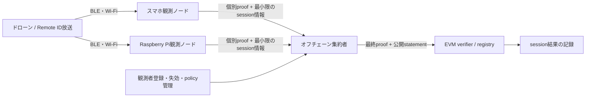

# 複数観測ノードによる Remote ID 不整合判定 — 全体設計案

状態: Draft（2026年10月、中期PoCの設計基準）
期限目標: 2026-11-30

## 1. 目的と範囲

複数の独立したスマートフォン／Raspberry Pi 観測ノードが、同じ Remote ID と時間帯について作成した観測証拠を検証・集約し、放送された位置と物理観測の不整合を判定する。その判定が規定どおり計算されたことを最終 ZK proof で示し、EVM コントラクトで検証する。

この版が判定するのは **Remote ID の申告位置と観測の不整合（詐称の疑い）** である。「飛行が安全」「操縦者が違法」「実機が必ずその場所にいる」といった一般的な安全・法的結論は出さない。不整合が見つからない場合も「真実」ではなく「この観測・ポリシーでは不整合が確認されなかった」と解釈する。

## 2. 保証したいこと

最終 proof は、ポリシーが定めた条件のもとで、次の計算が正しく行われたことを示す。

1. 個別報告の proof が、リリース時に固定した circuit/VK に対して有効である。
2. 全報告が同じドローン疑似ID、時間窓、ポリシー版、登録ルートに結び付いている。
3. 報告者は登録された別々の観測資格を持ち、同一資格は一つの session で一度だけ数えられる。
4. 有効報告数、整合・不整合・認証不能の件数と最終分類は、個別結果から回路内で計算された。
5. GPS座標、生RSSI、画像、長期観測者ID、Merkle path、秘密鍵は最終公開入力に含まれない。

これは入力の物理的真実性を暗号だけで証明するものではない。ZKP は所与の witness に対する計算の正しさを保証する。センサーの偽装、電波の中継、共謀、共通の較正誤りは別の信頼・実験課題である。

## 3. 主体と信頼境界

| 主体 | 役割 | 信頼上の要件 |
|---|---|---|
| ドローン | Remote IDの放送元 | 認証鍵・IDの登録元を信頼できる形で確認する。署名が有効でも位置が真とは限らない。 |
| 観測ノード | Remote ID受信、時刻・RSSI・任意の映像等の取得、個別proof生成 | 登録、鍵の保護、ソフトウェア／較正プロファイルの版管理、session内重複防止。 |
| 登録・policy管理者 | 観測資格・ドローン認証根・policy・失効状態を管理 | 変更履歴と権限を監査可能にする。単独管理者を信頼する前提を明示する。 |
| 集約者 | 個別proofを検証し、複数報告から最終proofを生成 | proofの健全性は回路と固定VKで守る。可用性、報告選別、メタデータ秘匿は別問題。 |
| EVM | 最終proof・公開statementを検証し記録 | 登録済み verifier / policy だけを受け入れ、session再利用を拒否する。 |

## 4. Remote ID認証と物理検証は別にする

Remote ID認証には、受信するBroadcast RID方式と、その公開鍵・登録情報の信頼経路を明示する。[RFC 9575](https://www.rfc-editor.org/rfc/rfc9575.html)のDRIPはASTM Authentication Message上の形式を使うが、pageを受信しただけでは認証にならない。信頼状態はRFCの用語を保ち、単純な`VALID/INVALID`へ潰さない。

| 状態 | 意味 | 扱い |
|---|---|---|
| `not_evaluated` | signal/capture pipelineで認証検証を実行していない（本プロジェクトの内部状態。RFC 9575の状態ではない） | 認証成功・失敗どちらとも解釈しない。現在のcapture/leafはこの状態。 |
| `None` | Authentication情報がまだ届いていない | `Unverified`と区別し、認証なしの申告として別集計する。 |
| `Partial` / `Unverifiable` | page収集中、または署名鍵など検証材料不足 | 待機・cache可能。期限後も認証済み扱いしない。 |
| `Unsupported` | Authentication/SAM方式またはsuiteを実装が扱えない | 正常・異常のどちらにも混ぜず、理由と件数を残す。 |
| `Verified` | その時点までにclaimed senderから受信した全Authentication messageの署名検証に成功し、要求されるsigned-content validationも満たした状態 | 受信途中でさらに失敗証拠が届けば状態は更新され得る。DIME/発行者をpolicy上信頼する判断とは別。 |
| `Trusted` | `Verified`の条件に加え、当該UA public keyを登録したDIME chainがObserver ownerのtrust policyで信頼される | policyが許す場合のみ「信頼済み登録主体に結び付くID」と表現する。位置の真実性は別。 |
| `Unverified` | 受信Authenticationの署名またはcontent validationに失敗 | その認証主張を拒否する。 |
| `Questionable` / `Conflicting` | 同一claimed senderについて成功・失敗の証拠が混在（後者はtrusted/unverifiedの混在） | `Trusted`として数えず、競合状態を保持してpolicyで扱う。 |

RFC 9575の状態はAuthentication message、DET、claimed senderのいずれにも適用され、受信・検証証拠に応じて変化する。ObserverはBroadcast Endorsement chainを検証して登録keyへの信頼を確立するだけでなく、UA-Signed Evidenceの署名に加えて、その動的・予測困難な内容を検証する必要がある。さらに各Observation session内で少なくとも一度、UAS RID要素を含むDRIP Authenticationを署名検証した後に、別ソース（例: 視覚・独立位置truth）とsigned contentを相関させる。許容閾値外なら、そのdataは署名検証失敗と同様に拒否する。静的Basic ID、Endorsement chain、またはtimestamp一致だけではreplay耐性・現送信者の所有・位置真実性を示さない。相関方法と閾値はRFCではなくこのPoCの明示的policyである。[RFC 9575 Appendix A](https://www.rfc-editor.org/rfc/rfc9575.html#appendix-A)、[§3.1.2](https://www.rfc-editor.org/rfc/rfc9575.html#section-3.1.2)、[§6.4.2](https://www.rfc-editor.org/rfc/rfc9575.html#section-6.4.2)

### 10〜11月PoCの暫定認証・信頼根

- **ドローン側**: 実放送に対応するDRIP認証で`Verified`またはpolicy上の`Trusted`を確立できない間は`not_evaluated`/`None`等を保持する。位置/RSSIの不整合は、認証状態と独立して「claimed RIDに対する不整合」として評価できるが、「登録機体の詐称を確認」とは表示しない。
- **鍵の信頼根**: [RFC 9886](https://www.rfc-editor.org/rfc/rfc9886.html)ではDETのHHIT RRにCanonical Registration Certificateを載せ、UAS RIDではBRID RRにBroadcast Endorsementsを載せる。RFC 9886に従いapexの自己署名登録証明にはDNSSECを必須とし、他階層ではDNSSECを推奨する。DNSSECを使わない経路では証明書階層をrootまでwalkして検証する。PoCは許可root/RAA/DIME policy、trust-bundle hash/version、取得・有効期限・失効確認時点を固定する。IANAのRAA割当そのものは個々のDIMEや機体を信頼する根拠ではない。
- **試験root**: synthetic cryptographic testsにはRFC 9886のprivate-use RAA `15360..16383`と隔離したprivate DNS/fixture chainを使う。これはwire format/署名検証の試験用であり、global DNS、CAA、実登録を示さない。試験用key/rootの結果をfield recordや本番root集合へ昇格させない。
- **観測者側**: PoC管理者がスマホ／Piの鍵を登録し、公開ルートを固定する。鍵ID、端末/所有主体、evidence profile、校正profile、有効期限、失効状態は監査できる台帳で管理し、長期識別子はproofやEVMへ出さない。Distinct keyはdistinct credentialを示すだけで、別人・別設置場所・独立測定を証明しない。

既存の`AttestationRegistry`は`registeredOperator[operatorCommitment]`を確認するが、現状のmappingだけでは特定の`droneIdCommitment`とoperator鍵の対応関係を表さない。PoCで鍵とIDの対応を主張するには、登録表でその組を明示して検証するか、採用したDRIP登録連鎖で同じ結び付きを検証する必要がある。

### 回路バージョン別のRemote ID認証境界

- **V1（legacy）**: `circuits/uav_witness_attestation.circom` はprover提示鍵による独自EdDSA-Poseidon statementを検証するが、その鍵とDRIP DET/Basic IDの登録関係を証明しない。旧`drone_auth_ok` signalがあっても、機体のRemote ID認証完了や信頼根を示すものではない。V1結果を認証済み機体の結果として扱わない。
- **現行V2**: `circuits/uav_witness_attestation_v2.circom` の公開statementはclaimed RIDをrun/time-window scoped commitmentとして束ね、観測者鍵による測距・判定statementを検証する。V2 circuitには`drone_auth_ok`出力もDRIP SAM/FEC/page assembly、UA signature、Broadcast Endorsement chain、DET trust-root verifierもない。`scripts/capture_to_witness_v2.js`は`remote_id_authentication_status: not_evaluated`を出力し、Go batch preflightもRID commitmentはclaimed broadcast IDのgroupingに限ると明記する。

したがって現行V2 proofが示すのは、**同じ申告RIDとしてgroupされた観測者statementと位置不整合判定**であって、登録済み機体の真正性ではない。現段階の最終表示は「Remote IDの位置不整合の疑い」に限定する。将来DRIP状態を最終policyへ加える場合は、RFC 9575に沿った署名・signed-content検証とRFC 9886の登録/endorsement trust pathを別途実装し、その検証結果・trust bundle version・有効性policyをleaf proofと最終statementへ暗号学的に束縛する必要がある。

### V1の測距署名binding欠陥

V1の観測者署名は`measured_range_cm`、RSSI/calibration profile、回路出力`consistency_ok`を束縛しない。2026-10-04の再現試験では、同じ有効署名のまま測距値を5000cmから341cmへ変えると、既存V1 VKが受理するproofを生成でき、`consistency_ok`が0から1へ変化した。したがって現在のV1 proofは観測者がそのRSSI値を署名した証拠ではなく、V1の整合判定を高信頼な複数ノード証拠として扱ってはならない。再現手順とV2要件は[`leaf-attestation-v1.md`](leaf-attestation-v1.md)に記録する。

### PoCで採用する認証プロファイル

- **方式**: 規格プロファイルは[RFC 9575](https://www.rfc-editor.org/rfc/rfc9575.html) DRIP Broadcast RID、登録取得は[RFC 9886](https://www.rfc-editor.org/rfc/rfc9886.html)のDET DNS hierarchyとする。Legacy BLEでは必要なAuthentication pageをassembleしFECをdecodeしてからSAM/署名形式を解釈する。完了までは`Partial`で、pageの存在だけを署名成功としない。
- **信頼根**: 実機評価では許可するroot/RAA/DIMEとDNSSEC/chain-walk policyを事前固定し、trust bundleのhash/versionを記録する。expiry・取得時点・失効情報の鮮度を検証入力に含める。試験用private-use rootはtest-onlyと明示し、実登録の証明と混同しない。
- **失敗時**: RFC状態をそのまま保持する。`None`, `Partial`, `Unsupported`, `Unverifiable`, `Unverified`, `Questionable`, `Conflicting`を`Verified`/`Trusted`と合算しない。`Verified`と`Trusted`も同一視しない。認証未確立でも位置判定を行う場合はclaimed RIDに対する結果として分離記録する。
- **実装ゲート**: 現行Circomの独自EdDSA-Poseidonはprover提供鍵しか検証せず、現在のleaf/PCD/EVM proofはDRIP認証状態を含まない。認証をfinal proofの主張に含める次protocolでは、DRIP chain・signed message digest/content binding・trust-bundle version・statusを検証可能な形で固定する。外部verifierの結果を観測者が署名するだけなら証明されるのは「観測者の報告」であり、verifierが規格どおり実行した事実ではない。回路内検証または明示した信頼verifierがない間、final resultは`not_evaluated`のままにする。

## 5. 個別観測とleaf proof

各ノードは、観測1件ごとに同じ論理statementへ正規化する。センサー方式の違いは `evidenceProfile` と circuit/VK の版で区別し、スマホ専用の映像条件をラズパイの無線観測に暗黙に要求しない。

### 個別報告に結び付ける情報

- Remote IDの正規化した識別子、位置・時刻・速度等の受信フィールド
- 受信したtransportと受信時刻、message counter等の鮮度情報
- 観測ノードの秘密位置、生RSSIまたはその校正済み集約値、任意の画像特徴
- 観測ノード資格、session固有nullifier、観測software/calibration profile
- 実際に検証したRemote ID認証状態

### leaf proof が示すこと

- 入力範囲・時刻窓・message結合の正当性
- 公開位置とノードの秘密位置／測距値から、固定した整合ルールを計算したこと
- 観測ノードが有効な登録資格を持ち、そのsessionで未使用であること
- outcomeが回路により算出され、callerが自由に選んだ値でないこと

画像AIの出力やGNSS値が正しいことまで自動的に証明するものではない。ノード署名は「この鍵の保持者がこの報告を出した」ことを示すが、未改ざんセンサーの証明には、端末保護・attestation・独立実測・監査が別途必要。

### leaf出力の原則

集約に必要な値だけを公開する。候補は `protocolVersion`, `droneIdCommitment`, `timeBucket`, `policyCommitment`, `memberRoot`, `evidenceProfile`, `authStatus`, `consistencyOutcome`, `sessionNullifier`。長期観測者公開鍵、正確な座標、生RSSI、個別映像は最終proof／EVMに出さない。leafを集約者へ渡す場合、集約者はleafの公開値を見られるため、これは「公開チェーンからの秘匿」であり「集約者からの秘匿」ではない。現在のV2 leafは正確な観測Unix時刻も公開signalに含むため、集約者には秒単位で見える。一方、FinalBNV2の最終公開入力／registry記録は60秒bucketのみ。集約者にも正確な時刻を隠す要件があれば、timestampをprivate witnessに戻してleaf schema/VKを更新する。後者が必要なら別の分散集約・MPC等の要件として扱う。

## 6. 観測者登録・一意性・session

- スマホとRaspberry Piの各観測credentialを、同じ登録ルートまたは明示的に区別した信頼tierで管理する。
- 同一公開鍵の重複登録を拒否し、鍵更新・紛失・失効を追跡可能にする。
- 最終EVMへ長期公開鍵や個別nullifierを出さず、登録member indexに配置したsession固有nullifierのset rootだけを公開する。現行V2の式は`session = MiMC(SessionDomain, protocolVersion, droneIdCommitment, timeBucket, policyCommitment)`、`deviceLeaf = MiMC(observerPubKeyX, observerPubKeyY)`、`nullifier = MiMC(NullifierDomain, deviceLeaf, session)`。
- leaf bridgeは空rootから一参加分を追加し、binary nodeはprivate leaf vectorをchild rootへ結び付けて重複indexのないunionを証明する。Final registryは同一drone/time bucketを一度だけ確定する。これはsession内重複を防ぐ仕組みであり、別sessionの参加を禁止しない。member index／nullifierの秘匿はon-chain verifierに対するもの。集約者にはleaf proof入力のobserver keyが見える。
- **privacy caveat**: 現行nullifierは別の秘密鍵ではなく`MiMC(observerPubKeyX, observerPubKeyY)`から導出される。ordered candidate rosterを知るchain watcherは固定16 slotの候補集合を列挙してrootを照合できるため、現行rootはroster-aware匿名性を与えない。roster/index mapの機密性を仮定するか、roster-aware privacyが必要ならobserver-held secret commitmentを登録credentialへ結び付ける新protocolが必要。
- 異なる鍵の数だけでは独立性を証明しない。登録時の重複防止、所有主体／設置場所の運用管理、必要なら証明可能な地域・source diversityを定義する。
- 鮮度をrelayer任せにしない。受信時刻・message counter・session epochのどれを信頼するか決め、許容遅延と時計ずれをテストする。

`pcd3`のroster入力は、manifestの宣言rootをメンバー列から再計算して照合し、重複公開鍵・非canonical field値・容量超過を拒否する。さらに `--active-member-root` で独立に取得したregistry rootを与え、その値とも一致させる。これを省略できるのは `--allow-manifest-root-for-test` を明示したoffline synthetic fixtureだけであり、このモードは登録機関の認証を証明しない。実運用のtrust anchor自体はregistry contractとroot取得経路であり、CLI引数はその取得事実を暗号学的には証明しない。

### 現コードとの照合：観測者credentialの所在

「端末アテステーション」「観測者署名」「Remote ID署名」は別の鍵・別の主張である。現在のコードでは、Flutter recorderとPi capture callbackから同じJSONL/witness adapterを経由し、異なる3つの合成observer keyで現行V2 leaf Groth16 proofを作り、synthetic test rosterに対してGo `pcd3 --stage=plan`するtest-only経路がある。実radio capture、実enrollment credential、recursive proof、FinalBNV2 EVMまで通した証拠はまだない。

| 経路 | 現在確認できるもの | まだ証明しないもの |
|---|---|---|
| `scripts/gen_witness_sample_v2.js` | 固定のテスト秘密鍵でV2のEdDSA-Poseidon messageを署名し、合成witnessを生成する。 | 登録・失効・実captureへの鍵所有者署名。これらの秘密鍵を実機で使ってはならない。 |
| Pi `uav/observer_capture.py` | caller指定のローカル`observer_id`と、任意の共有session HMAC鍵を使ったRID pseudonym / session saltをJSONLに記録。 | 観測者credentialの署名。HMAC鍵はcaptureを観測者公開鍵へ結び付けず、BLE/RSSI記録の真正性も与えない。 |
| Flutter `BleService` / BLE Raw Scan | BLE Service Dataのprivate JSONL、run-scoped UAS tag、receiver RSSI、phone GPSと報告accuracyを記録し、停止時に`capture_end`を閉じる。 | Remote ID認証、GPS/RSSI attestation、V2 observer EdDSA鍵の生成・保管・登録・署名。Wi-Fi観測とon-device proofも未対応。 |
| `scripts/capture_to_witness_v2.js` | Pi/phone共通JSONLを検証し、共有key、calibration report、別途provisionしたobserver secretからV2 witnessを作る。phone GPS source/accuracyをprovenanceへ保存する。三つの合成captureからのleaf proof生成とsynthetic rosterへのbatch preflightもtest済み。 | real phone/RPi captureからの実proof・登録credential enrollment。shared HMACは観測署名鍵ではなく、GPS accuracyは現在のleaf判定に組み込まれない。 |
| Flutter/Dart `ZkInputBuilder` | 既存アプリの従来proof入力を組み立てる。 | V2 observer EdDSA鍵の生成・保管・署名、およびV2 leaf proof生成のon-device統合。 |
| Android `DeviceAttestation` | 呼び出しごとに再生成するP-256鍵のAndroid Key Attestation chainとchallengeを返す。 | 回路のBabyJubJub EdDSA鍵との鍵所有対応、観測statement署名、安定したobserver ID。iOS側の同等実装もこの経路では確認できない。 |
| `scripts/attestation` | 合成証明書chainを使ったオフライン検証fixture。検証器は期待challengeと明示的なtrust rootを要求する。 | 実端末由来のchain/root、production enrollment、BabyJub秘密鍵の所持。challenge一致のみで異なる鍵方式を同一credentialとはみなせない。 |

PoCで観測資格として数える鍵は、V2 leafが実際に検証するEdDSA鍵とする。端末アテステーションをSybil対策として主張するには、attested P-256鍵がそのEdDSA鍵の登録・所持とどう結び付くかを別途検証し、固定root・失効・鍵更新を含むenrollmentを通す必要がある。単にEdDSA公開鍵のhashをKey Attestation challengeへ入れるだけでは、そのEdDSA秘密鍵の所持証明にはならない。

実装の受け入れ条件は、少なくとも (1) 各端末の登録credentialから同じcanonical V2 statementを署名できる、(2) 未登録鍵・別端末鍵への差し替え・署名後のrange/profile/time/session改ざんを拒否する、(3) 二重登録・失効済み鍵・別sessionを拒否する、(4) 合成鍵fixtureと実端末資格を明確に区別する、の自動試験である。10〜11月PoCではBLE/RSSIのみを採用し、位置不整合の大きさで観測leafを落とさず、RSSI整合結果として複数nodeへ集約する。生captureをwitnessへ写すだけでは受信の真正性・sensor honestyを証明しないため、その境界も試験・報告する。

## 7. 複数報告の集約・危険判定

集約前に全leafの `droneIdCommitment`, `timeBucket`, `policyCommitment`, `memberRoot`, 対応する認証profileをそろえ、重複nullifierを拒否する。

結果は単純な `Trusted / SpoofSuspected` だけでなく、少なくとも次を区別する。

| 結果 | 意味 |
|---|---|
| `INSUFFICIENT_EVIDENCE` | 有効な独立観測数または空間分散が足りない。 |
| `NO_INCONSISTENCY_OBSERVED` | 対象policy内で位置不整合が閾値を超えなかった。安全・真実の認定ではない。 |
| `POSITION_INCONSISTENCY_SUSPECTED` | 不整合報告が較正済みの閾値を超えた。詐称の疑いであり確定認定ではない。 |
| `CONFLICTING_EVIDENCE` | 整合／不整合が拮抗、または認証・profileが混在して結論できない。 |

集約policyには最小観測数、必要なsource/location diversity、外れ値処理、RSSI測定profile、各結果のしきい値を含め、commitmentで固定する。汎用の多数決値を先に置かず、実測した偽陽性・偽陰性から決める。

### 異なる観測端末profileの扱い

校正profileはreceiver/antenna/placementごとに別IDとなり得るため、同じprofile IDを要求しては実際のスマホとPiを正しく同じbatchへ入れられない。物理的に異なる校正内容を同じIDへ偽装して通してはならない。

採用案は、policyが許可するprofile集合のMerkle rootをcommitし、各leafが自分のprofile IDのmembershipをBridge内で証明する方式とする。全leafは同じ許可集合root・quorum policyに束縛されるが、個別profile IDは異なってよい。FinalBN/registryは集合rootを含むpolicy commitmentだけを承認・記録し、運用台帳はprofile IDからimmutableな機種・antenna・測定条件・較正係数・有効期間へ監査可能に対応付ける。profile path改ざん、未許可profile、root差し替えの拒否を自動テストする。

このprofile-set方式はV2 sourceへ実装した。2026-10-04の混在profile batchとBridge BW6 test-engine solveは、後にBLE/RSSI-onlyへ変更する前の12,087-constraint leaf relationに対する結果である。そのrelationでは`RUN_BRIDGE_BW6_SOLVE=1 bash scripts/test_v2_observer_batch.sh`が許可集合`{1,2}`でprofile 1/2 leafを検証し、profile path改ざんと未許可profileを拒否した。leaf signed-message semanticsが変わった現行6,201-constraint relationではBridge gateをまだ再実行しておらず、旧結果を現行sourceの検証として扱わない。outer recursive proof/EVMも未確認であり、PoC全体の完了条件ではない。現行leafの`measured_range_cm`は回路外で算出され、回路はその値・profile ID・整合結果をobserver署名へ束縛するが、RSSIサンプルからrangeへの変換が承認済み係数で行われたことまでは証明しない。profile membershipは「許可ID」を示すもので、センサー由来や較正計算の正しさを証明するものではない。public input[4]は単一IDではなく集合rootとなるため、この意味を持たない既存の実験proof/VK/verifier/registry ABIは互換ではなく、再生成が必要である。profile-set root・leaf membership path・policy commitmentのいずれかを省略したhost allowlistだけの検査では代替できない。

`week18/THREAT_MODEL.md` のROCは合成・理想較正条件での結果であり、実環境の保証値ではない。PoCでは少なくとも距離、遮蔽、マルチパス、端末・アンテナ差、送信出力を記録し、観測者数を変えて再評価する。RSSI単独で中継攻撃を防げないという既存脅威モデルの限界も維持する。

## 8. proof集約とEVM

### 最初の基準線

最終statementは `final-attestation-v1` の9入力に固定する。集約方式は、子proof検証・独立observerの一意性・session nullifier unionを回路内で強制し、実 verifierへ到達できる方式だけを採用する。現在の `aggregator/cmd/aggregate` はN=3のmulti-device試作だが、公開出力は旧5項目であり、新v1 statementの完成経路ではない。

### 2026-10-04の集約回路リソース実験

同一BN254内で3本のleaf Groth16 proofを直接検証する試作は **6,820,657 constraints** とcompileできたが、setupは7分44秒以上進めても完了せず、共有Macのswap使用量が約17GB/17.4GBまで増えたため中断した。最終proofやEVM検証の成功とは扱わない。

BW6-761内で同じ3 leafを直接検証するcross-curve試作は **8,284,443 constraints** でcompileできたが、setup/proveは未実施。3件を一度に扱うBLS12-377 batch案はcompile中にswapが約12.7GBまで増え、制約数を得る前に中断した。いずれもこの環境で安全にsetupできる根拠がなく、単に「固定サイズdirect batchなら簡単」とは言えない。

したがって、これら試作は解決策として採用せず、実験値だけを残す。次の回路判断では、固定深度ごとに異なるVKを上流から順にsetupする非循環proof chain、または異なる集約proof方式を、隔離された十分なRAMのrunnerで段階ごとに測る。鍵・証明検証を省くことで軽くする案は採用しない。実leaf→final→EVMが通るまで、リリース経路は未確定とする。

### 件数が増えて再帰が必要な場合

並行して独立に作られる観測証明を結合するには、子証明をそれぞれ検証し、session情報を一致させ、子nullifier集合が交差しないことを証明するbinary mergeが必要。各子が同じ空rootから開始しているのに `left.newRoot == right.oldRoot` と単純連結する順序付きappendでは、独立報告の安全な並列mergeにならない。

固定16スロットのBN254 nullifier集合unionは `NodeBLS` / `NodeBW` に実装され、synthetic子proofを使った正常・重複・root改ざん・異session拒否テストが通った。これは回路関係の進展であり、実leafから最終proofまでのE2Eや再帰鍵setup完了を意味しない。Nova等の代替方式も、このPoCの実データと必要件数で比較するまでは追加しない。

### オンチェーンに出すもの

final proof、session/policyの識別値、最低集約条件を満たした最終分類と必要最小限の件数のみ。個別leaf、長期観測者ID、nullifierそのもの、位置・RSSI・映像は出さない。少人数bucketと送信時刻・IP等のmetadataから参加が推測されるリスクがあるため、最小集約数・公開遅延・batch公開もpolicyにする。

現在の `final-attestation-v1` は `Undetermined / Trusted / SpoofSuspected` と9入力ABIを定義している。本案の結果分類やpolicyがそれと異なるなら、意味だけを差し替えず、互換性を壊す変更として新しい `protocolVersion`、VK、verifier/registry経路を設ける。

## 9. 主な脅威と残る限界

| 脅威 | 対策・検知 | PoCで明記する限界 |
|---|---|---|
| Remote ID ID／位置の偽装 | 認証鍵の登録検証 + 独立観測との整合 | 鍵署名だけでは物理位置の真実性を示さない。 |
| 1端末の重複投稿／replay | session nullifier、freshness、session binding | 鍵を複数登録するSybilは登録管理も必要。 |
| 未登録・侵害ノード | memberRoot、鍵失効、attestation／software版管理 | attestationはセンサー測定そのものの真実を保証しない。 |
| RSSIゆらぎ・遮蔽・マルチパス | 実測較正、複数地点、結果を`CONFLICTING`/`INSUFFICIENT`にできるpolicy | 電波環境の相関誤差・高い偽陽性/陰性が残る。 |
| 中継／wormhole | 複数センサーの相関、視覚/TDoA等の追加証拠候補 | RSSIだけでは防げない。PoCで「検出可能」と主張しない。 |
| 集約者による報告選別・先行確定 | pinned VK、回路内のgroup/count/union制約、最低quorum、最終proof | proofは「入力された報告集合」の正しさしか示さず、全観測の包含は保証しない。管理者は一部報告を省いてquorumを満たす集合を作れる。registryは最初の有効proofでsessionを不可逆に確定するため、後からより完全な集合を提出できず、front-run/DoSにも使える。PoCは完全性を主張しない。必要ならreceiptの事前commit、締切・異議申立期間、複数集約者等を別途設計する。 |
| 共謀・少数観測での個人推測 | 最小K、diversity、公開遅延、最終出力を限定 | K未満の結果を公開しない。ZKでも通信metadataは隠れない。 |
| ドローンの長期間相関 | 実験V2 leafはrun key/opaque run ID由来の秘密saltと60秒time bucketをRID commitmentへ含め、公開値の単純なrun間一致を避ける。 | saltの乱数性は回路で証明できない。session coordinatorの高entropy key生成・安全な配布・非再利用を信頼する。key保有者は既知RID候補を照合できる。V1の`Poseidon(remote_id)`は依然として長期追跡可能で、V2用として使用しない。 |

## 10. 2026年10〜11月の達成順

> **V1 leafは測距値への署名bindingを欠くため、実データ評価やmulti-node E2Eを高信頼な物理判定として主張する前に、versioned V2 leafの改ざん拒否を通す。既存V1のVK/proofは流用しない。**

1. **Scope freeze**: 位置不整合の疑いをPoCの判定対象とし、認証なし／未対応状態の扱い、信頼根、privacy adversaryを決める。
2. **観測仕様・実機採取**: phone/Pi共通のreport schemaとprofileを固定し、Remote ID受信・RSSI・時刻の実データとground truthを集める。
3. **leaf整合**: 実Remote ID認証方式・鍵登録を回路と結び、観測者credential・session nullifier・公開signal vectorを固定する。アプリとPiで同じstatementを生成する。
4. **multi-node direct E2E**: distinct registered nodeの複数leaf、正常系・改ざん・重複・session混入・認証状態別をテストし、直接集約proofをEVMで検証する。
5. **統計と再帰の判断**: 実測ROC/誤検知・見逃しを公開し、必要ならnullifier set-unionをPCD nodeへ統合して同じE2Eを再実行する。
6. **release evidence**: circuit/VK/prover/verifier/policy/test vectorsのhash、再現コマンド、テスト環境、既知限界をmanifestへ記録する。

Flutter/KMPの選択はこのプロトコルの正しさを変えない。アプリ基盤は、同一leaf statementをphoneから再現できることとネイティブproof性能が確認できてから評価する。Raspberry Pi observerは別の実装主体として同じreport/proof interfaceへ接続する。

### 10〜11月の中期マイルストーン

期限は **2026-11-30**。各段階で証拠（仕様・テスト結果・測定データ）を残し、未達の段階を「完了」と扱わない。

| 期間 | 到達点 | 完了条件 |
|---|---|---|
| 10/04–10/11 | 問題範囲と信頼モデルの固定 | 対象をRemote ID位置不整合の疑いに限定。認証状態、観測者の登録根、重複防止、非公開データ、判定保留条件を仕様に記録。 |
| 10/12–10/25 | 観測データ取得の準備・試行 | PiとFlutter phoneで同一private JSONLをローカル採取できる状態にし、実機での送受信確認、profile照合、ground truth採取手順を揃える。2026-10-04時点はsynthetic recorder tests/debug APKまでで、実機captureは未確認。 |
| 10/26–11/08 | 共通reportとleaf境界の確定 | phone/Piのreport字段・単位・時刻窓を同一化。各node固有profileの許可集合rootとleaf内membership拘束、登録observerとsession/nullifier、公開signalを定義し、異なる許可profileを持つ相互運用fixtureを追加。 |
| 11/09–11/22 | 複数ノード判定とEVM経路の検証 | 複数leafの正常系と改ざん・重複・別session混入の拒否を通す。direct aggregationから実verifierを使ったEVM検証まで再現。実RSSIで誤検知/見逃しを評価する。 |
| 11/23–11/30 | 再現可能なPoCと限界の報告 | クリーン環境からの再現手順、artifact/hash、結果、未解決脅威をまとめる。再帰PCDは必要性が確認され実E2Eが通る場合だけ範囲に含める。 |

実機RSSI評価は開発コードだけでは完了できない。観測端末複数台、Remote ID送信機、測定距離/位置のground truth、試験環境と時刻記録が必要であり、これらの実機・現地作業は利用者側で準備する依存事項として扱う。端末や試験機会が揃わない場合、11月末の成果は「プロトコル/回路PoCと合成データ試験」に限定し、実測検証未完了を明示する。

## 11. 2026-10-04時点の検証基準

以下はこの設計を追加した時点で実行した結果であり、新しい複数観測PoCの完了を意味しない。

| 検証 | 結果 | どこまで証明するか |
|---|---|---|
| `cd aggregator && go test ./...` | 成功（2026-10-04再実行） | membership/nullifier/PCD等のGoテスト。`aggregator/cmd/aggregate`自体にはテストがない。 |
| `cd aggregator && go test ./cmd/aggregate` | 成功 | 旧N=3集約回路のコンパイル確認のみ。leaf VKをprover witnessから固定VKへ変更したが、実proof生成/EVM E2Eは未確認。 |
| emulated BN254 nullifier union + NodeBW binary merge | 成功 | disjoint set、重複slot、root改ざん、異sessionをsynthetic proof fixtureで検証。 |
| NodeBLS binary merge (`RUN_RECURSIVE_PCD_HEAVY=1`) | 成功 | 同じくsynthetic child fixture。実 `BridgeBW` key/proof、再帰鍵bootstrapは未検証。 |
| `PrepareObserverBatch` + `MergeObserverStates` (2026-10-04) | 成功 | 同梱Circom leaf proof 3件を固定VKで検証し、独立したsynthetic roster/root照合、member/nullifier path、重複・未登録・異session拒否、2+1 merge stateを確認。recursive proof生成ではない。 |
| `cmd/pcd3` compile + `--stage=plan` (2026-10-04) | 成功 | runnerがビルドでき、実leaf proof 3件とsynthetic rosterを読み、最終statementと固定3観測者topologyを出力。9 public inputのABI順序testも含み、Remote ID trust-root未証明とV1 RSSI outcomeがobserver署名で束縛されない点を警告する。recursive circuit compile/setup/proveもEVM callも行っていない。 |
| current V2 leaf proofs → `pcd3 --protocol=v2 --stage=plan` (2026-10-04) | 統合テスト成功 | session-salted relationからfresh生成した3 leaf proof/VKとsynthetic rosterをV2 CLIへ渡し、3 observer、member/nullifier root、profile-set/policy、2+1 counts、verdict、V2 topologyを出力。planはrecursive circuit compile/setup/proveをしない。full recursive proof/FinalBNV2 EVMは未完了（setup attemptは次行）。 |
| V2 verdict semantics (2026-10-04) | label correction, numeric ABI unchanged | V2 code `1` is now rendered/stored symbolically as `NO_INCONSISTENCY_OBSERVED`, not `Trusted`; `0`/`2` labels are `INSUFFICIENT_EVIDENCE` / `POSITION_INCONSISTENCY_SUSPECTED`. Numeric public-input values remain `0/1/2`; V1 `Trusted` wording/ABI is unchanged. Go policy/CLI tests and all 6 `FinalAttestationRegistryV2` Hardhat tests pass. This is display/semantic clarity, not a final-proof EVM E2E. |
| Flutter PoC status UI (2026-10-05) | generic local proof separated from V2/chain status | The existing chain tab received only a generic single-circuit proof flag, then described it as a registered observer leaf/aggregation wait and used `Trusted`/`Spoof suspected` labels. It now names the tab as PoC status, labels current proof as a disconnected local demo, reserves `NO_INCONSISTENCY_OBSERVED` / `POSITION_INCONSISTENCY_SUSPECTED`, and explicitly states Remote ID authentication, V2 multi-observer aggregation, Final proof and EVM registry are not connected to the app screen. A separate verifier-result flag prevents a semantic verdict from being displayed as proof verification. Flutter test suite 14 passed; isolated model/page/test analyze is clean. |
| V2 recursive proof run attempt (2026-10-04) | BridgeBWV2 setup中断 | 外部SSD上のfixtureからpcd3 `--stage=run`を開始し、BridgeBWV2を2,285,785 constraintsでcompile。Groth16 setup中に観測したswap usageは8 GiB中7,841.69 MiB・空き334.31 MiBで、ホスト保護のため中断。setup/proof・FinalBNV2 EVMは未完了。peak-memoryを実測できる十分なRAMのrunner、または証明関係を保つsetupメモリ削減策が必要。 |
| V2 full-proof再試行 (2026-10-04) | BridgeBWV2 Groth16 setup開始後に中断 | `RUN_PCD3_V2=1`, `GOMAXPROCS=1`, `PCD3_GOMAXPROCS=1`で葉proof生成・leaf EVM・Go integration test・`pcd3 --stage=plan`を通過後、2,285,785制約のBridgeBWV2 setupへ進んだ。観測時に空きメモリ34%、swap 2,918.62/4,096 MiBを確認し、ホスト保護のためSIGINT。中断後は空きメモリ61%、一時fixture directoryはtrapで削除済み。これは資源状態を理由にした停止で、回路/proofの失敗ではない。recursive setup/proofとFinalBNV2 artifact/EVMは依然未完了。 |
| BW6-761 setup memory source audit (2026-10-04) | 後続source reviewで下限表現を訂正 | 旧`gnark v0.15.0` / `gnark-crypto v0.20.1`のR1CSについてsetupがconstraint-sized配列と`Z[D]`を作ること、`GOMAXPROCS`だけではslice lengthが減らない点を確認した。scalar input・digit window・Jacobian・affine arraysのサイズ合計を2.25GiBと計算したが、digitsとaffine outputが同時にliveとは証明できないため、2.25GiBをpeak/liveness lower boundとして使わない。現行依存・R1CSに対する保守的なoverlap boundを以下に更新。 |

### BridgeBWV2 setup allocation floor from the current pinned source (not a total RAM estimate)

The current BridgeBWV2 compile recorded 3,295,111 constraints under `gnark v0.16.3` / `gnark-crypto v0.21.0`. BW6-761 `fft.NewDomain` rounds this to `D = 4,194,304`. In current `groth16/bw6-761/setup.go`, the scalar batch includes `Z[D]`, so the scalar count `N >= D`. During `BatchScalarMultiplicationG1`, `toReturn` holds `N` G1 Jacobian points; `BatchJacobianToAffineG1(toReturn)` allocates an `N`-element affine result while that input slice is still required. Current `G1Jac` is three 96-byte base-field elements (288 bytes) and `G1Affine` is two (192 bytes). These two backing arrays alone therefore overlap for at least `D * (288 + 192) = 2,013,265,920` bytes = **1.875 GiB**. This omits the affine conversion's `N`-byte zero mask and every other live setup object, so it is a strict partial allocation floor, not a peak-RAM estimate or runner recommendation.

The earlier 2.25 GiB calculation added the 48-byte-per-scalar input and `uint16` digit array to the affine output. Current `gnark-crypto/ecc/bw6-761/g1.go` finishes consuming `digits` before allocating the affine result; the source does not guarantee those arrays remain live together through affine conversion. Treat 2.25 GiB only as the sum of allocations across the scalar-multiplication phase, not as a proven simultaneous floor. `GOMAXPROCS` does not change the domain, scalar, Jacobian, or affine slice lengths. SetupABC, FFT/inversion temporaries, larger actual `N`, G2 setup, other key arrays, Go/runtime overhead, and proving-key serialization add further usage. Neither this lower bound nor constraint count is evidence that a particular runner has adequate headroom; current-version peak RSS/swap still needs measurement on an isolated high-memory runner.
| 現行回帰テスト再確認 (2026-10-04) | Go/Python/V2 registry成功 | `GOMAXPROCS=1 go test -p 1 ./...`、`PYTHONDONTWRITEBYTECODE=1 python3 -m unittest discover -s uav -p 'test_*.py' -v`（46件）、`contracts`の`hardhat test test/FinalAttestationRegistryV2.test.js`（6件）が成功。registry単体テストの成功はFinalBNV2実proofを使ったEVM end-to-end検証ではない。 |
| generated verifier compiler harness (2026-10-04) | 成功 | solcでstandalone verifier sourceをcompileし、`verifyProof(bytes,uint256[9])`以外のpublic-input幅を拒否するtestを追加。生成FinalBN proofの実EVM検証・registry記録はartifact未生成のため未実施。 |
| Remote ID auth boundary review (2026-10-04) | 仕様更新 | PoC認証対象をRFC 9575 DRIP Broadcast RID、信頼根を事前配布されたregistration hierarchy root/RAA/DIME keysとし、現行prover-supplied EdDSA-Poseidonは登録IDの真正性を証明しないと回路コメント・仕様・plan出力で明示。DRIP chain verifierとroot binding circuitは未実装。 |
| BN254 3-proof direct aggregate feasibility | 中断 | 6,820,657 constraints。setupが7分44秒以上完了せず、swap約17GB/17.4GBでホスト保護のため停止。proof/EVMは未生成。 |
| BW6 3-proof direct aggregate feasibility | compileのみ | 8,284,443 constraints。setup/prove未実施。より軽い候補とは確認できていない。 |
| BW6→BN254 canonical state conversion | 成功 | 377-bit native値を256-bitへ分割後にBN254範囲制約するテストを追加。正準値を受理し、BN254 modulusそのものを拒否。 |
| Circom leaf circuit compile + 既存fixture照合 | 成功 | Circom 2.2.3で現行sourceをcompile（11,785 nonlinear constraints、18 public outputs、11,777 wires）。`input_dev0..2` のWASM出力はfixture public signalsと一致し、3件のproofは同梱zkeyからexportしたVKでverify成功。fixtureはsynthetic。 |
| V1 RSSI signature rebinding attack (2026-10-04) | 再現成功 | `input_dev2` の`measured_range_cm`を5000→341に変更し、同じdevice署名のまま新witness/proofを生成。checked-in V1 VKが検証し、public `consistency_ok`は0→1に反転。V1は観測者署名済みRSSI evidenceではないと確認。 |
| V2 leaf compile + witness binding (2026-10-04, prior relation) | 旧unsalted relationのhistorical evidence | 12,006 nonlinear constraints、8 public outputs。freshness/range/profileの改ざん拒否とBridgeBWV2 test-engine solveは成功したが、session-salted commitment導入でrelation/VK/proofが置き換わり、旧proofは使用不可。 |
| Run-scoped RID commitment (2026-10-04, prior leaf relation) | 旧12,087-constraint relationのproof-backed batch/Bridge test-engine/leaf EVM | 12,087 nonlinear constraints、8 public outputs。同一key+run ID+RID+bucketではobserver間commitment一致、別run（同一bucket）と別bucketで異なる。JavaScript/Python KDF vector一致。fresh disposable Groth16 leavesでhost batchが別runを拒否し、当時の`RUN_BRIDGE_BW6_SOLVE=1`でpath/member tamperingを拒否。fresh Solidity leaf verifierがproofを受理し、5種のpublic-signal改ざんを拒否。これはBLE/RSSI-only relationへの変更前の記録で、現在のBridge検証証拠ではない。FinalBNV2 proof/registry EVM、outer recursive proof、実機データは未確認。 |
| V2 preflight・Bridge assignment・policy gadget (2026-10-04, prior leaf relation) | 旧relationのproof-backed batch/Bridge solve成功 | 当時の`RUN_BRIDGE_BW6_SOLVE=1`が12,087-constraint leafから3 observer proofを生成。2+1集計、duplicate/profile/time-bucket/timestamp/public-profile改ざん/V1 VK流用拒否、BridgeBWV2のtest-engine solveとpath tamper拒否を確認。quorum/profile policy gadgetのhash/vector testは成功。現在のBLE/RSSI-only leafは署名messageとrelationが変わったため、この結果を現行Bridge検証として扱わない。Session nullifierのleaf insertionとNodeBLS/NodeBW disjoint-set union gadgetはunit/test-engine tests済みだが、recursive outer proof setup/proofとFinal EVMの一続きの確認は未完了。 |
| V2 heterogeneous calibration profiles (2026-10-04, prior leaf relation) | 旧relationの実leaf proof 3件でprofile 1/2混在batch・Bridge solve成功 | 許可profile集合`{1,2}`の固定depth-4 rootをpolicyへbindし、各leaf profile membership pathをBridgeBWV2内で検証。host preflight、Bridge assignment、実profile-2 leaf proofのtest-engine solveが成功し、未許可profileと改ざんpathを拒否。FinalBNV2 input[4]とregistry recordはprofile-set rootへ変更し、registry mock suite 6 tests成功。current BLE/RSSI-only leafには再実行していない。outer recursive proofと実verifier EVM検証は未完了。 |
| BLE/RSSI-only leaf (2026-10-04, current relation) | 6,201 constraints・witness audit・proof-backed host batch・leaf EVM verifier・Bridge test-engine solve・plan確認 | fresh disposable Groth16 proofsで正常1+far mismatch 2を作成。host batchはdistinct observer/profile set `{1,2}`とcount `1/2`・`VerdictSpoofSuspected`を導出し、leaf Solidity verifierは正常proofを受理・5種のsignal改ざんを拒否。`RUN_BRIDGE_BW6_SOLVE=1` gateで実far-mismatch/profile-2 leaf assignmentを現行BridgeBWV2 test engineで解き、member/profile path改ざんを拒否。`pcd3 --stage=plan`も同じ判定を出力。outer recursive Groth16 proof・FinalBNV2 EVM・実機データは未実施。2026-10-04に`TMPDIR=/Volumes/SSD bash scripts/test_leaf_v2_binding.sh`を再実行し、署名入力tamperとeligible far mismatchを再確認。 |
| Capture decision window → V2 leaf witness (2026-10-04) | synthetic JSONLのmedian windowから現行Circom witness作成 | `scripts/capture_to_witness_v2.js`はanchor Basic ID、同一run-scoped tagのdecision window、per-event RSSI median、Location timestamp/coordinate medians、observer/profile evaluation model、鮮度、座標・range encodingを検査してcanonical observer署名witnessを作る。12 regression testsではCircom witness、CLIの0600/exclusive出力、署名検証、median reduction、phone GPS source/accuracy、malformed accuracy、ASTM protocol version 2 enforcement、stale time・session key mismatch・bucket越境・対象緯度外・unknown option拒否を確認。合成captureだけで、実機capture・登録済み鍵・trusted ceremony/release VKとはつながっていない。RSSI source・係数適用・DRIP認証も証明しない。 |
| Flutter phone BLE capture (2026-10-04) | 共通JSONL recorder、BLE Raw Scan start/stop UI、debug APK build、Dart→Node→Circom synthetic interop gate | 受信Service Data/Message PackをPiと同じ`signal.observer-capture.v1`へ変換。shared UAS HMACの固定Python vector、広告dedup、同一event grouping、private raw capture、GPS source/accuracyをFlutter unit testsで確認。`node --test scripts/test_flutter_capture_interop.test.js`はDart recorderの実出力Message Pack JSONLをNode adapterでwitness化し、現行Circom WASM witnessまでPASS。実phone radio/GPS/ADB搬送・field truthは未検証。既存`main.dart`の未使用要素等で`flutter analyze`は12 diagnosticsを出しexit 1、新規ファイル由来のdiagnosticはない。 |
| Flutter + Pi capture → 3 leaf proofs → V2 preflight (2026-10-04) | synthetic cross-runtime multi-observer batch成功 | Dart phone recorderとPi capture callback 2件を同じrun/key/RID/time bucketで使い、observer key/location/profileは別々に生成。使い捨てsingle-contributor setupの同一VKで3 leaf proofを作成・検証し、Go `pcd3 --stage=plan`がsynthetic rosterの3 distinct membersとして全proofを再検証。profile set `{1,2,7}`、consistent=1 / suspicious=2、`POSITION_INCONSISTENCY_SUSPECTED`を確認。さらにpublic signal改ざん・重複observer proof・別run/sessionの暗号学的に有効なproof混入を拒否。実radio/GPS、登録credential、recursive proof、FinalBNV2 EVMではない。 |
| Capture-event tag consistency + current cross-runtime rerun (2026-10-05) | 14 capture-to-witness unit tests + 1 Flutter/Pi proof-backed integration test PASS | `parseCaptureBytes` now rejects malformed run-scoped UAS tags and two distinct non-null UAS tags within one `capture_event_seq`, preventing a selected Location window from silently including a differently tagged record. Integration re-generated three current-relation proofs from synthetic phone/Pi capture fixtures and passed duplicate/tamper/mixed-session rejection. Test-only Powers-of-Tau was reduced from power 14 to 13 (8,192 capacity for 6,201 constraints); both integration entrypoints now verify compiled constraint counts before ceremony work and reject unknown/oversize counts. No real radio/GPS, operationally enrolled keys, recursive proof, or FinalBNV2 EVM was tested. |
| freshness window + FinalAttestationRegistryV2 tests (2026-10-04) | Hardhat全体45 tests成功（V2 registry 6 tests） | signed freshnessを`target_time_sec`に一致させ、60秒bucketを算出。Final registryはbucket startに対するcoarse recency/future gate、approved policy/member root、final session/proof replayを検査する。registry testsはmock verifierを使い、observer時計や受信時刻の真実性、実leaf→final proof接続は証明しない。 |
| RSSI field-evaluation tooling (2026-10-04〜05) | synthetic unit tests成功・実データ未取得 | `uav/evaluate_rssi.py`はreceiver/profile別log-distance calibration、held-out truthとの比較、3D position-errorラベル、confusion matrix、false-positive/negative率、range MAE/RMSEを算出する。校正・評価のrun_id/sample_id重複を拒否し、profile毎に複数の校正runを要求。opaqueなrun ID単位のcluster bootstrapで同一飛行の連続windowを独立標本扱いしない。必要クラスを含むvalid replicate数をFPR/FNR別に報告し、valid率が95%未満なら区間を出さない。truth labelごとのsample/independent-run数、時刻不確かさ・window幅・RSSI event/Location packet数もreportする。時刻品質4項目は必須で、CLIに事前登録した最大時刻不確かさを渡し、欠落・上限超過windowを採点前に拒否する。上限値やmetadata自体の真正性はツールが認証しない。合成テストは計算検証のみで実RSSI精度の証拠ではない。 |
| RSSI preregistered sample/precision gate (2026-10-05) | 実装・synthetic regression test成功 | Policy値と期待run IDを単一のowner-private `study-preregistration.json`から読む。calibration/evaluation CSVのrun ID集合が事前登録と完全一致しない限り採点しない。reportにはpreregistration/CSVのhashを記録し、hashは作成時期やdata provenanceを証明しないと明記。example JSONはtemplateであり実データではない。finalized exact-3-observer decisionsだけでclass別run floorを判定し、FPR/FNR interval幅と照合、unfinalized群をcoverage達成扱いしない。duplicate JSON keysとcalibration/evaluationのrun-set mismatchを拒否。`uav` test suite 61件PASS。実RSSI/independent truthは未取得。 |
| Current worktree regression (2026-10-05) | Python 61 / Go all packages / Hardhat 48件 PASS | `PYTHONDONTWRITEBYTECODE=1 python3 -m unittest discover -s uav -p 'test_*.py'`、`GOMAXPROCS=1 go test -p 1 ./...`、`cd contracts && npm test`に成功。Goの再帰・Bridge setupや、FinalBNV2実proofを使ったEVM経路はこの回帰suiteの範囲外。GitHub APIでこのrepoのself-hosted runner登録数0を確認。 |
| leaf zkeyと現行sourceのceremony provenance | 未確認 | `.ptau`/ceremony transcriptがないため、出力・サイズ一致だけでは同梱zkeyが現行R1CSから生成されたことを暗号学的に確認できない。 |
| `cd contracts && npm test` | 36 passing | 旧`AttestationRegistry`には実leaf proofを使うE2Eテストがある。V1 registry testsは`MockFinalAttestationVerifierV1`を使い、実FinalBN proofの接続を示さない。 |
| `./scripts/run_e2e_demo.sh` (2026-10-04) | 21 Hardhat tests + targeted Go tests passing | M1/M2の実proof系、v1 ABI/registry mock系、実leafからPCD assignmentまでを個別に確認。FinalBN proofをv1実verifierへ渡す一続きのE2Eではない。 |
| 実機RSSI・phone/Pi同時観測 | 未実施 | synthetic ROCやテストfixtureは実機の偽陽性・偽陰性の証拠として扱わない。 |
| 実leaf → 集約proof → FinalBN → EVM V1 | 未実施 | Go単体テスト、mock verifier、旧5入力E2Eのいずれもこの全経路の代わりにならない。 |

旧fixtureのproofはnative BN254 verifierで検証し、ホスト側のobserver registry/path/state組み立てまで照合したが、鮮度・session-salt拘束やその後のBLE/RSSI-only変更を含む現行leaf sourceには使えない。現行6,201-constraint leafはwitness監査、single-contributor disposable setupで再生成した複数observer proof、host batch、generated leaf verifierのlocal EVM call、現行leaf proofを含むBridgeBWV2 test-engine solve（member/profile path改ざん拒否）、`pcd3 --stage=plan`まで通した。outer BW6 Groth16 proof、recursive Node/FinalBNV2 proof、FinalBNV2 verifier/registry EVM接続、実機RSSI評価も未実施。次は資源に余裕のあるrunnerで現行Bridgeのouter proofとrecursive Node/FinalBNV2 EVM経路を一続きに再現する。

## 参考資料

- [RFC 9153 — Drone Remote Identification Protocol Requirements and Terminology](https://www.rfc-editor.org/rfc/rfc9153.html)
- [RFC 9575 — DRIP Entity Tag Authentication Formats and Protocols](https://www.rfc-editor.org/rfc/rfc9575.html)
- [RFC 9886 — DRIP Entity Tags (DETs) in the Domain Name System](https://www.rfc-editor.org/rfc/rfc9886.html)
- [NISTIR 8259A — IoT Device Cybersecurity Capability Core Baseline](https://csrc.nist.gov/pubs/ir/8259/a/final)
- [`week18/THREAT_MODEL.md`](../../week18/THREAT_MODEL.md)
- [`docs/protocol/leaf-attestation-v1.md`](leaf-attestation-v1.md)
- [`docs/protocol/recursive-pcd-v1.md`](recursive-pcd-v1.md)
