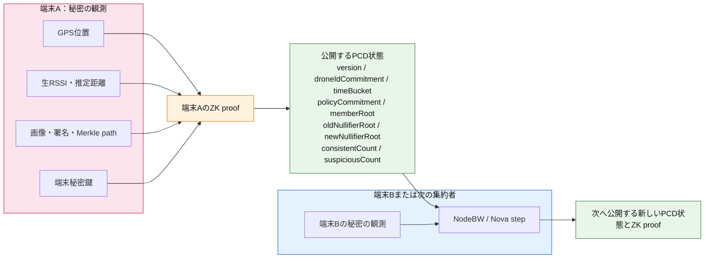
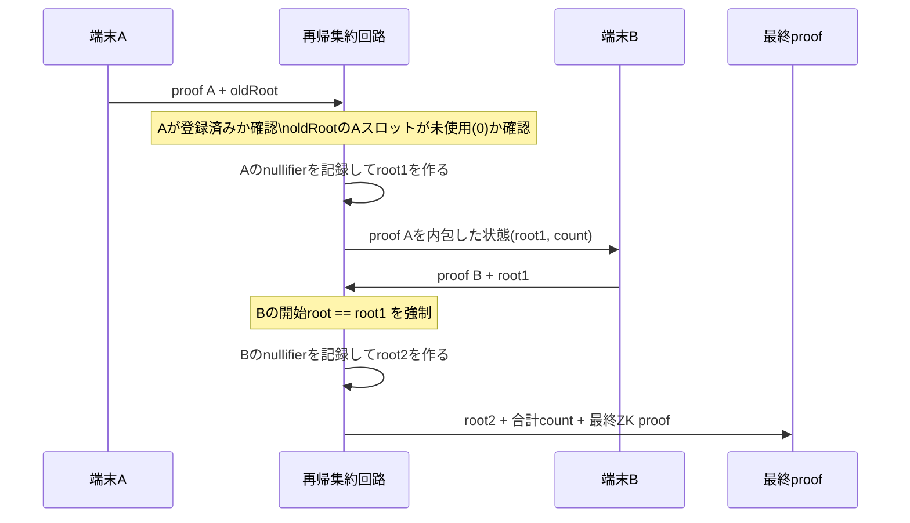
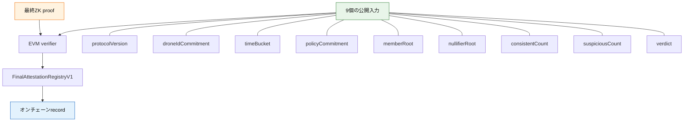

# 公開データと秘匿データ：証明チェーン図

## 端末Aから端末B（または次の集約者）へ渡すもの

## nullifier rootが二重参加を防ぐ流れ

同じ端末Aがもう一度参加しようとしても、`root1` ではAのスロットがすでに
未使用値 `0` ではないため、次のproofを作れない。

## 最終的にEVMへ公開するもの

EVMには端末のGPS位置、生RSSI、画像、端末ID、端末秘密鍵、Merkle path、
nullifierそのものは公開しない。
