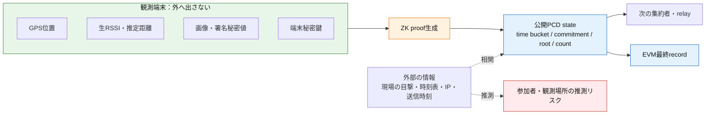
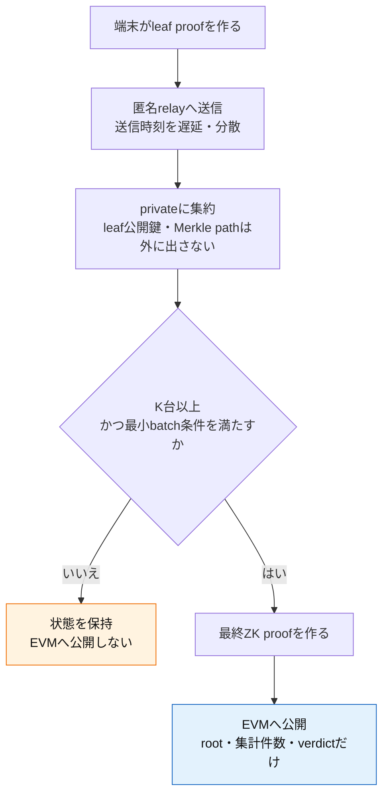

# 公開状態から相手の情報を推測できるか

## 結論

**GPS位置・生RSSI・画像・秘密鍵を、公開proofやrootだけから数学的に復元することは
できない設計である。** ZK proof、Poseidon/MiMC commitment、Merkle rootは、そのために
使っている。

しかし、**推測が一切できないわけではない。** 時刻、ドローンの同一性、件数、通信の
送信元や順番を組み合わせると、観測者の行動を推測できる場合がある。これは暗号の破り
ではなく、metadata（周辺情報）による相関攻撃である。

## 全体像：何が守られ、どこから推測が生じるか



緑の情報はZK proofの秘密witnessであり、公開stateから復元できない。赤い経路は
暗号の破りではなく、公開値と外部情報の組合せによる推測である。

## 公開値ごとのリスク

| 公開される値 | 直接わかること | 推測され得ること | 対策 |
| --- | --- | --- | --- |
| `droneIdCommitment` | 同じcommitmentなら同じドローンsession | 特定地点・特定時刻に出た既知のドローンとの対応 | sessionごとのsalt化、アクセス制御、必要なら公開遅延 |
| `timeBucket` | おおまかな観測時間帯 | その時間に誰が現場にいたか | bucketを粗くする、遅延公開、batch化 |
| `consistentCount` / `suspiciousCount` | 何件の観測が集まったか | 人通り・観測端末数、少数時には個人の参加 | K未満は非公開、k-anonymity閾値、件数の丸め |
| `memberRoot` | 登録端末集合の版 | root更新時期から登録運用の変化 | root更新を定期batchにする |
| `nullifierRoot` | 使用済み端末集合が更新された事実 | root変化の回数から参加回数 | rootを最終時だけ公開、batch更新、固定サイズbatch |
| proof送信時刻・IP/BLE接続情報 | 誰がいつrelayへ送ったか | 端末・利用者・場所の特定 | mix relay、遅延送信、Tor/VPN、近接通信の匿名化 |

## 具体例：少人数のときに起きる推測

```text
公開結果:
  timeBucket = 10:00–10:10
  droneIdCommitment = X
  consistentCount = 1
  suspiciousCount = 0

外部の知識:
  この時刻、この場所にいた観測者はAさんだけ

推測:
  「Aさんがこのドローンを観測した可能性が高い」
```

proofからAさんのGPS位置やRSSIを取り出したわけではない。それでも、件数が1件で
外部情報が多いと参加事実が推測される。このため、暗号だけでなく公開方針が重要になる。

## 「次の人」が知る範囲

### PCD stateだけを受け取る場合

次の集約者は、原則として次だけを見る。

```text
同じsessionであること
前段のnullifier root
更新後のnullifier root
整合・矛盾の累計
それらの更新が正しいことを示すproof
```

この場合、前段端末のGPS・RSSI・画像・端末鍵・Merkle path・nullifier値は見えない。

### 現在のleaf proofを直接relayする場合の注意

現在のCircom leaf proofには、集約のため `device_pubkey_x/y`、時間bucket、
ドローンcommitment等の公開信号がある。leaf proofを次の人へそのまま渡す運用では、
端末公開鍵によって同じ端末の複数session参加をリンクできる。

したがって本番構成では、leaf proofをrelay網へ広く配るのではなく、Bridgeまたは端末側の
集約proverがleafをprivate witnessとして消費し、外へはPCD stateだけを出すべきである。

## 必須の対策

1. **最小参加数Kを満たすまで最終結果を公開しない。** 例えばK=3未満なら
   `Undetermined`すらオンチェーン記録しない。
2. **rootを端末ごとにオンチェーン公開しない。** 3台または一定時間ごとのbatchで
   更新・finalizeする。
3. **時間bucketを必要以上に細かくしない。** 精度と追跡可能性のトレードオフを
   policyとして固定する。
4. **relayのネットワークmetadataを保護する。** proof本文が秘匿でも、送信元IPや
   即時送信は位置推測に使われる。
5. **leaf公開鍵を最終proofやEVMへ出さない。** 最終的にはmemberRootと
   nullifierRootだけでmembership・一回性を示す。
6. **公開前にprivacy reviewを行う。** 小地域・少人数・既知ドローンでは、公開値の
   組合せが個人の参加事実を示さないか評価する。

## 対策を入れた公開フロー



この流れでは、1人だけの参加や端末ごとのroot更新を公開せず、一定数の観測をまとめた
最終結果だけを出す。これが公開値からの推測を減らす実装上の要点である。

## 設計上の判断

この研究で守る対象は「観測の中身」と「端末の恒久ID」であり、公開するのは集約結果だけ
とする。ただし、公開時刻・件数・通信経路まで隠さない限り、参加した可能性の推測は残る。

よって最終設計では、ZK回路の正しさだけでなく、`K`、time bucket、公開遅延、batch size、
relay方式をpolicyに含めて評価する必要がある。
