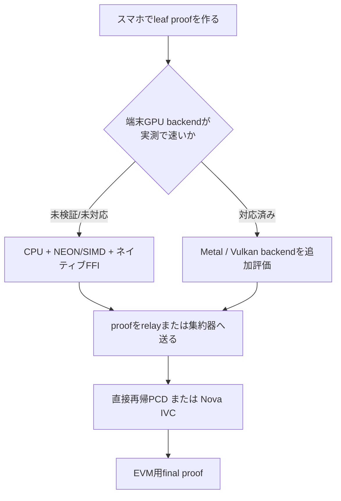

# 再帰ZKPの選択肢とスマホGPU調査

調査日: 2026-09-28

## 結論

Nova以外にも選択肢はある。ただし本研究の要件は「既存BN254 leaf proof」「重複防止の
状態遷移」「EVM最終検証」「スマホでの観測proof」であり、万能な方式はない。

現時点の推奨は、**端末leafはBN254/Groth16を維持し、集約器は直接再帰PCDとNova IVCを
同じ状態遷移で比較する**ことである。スマホGPUはAPIとして使えるが、主流ZKライブラリの
iOS/Android向けGPU proverは成熟していない。GPU前提で設計を決めない。

## Nova以外の候補

| 方式 | 集約の考え方 | EVMとの相性 | この研究への適合 | 判断 |
| --- | --- | --- | --- | --- |
| 直接再帰Groth16 | 親回路が子proofを検証する | BN254 final proofなら高い | 既存leafと結合しやすい | 現在の本命 |
| Nova / CycleFold | 同じstate transitionを逐次foldする | 最後にDeciderへ圧縮 | 順序付きnullifier更新に強い | 比較PoCを行う |
| Halo2 recursion | Plonkish proofを曲線サイクルで再帰検証 | KZG等の最終設計次第 | lookupや大規模回路に強いが移植量が多い | 研究比較候補 |
| Plonky2 | FRI系の高速再帰 | EVMではwrapが必要 | 高速だがGoldilocks前提でBN254 leafと距離がある | 今回は優先低 |
| zkVM（RISC Zero / SP1等） | Rust/VM実行を証明し再帰・集約 | EVM verifierを提供するものがある | 実装容易性は高いがproof/コストを要測定 | アプリ層の候補 |
| Mina o1js / Kimchi | Mina系再帰proof | Ethereum直結ではない | 既存のEVM/BN254構成を大きく変える | 採用しない |

## 方式ごとの具体的な意味

### 直接再帰Groth16（現在実装中）

親proofの回路内で子proofを検証する。`BridgeBW`、`NodeBW`、`NodeBLS`、`FinalBN`を
つなぐ設計であり、proofが「どの子proofを受理したか」を直接保証できる。

- 長所: 現在のCircom BN254 leafとEVM final verifierを接続しやすい。
- 短所: 曲線サイクル、固定VK、trusted setup、再帰verifierが重い。
- 現状: fixed VK部品、2入力`NodeBW`、nullifier順序遷移まで実装済み。

gnarkはGroth16再帰verifierと固定verification keyのAPIを提供している。
[gnark recursion API](https://pkg.go.dev/github.com/consensys/gnark/std/recursion/groth16)

### Nova / CycleFold

Novaは `z(i+1) = F(z(i), w(i))` のような繰返し状態遷移をfoldする。端末を一台ずつ
追加し、nullifier rootとcountを更新する本研究の順序付き処理には自然に対応する。

- 長所: 多数stepでの更新コストを抑えやすい。透明setup系の選択肢がある。
- 短所: 既存Circom/Groth16 leafをそのまま使うにはBridgeまたは回路移植が必要。
- 注意: arbitraryな2集合のnullifier unionはNovaを使っても別設計が必要。

[Nova論文](https://eprint.iacr.org/2021/370.pdf)、
[Sonobe](https://github.com/privacy-ethereum/sonobe) はNova/CycleFoldとEVM Deciderを
扱うが、Sonobeはpre-release/experimentalの注意書きがある。

### Halo2 recursion

Halo2はcustom gateとlookupを使えるPlonkish系で、曲線サイクル上の再帰を説明している。
複雑な判定・lookupが主役になるなら有力だが、Circom回路、Go集約器、Solidity verifierを
Rust/Halo2系へ再構築するコストが大きい。

[Halo2 recursion documentation](https://zcash.github.io/halo2/background/recursion.html)

### Plonky2

再帰処理そのものは実装・ベンチマークされているが、EVMで検証するには別のwrap proofが
必要になる。既存のBN254 leafとのfield/curve差も大きく、今回の最短経路ではない。

[Plonky2 recursion module](https://docs.rs/plonky2/latest/plonky2/recursion/index.html)

## スマートフォンGPUは使えるか

### ハードウェア／OSとしては可能

| OS | compute API | 可能なこと |
| --- | --- | --- |
| iOS | Metal compute | GPUへ並列計算をdispatchできる |
| Android | Vulkan compute | compute shaderで並列計算できる |
| Browser | WebGPU | 対応環境ならcompute workloadを実行できる |

AppleはMetalをiPhone/iPadを含むApple GPU向けのcompute APIとして提供し、Androidも
Vulkan compute shaderへの移行手順を公開している。
[Apple Metal](https://developer.apple.com/metal/)、
[Android Vulkan compute](https://developer.android.com/guide/topics/renderscript/migrate/migrate-vulkan)

### しかしZK proverとしては、そのまま使えない

ZK proverでGPU化したい主な処理は、MSM、NTT/FFT、有限体演算、hashである。これらは
GPU並列性を持つが、既存ライブラリの対応はGPU/OSごとに異なる。

- gnarkのIcicle連携はBN254 Groth16の低レベル演算を対象にするが、gnark自体は64bit
  architecture向けに最適化・テストされている。
- ICICLEのGPU backendはCUDAとMetalを提供するが、Android Vulkan向けbackendは今回の
  調査範囲では確認できない。
- Nova/Sonobe/Halo2/Plonky2について、Flutterからそのまま使えるiOS Metal + Android
  Vulkanの成熟したprover backendは確認できない。

[gnark GPU support](https://github.com/Consensys/gnark)、
[ICICLE GPU backends](https://dev.ingonyama.com/3.6.0/icicle/install_gpu_backend)

## 実装判断

最初に行う実装はGPU proverではない。

1. Android ARM64・iPhone実機で現在のleaf proofをCPU測定する。
2. proof時間、RAM、発熱、電池消費、proof sizeを記録する。
3. iOSではMetal対応ライブラリが実際にBN254 MSM/NTTを提供できる場合だけ比較する。
4. AndroidはVulkan backendを自作する前に、CPUで許容時間を満たすか判断する。
5. GPU実装はproofの秘密入力を端末外へ出さず、thermal throttlingと副作用も評価する。

## 採用基準

| 判断 | 採用条件 |
| --- | --- |
| Nova | 10〜100 stepのstate更新で直接再帰より実測優位、DeciderがEVM要件を満たす |
| 直接再帰Groth16 | Bridge/FinalBNを含むE2Eが実装しやすく、proof時間・gasが許容範囲 |
| GPU | iOS/Android両方で再現可能なbackendがあり、CPU比の速度・電力優位を実機で示せる |
| server集約 | 端末はleafのみ、重い再帰はrelayへ移す。ただしrelayはproofの正しさを信頼しない |
