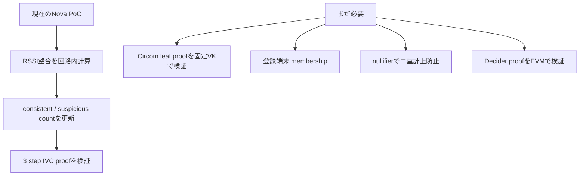
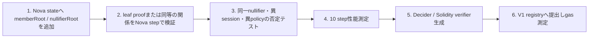

# Week 22：Nova実装チェックリスト — 例と検証経路

作成日: 2026-10-02

## まず何ができていて、何ができていないか

現在のNova PoCは、RSSI観測を3件順番に追加し、整合件数と異常件数を更新できる。
しかし、端末が登録済みか、同じ端末を二度数えていないか、観測proofが本物かまでは
まだNovaの証明に入っていない。



## 目標stateの例

Novaが各stepで保持すべき状態は、単なる件数ではなく次の値である。

```text
state = (
  protocolVersion,
  droneIdCommitment,
  timeBucket,
  policyCommitment,
  memberRoot,
  nullifierRoot,
  consistentCount,
  suspiciousCount
)
```

### 具体例

```text
step 0
  nullifierRoot = root(すべて未使用)
  consistentCount = 0
  suspiciousCount = 0

端末Aの有効leafを追加
  memberRootに端末Aの鍵が含まれることを確認
  A用nullifierのleafを 0 → H(session, A) に更新
  RSSIが整合 → consistentCount = 1

端末Aをもう一度追加しようとする
  同じnullifier leafはすでに0ではない
  step proofを生成できない → 二重計上を拒否

端末Bの異常leafを追加
  B用nullifierを更新
  RSSIが不整合 → suspiciousCount = 1
```

## 実装ファイルの役割

| ファイル | 役割 | 状態 |
| --- | --- | --- |
| `nova_poc/uav_chain_step.rs` | RSSI整合と件数更新の最小Nova PoC | 実装済み |
| `nova_poc/nova-mobile/` | AndroidでNovaを実行するRust / Kotlin境界 | 実装済み |
| `aggregator/pcd/bridge_bw.go` | Circom leaf proofの固定VK検証、membership、nullifier遷移の直接再帰版 | 実装済み。Nova版Bridgeは未接続 |
| `aggregator/nullifier/merge.go` | 2つのnullifier treeを重複なく併合する回路 | 実装済み。Nova stepへ未接続 |
| `contracts/contracts/FinalAttestationRegistryV1.sol` | V1 ABIを記録するEVM registry | 実装済み。Nova Decider未接続 |

## 実装順序



## 完了とみなす条件

次のすべてを満たしたときだけ、Nova経路を本研究の採用候補から実装済み経路へ進める。

- 実leaf proofに由来する端末だけが1 sessionに1回だけcountされる。
- 10 step程度で正常・異常混在の最終stateが期待値と一致する。
- count改ざん、leaf差し替え、nullifier再利用、session / policy混入が失敗する。
- Decider proofをEVMで1回検証し、V1 ABIに記録できる。
- proof生成時間、RAM、proofサイズ、calldata、gasを同じ条件で記録する。
