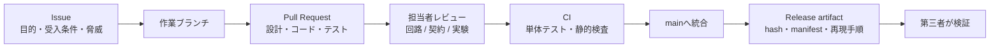
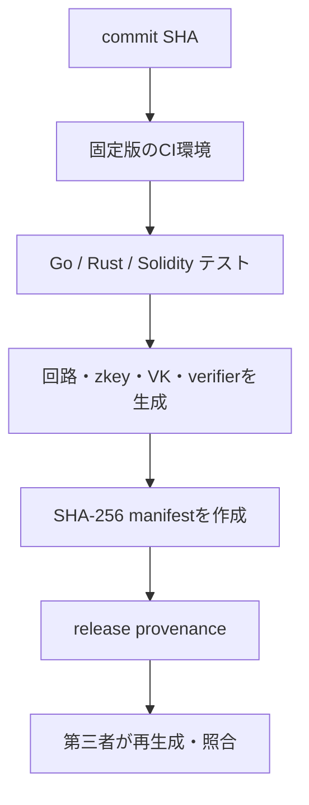
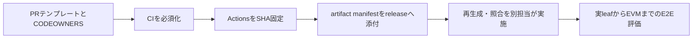

# 複数人で高信頼に実装するための設計

調査日: 2026-10-02

## 結論

この研究では、GitHubを単なるファイル置き場ではなく、**仕様・実装・検証結果・生成物の対応を
追跡する正本**として運用する必要がある。とくにZKPでは、回路ソースだけでなく
verification key、Solidity verifier、テストベクトル、実行条件が一致して初めて
「同じ証明を検証している」と言える。

目標とする共有経路は次の通りである。



## 現在の状態

| 項目 | 現在 | 判断 |
| --- | --- | --- |
| 基本CI | `contracts` と `aggregator` のテストを実行 | あり |
| Issue | GitHub Issueで課題を管理 | あり |
| 週次設計記録 | `week22/`、`week23/` にMarkdownを残す | あり |
| artifact manifest | `scripts/zk_artifact_manifest.sh` が存在 | 基礎あり |
| CODEOWNERS | 見当たらない | 追加が必要 |
| PRテンプレート | 見当たらない | 追加が必要 |
| mainの保護 | private repositoryの現在のプランではAPIが403 | プランまたは運用の検討が必要 |
| Actionsの固定 | `actions/checkout@v4` 等のタグ参照 | commit SHA固定が必要 |
| release provenance | build元・生成条件の証明を未作成 | 追加が必要 |

## 役割の分け方

少人数でも、変更する人と確認する人を分ける。1人がすべてを承認する運用では、
レビュー記録が残っていても独立した検証にはならない。

| 役割 | 確認する対象 | 例 |
| --- | --- | --- |
| 回路担当 | 公開入力、制約、否定系 | Circom、gnark、Nova |
| 契約担当 | ABI、状態遷移、gas、権限 | Solidity、Hardhat |
| 実験担当 | 実機条件、時間、RAM、再現手順 | Android、Raspberry Pi、EVM testnet |
| 統合担当 | Issue受入条件、artifact hash、release | main / release管理 |

高リスク領域は必ず担当外の人が確認する。

```text
回路を変えた人      → 契約担当または統合担当が確認
Solidityを変えた人   → 回路担当または統合担当が確認
性能結果を書いた人  → 実験条件を別の人が再実行
releaseする人       → manifestとhashを別の人が検証
```

## Issueの設計

1 Issueは、1つの安全条件または1つの実証結果に限定する。

### 良い例

```text
題名:
[Nova] session nullifierをstateへ統合する

目的:
同じ登録端末を同一sessionで2回countできないようにする

受入条件:
- memberRootに含まれない鍵でstep proofを生成できない
- 同一nullifierの2回目のstep proofが失敗する
- 異なるsessionのnullifierを再利用すると失敗する
- 10 stepの正常系が期待stateと一致する

再現コマンド:
cargo test -p nova-mobile
```

### 避ける例

```text
Novaを完成させる
```

「完成」の意味、確認する人、失敗すべき攻撃、再現方法が分からないためである。

## PRの最小テンプレート

すべてのPRに、次を記載する。

```md
## 目的

## 変更した仕様・実装

## 守る安全条件

## 追加した正常系テスト

## 追加した否定系テスト

## 再現コマンドと実行環境

## 生成物・hashへの影響

## 未完了事項と関連Issue
```

### ZKP変更で必ず確認する項目

```text
- 公開入力の順番・型・値域は変わったか
- verification keyをprover入力から差し替えられないか
- session / policy / memberRootを異なるproof間で混ぜられないか
- nullifierの再利用を拒否するか
- proof、public input、root、countを改ざんした否定系があるか
- 回路変更に対応したzkey / verifier / manifestを再生成したか
```

## mainへ統合する条件

GitHubのprotected branchでは、PR review、status check、署名済みcommit、
会話の解決、force pushや削除の禁止などを統合条件にできる。
この設定は重要なbranchを安定させるための公式機能である。
現リポジトリではprivate repositoryのプラン制約により、main protection APIが403を返した。
したがって次のいずれかを決める必要がある。

1. private repositoryでbranch protectionを使えるプランへ移す。
2. 当面はmainへ直接pushせず、2人の確認コメントがあるPRだけを統合する。
3. release branchは統合担当だけがpushし、release前チェックを手動で必須にする。

推奨設定:

```text
main:
- Pull Request経由のみ
- 承認 1名以上
- 最新push後に再承認
- CI成功を必須化
- force push / 削除を禁止
- 管理者による条件回避を禁止
```

## CIと供給網の設計

CIは「テストが通る」だけでなく、どの入力からどの生成物を作ったかを残す。



実施すること:

- GitHub Actionsはタグではなく、レビュー済みの完全commit SHAで固定する。
- workflowの`permissions`を最小化する。
- PRでは高速テストだけを必須にし、重いproof生成・実機計測はrelease候補で実行する。
- release時に、回路ソース、compiler version、zkey、verification key、Solidity verifier、
  テストベクトルのSHA-256をmanifestへ保存する。
- manifestを使い、別環境で再生成したartifactとの一致を検証する。

## 秘密情報とデータの境界

GitHubへ入れないもの:

```text
端末秘密鍵
ceremonyの秘密乱数
本番witness
生GPS・生RSSI
未匿名化のRemote IDログ
.env、API token、keystore
```

GitHubで共有するもの:

```text
回路ソース
公開verification key
匿名化済みテストベクトル
artifact manifestとhash
再現コマンド
実験条件・結果
```

## 導入順序



まずPRテンプレートとCODEOWNERSを入れる。次にCIとrelease artifactの照合を定着させる。
その後に重いE2E proof・実機・EVM評価を分担して実施する。

## 参考資料

- [GitHub Docs: protected branches](https://docs.github.com/en/repositories/configuring-branches-and-merges-in-your-repository/managing-protected-branches/about-protected-branches)
- [GitHub Docs: PRの標準化とCODEOWNERS](https://docs.github.com/en/pull-requests/reference/managing-and-standardizing-pull-requests)
- [GitHub Docs: Actions workflowの保護](https://docs.github.com/en/code-security/tutorials/secure-your-organization/protect-against-threats)
- [SLSA: Build provenance](https://slsa.dev/spec/v1.0/provenance)
- [NIST SP 800-218: Secure Software Development Framework](https://doi.org/10.6028/NIST.SP.800-218)
