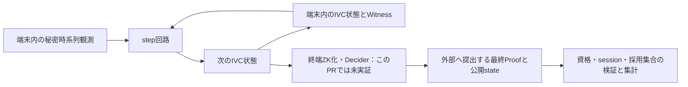

# HyperNovaの概念とSonobe PR #246の実装対応

調査日：2026-10-13。対象：[#44](https://github.com/SMRI2170/zkp-m1-v2/issues/44)。
**単一Proverの時系列IVCは実装があり、Week23のMac実験でも動作した。一方、このPRの既存APIだけで外部提出用の最終ZK証明まで完成させる経路は確認できない。**
その理由は、IVCの`Proof`にWitnessが含まれ、最終ZK用`Decider`に具体的実装が見つからないためである。
PiでのFolding評価は着手可能だが、最終ZK・EVM検証の成功やPi4への適合性は未実証。

## 調査対象・版・確認範囲

| 対象 | 固定情報・結果 |
|---|---|
| [HyperNova論文](https://eprint.iacr.org/2023/573) | ePrint 2023/573。公開メタデータでは最新改訂2026-02-20、5 revisions。CRYPTO 2024版の拡張・改訂版 |
| 論文改訂の内容 | 著者注記ではAppendixの結果をSection 7へ移し、NovaBlindFoldと命名した旨を確認。**PDF・版履歴ページはHTTP 403。Section 7／Appendix Dの全文照合は未完了** |
| [PR #246](https://github.com/ethereum/sonobe/pull/246) | OPEN・Draft・未merge。更新2026-07-26。baseは`staging`、headは`revamp/hypernova` |
| base SHA | `ad28992218368063d64072aa4d7ed35db43dc4fd` |
| head SHA | `9c4e61f8d1a5be87c00f28838a0ef657a3cf479f`。Week23と同一 |
| 監査の記録 | PR本文は監査後merge・#244依存と記載。#244もOPEN・未merge。取得したPR review/comment配列は空。監査完了報告を確認できたとはしない |
| 元ソースの照合 | GitHubの固定Git treeと、保存済み無変更archiveの`crates/`＋root Cargo.tomlの94ファイルをGit blob hashで照合。一致。全Rust 90ファイルを検索 |
| 実行用の互換patch | Week23の別ツリー。root Cargo.tomlのcore arkworks 0.6固定とPedersen MSM API互換の2ファイルのみ。元の依存不整合・失敗ログを保持 |

固定hash・確認結果は[manifest](manifests/pr246-source-audit.json)。
文献の全文未確認を、コード確認や著者abstractで代替して完了扱いにしない。
以下の概念表は**固定ソースの構造・演算と著者の公開概要に基づく説明**で、最新論文の定義・定理番号の完全な照合表ではない。

## 概念→課題→入力・処理・出力→実装

以下のソースリンクはすべて上記headに固定した一次資料。

| 概念 | 解く課題／入力→処理→出力 | 実装箇所・確認範囲 |
|---|---|---|
| CCS | 異なる算術制約を共通形式で扱う。行列・係数・index集合とassignmentから、行列積の要素積と加算で制約を評価する | [CCS/CCSVariant](https://github.com/ethereum/sonobe/blob/9c4e61f8d1a5be87c00f28838a0ef657a3cf479f/crates/primitives/src/arithmetizations/ccs/mod.rs#L40)。この実験のvariantはR1CSConfigで、全種類の回路frontend対応を実証したものではない |
| CCCS | Witnessへのcommitmentを持つ新しい入力を扱う。公開入力`x`・commitment `cm`と秘密`w,r`から、CCS関係とopeningを検査する | [CCCSInstance](https://github.com/ethereum/sonobe/blob/9c4e61f8d1a5be87c00f28838a0ef657a3cf479f/crates/fs/src/hypernova/instances/mod.rs#L75)、[relation検査](https://github.com/ethereum/sonobe/blob/9c4e61f8d1a5be87c00f28838a0ef657a3cf479f/crates/fs/src/hypernova/mod.rs#L113) |
| LCCCS | 累積用の線形化した関係を保持する。`cm,u,x,r_x,v`とrunning witnessから、多重線形拡張の評価値とopeningを検査する | [LCCCSInstance](https://github.com/ethereum/sonobe/blob/9c4e61f8d1a5be87c00f28838a0ef657a3cf479f/crates/fs/src/hypernova/instances/mod.rs#L21)、[running relation](https://github.com/ethereum/sonobe/blob/9c4e61f8d1a5be87c00f28838a0ef657a3cf479f/crates/fs/src/hypernova/mod.rs#L74) |
| NIMFS | 複数のrunning/incoming関係を1つへまとめる。transcript challenge、SumCheck、評価値、線形結合を使い、新running pairとfold proofを出力する | [prove](https://github.com/ethereum/sonobe/blob/9c4e61f8d1a5be87c00f28838a0ef657a3cf479f/crates/fs/src/hypernova/algorithms/prover.rs#L35)、[verify](https://github.com/ethereum/sonobe/blob/9c4e61f8d1a5be87c00f28838a0ef657a3cf479f/crates/fs/src/hypernova/algorithms/verifier.rs#L34)、[NIMFSProof](https://github.com/ethereum/sonobe/blob/9c4e61f8d1a5be87c00f28838a0ef657a3cf479f/crates/fs/src/hypernova/mod.rs#L207) |
| SumCheck | 大きな多項式の総和に関する主張をroundごとの小さい多項式と最終点の評価へ縮約する。最終評価値は別途CCS関連の式と照合する | [SumCheck](https://github.com/ethereum/sonobe/blob/9c4e61f8d1a5be87c00f28838a0ef657a3cf479f/crates/primitives/src/sumcheck/mod.rs#L94)、上記NIMFS。これ自体を秘匿化とは扱わない |
| Multi-Folding | 1対1に限定せず複数入力をまとめる。`M` running＋`N` incomingをchallengeのべきによる線形結合へ変換する | 上記`FoldingSchemeProver<M,N>`。M/Nの組合せをWeek23で実行。任意の分岐履歴や二重計上を自動で解決する意味ではない |
| IVC | `z_(t+1)=F(z_t,w_t)`を繰り返し、初期stateから現在stateまでの計算を累積する | [IVC](https://github.com/ethereum/sonobe/blob/9c4e61f8d1a5be87c00f28838a0ef657a3cf479f/crates/ivc/src/lib.rs#L42)、[IVCStatefulProver](https://github.com/ethereum/sonobe/blob/9c4e61f8d1a5be87c00f28838a0ef657a3cf479f/crates/ivc/src/lib.rs#L134)。単一Proverが状態・Witnessを保持できる用途に合う |
| CycleFold | 主回路のcommitment群演算検証を曲線cycleの副回路へ移す | [HyperNova adapter](https://github.com/ethereum/sonobe/blob/9c4e61f8d1a5be87c00f28838a0ef657a3cf479f/crates/ivc/src/compilers/cyclefold/adapters/hypernova.rs#L46)。`HyperNovaNovaIVC`／`HyperNovaOvaIVC`あり。群演算の検査を省略することではない |
| Blinding | 著者概要ではIVC証明をランダム化する秘匿化構成が述べられる。commitmentのhiding、running pairのrandom fold、外部向けZK証明は別々に評価する | [random running pair sampler](https://github.com/ethereum/sonobe/blob/9c4e61f8d1a5be87c00f28838a0ef657a3cf479f/crates/fs/src/hypernova/mod.rs#L175)はある。これと通常foldの存在だけでZK化の全構成が実装済みとはしない |
| NovaBlindFold | Nova foldingのblinding propertyを使うZK化の構成名。適用関係・transcript・最終検証・安全性仮定の論文全文照合が必要 | 固定Rust全90ファイルで名称一致0件。名前の不在は同等構成の原理的不可能性の証拠ではない。Section 7／Appendix Dは未照合 |
| zk-IVC | 累積計算の正当性を、秘密assignmentを公開せず検証できる形にする目標 | 生`IVC::Proof`はWitnessを含むため、そのまま外部提出しない。通常IVC成立と終端ZK成立を分ける |
| Decider | 累積関係から外部向けの最終証明を生成・検証する境界 | [IVC Decider trait](https://github.com/ethereum/sonobe/blob/9c4e61f8d1a5be87c00f28838a0ef657a3cf479f/crates/ivc/src/lib.rs#L189)はWIP。全Rustで当該traitの具体的implのtext matchは0件。下記の`FoldingSchemeDecider`とは別 |

Novaではrelaxed R1CSの誤差項を含む関係をfoldする。HyperNovaではCCSと、その線形化した評価値をSumCheckで結び付ける。
今回のHyperNovaがR1CSConfigを使っても、そのためNovaのfold verifierと同じになるわけではない。

## APIで混同しやすい検証境界

`crates/fs`の[decide_running／decide_incoming](https://github.com/ethereum/sonobe/blob/9c4e61f8d1a5be87c00f28838a0ef657a3cf479f/crates/fs/src/definitions/algorithms.rs#L80)は、
**Witnessとinstanceを引数に取る関係検査**である。`HyperNovaKey`はarith関係とcommitment openingを検査する。
名称にDeciderが含まれていても、Witnessを隠した最終SNARKの生成APIではない。

[CycleFoldのProof](https://github.com/ethereum/sonobe/blob/9c4e61f8d1a5be87c00f28838a0ef657a3cf479f/crates/ivc/src/compilers/cyclefold/mod.rs#L88)は
`(primary RW, RU, incoming IW, IU, secondary RW, RU)`のtuple。
[IVC verify](https://github.com/ethereum/sonobe/blob/9c4e61f8d1a5be87c00f28838a0ef657a3cf479f/crates/ivc/src/compilers/cyclefold/mod.rs#L316)は
step、初期/現在state、primary/secondary instanceのhash bindingを照合し、3つのWitness-bearing関係を検査する。
これは正当性検査として有効だが、外部へtupleを送ればWitnessも渡る。

H=trueのPedersenはcommitmentをhidingにしても、同梱の`w`を隠さない。
`NIMFSProof`は`sc_proof/sigmas/thetas`を持つfold proofで、IVC全履歴の最終公開ZK証明とは別。
さらにpartial verifier gadgetの群演算hintはCycleFold側の検査を必要とする。

PR内READMEには旧`folding-schemes`やNova DeciderEthの説明が残っている。
固定headの実際の`sonobe-fs`／`sonobe-ivc`のコードを優先し、READMEにある旧版のEVM能力をHyperNovaの実装能力へ転用しない。

## 新案と既往判断を分離



Week23の不採用は、**異なるProverへ秘密を渡さず内部状態を継続する用途**の判断で、変更しない。
Week24ではWitnessを端末内に留めるため、その転送問題を回避できる。ただし外部提出時には終端ZKが必要。
単一Prover内に保持できるからといって、生IVC stateを外部へ送ってよいことにはならない。
跨Prover用binderの開発は再開しない。BC採否やセンサー真値の問題もこの用途変更だけでは解決しない。

## 利用可能性・最小変更・採否ゲート

| 機能 | 分類 | 次の作業・条件 |
|---|---|---|
| HyperNova native folding／verify | 既存APIで利用可能（依存修正後） | 保存patch/lockを使い別workspaceで再現 |
| 単一Prover toy時系列IVC | 既存APIで利用可能（Mac既往実行あり） | 既存20stepテストをbaselineにする |
| UAV/RSSI時系列PoC | 小改修が必要 | 旧FCircuitを現traitへ移植。session/RID/window/policyとcount・観測数を拘束し、正常/異常/境界入力を検査。7非zero入力toyをRSSI整合性の証明としない |
| 状態観測・ベンチI/F | 小改修が必要 | `IVCStatefulProver`のstate/proofはprivate field。公式getterがないため、`IVC::prove/verify`を直接呼び所有側で計測する。ライブラリの検査を変更しない |
| Pi4 ARM64／4GB／1Hz | 未検証 | クロスbuildとPiネイティブ実行を分離。3→10→60→600step、単調時計の1Hz入力、RSS/cgroup/OOM/queueを計測 |
| 外部提出用最終ZK Proof | 当該固定PRでは未実装と判断 | WIP traitの具体的実装なし。別の実在する終端証明系との適合性調査、または暗号プロトコル追加設計・安全性検証が必要。小改修で完成とは見積もらない |
| HyperNova最終proofのBesu直接検証 | 未実装・未検証 | 最終証明系・VK・ABI・transcriptの固定と実proofのEVM検証が前提 |
| 跨Prover秘密非共有継続 | 開発停止・不採用 | Week23 ADRを維持。本Issueの必須実装へ戻さない |

Pi測定ではtoy→同等RSSI回路へ段階的に進め、最終ZK未実装の列をN/Aとする。
Foldingのみの時間をGroth16/PLONKの完成ZK証明時間と同等のコストとして比較しない。
当面の外部提出ZKPの比較基準はRapidSnark／gnark Groth16・PLONKであり、HyperNovaの本採用は確定しない。

## 既往実験と今回実施した確認

- [Week23/10](../week23/10_HyperNova実行と最新Sonobe安全性と秘密引継ぎ.md)：240fold/verify、関連38test成功。依存・MSMの互換patchとlockを保存。
- [Week23/11](../week23/11_HyperNova_IVCとブラインド状態引継ぎの検証.md)：HyperNovaNovaIVC／HyperNovaOvaIVC各20step成功。random fold成功と、元履歴への単純差替え・その後の継続検証失敗を分離。
- [Week23/12](../week23/12_HyperNova_Folding_binderの回路実装と検証.md)：fold binderの中間回路のみ。Groth16 proveはswap上限で停止。元履歴binderの完成実装ではない。
- 今回：最新PR metadata・#244・review/commentを取得し、94ファイル照合とRust全90ファイルのソース確認を実行。新しいproof生成・Pi測定は行っていない。

## 再現

元archiveの準備方法は[Week23 source manifest](../week23/manifests/sources.json)、
実行用別ツリーの準備は[Week23 README](../week23/poc/sonobe-current/README.md)。元archiveは書き換えない。

```sh
mkdir -p .cache/week24/references
gh api repos/ethereum/sonobe/pulls/246 > .cache/week24/references/pr246.json
gh api 'repos/ethereum/sonobe/git/trees/9c4e61f8d1a5be87c00f28838a0ef657a3cf479f?recursive=1' > .cache/week24/references/pr246-tree.json
python3 week24/poc/audit_pr246.py
```

auditは固定head／全対象blobの一致、IVC検証呼出、WIP traitと検索結果を検査する。
元ソースの一致を確認するもので、暗号学的安全性監査や証明実行の代用ではない。
既往テストの再実行はmemory/swapを確認後、保存lockを使い`--locked --release -j 2`で行う。
今回重いproof生成は不要で、使い捨てVK/proofを公開・deployしない。

## 未完了の調査項目

1. 最新論文PDFの取得とhash固定、Section 7／Appendix Dの定義・手順・定理・仮定の全文照合。
2. 文献のZK構成と、このPRのどの関係へ適用できるかの厳密な対応。単純random foldをZK完成と扱わない。
3. UAV時系列FCircuitの移植仕様と、Pi4のネイティブ動作・メモリ・1Hz追従。
4. 秘密を外部へ渡さず実行できる終端ZKの実装候補と、直接EVM検証までの成立条件。

V2はclaimed RIDと観測者署名の研究PoC。DRIP trust chain、GPS/RSSIの真値、受信事実、実UAV同一性、観測者hardware認証を証明しない。
