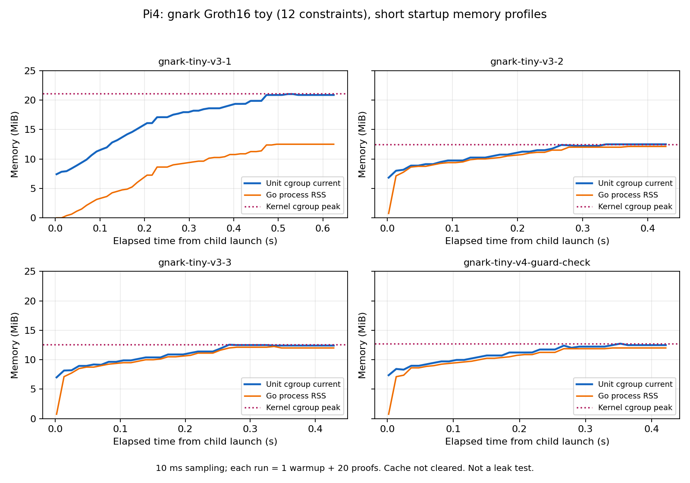

# Pi4 4GB：Groth16スモーク・メモリ統計・SSH保護

2026-10-13。[実施計画](00_Pi4_実機評価計画.md)の初回セッション。
**Piで小規模Groth16の4trial、計84回の正常prove/verify、16件の不正拒否が成功した。**
memory cgroupを有効化し、実験のハード上限・Swap禁止・SSH保護・OS余力監視を設置した。
32MiBのハード上限試験では対象プロセスだけがOOM停止し、同じSSH接続が継続した。
対象は12制約toyであり、RSSI回路・1Hz・長時間稼働・他方式の評価はまだ行っていない。

## Piで実際に確認した値

[初期inventory](logs/pi-inventory-initial.json)、[有効化後inventory](logs/pi-inventory-memory-enabled.json)。接続先や資格情報は保存しない。
以下は最初のsnapshotで、現在のmemory controllerは有効。

| 項目 | 実測／確認 |
|---|---|
| 機種 | Raspberry Pi 4 Model B Rev 1.5 |
| OS / kernel / arch | Debian 12 bookworm、6.6.51+rpt-rpi-v8、aarch64 |
| RAM / available | 3,976,183,808 / 3,520,929,792 bytes（inventory時点） |
| Swap total / used | 209,711,104 / 0 bytes |
| 空き容量 | 約10.2GiB |
| 温度 | 46.738°C（単回snapshot） |
| CPU | affinityで利用可能0/1/2/3 |
| systemd / Python | 252 / 3.11.2 |
| clock | UTC同期済み |
| memory cgroup | `/proc/cgroups`のenabled=0、root controller一覧にmemoryなし |
| power flags | `throttled=0x50000`。取得時のcurrent低4bitは0、過去の低電圧・throttling flagあり |

`0x50000`の意味は[公式vcgencmd manual](https://github.com/raspberrypi/utils/blob/master/vcgencmd/vcgencmd.1)に基づく。
これだけでSSH切断・再起動の原因を低電圧だと断定しない。
今回のSSH断続応答後、uptime約2分の状態で再接続した。
現在・前回起動のkernel log検索ではOOM記録を見つけなかったが、保存期間・過去の状況まで保証しない。
**切断時点では、この作業からPiへ証明器を実行していなかった。**

## メモリ上限のpreflightで発見した問題

user transient unitへMemoryHigh=1200M、MemoryMax=1536M、MemorySwapMax=0を指定した。
しかしeffective cgroupにはmemory.max/high/swap.maxがなく、controller自体が無効だった。
最初のprobeは最後の軽いコマンドが成功したためunitの終了はsuccessだったが、
この終了コードを「メモリ制限成功」とは扱わず、実際のfile/propertyを確認して未成立と判断した。

計測runnerはeffective limitを読み、期待値と一致しない場合はproveを開始しない。
起動設定を保持し`cgroup_enable=memory`だけを追加する案を用意した。
当初はユーザー確認待ちで停止した。後続のメモリ保護依頼を受け、元hash照合・root owner-only backup・変更・再起動を実施。
再起動後に`memory` controllerとenabled=1を確認した。SSH切断はこの計画した再起動時のみ。
backupはPiの`/root/week24-backup/cmdline-before-memory.txt`に保存。元のkernelやfirmwareは更新していない。

## 準備したGroth16ベンチ

[コード・再現手順](../experiments/pi4-zkp-bench/README.md)、[build manifest](manifests/gnark-tiny-build.json)。
gnark 0.16.3／gnark-crypto 0.21.0、BN254 Groth16、12制約のtoy。
private変数8bit xに対してpublic y=x³+x+5を拘束する。
小さいxはyから復元可能なので、このtoyをGPS/RSSI秘匿の実証にしない。
RSSI・session・資格・IVC・Besu検証は含まない。

Macでsetupし、Mac ARM64・Linux ARM64を同じsource digestから構築。
Linux binaryをPiへ転送し、SHA256一致とfixture directory0700/files0600を確認した。
private assignmentとproof/publicは保存しない。setup fixtureはlocal-only・使い捨てで、Git公開やdeployしない。
最初のfixture v1は保存し、permission検査を追加した版は新規v2とした。失敗cacheも削除しない。
host/receiverのfixture source・全artifact hash、再構築したCSの一致を実行前に検査する。

## Macでの検証（Piの性能値ではない）

[setup](logs/gnark-tiny-host-setup.jsonl)、[正常・否定テスト](logs/gnark-tiny-host-check.jsonl)、
[cache不一致拒否](logs/gnark-tiny-cache-negative.json)。

- warmup 1＋20回のprove/verifyすべて成功。
- 公開y変更、proof改変、不正なyのassignment、8bit範囲外入力の4種類を拒否。
- proof改変はdeserialize時に拒否。このケースを「deserialize成功後のverify拒否」とはしない。
- source digestの不一致を拒否し、対象fixtureを保存。
- ホストのprove p50 1.5995ms、p95 2.0575ms、verify p50 1.361ms、process peak RSS 13,025,280 bytes。

単回の20sampleで、Pi性能の推定や方式間の優劣に使用しない。
既存Python 61件・aggregator Go・contracts 48件も成功。

## メモリ保護の構成と実地検査

[guard manifest](manifests/pi-memory-guard.json)。

| 保護 | 設定／確認 |
|---|---|
| 全実験の合計 | root `week24.slice`、MemoryHigh 1200MiB／MemoryMax 1536MiB／Swap 0 |
| 初回toyの個別unit | MemoryHigh 192MiB／MemoryMax 256MiB／Swap 0、RuntimeMax 210秒 |
| OS余力 | 別unitのwatchdogが100msごとにMemAvailableを確認。1GiB未満なら実験sliceのみ停止。watchdog自体はMax 64MiB |
| OOM時の優先度 | SSH -900、実験 +500。SSHをrestartせず既存sshdへ適用 |
| guardの境界 | watchdogは実験slice外。実行コードはroot所有の`/run/week24/`へhash照合して配置し、ユーザー書込み不可 |
| 次回起動 | bootのmemory有効化は維持。guardのunit/drop-inは`/run`のruntime-onlyなので次回測定前に再設置・検査 |

最初の32MiB probeはsoft high 24MiBの抑制で30秒timeoutとなった。これをhard OOM成功とは扱わない。
別probeではsoft highをinfinity、**hard maxは32MiBのまま**にしてhard側を単独検査し、97msで`Result=oom-kill`、SIGKILLを確認した。
停止したのは試験unit。SSH channelは継続し、後続コマンドを実行できた。
OS availableは約3.3GiB、Swap使用0を維持した。

watchdogと同じslice停止操作もsleepを入れた小さなunitで検査し、active→inactive、SSH維持、slice復旧を確認。
**実際にOS available<1GiBまで圧迫する試験は行っていない**。この確認は停止操作の検査であり、全低メモリ条件の保証ではない。
試験後の[SSH heartbeat](logs/ssh-protection-heartbeat.json)は10/10成功。
powerやWi-Fiを原因とする過去の切断が解消したとは結論しない。

## Pi-native Groth16の結果

全trialでlinux/arm64、GoのみCPU affinity=[0]、GOMAXPROCS=1、visible CPU=1を確認。
各trialは新規process、warmup 1＋20測定。fixture hash・再構築CS一致を検査してからnative prove/verifyした。
setupはMacで行い、Piではcompile/key load/witness/prove/verifyを分離計測。

| trial | prove p50 / p95 (ms) | verify p50 (ms) | unit kernel peak (MiB) | memory p50 / p95 / p99 (MiB) | memory標本数 |
|---|---|---|---|---|---|
| v3-1 | 10.861 / 11.676 | 7.527 | 21.113 | 18.195 / 20.863 / 21.016 | 55 |
| v3-2 | 10.699 / 11.132 | 7.534 | 12.488 | 11.238 / 12.488 / 12.488 | 38 |
| v3-3 | 10.722 / 11.137 | 7.529 | 12.551 | 11.273 / 12.492 / 12.529 | 38 |
| v4 guard検査追加 | 同じ正常／不正検査が成功 | 成功 | 12.734 | 11.230 / 12.484 / 12.644 | 37 |

正本は[全trialのlog](logs/pi-gnark-tiny)。v4は親slice・SSH score・watchdogが未設定なら停止する検査を追加した版で、v3と別に表示する。
正常21×4=84回、不正4×4=16件拒否。proof変異はdeserialize拒否で、verify拒否と分けて記録した。
proof/publicのnative serializationは164/44 bytes。EVM calldata互換やオンチェーン成功とはしない。
通常trialでは全unitのOOM/high/max event増加0、experiment swap=0、system swap使用=0。
意図したhard-limit probeのOOM 1件は、通常trialの失敗件数へ混ぜない。

## メモリ統計の定義と限界

10msを目安にunit memory.current、Go RSS/HWM/PSS、OS available/swapを記録。
memory.peakはkernelが記録したunit全体のpeakで、samplingで取り逃す瞬間値を補う。
平均・母標準偏差・線形補間p50/p95/p99、実際のpoll間隔で重み付けした分布、OLS傾向を各trialの`memory-summary.json`へ保存。
観測中のOS available最小は約3.26GiB、観測したcurrent power低4bitはすべて0。
過去のpower flag `0x50000`は残っており、samplingが瞬間的な変化をすべて捕捉したとはしない。

各系列は0.42〜0.62秒と短く、startupと正常／否定テストを含む。標本も自己相関を持つ。
OLS傾きは正だが、初期allocationを含むので**メモリリークや長期増加率の証拠ではない**。
OSのpage cacheをクリアしておらず、最初と後続trialを同一cold条件の反復として扱わない。
unit cgroupとprocess RSSは測定対象が異なるため、両者の倍率を性能比較に使わない。
長期の増加評価は今後の60秒窓反復・1時間試験で、窓末メモリとqueueを別に観測する。

## 次の評価

今回完了したのは、Piでのgnark Groth16 **最小スモークとメモリ保護・計測基盤**。
次は同等RSSI回路のrange/statement照合とPi実行、RapidSnark・PLONKの最小試験。
Novaの60/600step、1Hz queue、最終ZK、1h/24h、他方式比較は残るため#44全体をDONEにしない。
V2はclaimed RIDと観測者署名の研究PoCで、DRIP、センサー真値、実UAV同一性、hardware認証を保証しない。
