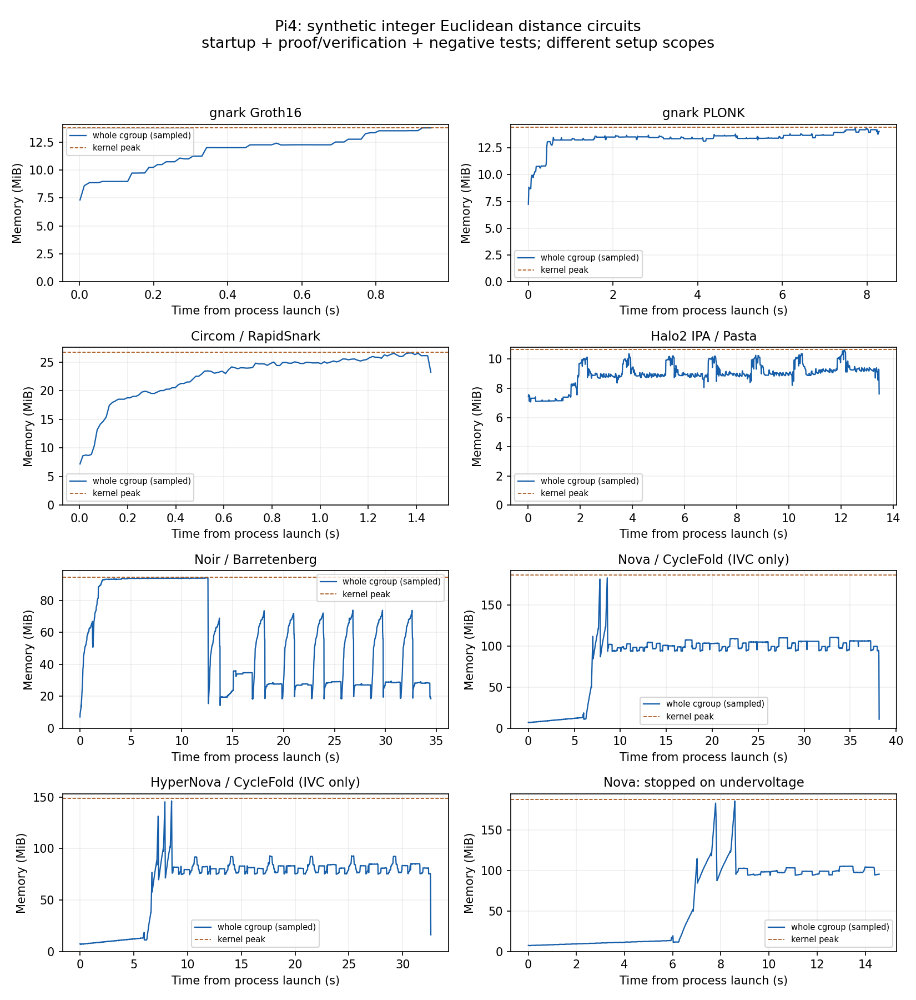

# ユークリッド距離回路：7構成のPi4実装と実行結果

2026-10-13。Issue [#44](https://github.com/SMRI2170/zkp-m1-v2/issues/44)。
**同じ整数距離関係を7構成で実装し、Pi4上で実際の証明生成・native検証に成功した。**
Nova／HyperNovaは単一ProverのIVC検証までであり、外部提出用の最終ZKは未実装。
実キャプチャ、実座標、RID署名、DRIP、センサーの真値、航空機・observer hardware認証は含まない。

## 共通の計算

privateのu16座標 `(x1,y1),(x2,y2)` から、publicの
`d2=(x1-x2)²+(y1-y2)²` と `r=floor(sqrt(d2))` を検証する。
平方根の候補をwitness生成時に整数計算し、回路は
`r² ≤ d2 < (r+1)²` とすべてのbit範囲を拘束する。
浮動小数点やGPS座標ではなく、同じ単位を持つ合成整数座標の2次元距離である。
最大d2は8,589,672,450、最大rは92,680。

全回路でu16×4、d2のu33、rのu17、2つの差分のu18を検査する。
これにより負の差分のfield wrapを「非負の差分」として通さない。
Noirのpublic型はu64/u32に上限を追加、Halo2はPasta、他はBN254。
[仕様・再現手順](../experiments/pi4-euclidean/README.md)、
[独立Python整数oracle](../experiments/pi4-euclidean/reference.py)、
[7ケースの期待値](logs/euclidean-reference.json)。

Nova／HyperNovaはstate `[step_count,last_d2,last_r]` を更新する。
終端stateは最後の距離とstep数を拘束し、過去の距離すべてを公開する構成ではない。
単発ZKPとのpublic statementの差を維持し、同じ完成ZK製品として比較しない。

## Pi実行と短期測定

Pi4 Model B Rev1.5、4GB、Debian12、aarch64。Linux ARM64でnative実行。
1CPU affinity、GOMAXPROCS／RAYON／OMP各1、同時に1方式。
表は最終採用runの標本中央値。gnarkはwarmup1＋20測定、他は7ケース各1回。
採用7runで正常verify **77回（測定75、warmup2）**。
各runのsetup・負例・verificationも全体のメモリ計測に含む。

| 構成 | Pi成功数 | 生成中央値 ms | 検証中央値 ms | unit peak MiB | 実装／ログ |
|---|---:|---:|---:|---:|---|
| gnark Groth16 | 21/21 | 30.120 | 7.597 | 13.758 | [Go](../experiments/pi4-euclidean/gnark/main.go)／[run](logs/pi-euclidean/euclidean-groth16-v1/benchmark.jsonl) |
| gnark PLONK | 21/21 | 384.322 | 12.782 | 14.426 | 同じDefine・SCS／[run](logs/pi-euclidean/euclidean-plonk-v1/benchmark.jsonl) |
| Circom／RapidSnark Groth16 | 7/7 | 44.595 | 20.283 | 26.719 | [Circom](../experiments/pi4-euclidean/circom/euclidean.circom)／[run](logs/pi-euclidean/euclidean-rapid-v3/benchmark.jsonl) |
| Halo2 IPA／Pasta | 7/7 | 1,512.194 | 50.993 | 10.660 | [Rust](../experiments/pi4-euclidean/halo2/src/main.rs)／[run](logs/pi-euclidean/euclidean-halo2-v2/benchmark.jsonl) |
| Noir／Barretenberg UltraHonk | 7/7 | 1,672.926 | 26.701 | 94.328 | [Noir](../experiments/pi4-euclidean/noir/src/main.nr)／[run](logs/pi-euclidean/euclidean-noir-v1/benchmark.jsonl) |
| Nova／CycleFold：IVC | 7/7 | 1,900.211 | 2,946.231 | 187.086 | [Rust](../experiments/pi4-euclidean/sonobe/src/main.rs)／[run](logs/pi-euclidean/euclidean-nova-v2/benchmark.jsonl) |
| HyperNova／CycleFold：IVC | 7/7 | 1,767.926 | 1,985.239 | 148.887 | 同じFCircuit／[run](logs/pi-euclidean/euclidean-hypernova-v1/benchmark.jsonl) |

**この表だけで最速方式・1Hz適合性を決定しない。** setup・公開statement・反復条件が異なる。

- gnark：Macで鍵生成しPiでkey load・witness・prove・verify。R1CS163、SCS311制約。
- Circom：154非線形＋9線形制約。Macでcompile／鍵生成。PiのWASM witness計算とnative CLI起動を分離。生成・検証時間にそれぞれCLI起動を含む。
- Halo2：k=9、Params／keygenをPi内で実施。setupは約1.84秒、表の生成時間とは別。
- Noir：beta25とbb5.2.0。`nargo execute`のcompile＋witnessは約1.16秒/件で表の生成時間に含めない。bb生成はVK生成を含み、初回にはCRS取得・cold処理が含まれる。初回約3.165秒、残りは約1.67秒。`-t evm`のZKモードでnative検証し、EVM deployは行わない。
- Nova／HyperNova：163制約の同一FCircuit。Pi内でpreprocess／keysを生成する。表の生成は1stepのIVC更新、検証はraw IVC verify。公開state3値の改変拒否を各stepで3回追加検証するため、unit全体の経過時間にはその負例も含む。最終ZK・Deciderは含まない。

raw IVCはWitnessを含む。今回の成功は端末内の単一Prover計算であり、
Week23で不採用にした「跨Prover元Witness非共有」が実現したという意味ではない。
Go/RustはMac上でLinux ARM64へcross compileし、PiにGo/Rust compiler一式は入れていない。
RapidSnarkのみPiで単一jobビルドし、ビルドpeak約377.38MiB、約64.8秒。
Piにはlibgmp-dev・nlohmann-json3-dev・nasmを追加。OS／kernel更新や追加reboot操作は実施していない。

## 正当性と改変拒否

共通7ケースはzero、3-4-5、逆順、非平方数、最大差、最大差の逆順、隣接。
期待値はPython `math.isqrt`、gnarkテストは独立の `big.Int.Sqrt` で照合する。

| 構成 | 実施した拒否試験 |
|---|---|
| gnark両方式 | public d2改変、serialized proof改変、誤出力assignment、座標u16範囲外、root上下誤り／範囲外、負座標等。Piで9種類のinvalid assignmentを拒否。hostで107入力に各4正常／異常判定＋範囲外2を各CS builderで検査 |
| Circom／RapidSnark | 各正常proofのpublicとproof改変を拒否、generatorで6invalid入力を拒否。加えてgeneratorを迂回しWTNSのpublic d2を変更：proverはproofを返したがnative verifierが拒否。生成成功と検証成功を区別 |
| Halo2 | MockProverで7正常・6異常。実proof7件それぞれpublic・proof改変を拒否。入力APIはu64、u16を超える値を制約で拒否 |
| Noir／bb | Piで12 Noir unit test（7正常・5異常）と7件の実proof。各proofのpublic・proof改変を拒否。private coordinateはu16型 |
| Nova／HyperNova | relation単体で7正常・6異常（負座標のfield表現も含む）。IVC各7stepでcount・d2・rの改変を個別拒否、各方式21回のstate改変拒否 |

RapidSnark／Noirはさらに追加audit各7件を実施し、負例verifierの終了コードが通常のinvalid-proof `1`であることを確認した。timeout／signal／crashを拒否成功として数えない。これら14件は上の初回測定表へ混ぜず、別runへ保存する。

proof改変の拒否はdecode／曲線点形式・検証のいずれかであり、常にdecode成功後の検証失敗とは主張しない。
公開値から座標候補を絞れるため、これは観測秘匿の定量的評価ではない。

## メモリ統計とSSH保護

各試験をweek24.slice内に置き、親1.5GiB・Swap0、OS available1GiBを維持。
子はgnark／RapidSnark／Halo2が256MiB、IVCが512MiB、Noirが1024MiB。
root所有watchdogは実験sliceの外で動き、SSHのOOMScoreAdjust=-900。
10msで全cgroup、command leaderのRSS/PSS/HWM、system available／swapを計測。
CLIの孫processをleader RSSへ足していないので、方式横断のメモリ表はcgroupを使用する。

| 構成 | メモリp50 MiB | p95 MiB | p99 MiB | kernel peak MiB |
|---|---:|---:|---:|---:|
| gnark Groth16 | 12.234 | 13.512 | 13.758 | 13.758 |
| gnark PLONK | 13.484 | 14.168 | 14.184 | 14.426 |
| RapidSnark | 24.156 | 26.305 | 26.584 | 26.719 |
| Halo2 | 8.977 | 10.116 | 10.371 | 10.660 |
| Noir／bb | 54.396 | 93.855 | 93.960 | 94.328 |
| Nova／CycleFold | 99.441 | 110.191 | 121.895 | 187.086 |
| HyperNova／CycleFold | 79.877 | 92.062 | 101.991 | 148.887 |

各runの`memory-summary.json`に平均・母標準偏差・分位点・時間重み・OLSを保存。
分位点は標本の線形補間、時間重みは前sampleを次sampleまで保持。
短いstartup込みの系列からリークや長期1Hz性能は推定しない。
採用7runではOOM／high／maxイベント増分0、実験とsystemのSwap使用0、現在power flagsの下位4bitは全sample0。
stickyの過去低電圧／throttling値`0x50000`は消えておらず報告へ維持する。

[図の再生成](../experiments/pi4-euclidean/plot_memory.py)、
[最終Pi health](logs/euclidean-final-health.json)。
最終snapshotは利用可能メモリ約3.26GiB、Swap0、guard active、SSH -900、専用tmpfs残存0。
電源やネットワークによる再起動・接続断はメモリ保護だけでは防止できない。

## 失敗を残した内容

1. **Nova初回v1：低電圧停止。** 現在power flagsが`0x50005`になりrunnerがSIGTERMで停止。peak約187.6MiB、OOM0、Swap0。成功runへ混ぜない。[resource](logs/pi-euclidean/euclidean-nova-v1/resource.json)。v2は同じ上限・回路・電源停止条件のまま成功。
2. **Circom初回v1：未貢献セットアップの退化。** 初期Powers of Tauとzkeyに乱数貢献せず、VKのIC3点（定数項を含む）がすべて単位元となり、public変更を受け入れた。正当性試験を失敗扱いにした。[stderr](logs/pi-euclidean/euclidean-rapid-v1/stderr.log)。新規v2 fixtureでphase1／phase2貢献・検証を実施し、source・artifact hashを固定。最終runnerは未貢献fixtureを拒否。改変拒否を通すために回路や試験を弱めていない。
3. **転送中の接続断／Pi再起動。** Nova v2を開始する前、binary転送中に接続断。再接続時にuptime約1分、runtime guard inactiveを確認。現在／前bootのkernel logに低電圧記録があり、確認できた範囲ではOOM該当0。電源が再起動の原因と断定する十分な記録はなく、電源・ケーブルの確認を依頼した。部分転送のbinaryはhash不一致として使わず保存し、別名の完成binaryを再転送・照合。guard再設置後に測定を再開した。

Circomの修正版もsingle-contributorの使い捨てTEST setupで、release keyやチェーンdeploy用ではない。
Witness／proof／VKの実体は公開logへ入れず、CLI用一時データはowner-only tmpfsで処理・削除。

## 版固定・検査・残件

[framework/source/binary manifest](manifests/euclidean-frameworks.json)、
[gnark build manifest](manifests/euclidean-gnark-build.json)。
Sonobe PR246 head `9c4e61f8d1a5be87c00f28838a0ef657a3cf479f`＋既存arkworks0.6互換patch。
[source94ファイルのhash](../experiments/pi4-euclidean/sonobe/source-sha256.json)。
RapidSnark commit `81eddf1a536d26497b237c0b8a04fe90baf7e439`、OpenMP OFF、ARM64 ASM ON、system GMP。
Noir beta25はbb5.2.0のvendored commitと照合。rc2は取得のみで、このproof試験には使わない。

ローカル：Python61、aggregator Go、contracts48、新規gnark整数oracleテスト、Noir12 testが成功。
CIにgnark回路テストと公開Piログのschema／hash／failure維持の検査を追加。
CIはPi試験を再実行するものではない。

**今回の共通距離回路とPiスモークは完了。**
残るWeek24全体の作業は、同等RSSI回路、時系列600step、1Hz pipeline、1h／24h評価、
IVCの最終ZK／Decider、Besuへの接続、モバイル比較。7方式の最終採否はまだ決定しない。
