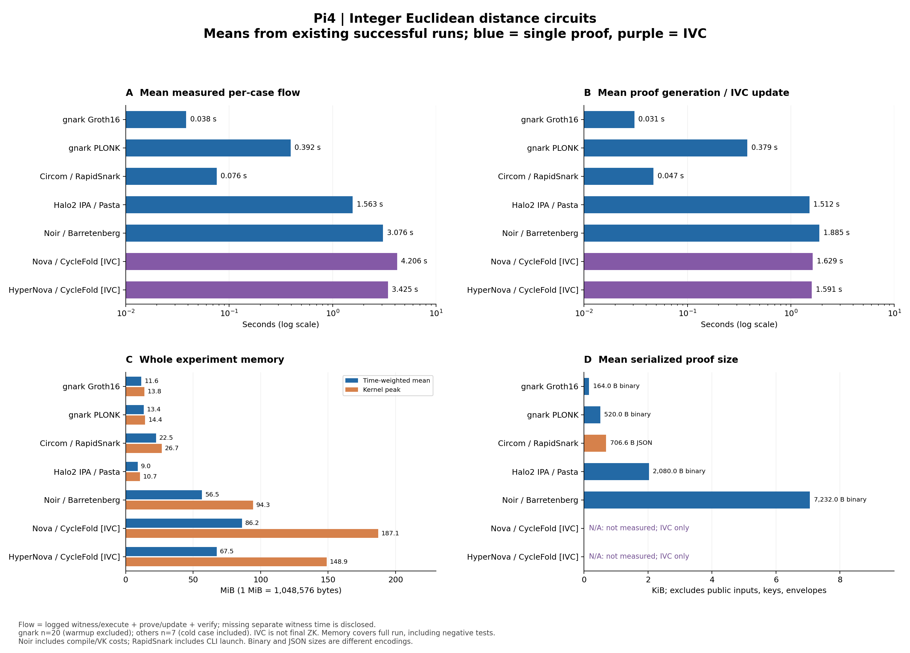
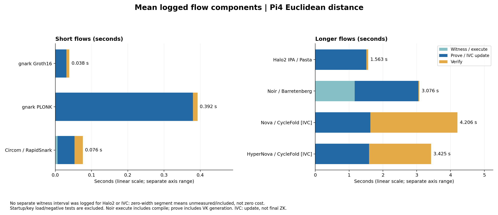

# ユークリッド距離：平均処理時間・メモリ・証明サイズの比較

作成2026-10-14。[実機実験03](03_ユークリッド距離_各方式のPi実装.md)の成功7run、合計75測定ケースを集計した。
今回は既存ログの可視化であり、Piでの追加実験は実施していない。
対象は合成u16整数座標の2次元距離とfloor sqrt。実観測や航空機認証の評価ではない。



- A：1件／1stepの計測済みフローの算術平均。ログのWitness／execute、生成／IVC更新、検証を合計。グラフの時間軸は対数。
- B：生成／IVC更新だけの算術平均。Folding単体の時間を分離計測したものではない。
- C：実験cgroup全体の時間重み付き平均メモリとkernel peak。平均は前sampleの値を次sampleまで保持して積分し、観測区間の長さで割る。
- D：proof単体のシリアライズサイズの算術平均。public入力、鍵、通信envelopeは含めない。RapidSnarkはJSON、他の測定済み方式はnative binary。形式が揃った通信量ではない。

Nova／HyperNovaのraw IVCサイズは未計測（N/A）。0バイトではなく、外部提出用の最終ZK証明も未実装。

## 平均値の一覧

|方式|標本数|平均フロー ms|平均生成／更新 ms|平均検証 ms|平均メモリ MiB|peak MiB|平均proof B|
|---|---:|---:|---:|---:|---:|---:|---:|
|gnark Groth16|20|38.414|30.681|7.624|11.608|13.758|164.0|
|gnark PLONK|20|392.382|379.445|12.818|13.350|14.426|520.0|
|Circom / RapidSnark|7|75.829|46.977|22.518|22.478|26.719|706.6 JSON|
|Halo2 IPA / Pasta|7|1,562.699|1,511.562|51.137|8.955|10.660|2,080.0|
|Noir / Barretenberg|7|3,076.073|1,884.956|26.621|56.546|94.328|7,232.0|
|Nova / CycleFold（IVCのみ）|7|4,205.892|1,629.253|2,576.639|86.236|187.086|N/A|
|HyperNova / CycleFold（IVCのみ）|7|3,424.632|1,591.433|1,833.199|67.498|148.887|N/A|

平均メモリはcgroupの時間重み付き平均。個別processのRSSではなく、Python／Node runner・子processを含む。
単位は1 MiB=1,048,576 B、1 KiB=1,024 B。
[集計JSON](logs/euclidean-comparison-summary.json)には算術平均・母標準偏差・min/max・p95、元ログSHA256、図生成script hash・library版を保存した。
母標準偏差とp95は標本の記述統計であり、独立標本や信頼区間を仮定しない。p95は線形補間。

## フローの内訳と測定範囲



内訳図は線形軸。短い3方式と長い4方式で横軸の範囲が異なる。

|方式|平均フローへ合計した区間|準備・条件の違い|
|---|---|---|
|gnark両方式|Witness＋prove＋verify|warmup1を除外し20回を平均。Pi compile／key loadは除外、鍵生成はMac|
|Circom／RapidSnark|WASM Witness＋native prove CLI＋native verify CLI|7ケース各1回、CLI起動を含む。compile／setupはMac|
|Halo2|create_proof＋verify|7ケース各1回。Witness処理はcreate_proof内。Params／keygenは平均フローから除外|
|Noir／bb|nargo execute＋prove/write_vk＋verify|executeはcompile＋Witness、生成はVK生成を含む。7ケースのcold初回も平均へ含む|
|Nova／HyperNova|IVC prove/update＋raw IVC verify|7step。独立反復ではなく順序付き。別のWitness時間は未計測、preprocess／keygenは平均フローから除外|

プロセス起動全体、待ち行列、センサー取得、停止処理、負例の検証時間はAのフローに含まれない。
反対にCのメモリは起動・準備・負例を含むrun全体を対象とするため、Aとは区間が異なる。
Halo2／IVCのWitnessの棒がないのは「未分離／内包」であり、処理コストが0という意味ではない。

Noirはcold初回のproof生成が約3.165秒、以降約1.67秒で、生成平均は約1.885秒となる。
前報告03の中央値と今回の平均を混同しない。
IVCのstep数や初回条件が混在する短い測定から、1Hz性能、長期リーク、最終ZK完成時の優位性は判定しない。

## 再生成と公開データの境界

```sh
python3 experiments/pi4-euclidean/plot_comparison.py
python3 experiments/pi4-euclidean/check_results.py
```

[図生成script](../experiments/pi4-euclidean/plot_comparison.py)は公開済みの時間・メモリ・サイズmetadataのみを読む。
秘密Witness、VK／PK、proof実体、実キャプチャは読まず、図・JSONへ追加しない。
全runの時間平均は各ケースの区間を足してから平均し、区間別平均の合計とも照合。
メモリの時間重み付き平均は生ログから再計算し、既存memory-summaryと照合している。
失敗run、追加negative-exit audit、以前の重複runはこの平均に混ぜない。

PNGに加え、編集・拡大用の[比較図SVG](plots/euclidean-pi-comparison.svg)と
[内訳図SVG](plots/euclidean-pi-flow-breakdown.svg)も保存した。
