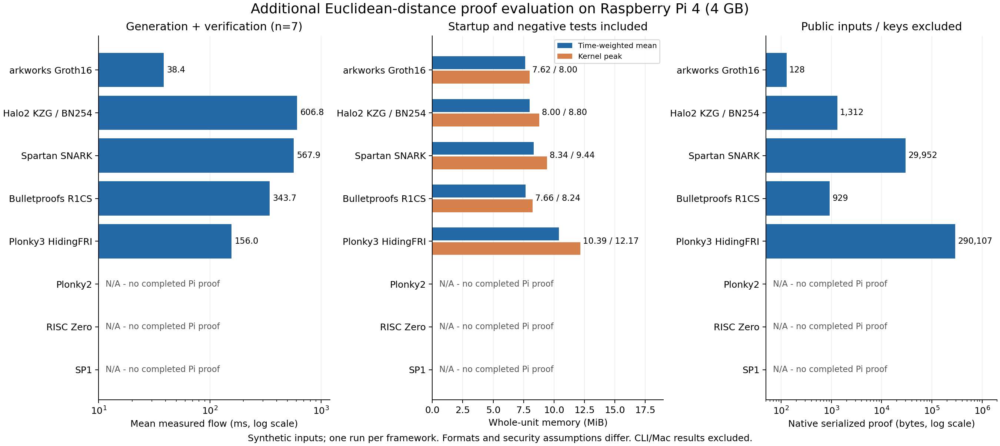

# 追加フレームワークのPi評価（2026-10-14）

Issue [#44](https://github.com/SMRI2170/zkp-m1-v2/issues/44)／[#45](https://github.com/SMRI2170/zkp-m1-v2/issues/45)の追加候補を評価した。**arkworks Groth16、Halo2 KZG、Spartan、Bulletproofs、Plonky3の5方式で、Pi4 4GB上の証明生成・検証が各7件成功**した。既存7構成と合わせて12構成の実行記録がある。ただしNova／HyperNovaの2構成はIVCであり、外部提出用の最終ZK証明は未完成のまま。

Plonky2はビルド成功後にPiで3回試行したが、証明完了前に監視失敗・再起動・低電圧停止が発生した。RISC Zero／SP1は資源・ツール条件までの評価で、実証明の時間・メモリ・サイズは未測定。SP1のARM64 CLI起動を証明成功に数えていない。

## 成功した5方式

|方式|平均フロー ms|平均メモリ MiB|peak MiB|平均proof bytes|正常／改竄検査|
|---|---:|---:|---:|---:|---|
|arkworks Groth16 BN254|38.380|7.621|8.000|128|7/7成功、全件public d2・r・proof改変拒否|
|Halo2 KZG BN254|606.816|8.003|8.797|1,312|7/7成功、全件public d2・proof改変拒否（r単独改変は未計測）|
|Spartan SNARK Ristretto|567.852|8.341|9.438|29,952|同上|
|Bulletproofs R1CS Ristretto|343.709|7.661|8.242|929|同上|
|Plonky3 HidingFRI Goldilocks|155.971|10.386|12.168|290,107.3|同上|

[SVG](plots/euclidean-additional.svg)、[集計JSON](logs/euclidean-additional-summary.json)、[生成スクリプト](../experiments/pi4-euclidean-additional/plot_evaluation.py)。既存7構成の結果は[04](04_ユークリッド距離_平均処理時間とサイズ比較.md)に保持した。

フローは各入力の記録済みwitness（別計測されている場合）＋prove＋verifyの合計。未計測witness時間をゼロと解釈しない。setup、プロセス開始、負例検査、停止時間は含まない。メモリはそれらを含むrunnerと全子プロセスのcgroup全体で、平均は10ms間隔の観測値を次の観測まで保持する時間加重平均、peakはkernel値。各方式1run・異なる合成入力7件であり、独立した反復試行による信頼区間ではない。

入力は既存と同じprivate u16座標4つ、public u33距離平方d2とu17整数平方根r、u18 slack2つ。ゼロ、3–4–5、座標反転、非整数平方根、u16最大端点を含む。各方式で不正な平方根・出力・範囲外・負座標の6ケースも拒否した。曲線、security仮定、proof形式が異なるため、この表だけで普遍的な速度順位や採用を決められない。サイズはnative serialized proofのみで、公開入力・鍵・通信包絡を含まない。

成功runの子unitはMemoryHigh192MiB／Max256MiB／Swap0、親sliceはHigh1200MiB／Max1536MiB／Swap0。OS available1GiB停止、slice外watchdog、SSH OOM score -900を確認して実行した。5成功runでOOM・OOM kill・swap使用の増加は0、現在の低電圧／throttle bitsは0だった。履歴bit `0x50000` は残るため、電源に過去の問題がなかったという意味ではない。

## 実装・依存問題の評価

- **arkworks 0.6.0**：GR1CSで163制約、Groth16 BN254。Piでsetup140.008ms、compressed PK34,256B／VK328Bはサイズだけ記録。使い捨て単独setupの鍵・proof・assignmentはRAMのみで、公開・deployしていない。[上流](https://github.com/arkworks-rs/groth16)。
- **Halo2 KZG**：PSE `be955686`（v2023_04_20）を固定、k9、SHPLONK／Blake2b native verifier。既存IPA/Pastaとbackendを区別した。ランダムtest SRSをPiで生成し、setup1,422.854ms。2026-08-17にarchiveされたrepoの旧tagで、最新保守版として扱わない。EVM verifierは未評価。[上流](https://github.com/privacy-ethereum/halo2)。
- **Spartan**：Microsoft `d62b961f`、SNARKを直接生成。163制約／158private変数を256へpadしpublic2を別vectorに拘束。trusted setup不要。SonobeのDeciderや跨Prover秘匿引継ぎの検証ではない。[上流](https://github.com/microsoft/Spartan)。
- **Bulletproofs**：zkcrypto `04bce4e6`（5.0.1）。公開5.0.0のCtOption API不整合を上流修正で解消。ARM64 C helperはclang＋llvm-arでlinkし、clear_on_dropの消去を無効化していない。R1CS `yoloproofs` は上流でも実験的API。端末署名・実観測commitmentは含めていない。[上流](https://github.com/zkcrypto/bulletproofs)。初回は低電圧停止、同じ回路・制限のv2で成功したため、長期安定性は未評価。
- **Plonky3**：`f9833168`（0.8.0）、Goldilocks AIR、HidingFriPcs、value／challenge双方のhiding MMCS、Keccak、OS由来乱数。初期trace8は `HidingBudgetExceeded`。queries100／blowup2／query PoW16／batch PoW10を保ったままtrace256へ拡張し、Piで成功した。1入力を256行で反復するAIRであり、256独立観測の処理ではない。Macでの失敗・修正後検査ログも別保存し、Piグラフには入れていない。[上流](https://github.com/Plonky3/Plonky3)。

## 完了しなかった方式と理由

|方式|確認できたこと|未完了理由／次の条件|
|---|---|---|
|Plonky2 `5d9da5a6`|nightly固定でLinux ARM64ビルド、Piで回路構築（degree14）|3試行ともproof未完了。安定した電源・ケーブルと現在の低電圧bit解消を先に確認し、その後同じ安全条件で再測定|
|RISC Zero 3.0.6|公式資源条件・release asset確認|公式local proving推奨16GB以上が今回の1.5GiB実験上限を超える。固定releaseにはLinux ARM64 CLI assetなし。高メモリ環境とsource build／toolchainを準備した実proof評価が残る|
|SP1 6.9.0|公式Linux ARM64 CLI hash照合、Piでversion表示成功|公式Core／Compress・Groth16は16GB以上、PLONK64GB以上。guest実装・実proof・verifyは未実行。CLI時間は証明性能に含めない|

資源条件の一次資料：[RISC Zero zkVM](https://dev.risczero.com/api/zkvm)、[SP1 hardware requirements](https://docs.succinct.xyz/docs/sp1/getting-started/hardware-requirements)。これらは公式推奨／条件であって、この小さな回路を実行してOOMを実測した結果ではない。Piで絶対に実行不能という結論にもしていない。

Plonky2は上流のZK configを使用し、security設定を弱めて実行を通していない。上流はdeprecatedとし、nominal100bits設定でもPoseidonに約95bitsの注記があるため、他方式と同一security水準だとは主張しない。[上流README](https://github.com/0xPolygonZero/plonky2)。

Plonky2の停止記録は次の通り。失敗runを削除・再利用せず保存した。

1. **v1：Max512MiB**。回路構築15.282秒。証明中 `vcgencmd` が2秒でtimeoutしunit終了。sampled最大396.598MiB、OS available最小2.873GiB。最終resource／kernel peakは未取得。
2. **v2：Max1536MiB**。回路構築15.095秒後にSSH切断。再接続時の短いuptimeとguard消失から再起動を確認した。sampled最大553.691MiB、available最小2.721GiB。最後のメモリ1行は途中で切れたまま保存。再起動の原因は断定できない。
3. **v3：Max1536MiB・CPUQuota25%**。低電圧／throttle `0x50005` を検知しrunnerがprocess groupを停止。peak84.613MiB、OOM／OOM kill増加0、swap0。切断時には元resourceファイルを取得できなかったため、SSH consoleの値を出所付き [terminal-resource.json](logs/pi-euclidean-additional/additional-plonky2-cpu25-v3/terminal-resource.json) に保存。SSH復旧後に元 [resource.json](logs/pi-euclidean-additional/additional-plonky2-cpu25-v3/resource.json) も取得し、console記録との一致を確認した。失敗runの記録として保持する。

確認範囲にOOMの証拠はなく、v3では低電圧を直接観測した。SSH切断をメモリ不足と決めつけられない。runtime guardは再起動で消える。最後の切断後にSSHは復旧し、消失したguardを再設置した。[終了時health](logs/euclidean-additional-final-health.json)ではavailable約3.26GiB、swap0、現在throttle bits0、watchdog稼働、SSH -900を確認した。その後のproof負荷はかけていない。次回の再起動後にもguardを再設置し、電源状態を確認する必要がある。

## 再現・残件

[ソースとビルド手順](../experiments/pi4-euclidean-additional/README.md)、[source／binary manifest](manifests/euclidean-additional.json)、[成功・失敗状態JSON](logs/euclidean-additional-evaluation.json)、[生ログ](logs/pi-euclidean-additional/)。native binaryはhost／PiでSHA256一致を確認。鍵・proof実体はGitに追加していない。

追加runnerは監視例外でも子process groupを停止するよう改善した。メモリ保護は電圧不足や電源断を防ぐものではない。安全条件を弱める再試行はしない。

残件はHalo2 KZGのr単独改変テスト、Plonky2の電源安定後の実proof、zkVM2方式の実proof、各方式の反復・長期測定、EVM適合性、最終ZK／再帰・RSSI・FFI評価。Week23の跨Prover Sonobe／HyperNova不採用判断は維持する。

この合成距離PoCは数学的関係の検証であり、実観測の正しさ、DRIP trust chain、observer hardwareや航空機の認証、production safetyを証明しない。
