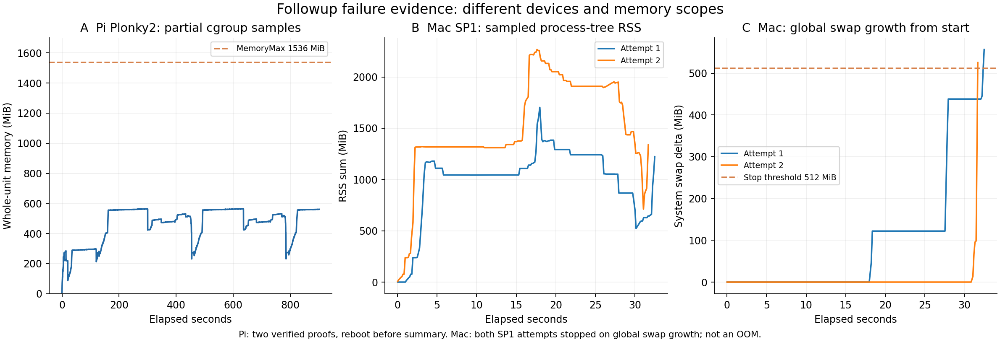

# 未完了方式の追加実行（2026-10-14）

[05の未完了・残件](05_追加フレームワークのPi評価.md)を追加実行した。**Plonky2はPiで2件の実証明と改竄拒否が成功、Macでは7件すべて成功。RISC ZeroはMacで実証明が成功。Halo2 KZGの公開r単独改変テストもPiで7件完了**した。SP1はguest／proverのビルドまで成功したが、実証明は保護停止で未完了。

|方式|今回の結果|残る条件・理由|
|---|---|---|
|Plonky2|Piで2件の生成・検証、公開d2／r／proof改変拒否。Macで7件＋6不正関係拒否|Piで約15分後にSSH切断・再起動。7件全体のsummaryなし。安定した電源・ケーブルを確認するまで長いPi実行を止める|
|Halo2 KZG|Piで7件の正常検証、d2／r単独改変・proof改変拒否、6負例拒否|今回の負例検査は完了。EVM／長期／反復測定は別件|
|RISC Zero3.0.6|Macで1件のComposite receipt生成・検証。journal改変・別image ID拒否|Pi向けcross checkはLinux ARM64 sysroot／stddef.h不足で失敗。Piの実proofは未実行|
|SP1 6.9.0|合成guestとlocal CPU proverをビルド。実proverを2回起動|両回ともMac全体swap増分512MiB超過で保護停止。Pi向けcross checkもLinux ARM64 sysroot／assert.h不足。検証済みproofなし|

「Piでは動作しない／ライブラリが非対応」と一括した結論にはしない。実行成功、ビルド環境の不足、資源保護による中断、未測定を区別する。

## Plonky2：Piで証明経路を確認

元のsource・binary・ZK configは変えていない。CPUQuota25%、子／親Max1536MiB、Swap0、OS available1GiB停止、slice外watchdog、SSH OOM score -900で `additional-plonky2-cpu25-v4` を実行。degree14・nominal security100を維持した。

|case|prove ms|verify ms|proof＋public bytes|
|---|---:|---:|---:|
|0（ゼロ距離）|331,087.320|108.761|148,820|
|1（3–4–5）|330,211.355|191.186|148,820|

どちらも正常検証と公開d2・r・proof改変拒否が成功。サイズはpublic16Bを含む形式で、既存のproof-only比較に混ぜない。CPU25%条件のため、CPU100%で測った[04](04_ユークリッド距離_平均処理時間とサイズ比較.md)の時間表にも混ぜない。

約15分後にSSHが切れ、再接続時uptime約1分で再起動を確認。設定した20分timeoutまで待って終了した記録ではなく、最終resource／kernel peak／exit codeはない。回収した8436件の完全なメモリ観測はsampled最大564.406MiB、OS available最小約2.698GiB、swap0。最後の1行はNULを含む不完全行のまま保持した。[partial summary](logs/pi-euclidean-followup/additional-plonky2-cpu25-v4/partial-memory-summary.json)。

最後の観測だけでは再起動の原因を断定できない。終了時の確認範囲では現在／前bootのkernel OOM matchesは0、undervoltage matchesは3／2。低電圧の記録はあるが、それだけでv4の再起動原因を確定していない。メモリ保護では電源断を防げない。

Macでは同じsourceで7件と6不正関係検査が完了。平均記録フロー6,336.080ms、proof＋public148,820B、`time -l` peak memory footprint673,596,304B。これはMacの値で、Piのメモリ統計ではない。[Macログ](logs/plonky2-followup-host.jsonl)。

## Halo2 KZG：r単独改変の拒否

元packageを保持し、[別package](../experiments/pi4-euclidean-followup/halo2-kzg/src/main.rs)で `fake_root[1] += 1` の独立検査を追加。Piで7件すべて成功し、元のd2改変・proof改変・6不正関係検査も維持した。使い捨てSRSはRAMのみ、publish／deployなし。

今回だけCPUQuota25%を使用。平均フロー4,415.857ms、unit peak11,599,872B（11.062MiB）、swap0、OOM events増加0、現在低電圧bits0。[生ログ](logs/pi-euclidean-followup/additional-halo2-kzg-root-v2/benchmark.jsonl)。CPU条件が違うため元の606.816msを上書きしていない。

## zkVM：guestから実proverまで

両guestとも合成private座標4つをreadし、同じ16／33／17／18bit条件と距離平方・整数平方根をassert、公開するのはd2とrだけ。実観測の真値、DRIP、observer hardware、航空機認証の証明ではない。

### RISC Zero

公式CLI3.0.6、rzup0.5.0、guest Rust1.88.0を導入。固定guest Rustより新しいMSRVを要求したruint／enum-ordinalizeは、上流v3.0.6のlockに合わせ1.16.0／4.3.0・derive4.3.1へ固定した。制約や検証を弱めていない。

Mac proverの初回buildはMetalToolchain不足で失敗し、Xcode公式componentを導入して解消。Docker CLIはあったがdaemonが起動していなかったためnative buildへ進めた。最初のproof実行はbare ELFを渡して `Malformed ProgramBinary`。上流risc0-buildと同じV1COMPAT kernel＋user ELFのProgramBinaryに包んで解消した。失敗ログも保存している。

**修正後のMac実proofは成功**：生成21,212.531ms、検証24.510ms、serialized Composite receipt209,594B。journal改変と異なるimage IDは拒否。dev-modeをcompile featureで無効化し、明示的LocalProverを使った。Bonsai／network／mockは使っていない。再帰・Groth16 wrapperは未評価。[成功ログ](logs/zkvm-followup/risc0-host-proof-v2/benchmark.jsonl)。

soft monitorで観測したprocess-tree RSS peak334,495,744B（319MiB）。Piのcgroup peakと同じ指標ではない。公式16GB推奨をこの小さなguestの硬い必要量と扱わず、今回の実測を分ける。Pi向けcross checkではnvtxのC compileが `stddef.h` 不足で失敗。Linux ARM64のsysroot／native build環境を準備したうえで、安定したPi電源下の実proofが残る。

### SP1

公式CLI6.9.0のMac archive hashをrelease digestと照合し、対応するsuccinct Rust toolchainを導入。RISC-V64 guestとMac local CPU proverがビルド成功。SDKはnetwork featureなし、`ProverClient::builder().cpu()` を明示した。

実proverの試行は2回とも正常proof summaryまで到達しなかった。Mac全体swap増分512MiBを超えたためmonitorがprocess groupを停止。初回はRISC Zeroの構築終了時期と重なったため、構築終了後にSP1単独でも再実行し、同じ停止条件に達した。OOMや暗号検証失敗ではなく、このMacの現在の資源余裕と保護条件による中断である。全体swap増分をSP1だけの使用量とは解釈しない。

Pi向けcross checkもBlake3 NEONのC compileが `assert.h` 不足で失敗。Linux ARM64 sysrootと、core runnerをtargetに合わせるビルド整備が必要。上流runner build scriptはhost向けhelperを構築するため、cross build時は正しいtargetのhelperも確認する必要がある。[固定版のbuild script](https://github.com/succinctlabs/sp1/blob/b8387fa61e1361d90ee7de49f551863418ca0f08/crates/core/runner/build.rs)。

今回試したのはCore経路。CompressedやGroth16／PLONK、最終ZK wrapperの成功ではない。[公式proof種類](https://docs.succinct.xyz/docs/sp1/generating-proofs/proof-types)、[公式資源条件](https://docs.succinct.xyz/docs/sp1/getting-started/hardware-requirements)。

[SVG](plots/euclidean-followup-memory.svg)。Piはcgroup、Macはprocess-tree RSSとOS全体swap増分で、同じメモリ指標の比較ではない。Piの最後の不完全行は描画から除き、生ログには保持した。

## 安全条件と結論

Mac monitorは100ms samplingのprocess-tree RSS4GiB／システムswap増分512MiB／timeout600秒。hard cgroup limitではない。PiとMacの時間／サイズ／メモリ指標を混ぜず、CLI起動・guest build・実proofも分けた。

Pi再起動後にruntime guardを再設置した。[終了時health](logs/euclidean-followup-final-health.json)でwatchdog／親slice稼働、SSH -900、swap0、現在低電圧bits0を確認。長いPi試行は電源が安定するまで追加しない。

次の実行条件は、Piの電源安定、Linux ARM64 build環境、SP1を安全に実行できるメモリ余裕。今回の研究用距離PoCの選定は、実測と運用条件から引き続きgnark Groth16が第一候補。RISC Zero／Plonky2も「検証不能」ではなく、対象環境の評価完了度とコストが異なる。

[source／binary manifest](manifests/euclidean-followup.json)、[評価状態JSON](logs/euclidean-followup-evaluation.json)。

[ソース・再現手順](../experiments/pi4-euclidean-followup/README.md)。秘密assignment、使い捨てsetup鍵、VK／proof実体をGitに追加・公開・deployしていない。Week23の跨Prover Sonobe／HyperNova不採用判断は維持。Nova／HyperNovaの端末内IVCと最終ZK未完成も今回変更していない。
