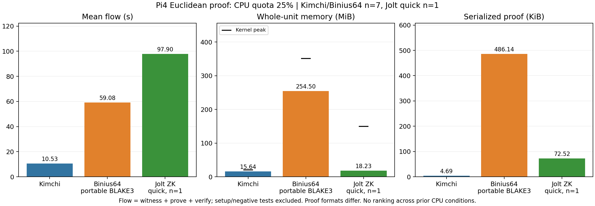

# Week24：Kimchi・Binius64・Joltを追加

3方式に同じ合成整数ユークリッド距離を実装し、MacとPi4で実proof生成・検証を確認した。
Kimchi／Binius64はPiで正常7件、JoltはPiで正常1件＋不正2件のquick実行。Macでは3方式とも正常7件。
JoltのPi全7件・反復／長時間評価は未完了。Issue #44／#45はOPENを維持する。

これは研究PoC。座標は合成値であり、実RID、sensorの真実性、DRIP trust chain、observer hardware、航空機認証を検証する実験ではない。
Week23の跨Prover状態引継ぎ不採用は変更しない。今回は各端末内の単一ProverのZK評価。

## Piで得られた値

Pi4B 4GB、Debian12 ARM64、1 CPU affinity・1 thread・CPUQuota25%。
フローはwitness＋prove＋verify、setup・改竄拒否・不正入力検査を除く。
メモリはsetupと負例を含むunit全体（runner・child込み）の時間加重平均／kernel peak。
正常7件は異なる合成ケースで、同じ入力の独立反復ではない。Joltのn=1にはSDを付けない。

|方式|正常件数|平均フロー ms|ケース間SD ms|平均メモリ MiB|最大メモリ MiB|proof B|
|---|---:|---:|---:|---:|---:|---:|
|Kimchi Vesta IPA|7|10,527.108|611.265|15.644|20.414|4,807|
|Binius64 ZK SHA256・portable BLAKE3|7|59,080.728|2,671.334|254.497|350.863|497,808|
|Jolt PrivateInput＋zk・quick|1|97,895.218|—|18.229|149.285|74,258|

[SVG](plots/euclidean-next.svg)／[集計JSON](logs/euclidean-next-summary.json)／[描画script](../experiments/pi4-euclidean-next/plot_results.py)。
以前のCPU100%条件の表には混ぜない。Binius64のportable hash実装はMacのnative SIMD variantとも条件が違う。
proofサイズはKimchi rmp-serde／Binius raw transcript／Jolt bincodeで形式が異なり、共通wire-formatの比較ではない。
Joltの平均メモリは全unitの滞在時間平均で、proof生成中の最大値149.285MiBの代替にはならない。
短い時系列の傾きだけでメモリリークや定常状態を主張しない。各memory-summaryにはp50／p95／p99・分布・OLSと限界を保存した。

|方式|Pi生ログ|メモリ統計|Mac全7件|
|---|---|---|---|
|Kimchi|[run](logs/pi-euclidean-next/next-kimchi-pi-v2/benchmark.jsonl)|[統計](logs/pi-euclidean-next/next-kimchi-pi-v2/memory-summary.json)|[run](logs/mac-euclidean-next/kimchi-next-host-v2/benchmark.jsonl)|
|Binius64|[run](logs/pi-euclidean-next/next-binius-pi-v1/benchmark.jsonl)|[統計](logs/pi-euclidean-next/next-binius-pi-v1/memory-summary.json)|[run](logs/mac-euclidean-next/binius-next-host-v1/benchmark.jsonl)|
|Jolt|[quick run](logs/pi-euclidean-next/next-jolt-pi-v2/benchmark.jsonl)|[統計](logs/pi-euclidean-next/next-jolt-pi-v2/memory-summary.json)|[prebuilt run](logs/mac-euclidean-next/jolt-next-prebuilt-host-v4/benchmark.jsonl)|

Macはhost monitor（RSS4GiB・OS全体swap増分512MiB・timeout）で実行した機能確認。
一部は他のbuildと同時だったため、Macの性能順位を結論に使わない。MacのRAMはprocess-tree RSS、Piはunit cgroupで測定対象も異なる。

## 制約と拒否検査

秘密入力は16bit座標4個。公開入力は33bit d2と17bit r。
d2＝(x1−x2)²＋(y1−y2)²、r²≤d2<(r+1)²を拘束する。
[共通ケース](../experiments/pi4-euclidean-next/cases.rs)は距離0、3–4–5、逆向き、非整数平方根、最大座標など正常7件。
不正6件はroot low/high、誤ったd2、座標範囲外、root範囲外、負数相当u64MAX。

すべての正常proofでd2改変・r改変・proof改変を実verifierが拒否した。
Kimchiの不正6件はindex witness制約チェック、Binius64はfrontend populationで拒否する。
この2方式について「強制的に不正assignmentでproofを生成した」とは主張しない。
JoltのMac全6件・Pi root low/high2件は不正計算の実proofを生成し、panic=falseという成功claimを実verifierが拒否した。
Joltの正常判定はoutput=trueかつpanic=false。panicの正しいproofを、正常な距離計算の成功と混同しない。
ログのPANIC表示はこの負例のguest diagnosticで、最終summary・exit・期待件数を併せて検査する。

座標をverifierの入力へ渡さず、proof本体・秘密assignmentを保存しない構成を確認した。
これは全実装の暗号監査やside-channel耐性・プログラム自体の秘匿性の証明ではない。
公開d2/rから推測できる情報はZKでも隠れない。

## ビルド／起動の問題と修正

固定source：[Kimchi](https://github.com/o1-labs/proof-systems/tree/9227444890bc56d63d95ce14b9cbe34e2cf58996)、
[Binius64](https://github.com/binius-zk/binius64/tree/4428e759dd27956bd5b9ae5025d67eb8ccc1accf)、
[Jolt](https://github.com/a16z/jolt/tree/8b6099f70bb21c8d38abd32dc295d34786c1699a)。
Rust stable1.97.1（Kimchi／Jolt）、1.98.1（Binius64）。
Joltのarkworks forkはlockの `76bb3a4518928f1ff7f15875f940d614bb9845e6`。
[source／artifact hash・build metadata](manifests/euclidean-next.json)と[再現手順](../experiments/pi4-euclidean-next/README.md)を保存する。

**Kimchi**：上流のtest helperがMacのprecomputed SRSファイルの絶対pathをbinaryに含め、Piでexit101。
[失敗ログ](logs/pi-euclidean-next/next-kimchi-pi-v1/stderr.log)を保持した。
custom SRS factoryで回路domain512に必要な透明IPA SRSをRAM生成するよう修正し、Pi全7件成功。
元helperの65536点fixtureを移植する必要はなく、制約・gates checks・blindingは保持した。
以前のMac v1（5306B）と現在のv2（4807B）はSRS条件が違い、同一variantとして扱わない。

**Binius64**：rand0.9では上流rand0.10のCryptoRng traitと不一致。上流と同じrand0.10.1へ修正。
ARM標準cross buildはBLAKE3 NEON C用の `aarch64-linux-musl-gcc` 不足。
portable-blake3で同じBLAKE3の純Rust実装を使用し、Pi全7件成功。
ZKProver／ZKVerifier、SHA256、log_inv_rate1、範囲／overflow／borrow制約は変えていない。

**Jolt**：最上位workspaceに上流arkworks patchがなかったため、registry版とforkが混ざり型不一致。
workspace＋上流patch＋lockを揃えた。CLIがworkspaceを要求する点、RISC-V guest targetの構築も解消した。
PrivateInputだけでZKとはせず、hostのzk feature（BlindFold）を有効にした。
公開guest ELFをMacで構築し、hash照合してPiへ送る経路を追加。
初回Piバイナリは変更前のCLI起動経路が残り、[CLI不足でexit101](logs/pi-euclidean-next/next-jolt-pi-v1/stderr.log)。
mtimeを更新して再buildし、hashの違う最新バイナリでquick実行成功。
build driverはcopy2による古いmtime保持を避ける。PiにRustやCLIを導入することは今回の実proof実行に不要だった。
quickは共通CASES[1]の3–4–5で、ログcase_id0。全7件の代替とはしない。

Git依存取得では無関係なOptimism／Solidity／RISC-V test submoduleまで取得して停滞した。
checkoutのHEAD・tracked source一致を確認し、path依存に変換するdriverで構築した。
公開Cargo設定はGit rev、実buildは検証済みpath＋registry lockなので再現時はdriverを使う。
停滞した依存取得をproof失敗とは数えない。不完全cacheを削除／再利用して成功扱いにしていない。

## メモリ保護と実機の状態

親slice High1200MiB／Max1536MiB／Swap0、OS available1GiBを保つ外置きwatchdog、SSH oom_score_adj=-900。
子unitはKimchi High192／Max256MiB、Binius64／Jolt High384／Max512MiB。
正常run3件のmemory.events OOM／OOM kill増加0・swap0・現在のpower低4bitは全samplingで0。
unit全時間はKimchi95.393秒、Binius64 453.275秒、Jolt392.186秒（setup・負例を含む）。

Binius64の成功後にPi再起動とguard消失を確認し、[guardを再設定](logs/euclidean-next-guard-restored.json)した。
実験unitでOOMは記録されず、kernel journalにもOOM一致0。低電圧記録は存在するが、再起動原因を断定しない。
CPUQuota25%やメモリ上限は電源由来の再起動を防ぐ保証にはならない。
[最終health](logs/euclidean-next-final-health.json)でSSH保護・watchdog・slice・swap0・現在power bits0を再確認した。
Jolt成功後のSSH再接続時はuptime継続を確認し、新しい再起動とは判定していない。

公開したのは合成回路・固定source／artifact hash・測定／拒否結果のみ。
setup／VK／proof／private assignment実体をGitへ追加・deployしていない。

## 残件とチェック

- JoltのPi正常7件・不正6件、全3方式の同入力反復・長時間／安定電源測定。
- mobile/FFI、終端／再帰統合、Besu／EVM実検証は別タスク。
- 現条件のKimchi／Binius64／Joltはいずれも1Hzのproof生成に達していない。小さい合成回路の結果でRID全体の性能を推定しない。

Python observer tests、aggregator Go tests、contract tests、既存3組と新規組のevidence checkを実行。
新規CIチェックは保存ログのscope／hash／資源保護／拒否結果を確認し、CIで実機や新しいproof生成を行うものではない。
