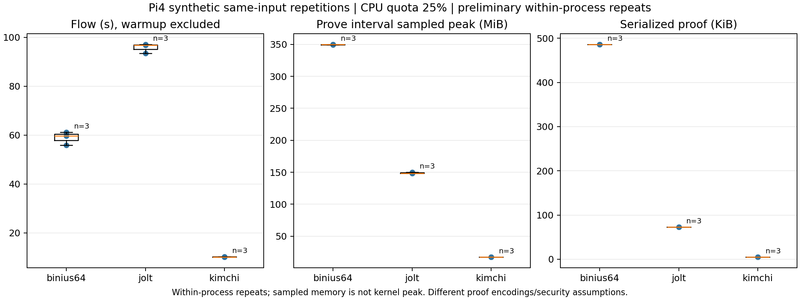
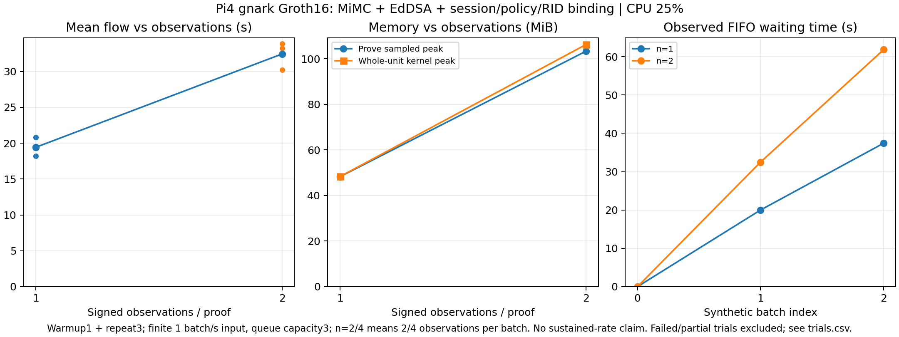

# Week24：追加評価を後から描画できるデータとして収集

Kimchi・Binius64・Joltの同一入力反復と、gnarkの署名付き合成観測batchの追加負荷を分けて収集した。
CSV／JSONL・raw log・schema・source／artifact hashを保存し、再集計／描画scriptを追加した。
これは研究PoC。claimed RIDとobserver-signed statementの計算を扱い、DRIP trust chain、sensor honesty、observer hardware、航空機認証を検証するものではない。

## 収集条件

Pi4B4GB／Debian12 ARM64、CPUQuota25%（runnerが実cgroup cpu.maxを検査）、CPU affinity0、計算並列度1（Rust RAYON=1／Go GOMAXPROCS=1。OS thread総数の測定ではない）。
warmup1件を残したまま通常集計から除き、同じ合成入力を1process内で3回反復した。
初期化時間、Witness変換、prove、verify、拒否検査を区別する。各処理のmarkerとmemory sampleは同じPiの時刻で対応付ける。
JoltのWitness／trace生成はproveに内包され、未計測Witnessを0として扱わない。

親slice High1200／Max1536MiB、Swap0、OS available1GiB、slice外watchdog、SSH oom_score_adj=-900を維持。
子はKimchi High192／Max256MiB、それ以外High384／Max512MiB。方式／観測数ごとに直列実行し、Piで重い処理を同時に動かしていない。
短いprocess内反復なので、独立cold trial、性能p95／信頼区間、長期失敗率の推定には使わない。

## 同一入力の3方式比較

CASES[1]＝3–4–5。回路・ZK feature・security設定・正常proofの公開入力／proof改変検査・既存不正入力検査は前回から変更していない。

|方式|反復数|平均フロー ms|中央値 ms|SD ms|prove sampled peak MiB|VK B|proof B|
|---|---:|---:|---:|---:|---:|---:|---:|
|binius64|3|58,933.210|59,692.175|2,729.368|350.055|2,532|497,808|
|jolt|3|95,732.944|96,711.509|2,036.412|150.184|112,166|74,258|
|kimchi|3|10,197.846|10,199.530|98.105|17.621|1,531|4,807|




[CSV／JSONL](data/euclidean-evaluation/)／[集計JSON](data/euclidean-evaluation/summary.json)／[raw log](logs/pi-euclidean-evaluation/)／[memory時系列](plots/euclidean-evaluation-memory.png)。

proof生成区間のmemory平均／最大は**sampled cgroup値**で、runner／childを含む。
区間内sample間の観測spanを時間加重する。whole-unitの平均・kernel peakも別列に保存した。
実sampling間隔は負荷で変わるため、10msの設定値だけを精度とはみなさない。
初期化、verify、負例検査のmemoryをprove区間に混ぜない。短い傾きだけでleakの有無を結論しない。

### 不正Witnessと秘匿diagnostic

Kimchiではprivate bit assignmentへ+2、Binius64ではpopulation後にprivate coordinateをxor1で壊し、再populationせず直接proverへ渡した。
Kimchiは `prover_error`、Binius64は `prover_panic`。どちらも今回のraw mutationではproofが完成しておらず、**実verifierが不正proofを拒否したとは記述しない**。
Binius64のpanicはcatchして結果を記録し、正常proofの検証成功と混同しない。
Joltのroot low/high負例は不正実行proofを生成し、panic=falseという成功claimを実verifierが拒否した。

同じ入力でも全4proofのserialized bodyは異なった。RustはRAM内の非暗号学的fingerprint、GoはRAM内のbyte比較で非同一性を診断し、proof／digest自体は出力・保存していない。
この検査だけでZKの形式的安全性やside-channel耐性を証明したとはしない。
fresh owner-only tmpfs work directory内の作成fileを監査した。これは全OSのファイルアクセス追跡ではない。

## hash・署名・session拘束を含む観測数scaling

gnark0.16.3／gnark-crypto0.21.0、Groth16 BN254で、観測数1／2／4の別回路をcompileする。
各観測の合成座標、d2/r、batch count、Session、Policy、claimed RID、indexをdomain付きMiMCへ束縛し、RAM内test EdDSA keyで署名する。
回路で距離、整数範囲、各署名、集合digestを検査し、batch全体を1proofへまとめる。

|観測数|状態|constraint数|setup秒|平均フロー秒|prove sampled peak MiB|最大実測wait秒|
|---|---|---:|---:|---:|---:|---:|
|1|warmup1＋測定3、成功|12,668|171.501|19.438|48.270|37.405|
|2|warmup1＋測定3、成功|24,230|333.603|32.438|103.367|61.805|
|4|Pi再起動で未完了|—|—|—|—|—|




[CSV／JSONL](data/observation-workload/)／[集計JSON](data/observation-workload/summary.json)／[raw log](logs/pi-observation-workload/)／[回路とテスト](../experiments/pi4-euclidean-evaluation/workload/README.md)。

Public keyは検証者が期待するpublic statementの一部。PolicyはIDの署名拘束であり、資格・期限・失効ルールではない。
単一のtest observer keyを各batch内で使っており、複数実機observerの資格管理を完成させたわけではない。
同じproofに対するsession／digest改変は実verifierで拒否。破損proofはdecoderまたはverifierで拒否する。
session／policy／座標／署名改変、count>=2で別indexの観測をコピーする負例はconstraint solverが拒否した。
この負例について不正assignmentの実proof生成を主張しない。

署名生成は各runで1回行い、通常フローのWitness時間はassignment→gnark witness変換である。
鍵生成／署名生成・実BLE受信・network通信は通常フローに含めていない。
セットアップは使い捨てlocal-only、RAM内だけ。release keyでもオンチェーンデプロイ用の承認済みkeyでもない。

### 1Hz待ち行列：モデルと実測を区別

距離3方式の `queue_model_1hz` は、測定service timeによる初期化済みserial FIFOモデルであり、実producerの負荷試験ではない。
署名workloadの `queue_observed_1hz` は、別goroutineが3batchを1秒間隔で投入し、到着jitter、dequeue時のwait、queue depthを**実測**した。
queue capacity3で有限に保つ。count2／4は1batchに2／4観測があるため、1観測/sと同一条件ではない。
実キューのconsumerにはproof後の改竄検査などの追加処理も含まれ、通常フローだけを使うモデルと一致する必要はない。
この短い3batch試験は長期1Hz安定性・sensorの実負荷試験ではない。

## 再利用できるファイル

|ファイル|用途|
|---|---|
|samples.csv／jsonl|warmup flag、repeat index、各phaseの時間、public／proof byte数、prove区間memory、温度|
|trials.csv／jsonl|成功／失敗／partial、初期化、compile／constraint数、whole-unit資源、VK／binary／guest size、実行条件|
|memory.csv／jsonl|時系列。run_idでtrialsの条件metadataとjoin|
|checks.csv／jsonl|prover／verifier／solver／decoderの拒否段階|
|queue_model_1hz.csv／jsonl|モデルの待ち時間。measured_load_test=false|
|queue_observed_1hz.csv／jsonl|実synthetic batch arrival／dequeue。measured_load_test=true|
|schema.json|単位・欠測・測定範囲・raw file hash|
|coverage.json|実測、source確認、モデル、未測定の区別|

欠測はCSV空欄／JSON nullで、未測定を0にしない。warmupと失敗／partialをraw・tableから消さず、描画時に除外する。
VKサイズは各方式のnative verifier serializationで、IPA SRSや再構築時のRAM全体、protocol包絡を全て含む値ではない。
proof／public inputの形式も方式ごとに異なる。binaryサイズはARM64 artifact、Jolt guest ELFは別列。

```sh
python3 experiments/pi4-euclidean-evaluation/collect.py --runs week24/logs/pi-euclidean-evaluation --out week24/data/euclidean-evaluation
python3 experiments/pi4-euclidean-evaluation/summarize.py --data week24/data/euclidean-evaluation
python3 experiments/pi4-euclidean-evaluation/plot.py --data week24/data/euclidean-evaluation --out week24/plots/euclidean-evaluation
python3 experiments/pi4-euclidean-evaluation/plot_workload.py --data week24/data/observation-workload --out week24/plots/observation-workload
```

collect／summarizeはPython標準libraryのみ。plot時だけmatplotlibが必要。
[再現手順](../experiments/pi4-euclidean-evaluation/README.md)／[source・artifact manifest](manifests/euclidean-evaluation.json)。

## 状態と残件

距離3方式の正常proofは計12件（warmup3件を含む）、署名workloadの観測数1／2は計8件（warmup2件を含む）が生成・検証に成功。成功run5件はOOM／kill増加0、swap0、sampled current power低4bit0。fresh tmpfs内の作成fileは0。

観測数4は約41秒分のmemory記録後にSSHが切れ、再接続時uptime1分・guard消失を確認した。初期化完了／proof／resource／filesystem-auditの記録はない。memory最終768行目はtruncatedで、raw bytesはgzipでそのまま保持し、767完全sampleだけ集計した。truncated末尾の空白も改変せず、展開後SHA256をpartial集計に記録した。
[partial集計](logs/pi-observation-workload/eval-workload-n4-v1/partial-memory-summary.json)のsampled最大は64,405,504B（61.422MiB）、OS available最小3,431,182,336B、sampled swap0。
取得できたcurrent／previous kernel journalにOOM一致0、低電圧記録は2／3件。ただし最後のmemory.eventsやpower samplingは取得できず、再起動原因をOOM／電源のいずれとも断定しない。
終了codeとkernel peakはnull、4件の実proof成功は主張しない。元の観測数4の回路を縮小して通す修正は行っていない。

runtime guardを復旧し、SSHを再起動せずoom_score_adj=-900・watchdog・slice・swap0・current power bits0を確認した。4件の再測定・長いPi実行は安定電源条件の確認後に残す。

- 他方式への同等hash／署名／session workload移植、RSSI・長い時系列・複数observerの資格管理。
- 独立process反復・十分な試行数、安定電源での長期1Hz・leak評価。
- side-channel／形式的ZK監査、mobile／FFI、再帰／終端・Besu／EVM統合。
- Joltの距離正常7件・不正6件のPi全件検査は今回の同一入力反復では代替していない。

[最終health](logs/euclidean-evaluation-final-health.json)にSSH保護・watchdog・swap・power／kernel記録を保存。
setup／VK／proof／private assignment／test observer秘密鍵の実体をGitへ追加・deployしていない。
既存Python61件・contract48件・Go tests、追加workloadのbinding test、collectorの欠測／失敗／phase区間テスト、監視例外のprocess-group停止テストを実施。
CIのevidence checkは保存データの検査であり、CI上の新しいPi／proof実行ではない。
