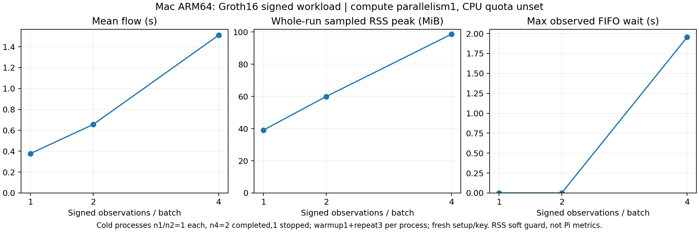

# Week24：4観測回路のMac検証と独立プロセス反復

前回Piで未完了だった署名付き4観測の回路を変更せずMac ARM64へnative buildし、実proof生成・検証を確認した。
Macでは観測数1／2／4が完走。4観測は独立3process中2完走、1保護停止。
これは合成observer-signed statementの研究PoCであり、DRIP trust chain、sensor honesty、observer hardware／航空機認証の評価ではない。

## Mac結果（Piの値と分離）

Go GOMAXPROCS=1、CPU quota設定なし。各processでwarmup1＋repeat3。
processごとに新しい使い捨てlocal setupとtest observer keyをRAM生成する。
同じ座標／観測数のworkloadだが、process間で完全に同じkey／signature／Witnessという条件ではない。

|run|観測数|状態|測定済み反復数|平均フロー ms|全run sampled RSS peak MiB|最大実測wait ms|
|---|---:|---|---:|---:|---:|---:|
|mac-n1-v1|1|completed|3|377.585|39.062|0.058|
|mac-n2-v1|2|completed|3|655.715|59.906|0.076|
|mac-n4-v1|4|completed|3|1205.107|98.688|433.712|
|mac-n4-v2|4|failed_or_partial|2|2142.083|93.906|2288.912|
|mac-n4-v3|4|completed|3|1815.028|94.500|1955.230|

[CSV／JSONL](data/observation-followup/)／[raw log](logs/observation-followup/)／[再生成script](../experiments/pi4-observation-followup/README.md)。
図は完走runのみ。4観測の平均は完走2processの平均フローの平均、RSS／waitは完走runの最大。
全runの値と停止したrunの検証済み部分はtableに保持した。失敗を除いた普遍的な性能順位を主張しない。

4観測では47,354 constraints。正常proofは公開session／digest改変を実verifierで拒否し、破損proofはdecoderまたはverifierで拒否。
session／policy／座標／署名の改変、別indexの観測コピーはconstraint solverで拒否した。
不正assignmentの強制proof生成検査ではない。PolicyはID拘束で、資格・失効管理ではない。
全runでproof body非同一性diagnosticも記録するが、形式的ZKやside-channel監査を代替しない。

Mac memoryは100ms設定のsampled process-tree RSS（soft monitor）。Piのcgroup／CPU25%データへ混ぜない。
phase別memoryは未計測としてnull／CSV空欄で保存した。CPU quota未設定もnull。
setup／VK／proof／private observer keysのbodyを保存・公開・deployしない。

## 保護停止とPi接続

Mac `mac-n4-v2` はOS全体swap増分512MiBの上限を超え、process groupをSIGTERMして停止した。
終了-15、stop_reason=system_swap_growth_limit、sampled process群RSS peak約94MiB。
正常proof3件（warmup1＋測定2）まで記録があり、最後のproof開始後に停止。summaryなし。
OS全体swapの増加をこのproverのメモリ消費だけに帰属させない。host負荷が変動したため、cold run間の差も制御された性能差とはしない。

Piは今回重い実験を開始する前にIPv4 SSHがtimeout。pingは応答し、IPv6で既存host keyを照合して接続した。
接続時uptime1分、watchdog inactive。手動の再起動か予期しない再起動かは未確認で、ユーザーに確認を出している。
今回Piの4観測proofは再実行していない。前回のpartialを成功扱いにしない。

runtime guardを復旧し、[health](logs/observation-followup/pi-health-after-restore.json)でSSH oom_score_adj=-900、
slice High1200／Max1536MiB、swap0、外置きwatchdog、current power低4bit0を確認。
current／previous kernel OOM一致0、低電圧記録3／1件。原因は断定しない。
SSHサービスの再起動・永続OS設定の変更は行わなかった。

## 残件

- Piでの4観測生成・検証と観測数scaling。再起動の背景を確認し、安定稼働を確かめてから再測定。
- 同じsetup／observer keyを保ったprocess間cold repetition、より多い独立反復、長期1Hz／memory／failure-rate評価。
- 他方式への同等signed workload、RSSI・複数observer資格管理、FFI／終端・再帰・Besu/EVM。

Python61件、contract48件、aggregator Go tests、既存evidence checkと新規scope／hash checkを実施。
新規CIは保存したMac証拠・停止・復旧状態を検査し、新しいproofやPi試験をCIで実行しない。
