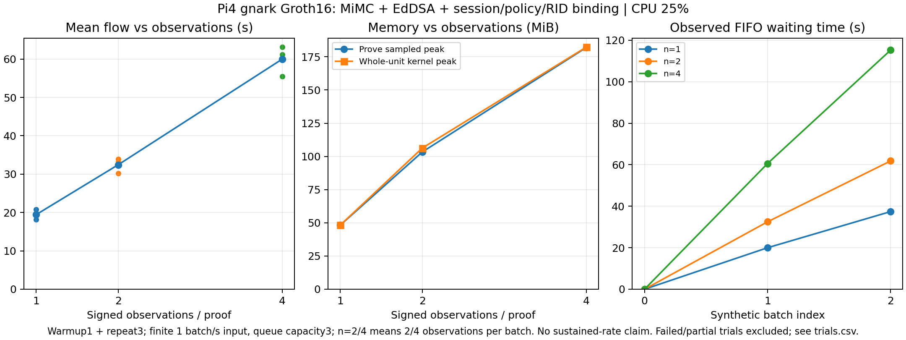

# Week24：追加実装と進捗

親Issue：[追加評価 #47](https://github.com/SMRI2170/zkp-m1-v2/issues/47)。
**Piで署名付き4観測の生成・検証が完走した。** 実験前チェックと否定・境界テストも追加し、1／2／4観測の比較データと図を更新した。

## 何を作ったか

| 実装 | できること | 対応Issue |
|---|---|---|
| [事前確認ツール](../experiments/pi4-stability/preflight.py) | メモリ・電源状態・watchdog・SSH保護を確認。不足や欠測をJSONに記録して停止 | #48 |
| [実行ランチャー](../experiments/pi4-stability/launch_workload.py) | バイナリ照合→3回の確認完了→保護付き実行。失敗時は証明処理を起動しない | #48 / #49 |
| [追加テスト](../experiments/pi4-binding-tests/extra_test.go) | 別鍵・署名者・観測順・整数境界を、既存回路を変更せず検査 | #53 |

事前確認ツールは保護設定が消えていても例外で情報を失わず、`ready=false`と不足項目を残す。
今回、実際に再起動でruntime保護が消えた状態を確認し、既存の固定版で復旧した。
SSHの再起動・永続OS設定の変更は行っていない。

実行ランチャーは実装と停止動作のローカルテストまで。今回のPi実測は従来runnerの手動起動であり、新ランチャー全体の実機完走ではない。

## Piの確認結果

- 接続時点のuptimeは約10時間。今回以前の再起動が手動か、予期しないものかは不明。
- 復旧後、親メモリ上限1.5GiB・swap上限0・外置きwatchdog・SSHのOOM優先度-900を確認。
- [60秒・3回の状態記録](logs/pi-stability/preflight-n4-v2/)は全項目合格、観測中のuptimeリセットなし。
- この3回は「負荷開始前と開始直後」の記録。3回すべてが無負荷の事前測定ではない。
- 過去の低電圧履歴はある。journalのOOM一致0だけで、電源やOOMなどの再起動原因を断定しない。

メモリ不足に対してはcgroup上限とOS reserve 1GiBのwatchdogで実験を停止する。
電源断・OS障害・ネットワーク断まで含めてSSHが切れないと保証するものではない。

## 追加テストの結果

追加16ケースすべて期待どおり。既存の署名拘束テストも成功。

| ケース | 期待と結果 |
|---|---|
| 距離0、3–4–5、平方根切捨て、座標最大値、公開metadata最大値（5件） | 正しく署名した入力を受理 |
| 座標・距離二乗・Session・Policyの範囲外、root上下誤り（6件） | 拒否 |
| 別公開鍵、別署名者の署名、別RID、観測順入替、集合root改変（5件） | 拒否 |

境界ケースは入力ごとに新しく署名するため、署名不一致だけに頼る検査にしない。
距離二乗の範囲外ケースは座標範囲も超えており、D2制約だけを分離した検査ではない。
拒否は **constraint solverでの結果**。無効proofを強制生成してverifierへ渡した試験ではない。
[実行ログ](logs/pi-stability/binding-tests-mac.log)／[再実行手順](../experiments/pi4-binding-tests/README.md)。

## 4観測のPi試験

ウォームアップ1件＋測定3件すべてで、実proof生成・検証とpublic session／digest改変拒否に成功した。
破損proofはdecoderまたはverifierで拒否。別indexの観測コピーなど不正5条件はsolverで拒否した。
全工程877.800秒、うちsetup630.404秒。OOM／kill増加0、swap使用0、試験中の再起動なし。

| 署名付き観測数 | setup（秒） | 平均フロー（秒） | 全unit最大メモリ（MiB） | proofサイズ |
|---|---:|---:|---:|---:|
| 1（報告08） | 171.501 | 19.438 | 48.332 | 164 B |
| 2（報告08） | 333.603 | 32.438 | 106.297 | 164 B |
| 4（今回） | 630.404 | 59.971 | 182.320 | 164 B |

平均フローはwitness変換＋prove＋verify。setup、署名鍵生成・署名生成、入力待ち時間は含まない。
公開入力204B、VK524B。数値はserialized sizeだけで、実体は公開しない。
4観測の測定3件のSDは3.984秒、prove区間sampled peakは182.020MiB。
全unitの時刻加重平均は89.247MiB。OS利用可能メモリ最小3.064GiB、温度最大49.173℃。
設定samplingは10msだが、実測間隔中央値は約77ms。sampled peakとkernel peakを区別する。

[メモリ時系列図](plots/pi-observation-scaling-v2-memory.png)／[CSV・JSONL](data/pi-observation-scaling-v2/)／[raw log](logs/pi-stability/eval-workload-n4-v2/)。
別日・別boot・fresh setup/keyの各1processを並べた記述的比較で、十分な独立反復や観測数だけを変えた統制実験ではない。
旧4観測partialも新datasetに残し、欠測を0にしない。上の比較図は完走runだけ。メモリ時系列図にはpartialの途中までの記録も含める。

4観測の最後のbatchの実測待ち時間は115.218秒。3件の有限producerであり、継続1Hzへの追従成功ではない。
試験後も[保護設定とSSH接続](logs/pi-stability/after-n4-v2/)を確認した。
旧source／依存版・バイナリは変更せず、CPU25%・子メモリHigh384/Max512MiB・swap0で実行。
setupも含めたtimeoutは1500秒、unit上限1530秒。旧partialはそのまま保持する。

## まだ終わっていないこと

| Issue | 残件 |
|---|---|
| #48 | 再起動原因の特定、長期安定性、新ランチャーの実機E2E確認 |
| #49 | 今回完了：Pi4観測の生成・検証・集計。長期／独立反復は #51/#52 |
| #50 | Kimchi / Binius64 / Joltへの同等署名workload移植 |
| #51 | 十分な独立cold反復と統計 |
| #52 | 持続1Hz入力・長時間のキューとメモリ |
| #53 | 永続replay状態、資格失効、漏出検査など |
| #54 | RSSI・時系列・複数観測者資格・期限条件 |
| #55 | Jolt全ケース・Plonky2・zkVMの未完了条件 |

本研究が検証するのはclaimed RIDとobserver-signed statementの計算上の整合性。
DRIPの信頼チェーン、センサーの真実性、端末ハードウェアや航空機の真正性を保証しない。
使い捨てsetup・VK・proof・秘密鍵の実体はRAM内だけで扱い、Gitやチェーンへ公開しない。
Week23の跨Prover秘匿状態引継ぎの不採用判断は維持する。

## 検証・再実行

Python61件・契約48件・aggregator Go tests、新しいpreflight／起動停止テスト4件、追加16ケースと既存署名拘束テストが成功。
[実行・集計手順](../experiments/pi4-stability/README.md)にコマンドをまとめた。
CIは記録済み証拠のhashと結果を検査し、Pi上で新しいproofを実行するものではない。
