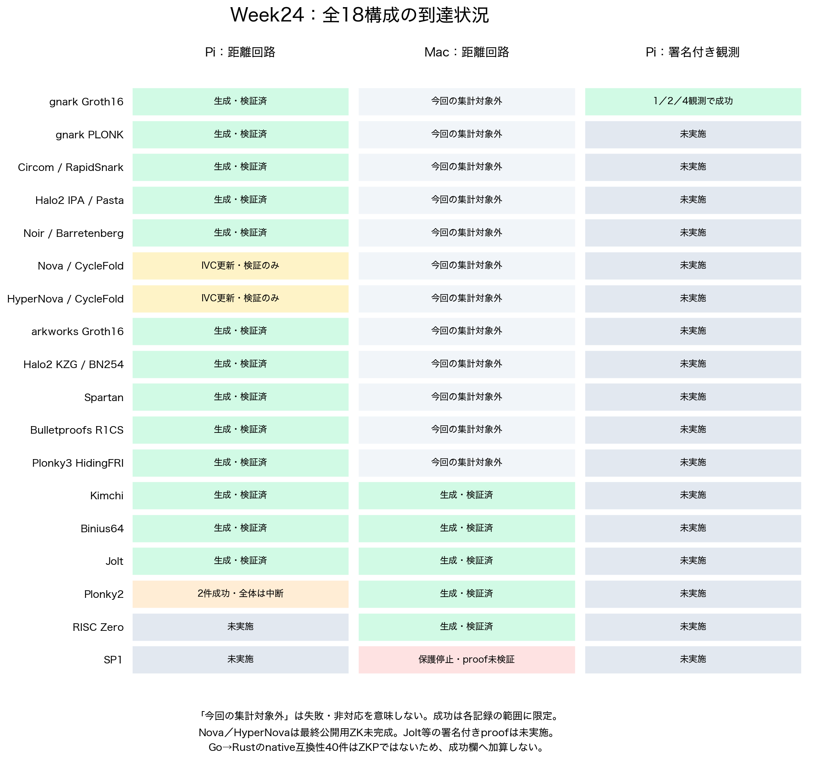
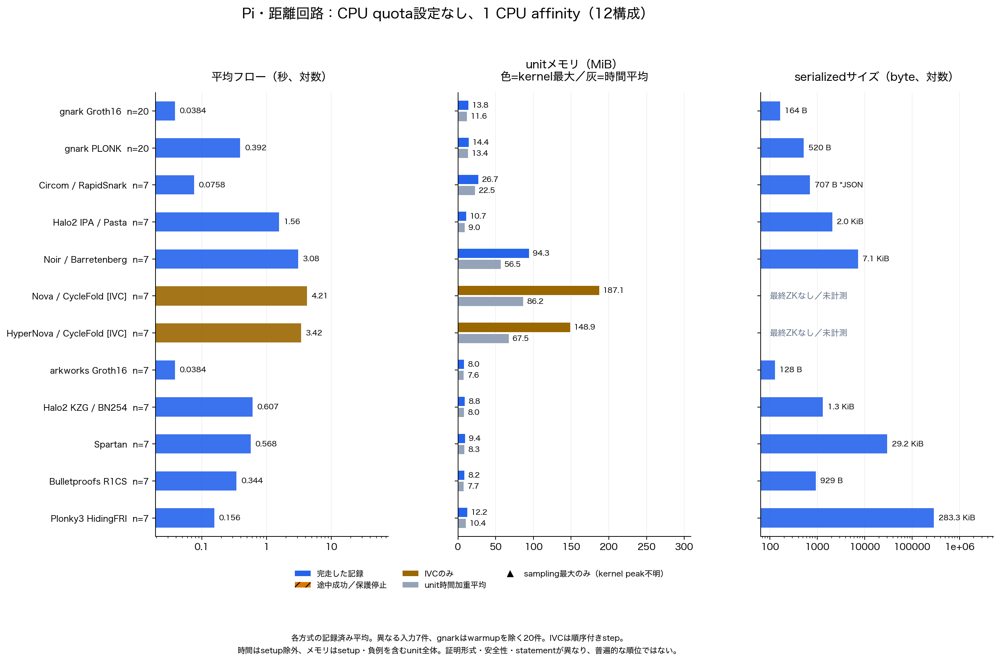
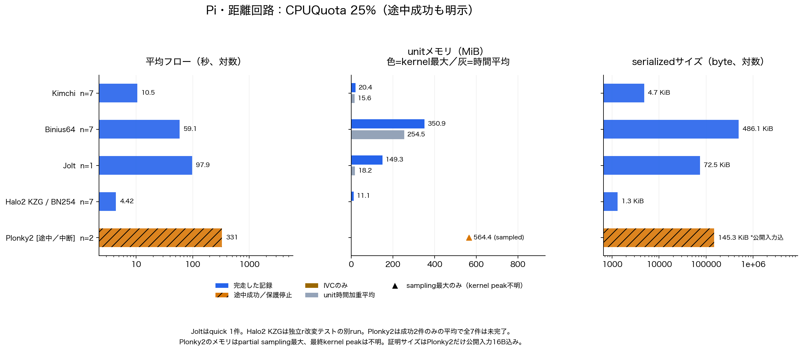
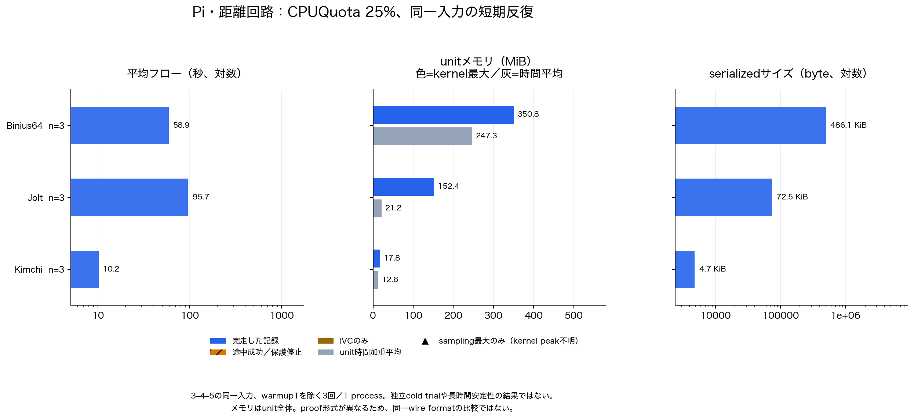
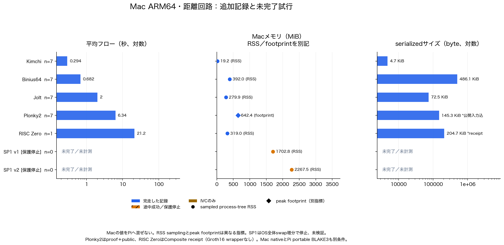
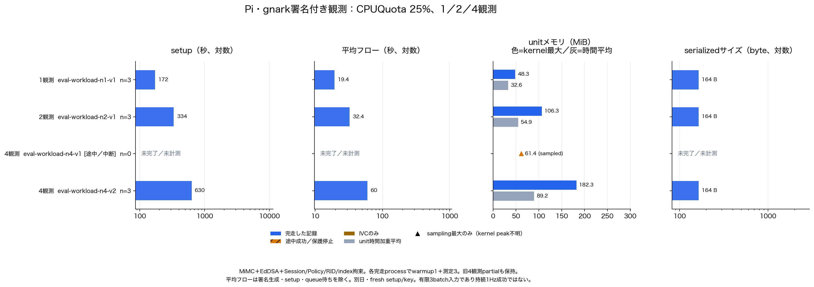
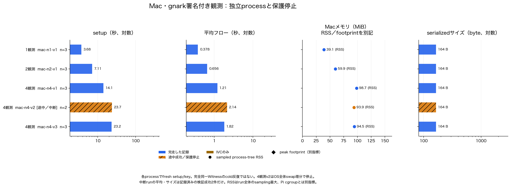

# Week24：全フレームワークの比較グラフ

**評価した18構成を対象に、7種類の図をPNG・SVGで生成した。** 既存の実測結果の再集計であり、新しいproof生成やPi実行は行っていない。
処理時間・メモリ・証明サイズを、CPU条件とworkloadを分けて確認できる。

[全図・集計データをZIPで取得](plots/all-frameworks.zip)。ZIPは閲覧・資料利用用で、再生成にはrepositoryの元データが必要。

## 図の一覧

| 図 | 内容 | PNG | SVG |
|---|---|---|---|
| 00 | 全18構成の到達状況 | [画像](plots/all-frameworks/00_status.png) | [ベクトル版](plots/all-frameworks/00_status.svg) |
| 01 | Pi：距離回路、quotaなし・1CPU固定 | [画像](plots/all-frameworks/01_pi_distance_affinity1.png) | [ベクトル版](plots/all-frameworks/01_pi_distance_affinity1.svg) |
| 02 | Pi：距離回路、CPUQuota25% | [画像](plots/all-frameworks/02_pi_distance_quota25.png) | [ベクトル版](plots/all-frameworks/02_pi_distance_quota25.svg) |
| 03 | Pi：同一入力の短期3反復 | [画像](plots/all-frameworks/03_pi_distance_repeat3.png) | [ベクトル版](plots/all-frameworks/03_pi_distance_repeat3.svg) |
| 04 | Mac：距離回路、失敗試行も表示 | [画像](plots/all-frameworks/04_mac_distance.png) | [ベクトル版](plots/all-frameworks/04_mac_distance.svg) |
| 05 | Pi：署名付き1／2／4観測 | [画像](plots/all-frameworks/05_pi_signed.png) | [ベクトル版](plots/all-frameworks/05_pi_signed.svg) |
| 06 | Mac：署名付き観測、独立processと保護停止 | [画像](plots/all-frameworks/06_mac_signed.png) | [ベクトル版](plots/all-frameworks/06_mac_signed.svg) |

対象：gnark Groth16／PLONK、Circom＋RapidSnark、Halo2 IPA／KZG、Noir＋Barretenberg、Nova／HyperNova、arkworks Groth16、Spartan、Bulletproofs R1CS、Plonky3 HidingFRI、Kimchi、Binius64、Jolt、Plonky2、RISC Zero、SP1。

## 00：どこまで実行できたか



緑は各記録の範囲で生成・検証を確認したもの。Nova／HyperNovaはIVCだけで、外部提出用の最終ZKは未完成。
Plonky2はPiで2件成功後に再起動し、全体は未完了。SP1はMacで資源保護停止、検証済みproofはない。
RISC Zero／SP1のPi proofは未実行。Macの「今回の集計対象外」は失敗を意味しない。
Go→Rust互換性40件はnative検査であり、Joltの署名付きproof成功に加算しない。

## 01：Pi・距離回路（quotaなし、1CPU affinity）



[報告04](04_ユークリッド距離_平均処理時間とサイズ比較.md)と[報告05](05_追加フレームワークのPi評価.md)の12構成。
平均フローは記録済みwitness／prove／verify。Noirのexecute/compileやcold初回、IVC updateなど、工程範囲に差がある。
メモリはsetup・負例を含むunit全体。灰が時間加重平均、色付きがkernel最大。
証明サイズはnative serializedサイズ。RapidSnarkはJSONで、同じwire formatではない。

## 02：Pi・距離回路（CPUQuota25%）



Kimchi／Binius64は異なる正常7ケース、Joltはquick 1件。Halo2 KZGは独立r改変検査の追加run。
Plonky2の時間は成功した2件だけの平均。メモリはpartial sampling最大で、最終kernel peakは不明。
Plonky2のサイズだけ公開入力16B込み。図01のCPU条件へ混ぜていない。

## 03：Pi・同一入力3反復



Kimchi／Binius64／Joltについて、warmup1の後に同じ3–4–5入力を3回実行した[報告08](08_追加評価データの収集と反復測定.md)の値。
1process内の短期反復で、独立cold trial・長期安定性・信頼区間を示すものではない。

## 04：Mac・距離回路の追加記録



Macだけを別図にした。SP1はproofが未完了なので時間・サイズを空欄にし、停止までに観測したRSSだけを表示。
SP1の停止はOS全体swap増分512MiBによるもので、このプロセスのOOMや使用量だけに帰属させない。
Plonky2のpeak footprintと、他方式のsampled process-tree RSSは別指標。
RISC ZeroはComposite receiptで、Groth16 wrapperではない。Piの値や同一形式の通信量と混ぜない。

## 05：Pi・署名付き観測



[報告10](10_追加実装と進捗.md)のgnark MiMC＋EdDSA＋Session/Policy/RID/index拘束。
setupと平均フローを別の列に表示した。平均フローは署名生成・setup・queue待ちを含まない。
旧4観測partialも消さず、生成前の観測メモリだけを三角で残す。別日・fresh setup/keyの記述的比較。

## 06：Mac・署名付き観測



[報告09](09_4観測のMac検証と独立反復.md)の5process。4観測v2の斜線は途中停止で、時間・サイズは記録済みの検証成功2件だけ。
新しいsetup/keyを各processで生成しており、完全同一Witnessのcold反復ではない。
Macの結果からPi性能や持続1Hzの成立を推定しない。

## データと再生成

[metrics.csv](data/all-frameworks/metrics.csv)／[JSON](data/all-frameworks/metrics.json)／[JSONL](data/all-frameworks/metrics.jsonl)には38記録を保存。
[coverage.csv](data/all-frameworks/coverage.csv)に全18構成の状態、[provenance.json](data/all-frameworks/provenance.json)に参照元のSHA256を記録。
欠測はnull／CSV空欄であり、0 byte・0秒にはしない。`n`は平均に用いた記録数で、観測者数やsigned batchの観測数とは別。

```sh
python3 experiments/all-framework-plots/plot.py
python3 -m unittest discover -s experiments/all-framework-plots -p 'test_*.py'
python3 experiments/all-framework-plots/check_results.py
```

[生成手順](../experiments/all-framework-plots/README.md)。今回の図はHiragino Sans・matplotlib3.9.4で作成し、SVGはfontをpathへ埋め込んだ。
元の計測ログ・図・manifestは変更していない。画像を目視し、日本語の表示、ラベル、タイトル、注記の重なりを確認した。

同一security・statement・工程・反復条件の完全な比較ではないため、普遍的な速度順位や採用結論にはしない。
研究PoCの合成データを扱い、DRIP trust chain、sensor honesty、observer hardware／航空機認証を保証しない。
秘密assignment・鍵・使い捨てsetup/VK/proofの実体は読取り・追加・公開していない。

検証：欠測／partial／host境界の回帰テスト4件と新規artifact検査が成功。既存のPython61件・契約48件・aggregator Go tests、Pi4観測とGo→Rust互換性の既存証拠検査も成功。
CIはデータ・出力hash・未完了の扱いを確認し、新しい実機性能測定は行わない。
