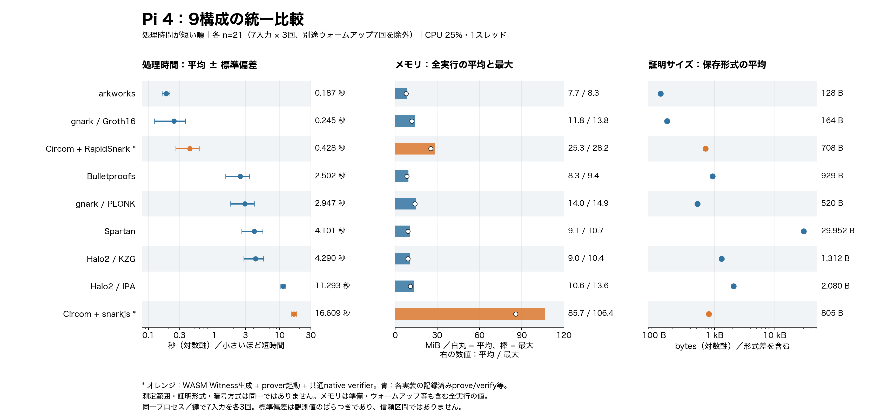

# Pi 4で完走した9構成の統一比較

既存の7構成と追加のCircom 2構成を、同じ行・同じ順序で比較できる図にまとめた。追加の重い実験は実行せず、保存済みの実測189件（各21件）から生成している。



処理時間が短い順に並べ、左から処理時間、メモリ、証明サイズを表示する。数値を図に直接記載し、時間とサイズには対数軸を使用する。処理時間のエラーバーは平均±標準偏差であり、信頼区間ではない。メモリは白丸が時間平均、棒がカーネル計測の最大値である。

## 拡大表示とデータ

- [統一比較 PNG](figures/balanced-nine-overview/overview.png) / [SVG](figures/balanced-nine-overview/overview.svg)
- [処理時間](figures/balanced-nine-overview/time.png)
- [メモリ](figures/balanced-nine-overview/memory.png)
- [証明サイズ](figures/balanced-nine-overview/proof-size.png)
- [集計CSV](figures/balanced-nine-overview/comparison.csv) / [JSON](figures/balanced-nine-overview/comparison.json)
- [入力ファイルのハッシュと共通条件](figures/balanced-nine-overview/sources.json)

## 共通条件と解釈の範囲

別の見方として以下の2種類も追加した。元の統一図・項目別図は保持している。

- [速度と最大メモリの散布図](figures/balanced-nine-insights/time-memory.png)：左下ほど短時間・省メモリ。各点に構成名を記載する。方式や保証の違いを含むため、これだけで採否を決めない。
- [数値付きヒートマップ](figures/balanced-nine-insights/metric-heatmap.png)：薄い黄ほど値が小さく、濃い赤ほど大きい。色は列ごとに対数正規化しており、列間の色の比率や総合評価点を示さない。

いずれも同じフォルダにSVGを保存した。次のコマンドで集計JSONから再生成できる。

```sh
python3 experiments/all-framework-plots/plot_balanced_insights.py \
  --data week24/figures/balanced-nine-overview/comparison.json \
  --out week24/figures/balanced-nine-insights-new
```

Pi 4B 4GB ARM64、CPU quota 25%、1スレッド、distance-u16-balanced-v1。7入力のウォームアップを各1回行い、同じ入力を各3回、計21件測定した。同一プロセス／鍵での反復であり、独立した21回のcold start実験ではない。セットアップは処理時間に含まない。

オレンジのCircom構成はWASM Witness生成、proverプロセス起動、共通のRapidSnark native verifierを含む。snarkjs構成も検証にはこの共通verifierを使う。青の7構成は各実装が記録するWitness処理（分離されている場合）、prove、verifyの合計である。計測範囲の細部が異なるため、図は実装フローの比較として読む。暗号方式やセキュリティ設定の同等性を示す順位ではない。

メモリはcgroup全体を対象とし、準備・ウォームアップ・負例検査も含む全実行の値である。各証明の平均RSSではない。証明サイズは実装固有の保存形式で、CircomではJSONの書式差も含む。JSON表現のバイト数の違いを暗号学的な証明要素数の違いとは解釈しない。

今回の9構成は完走済みの集合であり、未完走・未対応のフレームワークを網羅した図ではない。このリポジトリは研究PoCであり、航空機認証、センサの正直性、観測者ハードウェアの真正性を保証しない。

## 再生成

```sh
python3 experiments/all-framework-plots/plot_balanced_overview.py \
  --data .cache/week24/sequential-jobs/circom-1017c/combined-data \
  --out week24/figures/balanced-nine-overview-new
```

出力先は新規ディレクトリを指定する。PNG・SVGと集計CSV・JSONを生成し、元データは変更しない。日本語表示にはHiragino Sansなどの日本語フォントが必要。今回の生成結果は描画後に画像を確認済み。
