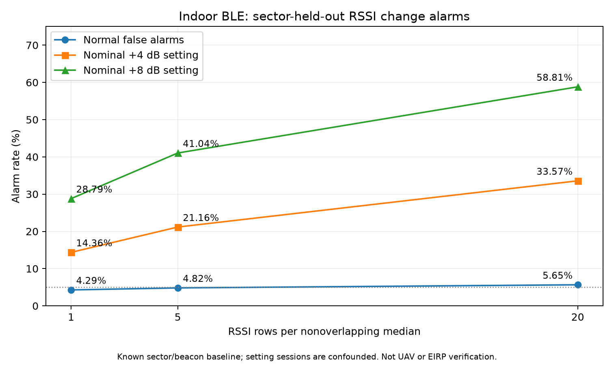
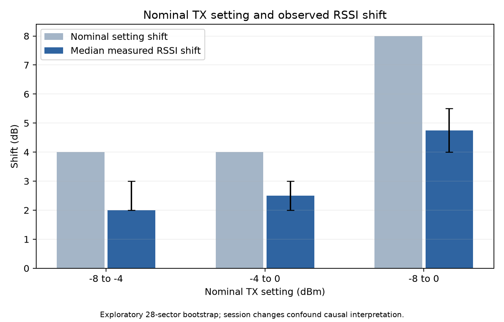

# Week26：Macでの公開BLE再解析と再現確認

実施日：2026-11-01。Piは使わず、Mac ARM64で実行。結果文書06の方法を新たに実装した**独立再解析**。元ZIPのコードそのものを追試したものではない。

## 結果

固定コミットの公開CSV3個、8,400行・50,400 RSSI値を再取得・解析。報告済みの誤警報率・検出率9項目は、小数第2位まで全件一致した。

| まとめるRSSI行数 | 正常時の誤警報率 | 公称+4dBの設定変更での警報率 | 公称+8dBの設定変更での警報率 |
|---:|---:|---:|---:|
| 1 | 4.29% | 14.36% | 28.79% |
| 5 | 4.82% | 21.16% | 41.04% |
| 20 | 5.65% | 33.57% | 58.81% |

20行の場合、正常336判定、+4／+8dBは各840判定。正常誤警報率はテストするセクター分割により2.38～8.93%。これらの判定を独立したRF試行数と解釈しない。

また次の報告値も再計算で一致した。

- グループ内残差の絶対値中央値3.0dB、90%点11.0dB、95%点20.0dB、RMS約8.212dB。
- 公称−8→−4dBmでRSSI中央値変化の中央値+2.0dB。168組中35組で中央値が低下。
- 公称−8→0dBmで+4.75dB。168組中11組で中央値が低下。
- 28セクター単位・3000回の探索的bootstrap区間は、上の2比較でそれぞれ[2.0, 3.0]dB、[4.0, 5.5]dB。

## 再解析の定義

- 各セクター・ビーコンの−8dBmの先頭50行から基準中央値を算出。正常の残り50行が校正／評価対象。
- セクター番号の奇数・偶数で閾値校正と評価を分離し、入れ替えて2分割評価。
- 正常スコアの95%点を線形補間で計算し、**閾値を厳密に上回る**場合に警報。
- 1／5／20行を重複なしのブロックに分けて中央値を計算。末尾の不完全ブロックを破棄。20行の場合、正常50行のうち最後の10行は使用しない。
- 2分割の警報数／判定数を合算。各評価セクターにも既知地点・既知ビーコンの基準測定がある設定であり、未知地点へ無校正で一般化した検証ではない。
- 行の順序は元CSVの順序。時刻間隔や独立性は仮定しない。

## 合成反例

既存の`identifiability_minimal.py`も今回のrunner内で実行。1000イベント、候補距離4倍と実効基準電力+12.0412dBの組合せで、RSSI最大差1.42e-14dB。assertion成功。

これは数理モデルの構成的反例。実送信機がその出力を設定可能なことや、実環境の通信が一致することを示す実験ではない。

## 検証・成果物

- [実行コード・手順](../experiments/week26-rssi-privacy/README.md)
- [要約JSON・入力ハッシュ・方法・環境](results/mac-recheck-20261101/summary.json)
- [検出結果CSV](results/mac-recheck-20261101/detection-summary.csv)
- [分割別の閾値・分母・警報数CSV](results/mac-recheck-20261101/detection-folds.csv)
- [旧報告値との照合CSV](results/mac-recheck-20261101/reported-value-checks.csv)
- [成果物ハッシュ](results/mac-recheck-20261101/artifact-manifest.json)

追加4テスト成功：ブロック端数の扱い、分位点と無効入力、基準50行の除外とセクター分離、閾値同値の非警報。固定入力ハッシュを照合。元CSVはignored `captures/week26-public-ble/`、ディレクトリ0700・ファイル0600で保管。公開成果物は集計値と図のみ。

## 結論の範囲と残件

**校正した既知地点でも、複数行をまとめれば設定変更への警報率は上がるが、検出漏れと誤警報が残る。** 設定変更と測定セッションの変化が交絡しているため、実送信電力の因果効果・不正操作・位置偽装の検出率とは呼ばない。実UAV／Remote ID／Pi／Pixelの測定でもない。

03・04の全シミュレーション、05の合成ストレス注入は、元のZIP・全コード・CSVを未取得のため未再現。今回、報告表からその出力を作り直したり、未取得のモデルを再現済みとして扱ったりしていない。新しいZKP生成や最終証明の実行もなし。

次は、元成果物の入手と03・04の再現確認、または独立真距離を持つ管理下のRF計測。今回の結果だけで単一RSSIから電力・移動・遮蔽を区別できるとは結論しない。

## データ出典

[公開データリポジトリ](https://github.com/manwestc/ble-rssi-indoor-localization-dataset)、固定コミット`b38a9a4a53a01f52136f4e9b29b5045f61655a06`。原資料は屋内BLE、6ビーコン・1スマホ、28セクター、3出力設定のデータ。入力ごとのURLとSHA-256を要約JSONへ記録。[元報告06](06_実測BLEから送信電力変更検出の限界を評価.md)。
