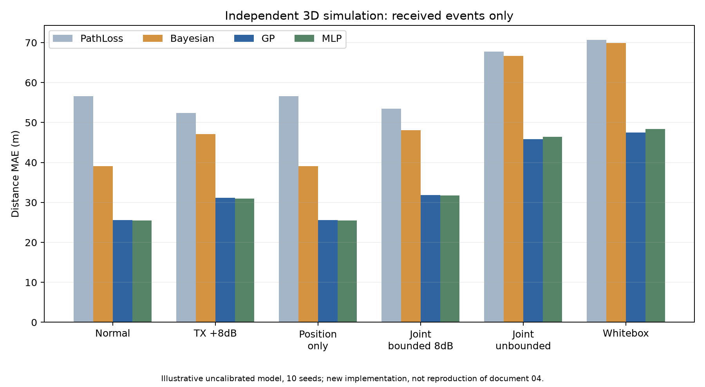
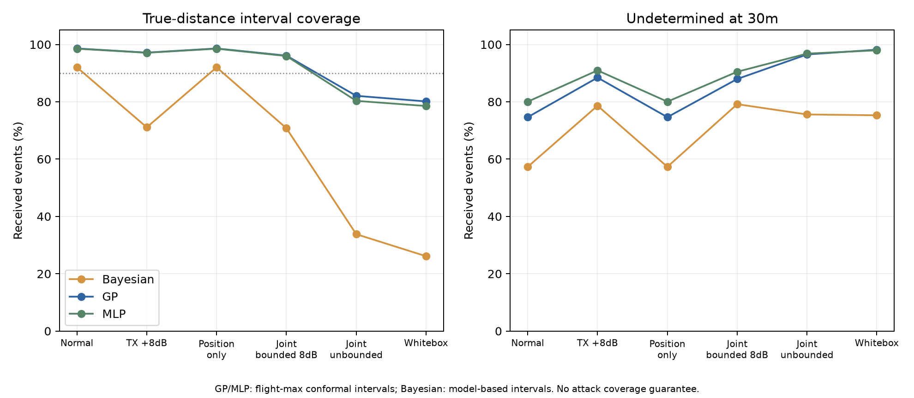
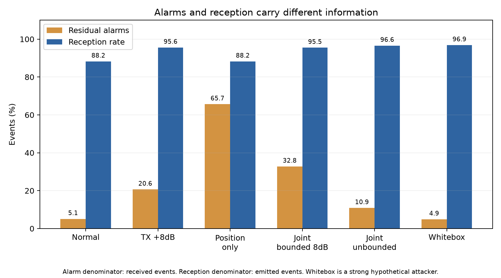

# Week26：Macでの独立3D・非同期RSSI合成評価

2026-11-01にMac ARM64で実行完了。**新たな別実装の合成評価であり、文書04の元ZIPの数値再現ではない。実UAV・RF・Pi・Pixel・ZKPの実験ではない。**

## 今回分かったこと

- 未校正の今回モデルでは、通常時のGPの距離MAEは約25.60m、位置と電力を連動させると約45.81mに悪化。
- 正常時のRSSI残差警報率は約5.11%、検出器と瞬時チャネルを知る強い白箱攻撃では約4.90%。ただし受信率が88.24%から96.86%へ変わるので、すべての観測で攻撃が隠れるとの結論にはしない。
- 30m付近を多くした別条件ではGPのMAEは約7.29m。しかし30m判定は17,353件中36件のみ、**99.79%が保留**。平均距離誤差と、距離境界の判定能力は別。
- 距離を訓練データの中央値へ固定するRSSI不使用の対照に対する改善は、広域で約3.05m、境界重視で約0.52mにとどまる。低いMAEをRSSIだけの有効性と解釈しない。

## 設計と範囲

| 項目 | 今回の定義 |
|---|---|
| データ | すべて生成した架空の局所3D座標・距離。実位置・実センサ値は不使用 |
| 観測 | 3受信ノードの抽象モデル。1イベントにつき1ノード・RSSI1値。飛行ごとに担当ノードが交替 |
| 時間 | 各飛行40発信、3秒間隔。飛行開始が1時間間隔。拠点間の同一パケット差分は不使用 |
| 分割 | 各seedの訓練70飛行、校正26飛行、評価45飛行。ID・時刻・乱数実現を分離 |
| seed | 固定10seed。1seedで同じ基礎イベントを10シナリオに対応適用 |
| 主評価規模 | 18,000基礎テストイベント×10条件＝180,000条件別イベント。独立180,000試行という意味ではない |
| チャネル比較 | 同じ10seedでLOSのみ・理想化の通常条件も評価。追加36,000条件別イベント |
| 境界重視 | 分布を変更した別コホートで180,000条件別イベント。主評価と合算しない |
| 取得成功 | 感度−100dBmと独立3%欠測。受信できたイベントで誤差・包含率を集計、発信数を分母とした受信率も保存 |
| 伝搬仮定 | 指数2.2、実効1m基準受信電力−42dBm、NLOS損失12dB、相関遮蔽・t分布フェージング・姿勢利得・校正誤差・相対GPS誤差・1dB量子化 |

**数値は感度分析用の仮定で、実機校正・3GPP規格準拠・現実の攻撃実行可能性を示さない。** 3ノードを移動する連続の真の飛行軌道を再現したものではなく、各拠点に対する飛行セッションを生成する。訓練・校正には独立の合成真距離ラベルがある有利な条件。

実行前の全パラメータ：[主設定](../experiments/week26-rssi-privacy/synthetic3d_config.json)。広域条件は水平半径6～140m・高度3～70m。生成後に30m以下が少ないことを確認し、[境界重視設定](../experiments/week26-rssi-privacy/synthetic3d_threshold_config.json)を別途定義して実行した。後者は半径5～40m・高度3～25m、学習・校正・評価すべての分布を変更するため、同一モデルの因果効果比較ではない。

## 比較した方法

- **PathLoss**：訓練の独立真距離から較正した切片を用いる、伝搬式の単純逆算。
- **Bayesian**：log10距離の一様事前と、訓練残差から推定したGaussian尤度による切断正規事後。構造が既知でない環境・敵対的電力で正しい事後とは限らない。
- **GP**：Gaussian Processによるlog10距離回帰。固定RBF＋WhiteKernel、訓練から無作為に最大512件。ハイパーパラメータ最適化なし。
- **MLP**：24×24・tanhの小型ニューラルネットでlog10距離を回帰。LBFGS、最大500反復。全訓練受信点を利用。
- **Oracle参考**：実電力とNLOS状態という隠れた真値を使う式。遮蔽・フェージング等は残るため、最良の誤差下界ではない。通常モデルより悪い場合も保存。

GP／MLPの入力は受信RSSIから受信機の推定オフセットを引いた1値のみ。偽装の申告距離・真のテスト位置を回帰器に入力しない。警報器だけは別に申告距離から「必要実効電力」を計算する。これは実電力の測定ではない。

GP／MLPの区間は、**校正飛行ごとの最大log距離誤差**を1スコアとするsplit conformal。26飛行のうち有限標本の90%順位を使用し、イベントを独立校正サンプルとみなさない。Bayesianは点ごとのモデル事後区間なので、保証対象が同一ではなく、区間方式の優劣を直接順位付けしない。攻撃時・分布外の包含保証は主張しない。GPの高い点ごと包含率は広い区間と保留の多さを伴う。

## 主評価：距離MAE（m）

| 条件 | PathLoss | Bayesian | GP | MLP |
|---|---:|---:|---:|---:|
| 正常変動 | 56.62 | 39.11 | 25.60 | 25.49 |
| 飛行内一定 | 55.27 | 37.85 | 25.11 | 25.05 |
| 電力+8dB | 52.35 | 47.14 | 31.12 | 30.95 |
| 電力SD9dB | 63.95 | 46.09 | 28.80 | 28.61 |
| 緩やかドリフト | 61.16 | 42.71 | 26.93 | 26.76 |
| 途中+8dB段差 | 55.34 | 43.77 | 28.46 | 28.25 |
| 位置だけ偽装 | 56.62 | 39.11 | 25.60 | 25.49 |
| 位置＋電力連動 | 67.73 | 66.63 | 45.81 | 46.47 |
| 連動・±8dB制限 | 53.50 | 48.10 | 31.86 | 31.75 |
| 白箱複合偽装 | 70.73 | 69.87 | 47.46 | 48.36 |

位置だけの偽装では受信RSSIを変更しないため、RSSIのみを入力とする距離回帰の予測・距離MAEは正常時と完全一致する。位置申告を使う残差警報は変わる。この違いを検査した。

## 包含率と保留：主評価のGP

| 条件 | 真距離を区間に含んだ率 | 30m判定の保留率 | 誤判定／全受信 | 誤判定／判定した受信 |
|---|---:|---:|---:|---:|
| 正常変動 | 98.60% | 74.63% | 0.12% | 0.47% |
| 位置＋電力連動 | 82.08% | 96.50% | 0.83% | 23.85% |
| 白箱複合偽装 | 80.13% | 98.18% | 0.75% | 41.19% |

正常時のGP区間の平均幅は約242.3m。誤判定／全件の小ささだけで評価すると、ほとんど判定しない方式を過大評価する。白箱攻撃では、少数ながら判定した事例の約41.2%が誤判定となる。

## 警報と受信率

警報率の分母は受信件数、受信率の分母は発信件数。両者は異なる。白箱攻撃は瞬時のチャネル・受信機較正推定値・検出器の校正残差分布を知り、任意の電力を設定する極端な対照。現実の機体へ実装可能・合法とは評価していない。

±8dB制限付き攻撃は、通常電力からの差分を±8dBに制限したもの。実EIRPや無線機の絶対出力上限を規定したものではない。各条件の最小・最大実効基準電力を[CSV](results/mac-independent3d-20261101/scenario-ranges.csv)へ保存。

## 30m付近を増やした追加評価

主評価では受信点のうち真距離30m未満は2.93%、20～40mは6.86%。常に「30mより遠い」と答えるだけでも誤りは2.93%であり、その集計だけでは評価が偏る。

境界重視コホートでは30m未満56.02%、20～40m67.78%。正常時の定数中央値予測はMAE7.81m、GPは7.29m。母集団を狭くするだけでもMAEが小さくなるので、広域25.60mからの改善と解釈しない。

| GPの条件 | 距離MAE | 受信数 | 判定数 | うち誤判定数 | 保留率 |
|---|---:|---:|---:|---:|---:|
| 正常変動 | 7.29m | 17,353 | 36 | 1 | 99.79% |
| 位置＋電力連動 | 11.37m | 16,466 | 21 | 21 | 99.87% |
| 白箱複合偽装 | 11.22m | 16,631 | 27 | 27 | 99.84% |

判定した少数事例が全部誤りとなる条件もあるが、少数のため一般的な失敗率とは主張しない。今回の保守的な区間構成では、30m付近の大部分を判定できないという結果。

[境界重視のCSV／JSON](results/mac-independent3d-threshold-20261101/summary.json) ／ [包含率・保留の図](results/mac-independent3d-threshold-20261101/coverage-and-hold.png)。

## 実行と検査

- 主評価＋チャネル比較120ジョブ、境界重視100ジョブを直列実行して完了。どちらも途中の進捗JSONLと状態JSONを保存。
- 分割・同一イベント・位置のみの対応関係・電力補償・±8dB制限・白箱の観測条件・飛行単位の区間校正・GPS誤差・端数／閾値処理、合計11テスト成功。
- 主評価の解析プロセス最大RSSは約194.7MiB、境界重視約179.7MiB。シミュレーションの実行時間は約5.44秒／2.31秒。依存読込み・環境構築・描画・資料作成は別。実機ZKP性能の値ではない。
- 学習時の警告は今回0件。警告は抑制して成功扱いせず、fitごとにJSONへ保存する。
- [実行コード・設定・手順](../experiments/week26-rssi-privacy/README.md)
- [主評価の全CSV](results/mac-independent3d-20261101/summary.csv) ／ [飛行単位の分母・誤差・判定数CSV](results/mac-independent3d-20261101/flight-metrics.csv) ／ [全設定・fit情報・ハッシュJSON](results/mac-independent3d-20261101/summary.json)
- [距離分布とRSSI不使用の対照](results/mac-independent3d-20261101/geometry-and-prior-diagnostic.json)

## 今後の判断

今回確認したのは**明示した仮定の下での計算結果**。実ドローンの距離精度・不正検出性能ではない。元ZIPの比較、公開BLE変動を合成モデルへ注入する文書05の再現は未実施。

次は未校正パラメータを増やすより、独立真距離を持つ実測、無RSSIの対照、30m付近で判定できる割合と誤りの許容条件を先に固定する。ZKP化する場合も、現段階で証明できる対象は仮定した計算と判定保留であり、物理的な真距離・安全性の保証にはしない。

実装APIの確認資料：[scikit-learn GP](https://scikit-learn.org/stable/modules/generated/sklearn.gaussian_process.GaussianProcessRegressor.html)、[MLP](https://scikit-learn.org/stable/modules/generated/sklearn.neural_network.MLPRegressor.html)。参考にした元の研究条件は[文書04](04_3D非同期RSSI_本格合成シミュレーション結果.md)。原コード未入手のため、元表との数値一致を評価基準にしていない。
