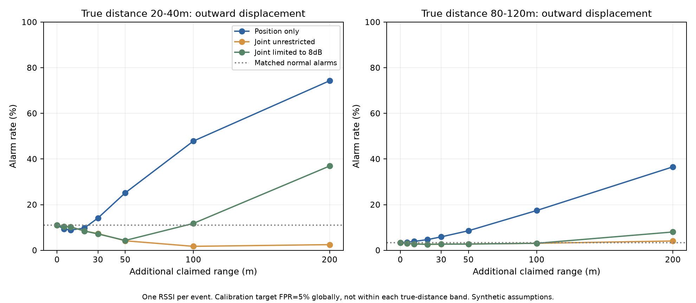
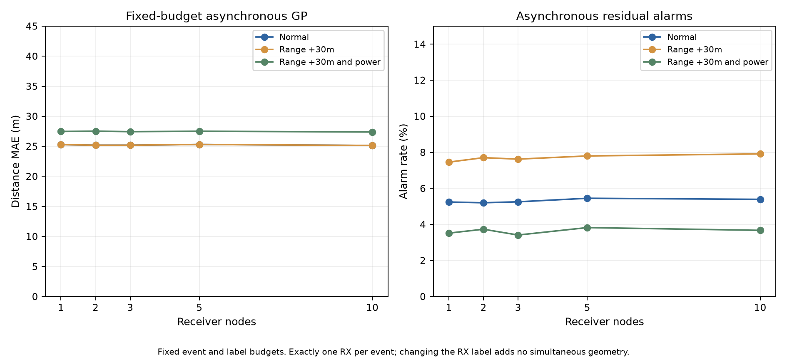
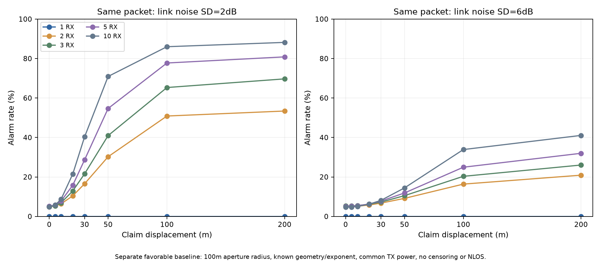
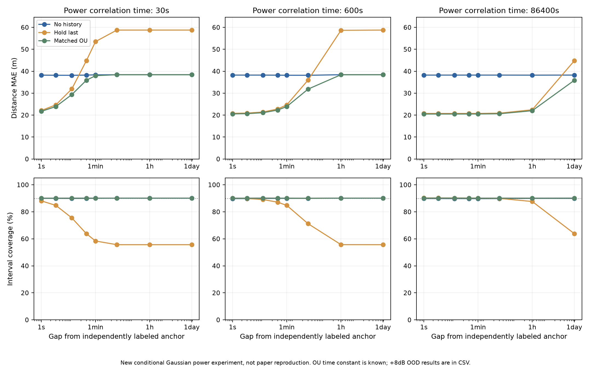
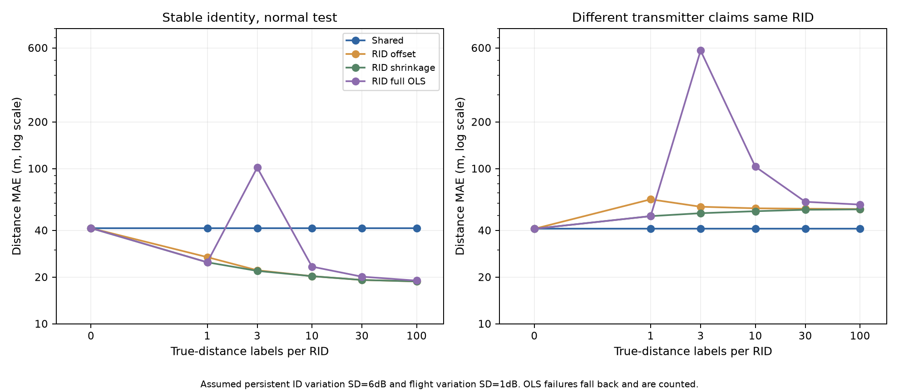
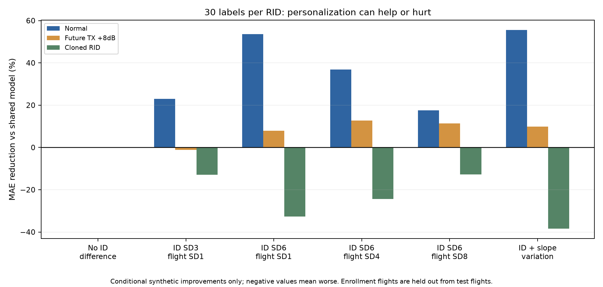

# Week26：偽装距離・端末数・時間差・RID別学習の追加評価

2026-11-01、Mac ARM64で実行完了。文献の成立条件を調べ、5つの独立した感度実験を追加した。**数値は仮定した合成モデル内の結果で、実ドローンでの検出距離や期待改善率ではない。** 先行実験08の元の出力は変更していない。

[文献調査・適用条件・実験設計](09_追加文献調査と感度実験の設計.md) ／ [全設定](../experiments/week26-rssi-privacy/sensitivity_config.json) ／ [再実行コード](../experiments/week26-rssi-privacy/sensitivity_suite.py)

## 結論

1. **何mで検知できるかは、元の距離・方向・電力・雑音で変わる。** 今回の単一RSSIでは、20～40m先の機体が外向きに追加30mの位置偽装をしても警報率14.12%。その距離帯の正常警報も10.95%あり、十分な検出性能とはいえない。距離を変えない方向は正常と区別できなかった。
2. **非同期のまま端末数だけを増やしても、今回はほぼ改善なし。** 固定した総観測・学習件数では1～10台でGP MAEは25.14～25.31m。
3. **同一パケットの複数受信は別の情報を加える。** 既知配置・低雑音の有利な条件では、30m位置偽装の警報率は2台16.53%から10台40.29%。ただし雑音6dBなら10台でも8.14%。単純に端末を増やせば保証されるわけではない。
4. **履歴の有効期限は電力特性の持続時間で変わる。** 相関時間10分の条件では、直前の独立真距離付き観測が3秒前ならMAE20.68m、1時間前なら38.41mで履歴なしとほぼ同じ。古い値を信じ続けると悪化する。
5. **RID別補正は、安定した個体差がある場合に改善し得る。** 今回の固有差SD6dB・飛行差SD1dBでは、独立真距離付き30件でMAE41.35→19.17m（53.65%減）。一方、別送信機が同じRIDを名乗る条件では40.96→54.33mへ悪化。RIDは機体認証ではない。

## 1. 偽装距離と方向

既存3Dモデルの通常の申告誤差を残し、さらに申告距離を外向きへずらす。正常校正データ全体で目標誤警報率5%となる閾値を設定した。閾値を結果に合わせて距離帯ごとに調整していない。

| 追加の外向き申告変位 | 真距離20～40m：警報率 | 真距離80～120m：警報率 |
|---:|---:|---:|
| 0m | 10.95% | 3.29% |
| 5m | 9.37% | 3.55% |
| 10m | 8.86% | 3.88% |
| 20m | 9.73% | 4.68% |
| 30m | 14.12% | 5.88% |
| 50m | 25.14% | 8.56% |
| 100m | 47.84% | 17.42% |
| 200m | 74.28% | 36.56% |

0mは偽装を追加していない対照。その警報率10.95%／3.29%が各距離帯の正常誤警報率。**全体で5%を目標に校正しても、距離帯別に5%とは限らない。** 近距離で5～10mのずれを加えると警報率が下がる条件もあり、モデル残差・受信選択の偏りがある。警報率の高さだけで検出能力と解釈しない。

この表は「追加の受信機からの距離変位」であり、あらゆる方向の3D位置ずれの検知率ではない。内向き、距離を変えない球面上の変位、電力連動もCSVに保存した。物理的に実現できない球面弦長や、受信機を通り越す内向き変位は除外し、分母を明示した。

同じ受信機からの距離を変えない方向では、すべての有効セルで警報数が対応する正常対照と**完全一致**。自由電力との連動では、距離差が大きくてもRSSI整合性を戻せる。±8dB制限は通常の実効基準電力からの変化幅で、現実のEIRP上限・法規適合の条件ではない。

## 2. 端末数：非同期と同一パケットを分離

### 非同期・総データ数固定

70訓練飛行・26校正飛行・45テスト飛行×40イベントを各seedで維持。真距離・真電力・時刻の同じ実現を、1／2／3／5／10受信機へ割り当てる。各イベントは1受信機だけで、受信機の較正誤差は残る。

| 台数 | 通常時GP MAE | 正常時警報率 | 追加30mの位置だけ偽装：警報率 |
|---:|---:|---:|---:|
| 1 | 25.28m | 5.24% | 7.46% |
| 2 | 25.19m | 5.20% | 7.70% |
| 3 | 25.19m | 5.25% | 7.62% |
| 5 | 25.31m | 5.45% | 7.80% |
| 10 | 25.14m | 5.39% | 7.91% |

この条件では台数だけではほぼ改善しない。観測数やカバー範囲を増やす実運用の便益を否定する結果ではなく、「同じ量の単一RSSIデータへノードの種類だけを増やす」対照である。今回、同時性や他のノードによる同じ真位置への追加拘束を与えていない。

### 同一パケット・共通未知電力

別方式として、同一イベントを複数受信機で受ける。申告位置に対して各受信機の必要電力を求め、共通平均を除いた残差RMSを検査。配置・伝搬指数が既知、欠測・NLOSなしという有利な条件。受信機は半径100mの円上に均等配置し、高さも交互に変更する。

| 台数 | 雑音SD2dB：30m偽装 | 雑音SD6dB：30m偽装 | 正常警報率（SD2dB） |
|---:|---:|---:|---:|
| 1 | 0.00% | 0.00% | 0.00% |
| 2 | 16.53% | 6.74% | 4.89% |
| 3 | 21.56% | 7.26% | 4.91% |
| 5 | 28.65% | 7.77% | 5.12% |
| 10 | 40.29% | 8.14% | 4.84% |

1台では未知の共通電力へすべて吸収でき、このスコアに位置情報は残らないため警報0。これは上の単一RSSI検査が用いる「学習済み電力分布」の事前仮定を置かない対照である。

低雑音SD2dB・10台・半径100m・ランダム水平偽装では、100mのずれで警報率約86.0%、200mで約88.2%。SD6dBでは200mでも約41.1%。**この半径100m・ランダム水平偽装の格子では95%の検出に届かず、「何m以上なら必ず検知」とは言えない。** 5台の80%到達は格子上200m、10台では100mだが、その間の真の境界や現実の最小検知距離ではない。

別方向では高い検出率の条件もある。第1受信機からの距離を保つ200mの変位で、SD2dB・半径100mの場合、5台で99.03%、10台で99.93%。ただし弦長200mが実現できる18,470標本だけの条件付き結果で、全位置・全方向の95%保証ではない。

半径20mの配置・第1受信機からの距離を変えない偽装も比較済み。Nごとに円上地点は異なり、完全な入れ子配置ではない。3D位置そのものを一意に推定した結果ではなく、申告位置の整合性スコアである。指向性利得・リレー・複数送信源で共通電力モデルが崩れる問題は未検証。

## 3. 時間差：どこまで過去を使えるか

ここでは独立した条件付きGaussian電力モデルを使う。電力の速い変動はrho=exp(−gap/tau)で相関し、安定した機体平均にも1dBの不確実性がある。直前の観測は**独立真距離が分かるアンカー**で、そのときの電力を雑音付きで推定できる有利な設定。現在のRSSIは1値だけ。距離を知らない不信頼な過去申告から電力真値を取得したとはしない。

相関時間tau=10分での通常条件：

| 時間差 | 履歴なしMAE | 過去値を維持MAE | 相関時間を知る予測MAE | 過去値を維持した区間包含率 |
|---:|---:|---:|---:|---:|
| 1秒 | 38.25m | 20.81m | 20.56m | 90.06% |
| 3秒 | 38.25m | 20.94m | 20.68m | 89.88% |
| 10秒 | 38.25m | 21.42m | 21.11m | 89.10% |
| 30秒 | 38.22m | 22.79m | 22.31m | 87.16% |
| 60秒 | 38.18m | 24.69m | 23.90m | 84.76% |
| 300秒 | 38.17m | 36.00m | 31.87m | 71.19% |
| 3600秒 | 38.42m | 58.67m | 38.41m | 55.72% |
| 86400秒 | 38.42m | 58.76m | 38.41m | 55.68% |

相関時間に合った予測では、このGaussianモデルの通常条件で包含率は約90%を維持。相関時間を1日と仮定すると、1時間差でもMAE38.23→22.02mで履歴が役立った。したがって「何時間まで有効」という普遍値はなく、**実際の電力・環境の持続時間を計測する必要**がある。

古い値をそのまま維持すると、相関時間10分・1時間差でMAE58.67m、区間包含率55.72%。履歴なしより悪い。未知の+8dB段差も別に評価しており、結果はCSV。相関時間と雑音分散を正しく知る前提そのものが有利で、実機で未知のまま同じ精度が出る保証ではない。今回比較したのは観測間ギャップで、学習の収集窓長を変えた実験ではない。

## 4. RID別モデル：改善する条件・悪化する条件

共通モデルは独立した外部30IDの合成真距離付きデータで学習。対象20IDへ0～100件の独立真距離ラベルを与え、別の10飛行で評価。受信機差は較正済みという簡略条件。識別名は機体の認証ではなく、同じRID文字列にデータを割り当てる抽象モデル。

比較は共通の伝搬直線、RID別切片、母集団へ戻す縮約切片、RID別切片＋傾きOLS。縮約はID差と学習量に応じて補正を弱める方法で、完全な階層GPやNNを実装したものではない。縮約の雑音分散は生成値に一致させている。

### 30ラベル／RIDでの通常条件

| 仮定したID差・飛行差 | 共通MAE | RID縮約補正MAE | 相対MAE改善 |
|---|---:|---:|---:|
| ID差なし・飛行SD1dB | 18.86m | 18.86m | -0.01% |
| ID SD3dB・飛行SD1dB | 24.99m | 19.24m | 22.99% |
| ID SD6dB・飛行SD1dB | 41.35m | 19.17m | 53.65% |
| ID SD6dB・飛行SD4dB | 48.95m | 30.88m | 36.91% |
| ID SD6dB・飛行SD8dB | 76.03m | 62.72m | 17.51% |
| ID SD6dB・伝搬指数にも固有差 | 43.95m | 19.53m | 55.56% |

マイナスは悪化。ID差がなくても個別化すれば改善する、という結果にはならなかった。ID固有差SD6dB・飛行差SD1dBの53.65%改善は、10seedでは約20.8～65.4%の範囲、10seedとも改善。一方、飛行差SD8dBでは約17.5%改善に縮み、10seed中1seedは悪化した。これらは信頼区間ではなく、設定した乱数seed間の記述的ばらつき。

### 安定ID差SD6dBの学習曲線

| 真距離ラベル／RID | 共通MAE | RID切片 | RID縮約切片 | RID切片＋傾きOLS |
|---:|---:|---:|---:|---:|
| 0 | 41.35m | 41.35m | 41.35m | 41.35m |
| 1 | 41.35m | 26.90m | 24.91m | 24.91m |
| 3 | 41.35m | 22.13m | 21.93m | 101.56m |
| 10 | 41.35m | 20.27m | 20.27m | 23.35m |
| 30 | 41.35m | 19.16m | 19.17m | 20.13m |
| 100 | 41.35m | 18.76m | 18.76m | 18.98m |

同一飛行内の複数フレームは独立な個体差情報ではない。今回30件は3飛行×10件、100件は10飛行×10件。1件／3件／10件は最初の1飛行からのprefixであり、単に独立飛行数30／100と解釈しない。

3件のRID別OLSでは平均誤差101.56mとなり、共通モデルより悪化。 これは上の安定ID差SD6dB・通常条件の値。飛行差SD8dBで同名別送信機を受ける別条件では、3ラベルOLSのMAEは約4,248.5mに達した。物理的に妥当な測距精度ではなく、モデルが破綻した予測の指標である。少数データで切片と傾きを自由に学習すると過学習する。数値不正・傾きが不適切な場合のfallback件数を含めて保存し、悪いrunを除外していない。RID別OLSは3件の正常条件でも200ID実現中15件が縮約へfallback。

### RIDコピー・途中の出力変更

ID SD6dB・30ラベルの場合、別送信機が同じRIDを名乗ると、共通MAE40.96mに対し個別化54.33m、約32.64%悪化。10seed中9seedで悪化した。個別モデルが「同じ機体が来た」という保証になるわけではない。

途中+8dBでは、同条件のRID補正は通常時19.17mから27.67mへ悪化する。一方、共通モデル自身は一部条件でMAEが小さくなる。距離分布・偏りの相殺もあり、**距離MAEの改善を攻撃検出の成功と解釈しない。**

実データでRID別モデルを作ることは可能だが、`claimed RID・受信ノード・受信時刻・flight/session・PHY・較正版・独立真値の有無`を区別して収集する必要がある。実座標・真値台帳はignored captures/へowner-onlyで保管する。RID申告座標を正解として無条件に学習しない。新しいRID・同名別送信機・移設・電力変更を想定し、共通モデルとの比較と更新の承認条件を残す。

## 成果物・検査・再実行

- 全5研究×10seed、50 seed-studyを直列実行。種別ごとに生の集計行と要約を保存。種別間の観測条件が異なるため、巨大な一つの標本数として合算しない。
- 18テスト成功。保存結果の追加監査9項目も成功：分母、seed、対応のある正常対照、同距離方向、1受信機の電力除去、非同期の位置だけ偽装、RID cold-start等。
- 解析プロセスの最大RSS約187.0MiB、主処理約11.80秒。描画・依存読込み・資料作成は別で、PiやZKPの性能値ではない。
- [要約JSON・設定・環境・出典ハッシュ](results/mac-sensitivity-20261101-v2/summary.json)
- [偽装距離CSV](results/mac-sensitivity-20261101-v2/position-summary.csv) ／ [同一パケット台数CSV](results/mac-sensitivity-20261101-v2/synchronous-summary.csv) ／ [非同期台数CSV](results/mac-sensitivity-20261101-v2/asynchronous-summary.csv)
- [時間差CSV](results/mac-sensitivity-20261101-v2/time-summary.csv) ／ [RID別CSV](results/mac-sensitivity-20261101-v2/personalization-summary.csv) ／ [RID改善率・seed間の範囲CSV](results/mac-sensitivity-20261101-v2/rid-improvement.csv)
- [格子上の50／80／95%警報到達点](results/mac-sensitivity-20261101-v2/sampled-detection-limits.csv)：未到達は空欄。格子間のしきい値・実用保証ではない。
- 各`*-seed-metrics.csv`に分母・警報数・誤差合計・fallback・警告を保存。`progress.jsonl`、`status.json`で実行済みと失敗を識別。
- [コードとコマンド](../experiments/week26-rssi-privacy/README.md) ／ [監査JSON](results/mac-sensitivity-20261101-v2/audit.json) ／ [成果物ハッシュ](results/mac-sensitivity-20261101-v2/artifact-manifest.json)

## 初回runの数値処理と改訂

初回は数値処理用にlog10予測距離を[-6,6]へ制限しており、極端なOLS予測の58評価ケースで上限が作用した。悪いモデルの誤差を過小に見せるため、初回runを`mac-sensitivity-20261101`へ保持し、数値範囲を[-100,100]として同じ設定で再計算した。本文・図・CSVは改訂run `mac-sensitivity-20261101-v2`。最終runでは数値上限の作用0件。安定条件の縮約補正・台数・時間・偽装距離の主要結果は変わらず、極端なOLSの失敗値を正しく保持できた。

## 今回の研究判断

今回の合成結果からは、**まず共通モデル＋小さなRID別補正を、独立した真距離付きの複数飛行で比較する**候補が得られた。ただし個体差・時間相関・受信機較正が実際にどれだけ安定するかを測る前に、53.65%改善や100m検出を実機の期待値として約束しない。

現在の主シナリオである非同期・1イベント1RSSIを維持するなら、端末数だけに改善を期待せず、安定性の計測・独立真値・異常時の保留を優先する。同一パケットの複数地点受信は有望な別条件だが、方向依存利得や反射を含む現実の検査が必要。

モデルの個別化・履歴管理・ZKPを追加しても、claimed RIDの物理機体への認証、センサの正直さ、30m安全性は自動で保証されない。新しい実機RF取得・ZKP回路・TEE／TPMは今回実施していない。
