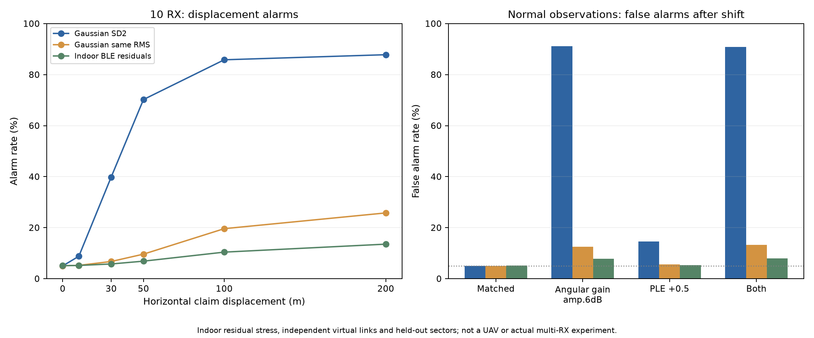
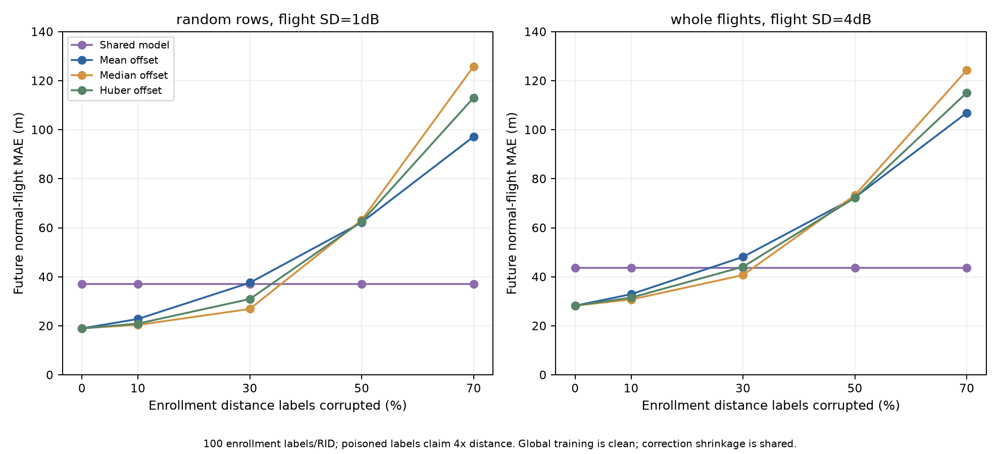
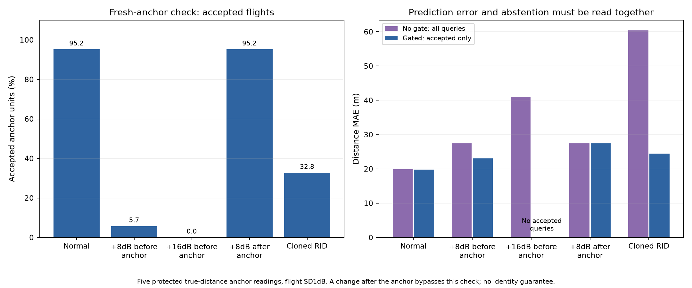
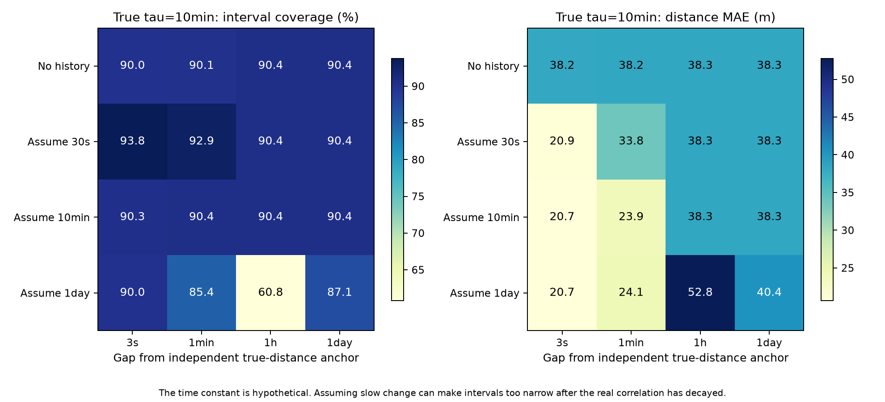

# Week26：実測揺らぎ・学習汚染・モデル失効の追加評価

2026-11-01、Mac ARM64で実行。4研究×10seed、40 seed-studyを完了。**屋内BLE残差を用いた独立ストレス試験と合成評価であり、実ドローンの測距性能・不正検出率ではない。** 前回までの結果は変更せず保持した。

[追加文献と実験設計11](11_実測揺らぎ_学習汚染_モデル変化の追加調査.md) ／ [設定](../experiments/week26-rssi-privacy/robustness_config.json) ／ [コード](../experiments/week26-rssi-privacy/robustness_suite.py)

## 今回の結論

- **低雑音Gaussianの高い警報率は、その仮定に強く依存する。** 10受信機・100m偽装で、SD2dBなら85.82%、公開BLE残差の再標本化では10.42%。後者は屋外UAVの予測ではなく、重い裾・変動を入れたストレスの結果。
- **正常な環境変化を不正と取り違える可能性がある。** 方向依存利得と伝搬指数を校正後に変えると、SD2dB条件の正常警報率が約90.84%になった。「警報が多い」だけでは検出性能にならない。
- **RID補正は、誤教師に耐える設計が必要。** ラベル30%を距離4倍へ汚染すると、平均補正MAE37.60mに対し中央値26.90m、Huber30.95m。ただし70%汚染では中央値125.86mとなり、共通モデル37.13mより大幅悪化。
- **新しい独立真距離アンカーはモデルの失効点検に使えるが、万能ではない。** 点検前の+8dBは94.3%を保留にした一方、点検後の変化は正常時と同じ95.2%が通過。モデル点検は機体認証でも将来の電力保証でもない。
- **時間相関を長く見積もりすぎると過信する。** 真の相関時間10分・1時間差で、1日安定と誤るとMAE52.78m・包含率60.82%。相関時間を正しく扱う場合は約38.29m・90.38%。

## 1. 公開BLEの残差による複数受信ストレス

入力は固定コミットのCSV3個、計50,400 RSSI値。各出力設定・セクター・ビーコンの先頭50行の中央値を基準とし、後半50行のみ残差へ変換した。残差は計25,200値。奇数/偶数14セクターずつの12,600値を校正・評価に分けて入れ替えた。原CSVはignored captures/内、権限0600。

残差のRMSは2分割で8.21／8.49dB、絶対残差95%点20.0／21.5dB。有限値・入力範囲・固定ハッシュを検査。README／codebookで明示的な欠測値規約は確認できず、欠測埋めや外れ値削除はしていない。行の時間的独立性は確認できない。

### 10受信機・通常の伝搬条件

| 雑音の置き方 | 正常警報率 | 30m偽装の警報率 | 100m偽装の警報率 |
|---|---:|---:|---:|
| Gaussian SD2dB | 5.01% | 39.82% | 85.82% |
| 校正残差と同RMSのGaussian | 5.06% | 6.74% | 19.61% |
| 公開BLE残差の再標本化 | 5.11% | 5.77% | 10.42% |

RMSだけを合わせたGaussianでも、残差再標本化より100m偽装の警報率が高い。分布の裾・非対称性・校正/評価の場所差を無視できない。

ただし、**このBLEデータは6固定ビーコンをスマホが測った屋内データ**である。複数受信機が同じUAVパケットを測ったデータではない。仮想リンクへ独立に残差を再標本化し、同一イベントの共通電力を除去する仮定を置いた。実リンク間相関、屋外、NLOS、欠測や実機の姿勢をそのまま再現してはいない。

### 校正後の変化

方向依存成分は各受信方向へ6*cos(angle) dBを足す**振幅6dBの相対利得**で、全受信機へ共通の+6dBではない。共通電力なら差分で消えるが、方向別の差は消えない。伝搬指数は校正2.2・評価2.7とする。

| 校正後の条件 | SD2dBモデル：正常警報率 | 残差再標本化：正常警報率 |
|---|---:|---:|
| 変化なし | 5.01% | 5.11% |
| 角度依存利得を追加 | 91.20% | 7.80% |
| 伝搬指数+0.5 | 14.60% | 5.25% |
| 両方 | 90.84% | 8.03% |

狭い通常分布で厳しく校正すると、環境変化に大量警報を出す場合がある。重い裾に合わせて閾値を広げると、偽装への感度が下がる。前回の「同一パケットなら改善し得る」は条件付きであり、実測校正なしに約86%の検出を期待しない。

## 2. RID別モデルへの誤教師混入

共通モデルを学習する外部30IDは保護・正常とする。対象20IDの独立真距離ラベル100件（10飛行×10件）の一部だけを、距離2倍／4倍という誤った教師へ変更した。実際のRSSIは変えない。これは、申告位置を無検証で教師に使う危険を模擬する。

平均・中央値・HuberによるRID切片補正を、同じ縮約率で比較。雑音分散・飛行分散・ID分散は正常な外部データから推定し、生成値をそのまま渡していない。Huber尺度も外部データのみで固定。推論は別飛行で実施。

### 飛行差SD1dB、ラベル4倍、ランダム行汚染、未来は通常

| 汚染率 | 共通モデルMAE | 平均補正 | 中央値補正 | Huber補正 |
|---:|---:|---:|---:|---:|
| 0% | 37.13m | 18.98m | 19.03m | 18.98m |
| 10% | 37.13m | 22.81m | 20.39m | 20.93m |
| 30% | 37.13m | 37.60m | 26.90m | 30.95m |
| 50% | 37.13m | 62.24m | 63.18m | 62.53m |
| 70% | 37.13m | 97.20m | 125.86m | 113.09m |

中央値・Huberは一部の汚染を抑えるが、正解へ自動的に戻すものではない。過半数が一方向の誤教師になると、頑健な推定も悪い値へ寄る。飛行単位の汚染と大きい飛行差も保存済み。飛行差SD4dB・30%の全飛行汚染では共通43.68m、平均48.14m、中央値40.72m、Huber44.11mで、改善も小さい。

+8dBの将来変更や同名別送信機の結果もCSVへ残す。誤教師と未来の出力変化が偶然相殺してMAEが下がる場合を、防御成功とは呼ばない。**外部の共通学習まで汚染された場合は今回の評価外**で、共通モデルを無条件に安全な退避先としない。

## 3. 新しい真距離付きアンカーで個別モデルを点検

ここでのgateは「個別モデルを使う／保留する」の点検。新しいアンカーのRSSIと**独立真距離**から必要電力を求め、個別モデルの想定との差が閾値を超えたら、その飛行の予測を出さない。閾値は通常の独立校正1000単位で決め、対象20IDの別10飛行で検査した。

独立真距離には、管理下の既知配置や別センサ等が必要。RIDの申告座標を信じた値では成立しない。取得経路・真値・点検後の持続性という追加条件であり、元のRSSIだけの非識別性を解消したのではない。

### 飛行差SD1dB・5アンカー観測

| 状況 | モデル使用率 | 保留率 | 判定前点検なしのMAE | 使用した予測だけのMAE |
|---|---:|---:|---:|---:|
| 正常 | 95.20% | 4.80% | 19.86m | 19.78m |
| 点検前+8dB | 5.70% | 94.30% | 27.43m | 23.03m |
| 点検前+16dB | 0.00% | 100.00% | 40.96m | —（全件保留） |
| 点検後+8dB | 95.20% | 4.80% | 27.43m | 27.49m |
| 同名別送信機 | 32.75% | 67.25% | 60.37m | 24.45m |

各条件は10seed合計2,000アンカー単位（ID×飛行）、各単位に20クエリ。クエリをすべて独立な試行と解釈しない。正常のモデル使用率95.2%は誤差の正解率ではなく、閾値を通過した率。

点検前+8dBでは94.3%を保留にできるが、点検後+8dBは正常時と同じ95.2%が通過した。点検は過去の状態を見ているだけで、将来の電力変更を防がない。同名別送信機も32.75%は通過。似た電力特性なら識別できず、機体認証ではない。

使用した予測だけのMAEは、保留した標本を除いた別の母集団。使用率を同時に読まないと改善を過大評価する。全件保留を誤差0とせず、CSVでは空欄／JSONではnullにする。1／20観測・飛行差SD4dBも評価済み。

CRCの形式的リスク保証や遠隔attestationを実装したものではなく、校正したモデル不整合スクリーニングである。

## 4. 時間相関の見積もり違い

真の相関時間と、モデルが仮定する値を分離。直前アンカーの独立真距離が既知という前回と同じ有利な観測条件だが、モデルは真の相関時間を知らない場合も比較した。

### 真の相関時間10分、1時間差、通常条件

| モデルの仮定 | 距離MAE | 公称90%区間の実包含率 |
|---|---:|---:|
| 履歴なし | 38.31m | 90.38% |
| 相関時間30秒 | 38.29m | 90.38% |
| 相関時間10分 | 38.29m | 90.38% |
| 相関時間1日 | 52.78m | 60.82% |

「長く安定する」と誤って覚えると、古い情報を重く使い、誤差が増えたうえに区間も狭すぎる。実測から相関時間を推定し、その推定誤差や変化を検査する必要がある。今回の値は仮定の感度分析で、実UAVの相関時間を推定したものではない。未知の+8dB段差も別集計した。

## 次の設計判断

1. **学習入力の出典を優先する。** 正解距離の入手経路を分け、RID申告を無検証で教師へ取り込まない。モデル更新前の検証・保留を設ける。頑健推定だけを防御としない。
2. **共通モデル＋小さなRID補正を候補として維持するが、失効条件を持たせる。** 新機体・RIDコピー・環境変化で過去の補正が不適切になり得る。共通モデルも正常性を別途検証する。
3. **物理的な追加情報は、その前提とコストを明記する。** 新しい独立真距離アンカーがない運用へ、今回の点検性能を適用しない。点検間隔・電力変更時刻も評価対象。
4. **複数受信の採用判断は実測校正後。** 低雑音のGaussianだけで端末数を決めず、方向依存利得・反射・欠測・リンク間依存を含める。

いずれも研究PoCの設計候補で、航空機認証・観測者hardwareの真正性・センサの正直さ・30m安全性を保証するものではない。新しい実UAV受信、Pi／Pixel実測、ZKP回路、TEE／TPMの導入は行っていない。

## 成果物と検査

- 4研究×10seed、40 seed-study完了。実行途中はseedごとにCSVと進捗を保存。
- Pythonテスト25件、保存結果監査9項目に成功。元BLEファイルのSHA-256、セクター分離、点検後攻撃の負の対照、保留時の分母等を検査。
- 主処理約3.37秒、解析プロセス最大RSS約134.8MiB。依存読込み・描画・資料作成を含まず、実機ZKPの性能値ではない。
- [要約JSON・出典ハッシュ・環境](results/mac-robustness-20261101/summary.json)
- [実測残差ストレスCSV](results/mac-robustness-20261101/empirical_sync-summary.csv)
- [学習汚染CSV](results/mac-robustness-20261101/poisoning-summary.csv)
- [モデル点検CSV](results/mac-robustness-20261101/anchor_gate-summary.csv)
- [相関時間不一致CSV](results/mac-robustness-20261101/time_mismatch-summary.csv)
- 各`*-seed-metrics.csv`に種ごとの分母・誤差合計・警報数・点検単位を保存。反復した条件間の同一標本を独立試行として合算しない。
- [監査JSON](results/mac-robustness-20261101/audit.json) ／ [成果物ハッシュ](results/mac-robustness-20261101/artifact-manifest.json)
- [再実行コマンド](../experiments/week26-rssi-privacy/README.md)
