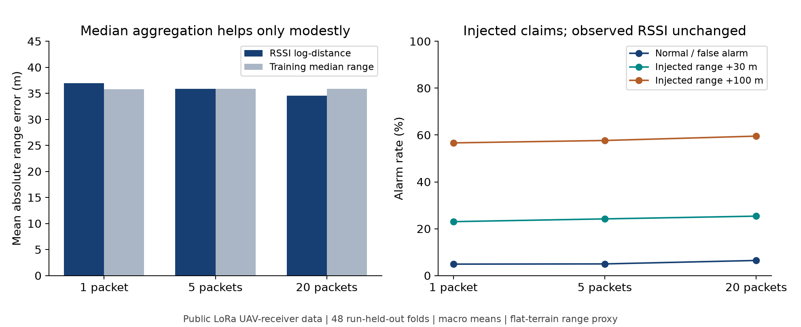
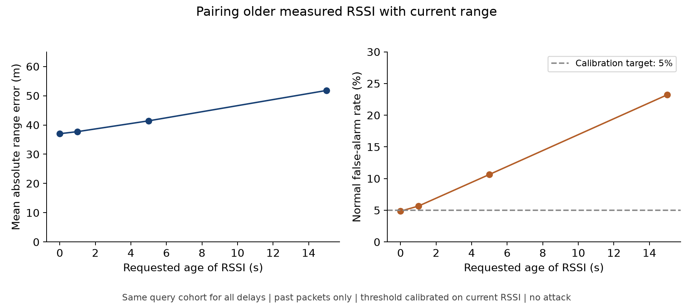
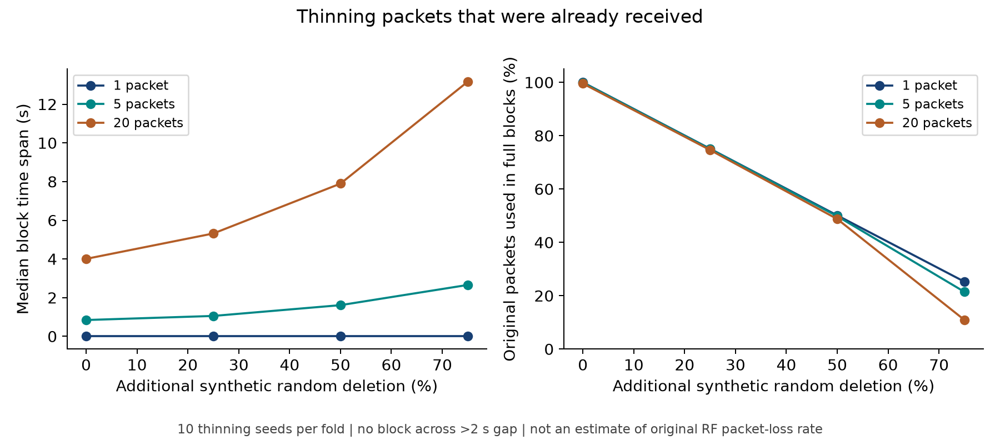
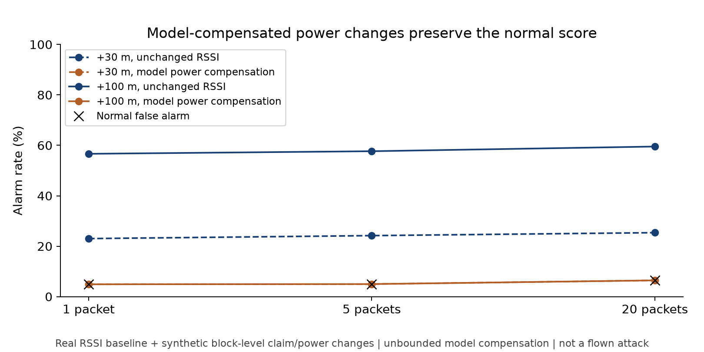

# 公開UAV実測データの入手とLoRa再解析

2026-11-01、Macで実行。**実際の飛行中に収集された公開RSSIを取得し、19条件・142,039件の件数を原論文と照合した。** 学習・校正・評価を分ける追加解析は、3つのrunがある16条件、48通りの分割で完了した。元論文の測位アルゴリズムやGhostBusterのグラフの完全再現とは区別する。

今回の実測は**雪に埋めた固定LoRa送信機を、ドローン上の受信機で観測したもの**。BLE Remote IDを地上の複数スマホで観測したデータではない。既往の屋内BLE残差を仮想配置に注入する評価とも別物で、今回はRSSIと位置の対応・連続時刻を実際の飛行記録から使用した。攻撃・追加欠測だけは後から注入した。

## 1. 前回挙げた評価に使える公開データはあるか

| 候補・一次資料 | 収録内容と用途 | 今回の取得確認 |
|---|---|---|
| [LoRa UAVデータ、Zenodo v2](https://zenodo.org/records/17339095)、[データ論文](https://doi.org/10.1016/j.dib.2025.112243) | 飛行中のRSSI、時刻、受信機位置、送信機位置。時間幅・時刻対応・距離モデルの別run評価に使う | **取得・ハッシュ確認・実行済み** |
| [GhostBuster原論文](https://doi.org/10.1109/CCNC51664.2024.10454860)が使用する[ICMCIS](https://www.kaggle.com/competitions/icmcis-drone-tracking/data) | UAV位置とDianaのSNRなど。原論文VI-A/Cでは1センサのデータから複数観測者のチャネルをモデル化 | Kaggleのファイル一覧APIはHTTP 401。認証なしで本体を取得できず、今回の再現には未使用 |
| [21 BLEゲートウェイのデータ](https://github.com/XPengZhao/Wireless-Localization-Dataset) | READMEにはRSSI行列、送信機位置、ゲートウェイ位置、未検出値の規約があり、配置・欠測の評価に有力 | 本体のSharePointリンクがHTTP 404。READMEだけから実験値を作っていない |
| [AERPAW TDoA、Dryad](https://doi.org/10.5061/dryad.vq83bk44h)、[実験者の案内](https://aerpaw.org/dataset/aerpaw-rf-sensor-measurements-with-uav-july-2024/) | 実飛行の推定位置・位置真値・LOS/NLOS指標。RSSIとは異なる観測方式の比較候補 | メタデータAPIは取得。本体のWebダウンロードは403、案内されたAPIは401。CSV本体は未取得・未評価 |

上記はこの環境から2026-11-01に確認した状態。「公開という記載がある」と「認証なしで現在ダウンロードできる」は区別した。認証を回避していない。

前回提案した6項目のうち、今回のLoRaデータで直接評価できるのは、**時間幅、時刻対応のずれ、連続記録内の依存、同条件の別runへの適用**。人工的な欠測と単一リンクの電力補償反例も追加できる。**同一パケットの複数受信機間の相関、受信機の配置比較、カメラ融合は今回の実測だけでは評価できない。** 原データの1受信機を複製して、複数受信機の実測と扱うことはしない。

## 2. 取得したデータと照合

- データ作成者：Mavilia, La Rosa, Berton, Girolami。
- 固定版：Zenodo record `17339095`、v2。メタデータのライセンスはCC BY 4.0。
- 収録時期はデータ説明では2024年4月・2025年2月・2025年4月。今回新しく飛ばして取得したものではない。
- 868 MHz LoRa、送信出力の設定値は14 dBm。記録された各イベントの実EIRP真値を意味しない。
- 19条件の全件数がデータ論文Table 5の各行と一致。合計142,039件。元データの全RSSI行を読み込み、異常値除去で件数を合わせていない。
- アーカイブの`runID`ごとのグループは52。論文本文の「62実験」と一致しない。19条件は19独立飛行、52グループは52独立な日・場所の試験、という意味ではない。
- 位置・高度等に非有限値なし。各run内の時刻は単調増加。同条件の異なるrun間で同一タイムスタンプがないことを確認。
- 記録間隔の中央値は多くの条件で約0.21秒。T1.0には長い空白があり、開始から終了までの経過時間と、論文表の測定時間を同一視しない。

```
dataset.zip SHA-256:
29c9715ca39d297ac7f00142958dc959fa154c34d684d32adeebe5f97681cc84

Zenodo公表MD5（一致）:
c9156712c90c5eb8fc5939b2171c7ac6
```

元アーカイブは`captures/week26-public-lora/dataset.zip`、親ディレクトリ0700・ファイル0600、Git対象外。座標、絶対時刻、パケットごとのRSSI、位置真値の行データは公開用結果ディレクトリへ複製していない。各入力メンバーのハッシュは集計JSONに保存。

## 3. 今回の追加解析の方法

### 距離のラベルは平坦地を仮定した近似

送信機の緯度経度と受信機の参照位置から球面距離`h`を求め、AGL高度と埋設深度を使って次を計算する。

```text
d_proxy = sqrt(h² + (AGL高度 + 埋設深度)²)
```

送信機の標高・詳細な地形モデルを含む厳密な3D距離ではない。以下のm単位の値は、この**斜距離の近似値**に対する誤差・改変量。地上のRID受信機から飛行機体への距離精度に直接読み替えない。

### 学習・閾値調整・評価を別runに分離

3つのrunがある16条件で、各条件内のrunを`学習／校正／評価`に割り当て、循環させる3分割、計48foldを実行。1・2runしかないT1.0、T5.1、T6.2は全件数照合には含めるが、この3分割評価には含めない。全行のランダム分割は行わない。

```text
RSSI予測 = a + b log10(d_proxy)
```

`a,b`は学習runのみで最小二乗推定。48モデルすべてで`b<0`。推定伝搬指数`-b/10`は約0.95〜4.30。距離推定値を誤差改善のために切り詰めていない。

比較対象として、**RSSIを使わず学習runの距離中央値を常に返す方法**も評価。誤差はfoldごとに算出して等重み平均。パケット数が多い条件に結果を支配させず、foldを独立試行とする信頼区間も主張しない。循環分割は過去データだけで学習する前向き運用評価ではない。

1／5／20パケットを非重複ブロックに分けてRSSI中央値を使用。未来は使わず、正解距離はブロック末尾の値。2秒を超える空白を跨がず、不完全な末尾ブロックは評価しない。観測の移動中の変化も含むため、中央値化だけで雑音が独立に減るとは仮定しない。

検知スコアは`abs(観測RSSI − 申告距離に対する予測RSSI)`。正常な校正runの95パーセンタイルを閾値とする。評価runで誤警報率5%が保証される方式ではない。今回は共通の校正目標で比較し、評価後に真値を見て閾値を調整していない。

## 4. 実測の再解析結果

### 窓を広げるだけでは改善が小さい

| 集約パケット数 | ブロック時間幅の中央値※ | RSSIモデルの距離MAE | RSSIなし中央値のMAE | 正常時の誤警報率 |
|---|---:|---:|---:|---:|
| 1 | 0秒 | 36.96 m | 35.83 m | 4.90% |
| 5 | 0.84秒 | 35.84 m | 35.84 m | 4.98% |
| 20 | 4.01秒 | 34.52 m | 35.91 m | 6.45% |

※各foldの中央値を等重み平均。1パケットの時間幅0秒は、処理時間や検知遅延がゼロという意味ではない。

距離モデル残差の隣接相関係数は、48評価runの中央値で**0.965**。近接時刻のデータに強い依存がある。これは伝搬雑音だけの相関を同定した値ではなく、距離モデルで表せない空間構造・動き・データ作成処理等を含み得る。20件を独立した20試行として扱えない。

**この単純な距離モデルではRSSIを使う利点自体が小さい。** 一般にRSSIが役に立たないとの結論ではなく、条件を揃えた別runと、RSSIなし基準の両方が必要だという結果。



### 古いRSSIを現在位置に対応付けると正常データでも警報が増える

受信済みの実測RSSIのうち、指定秒数以上前の最後の値を現在の距離と対応させた。補間や未来値は使わず、比較する現在時刻の集合は全遅延条件で共通。閾値は時刻ずれのない校正データから求めたまま固定。

| 指定遅延 | 実際の経過時間の中央値※ | 距離MAE | 正常時の誤警報率 |
|---|---:|---:|---:|
| 0秒 | 0秒 | 37.02 m | 4.87% |
| 1秒 | 1.05秒 | 37.73 m | 5.66% |
| 5秒 | 5.06秒 | 41.42 m | 10.66% |
| 15秒 | 15.08秒 | 51.80 m | 23.22% |

※各foldの中央値を平均。前表と0秒の誤差が少し違うのは、全遅延で評価可能な共通集合に限定したため。

**時刻を揃えずに複数ノードの結果をまとめると、移動による変化を不正と誤認する可能性がある。** この評価は1リンクのRSSIと位置の対応ずれであり、複数受信機の非同期融合を実測したものではない。



## 5. 実測に人工的な変化を加えた評価

以下は実際に攻撃飛行した記録ではない。正常な実測系列に、評価用の改変を追加した。

### 受信済みパケットを追加で削除

元々受信できた記録から0／25／50／75%を独立にランダム削除。各foldで10seed。校正・評価の双方を同じ削除率で処理し、校正側から閾値を再推定した。原データには全送信イベントの台帳がないため、**元々のRFパケット損失率は推定していない**。

| 追加削除率 | 20件ブロックの時間幅※ | 完全ブロックに使えた元パケットの割合 | 正常時の誤警報率 |
|---|---:|---:|---:|
| 0% | 4.01秒 | 99.54% | 6.45% |
| 25% | 5.32秒 | 74.64% | 6.41% |
| 50% | 7.90秒 | 48.76% | 6.71% |
| 75% | 13.16秒 | 10.92% | 13.12% |

※各seed/foldの中央値を平均。2秒超の受信空白を跨がない規則を維持。

75%削除・20件集約では480組中9組で校正または評価の完全ブロックを作れなかった。これらは利用不可としてCSVに残し、誤警報率を0にしていない。13.12%は利用可能だったseedの平均を各fold内で求め、foldを等重み平均した値。完全ブロックに入る割合は判定できる時間割合ではない。

**固定20件の窓は、通信が悪いほど古い観測を長く混ぜやすい。** 台数・件数と同時に観測の古さ、更新間隔、判定可能率を管理する必要がある。



### 距離申告の改変と電力補償の反例

実測RSSIを保ったまま、各評価ブロック末尾の距離を+10／30／100mした人工申告を作成。これは任意方向の3D位置偽装ではなく、**単一リンクの距離申告の改変**。

| 窓 | 正常警報率 | +10mの警報率 | +30mの警報率 | +100mの警報率 |
|---|---:|---:|---:|---:|
| 1件 | 4.90% | 8.40% | 23.02% | 56.64% |
| 5件 | 4.98% | 9.10% | 24.20% | 57.67% |
| 20件 | 6.45% | 10.32% | 25.37% | 59.53% |

正常誤警報率が同一ではないため、20件で警報率が高いことだけを性能改善と判断しない。

さらに、同じモデルの`f(d)=a+b log10(d)`を使い、集約RSSIに`f(d+Δ)−f(d)`を加えると、改変後のスコアは元の正常スコアと数値誤差内で一致した。+100mで必要な変更の絶対値の中央値はfold平均で約9.66dB。このモデルでは遠く見せるための減衰方向となる。

**これは電力を自由に変更できる数理モデルの反例**。実機でその出力を設定可能か、アンテナ姿勢やフェージングが同時にどう変わるか、全パケットで同じ制御ができるかは検証していない。ブロック単位の人工補償であり、実RF攻撃の成功率ではない。台数を増やしたときの反例はこの単一リンクデータから主張しない。



## 6. この研究への意味と残件

今回の実測に基づく結果は、**RSSIの件数を増やすだけでは不十分で、時間の整合・モデルの適用範囲・使えない観測の扱いが必要**という設計判断を補強する。

一方、このデータでは送信機が雪の中で固定、受信機が移動し、周波数も868MHz。飛行中の未信頼機体が送るBLE/Wi-Fi RIDとは、アンテナ・周波数・環境・送受信機の役割が異なる。ここで得た距離誤差や警報率をRIDの性能見積りとして使わない。カメラ、AoA、TDoAを導入した効果も今回の値からは計算できない。

次に必要なデータは、同一送信パケットを識別できる複数受信機の時刻・RSSI・設置位置と、独立な機体位置真値を持つもの。任意出力攻撃を評価するには、実効電力の制御記録も必要。公開本体を取得できていない候補は、取得後に入力形式と条件を確認して評価する。

V2は申告RIDに対応する観測者署名付きの主張を扱う研究PoCであり、この追加解析は機体認証、センサの正直さ、観測者ハードウェアの真正性やDRIP信頼連鎖を証明しない。

## 7. 保存物と再実行

- [解析コード](../experiments/week26-rssi-privacy/recheck_lora.py)／[6つの追加テスト](../experiments/week26-rssi-privacy/test_recheck_lora.py)
- [全結果JSON・入力ハッシュ](results/mac-public-lora-20261101/summary.json)
- [run別件数の照合](results/mac-public-lora-20261101/inventory.csv)
- [窓幅・改変量のfold別CSV](results/mac-public-lora-20261101/window-fold-metrics.csv)／[要約](results/mac-public-lora-20261101/window-summary.csv)
- [時刻ずれのfold別CSV](results/mac-public-lora-20261101/delay-fold-metrics.csv)
- [欠測のfold・seed別CSV](results/mac-public-lora-20261101/dropout-fold-seed-metrics.csv)
- [残差の連続依存](results/mac-public-lora-20261101/residual-dependence.csv)
- [保存結果の監査](results/mac-public-lora-20261101/audit.json)

```sh
.cache/week26-mac-venv/bin/python experiments/week26-rssi-privacy/recheck_lora.py \
  --download --out week26/results/mac-public-lora-reproduction
.cache/week26-mac-venv/bin/python experiments/week26-rssi-privacy/audit_public_lora.py \
  week26/results/mac-public-lora-reproduction
.cache/week26-mac-venv/bin/python experiments/week26-rssi-privacy/plot_public_lora.py \
  week26/results/mac-public-lora-reproduction
.cache/week26-mac-venv/bin/python -m unittest discover \
  -s experiments/week26-rssi-privacy -p 'test_*.py'
```

既存の結果や異なるハッシュの入力は上書きしない。必要依存は既存の`requirements-synthetic.txt`のNumPy・Matplotlib。今回の全専用テスト31件、保存結果の監査9項目が通過。PNG/SVGを4組保存し、表示を確認した。Piでの新しい計測・実機攻撃・ZKP生成は行っていない。
