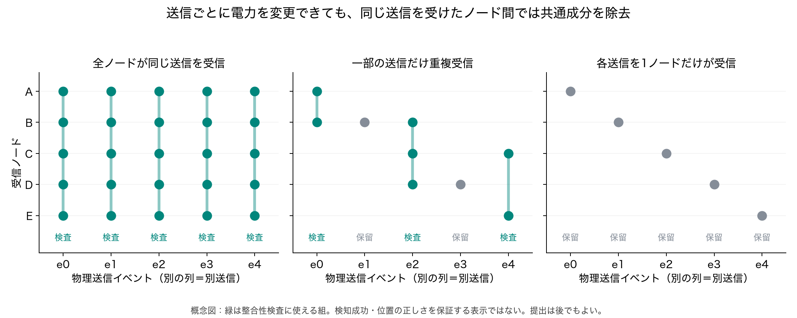
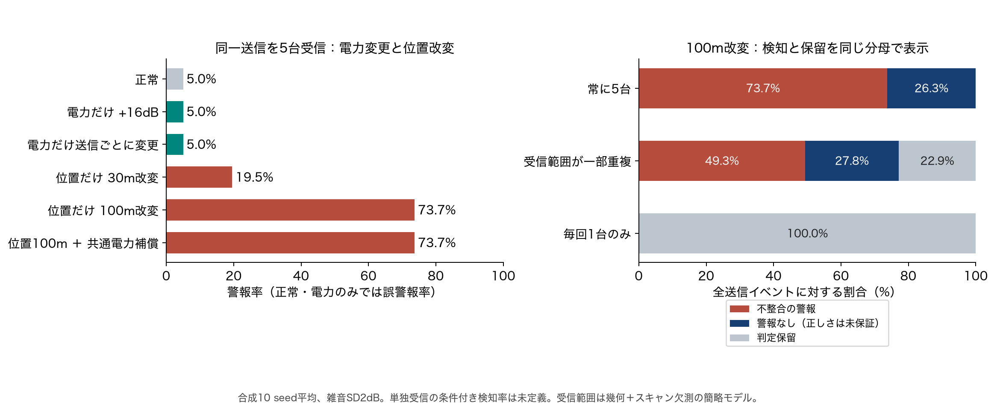
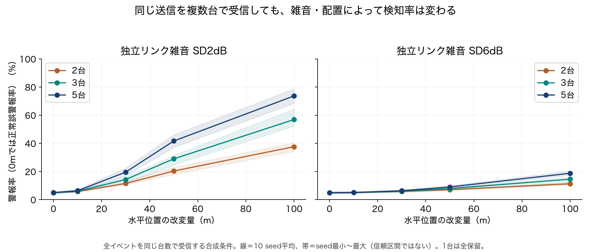
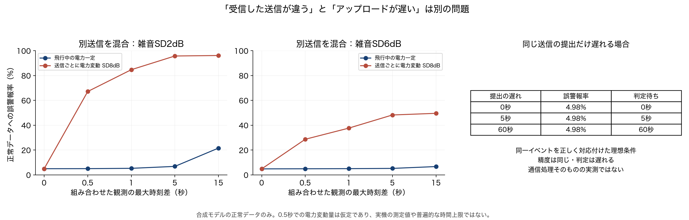
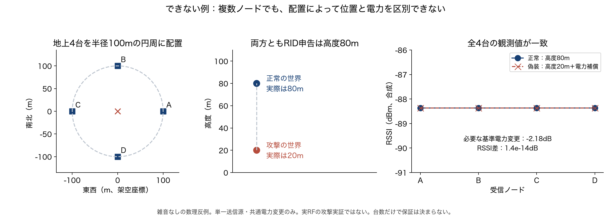

# 位置偽装検知の成立条件と限界：複数ノード合成評価

2026-11-01、Macで実装・実行。**今回の図と数値はすべて合成シミュレーション。公開LoRa実測の再解析とは別の実験であり、実際のドローンの検知性能ではない。** [前提整理14](14_異時刻の複数ノードで位置偽装を評価できるシナリオ.md)で未実装だった、一本の共通飛行軌跡と複数ノードの観測を結ぶ評価を追加した。

## 1. 何ができ、何ができないか

| 状況 | 今回確認したこと | 必要条件・できないこと |
|---|---|---|
| 同じ送信を複数ノードが受信、電力は未知 | 共通電力を除いて、RID申告位置との不整合を検査できる | 正しいイベント対応、適用可能な伝搬モデル、ノードの観測・位置の信頼が必要。全偽装検知ではない |
| 送信ごとに電力変更、各送信は複数台が受信 | 共通の電力変更だけではスコア・判定は変わらなかった | **電力変更そのものを検知しているのではない。** 受信台数が変わる効果はこの簡略モデルに含まない |
| 一部だけ複数台で重複受信 | 重複して校正もあるイベントは検査。その他は保留 | 条件付き検知率と、全送信中の検知割合・保留率を併記する |
| 各送信を1台ずつ受信、電力は毎回自由 | 全件保留。位置・電力が違っても同じ観測になる反例を構成 | RSSI単独から一般的な位置偽装判定をすることはできない |
| 異なる送信を同じ送信としてまとめる | 正常でも誤警報が増える | 「時刻が近い」「同じRID文字列」だけでは共通電力として扱えない |
| 同じ送信のログ提出だけが遅れる | 理想的な対応付けではスコア・精度は同じ。待ち時間が増える | イベントIDを正しく知る理想条件。実際の通信・時計・対応付け処理は未評価 |
| 複数台でも距離比を区別できない配置 | 真位置・電力が違う2つの世界でRSSIが一致する反例を構成 | 台数だけで一意性や全位置偽装の拒否は保証できない |
| 原因が位置偽装か電力の虚偽かを分類 | 今回の検査からは原因を確定できない | スコアはモデルとの不整合を示す。遮蔽・受信誤差などとの原因分離や実EIRPの検証は別課題 |



縦の同じ列が同じ物理送信イベント。緑は検査に使える組で、検知に成功したことを意味しない。実際の主実験はこの概念図の固定スケジュールではなく、共通軌跡から幾何的に受信可否を生成する。

## 2. 評価したシナリオと条件

### 共通の飛行と観測

- 各seedで正常な校正20飛行、評価30飛行。1飛行240送信、0.5秒間隔。
- 10 seed。校正48,000・評価72,000の合成送信。雑音・観測モード・攻撃条件では同じ送信を再利用し、別々の独立実測件数として足していない。
- 全ノードが同一の3D軌跡を参照。約360mの区間を横断し、小さな横揺れ・高度変化を含む。ノード座標・軌跡はすべて架空。
- 5ノードの既知配置を固定。東西・南北に広げ、設置高さを2〜12mとした例。最適配置を探索した結果ではない。
- 伝搬指数2.2を既知とし、リンクごとの独立ガウス雑音SD2／6dBを比較。数値は感度評価の仮定で、屋外UAVから推定した値ではない。
- 受信機の残留校正差はSD0.8dBの固定値をseedごとに生成し、校正・評価で共有。
- 未知の共通基準電力に、飛行ごとのSD3dBと送信ごとのSD8dBの変動を与える。さらに電力だけ+16dB、送信ごとの追加SD16dB、位置と共通電力の複合改変も比較。
- 真の機体位置・電力は評価用の合成真値。検査器には渡さず、申告位置・受信RSSI・ノード位置と既知モデルだけを使う。校正データは正常と分かる独立の合成飛行。

### 3つの観測モード

1. **全重複**：全イベントを5台すべてが受信。成立条件を確認する理想化された比較対象。
2. **一部重複**：機体から160m以内かつスキャン欠測15%を通過したノードが受信。何台受信するかは飛行位置ごとに変わる。
3. **完全非重複**：一部重複の受信候補から1台だけを残す。全ノードが同一の共通飛行を参照するが、1イベントの観測は最大1台。

**受信範囲は幾何＋独立欠測の簡略モデル。電力を変えると受信感度を超えたり受信台数が変わったりする実RFの効果は含めない。** 受信時刻の精密推定、正常GNSS誤差、NLOS、実測の相関雑音、複数送信源・リレー・受信機別のビーム形成も未導入。以下の結果はこの範囲の条件付き評価。

### 検査方法

申告位置から各ノードまでの距離を`d_claim`として、次の値を計算する。

```text
u_i = RSSI_i + 10n log10(d_claim_i)
score = sqrt(mean((u_i − mean(u))²))
```

同一送信なら共通する電力成分は平均を引くことで除かれる。検知器は送信ごとの実電力を知る必要がない。一方、受信機ごとに違う利得・経路誤差などは残る。

実際に受信したノードの組ごとに、正常校正イベントの95パーセンタイルを閾値とする。校正が40イベント未満の組、受信が1台以下の組は**保留**。校正と評価の飛行は分離し、評価側の真値を見て閾値を調整していない。

位置改変は、各評価飛行の水平軌跡全体をランダムな一定方向に10／30／50／100mずらした申告。真の飛行軌跡は変えない。攻撃者が検査器を知り、観測組に対して最良の共通平均電力補償をする場合も比較する。受信機ごとに別の電力を届ける能力は仮定しない。

## 3. 同じ送信なら、電力変更で警報を増やさずに位置改変を検査できる

全5台受信、雑音SD2dB、10 seed平均。

| 入力の状態 | 警報率 | 解釈 |
|---|---:|---|
| 正常 | 4.98% | 正常時の誤警報 |
| 電力だけ+16dB | 4.98% | 電力変更では追加の警報なし |
| 電力だけ送信ごとに追加変動 | 4.98% | 各イベントの共通電力変動は除去される |
| 位置を30m改変 | 19.52% | この改変条件での検知率。多くを見逃す |
| 位置を100m改変 | 73.68% | 約26.32%は警報なし |
| 位置100m＋共通電力補償 | 73.68% | 共通電力の補償は差分の不整合を変えない |

**「送信電力を偽ったことを検知できた」という結果ではない。** 電力を除去する方式なので、電力変更のみは追加検知しない。位置申告と複数ノードの相対的な受信強度が整合するかを検査する。



## 4. 一部重複では「検査できた部分」と「全送信」を分ける

100mの位置改変、雑音SD2dB。各率はseedごとに算出した後で平均。

| 観測モード | 判定可能な割合 | 判定できた部分の検知率 | 全送信中の警報割合 | 保留率 |
|---|---:|---:|---:|---:|
| 常に5台で重複受信 | 100.00% | 73.68% | 73.68% | 0.00% |
| 受信範囲が一部重複 | 77.11% | 64.02% | 49.35% | 22.89% |
| 各イベントを1台だけ受信 | 0.00% | **未定義** | 0.00% | 100.00% |

一部重複の正常時の条件付き誤警報率は5.27%。単独受信の0%は「偽装していないと判定した」「完全に安全」という意味ではない。**位置判定を出せなかった**という結果。

完全非重複では、各観測ごとに自由な電力を選ぶと、真位置が違っても同じ申告・同じRSSIを作れる数理反例も保存した。今回の構成で最大RSSI差は0dBだった。全件保留は単なる閾値の設定ミスではなく、この識別不能性に対応する。

## 5. 台数を増やせば必ず高精度、とは言えない

全送信で指定台数が受信する条件。ノードは固定した配置の先頭2／3／5台なので、台数と配置が同時に変わる。台数だけの普遍的効果とは解釈しない。

| 雑音 | 2台：100m改変 | 3台：100m改変 | 5台：100m改変 |
|---|---:|---:|---:|
| SD2dB | 37.60% | 56.89% | 73.68% |
| SD6dB | 11.25% | 14.54% | 18.73% |

SD6dBでは5台でも大半を見逃す。正常時の誤警報率は全5台で4.88%。図の0mは正常誤警報率、0m超は人工位置改変の警報率。帯は10 seedの最小〜最大で、95%信頼区間ではない。



## 6. 受信時刻のずれと、提出の遅れは別

### 別の物理送信を誤ってまとめる場合

5台のそれぞれに0〜指定時間差の過去のRSSIを割り当て、現在の位置申告と比較する。未来は使わず、全時間差条件で同一の現在イベント集合を評価。正常な入力だけを使い、閾値は同一送信を正しくまとめた校正から固定した。

雑音SD2dBの正常誤警報率：

| 混合する観測の最大時刻差 | 飛行中の電力一定 | 送信ごとに電力変動SD8dB |
|---|---:|---:|
| 0秒（同じ送信） | 4.95% | 4.95% |
| 0.5秒 | 5.01% | 67.13% |
| 1秒 | 5.26% | 84.70% |
| 5秒 | 6.81% | 95.74% |
| 15秒 | 21.55% | 96.13% |

**0.5秒でSD8dBの電力が変わるという仮定を置いたストレス評価。実機の電力変動を測った値ではない。** 「0.5秒なら必ず失敗」「何秒以内なら安全」という普遍的な時間上限を示していない。異なる送信の電力が独立に変われば、近い時刻でも共通電力として差し引けないことを示す。

電力一定でも、15秒離れた観測では移動による誤対応が増える。0秒の4.95%が前表の4.98%と少し違うのは、15秒前の観測も存在する共通集合に限定したため。

### 同じ送信の提出だけが遅れる場合

同一イベントの対応を理想的に知っている場合、0／5／60秒後に最後の観測が届いても、全5台の正常誤警報率は4.98%のまま。全台を待つ判定待ち時間はそれぞれ0／5／60秒。

これは同じ入力を後で処理する理想的な結合の確認であり、通信スタックの実行時間計測ではない。実際のパケット対応、時計誤差、タイムアウト、遅れて届いた記録による判定更新は未実装。0秒は受信からの追加の待ち時間であり、計算・通信時間がゼロという意味ではない。



## 7. できない例：同一送信を4台で受けても区別できない配置

地上の半径100mの円周に4台を置き、中心上空の2つの世界を比較。

| 世界 | 真の高度 | RID申告の高度 | 基準電力の変更 |
|---|---:|---:|---:|
| 正常 | 80m | 80m | 0dB |
| 偽装 | 20m | 80m | −2.176dB |

雑音なしの距離式では、**両者が全4台で同じRSSIを生成する**。数値差は最大`1.42e-14 dB`、浮動小数点誤差の範囲。基準電力はモデル中の実効値であり、実機EIRPの計測ではない。

同じ観測に対して常に正解を出す分類器は作れないため、配置・高さ・偽装方向の条件が重要。「4台ある」「同じ送信を受けた」だけで全位置偽装を検知できるという結論を避ける。



## 8. この結果から言える主張

**言えること**：同一イベントを複数受信でき、観測・位置・モデルが適切なら、送信電力が未知・送信ごとに変更される状況でも、相対RSSIによる申告位置の不整合検査を評価できる。一部重複のシナリオでは、検査できる部分と保留部分を明確に分けられる。

**言えないこと**：任意の電力操作・位置偽装の全検知、位置の正しさの証明、実EIRPや電力申告の真偽の認定、原因の確定。完全非重複・自由電力や、識別不能な配置は解決していない。実際のRIDパケットを正確に対応付けられるか、実ノードの時計やセンサが正しいかも今回の結果で証明されない。

単一送信源や共通利得の条件を破る複数送信源・リレー・方向別の送信制御、遮蔽、悪意のある観測者は追加脅威。ノード数・距離・電力変更の仮定は設定値であって実機への採用要件や性能保証ではない。

V2は申告RIDをまとめ、観測者署名付きの主張を検証する研究PoC。DRIP信頼連鎖、機体認証、センサの正直さ、観測ハードウェアの真正性は保証しない。今回もZKP回路・実機・無線送信の変更はない。

## 9. 保存物・再現方法

- [固定設定](../experiments/week26-rssi-privacy/event_scenarios_config.json)／[実行コード](../experiments/week26-rssi-privacy/event_scenarios.py)
- [8つの追加テスト](../experiments/week26-rssi-privacy/test_event_scenarios.py)／[保存結果監査](../experiments/week26-rssi-privacy/audit_event_scenarios.py)
- [完了状態](results/mac-event-scenarios-20261101/status.json)／[全要約JSON・数理反例](results/mac-event-scenarios-20261101/summary.json)
- [状態別seed CSV](results/mac-event-scenarios-20261101/cases-seed-metrics.csv)／[状態別要約CSV](results/mac-event-scenarios-20261101/cases-summary.csv)
- [距離・台数・雑音CSV](results/mac-event-scenarios-20261101/curves-seed-metrics.csv)
- [時刻誤対応CSV](results/mac-event-scenarios-20261101/pairing-seed-metrics.csv)／[提出遅延CSV](results/mac-event-scenarios-20261101/uploads-seed-metrics.csv)
- [受信ノードの組別の校正数・閾値](results/mac-event-scenarios-20261101/calibration-seed-metrics.csv)
- [監査結果](results/mac-event-scenarios-20261101/audit.json)／[全図PNG・SVGの保存先](results/mac-event-scenarios-20261101/)

```sh
.cache/week26-mac-venv/bin/python -u experiments/week26-rssi-privacy/event_scenarios.py \
  --out week26/results/mac-event-scenarios-reproduction
.cache/week26-mac-venv/bin/python experiments/week26-rssi-privacy/audit_event_scenarios.py \
  week26/results/mac-event-scenarios-reproduction
.cache/week26-mac-venv/bin/python experiments/week26-rssi-privacy/plot_event_scenarios.py \
  week26/results/mac-event-scenarios-reproduction
.cache/week26-mac-venv/bin/python -m unittest discover \
  -s experiments/week26-rssi-privacy -p 'test_*.py'
```

依存は既存の`requirements-synthetic.txt`、描画には日本語フォントが必要。既存出力は上書きしない。今回の主計算は約1.25秒、最大RSS約56.7MiB（Mac、描画時間を除く）。これは検知のオンライン遅延の値ではない。

日本語の図5組をPNG/SVGで作成し、表示を確認。全専用テスト39件と保存結果監査10項目を通過した。理論上の根拠・論文と適用範囲は[前提整理14](14_異時刻の複数ノードで位置偽装を評価できるシナリオ.md)、公開LoRa実測の結果は[再解析13](13_公開UAV実測データの入手とLoRa再解析.md)を参照。
