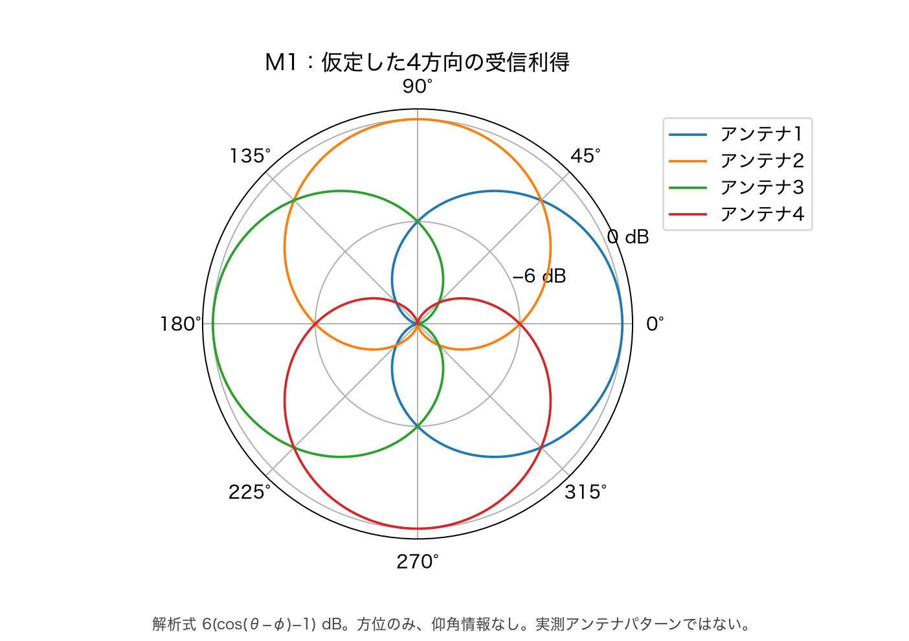
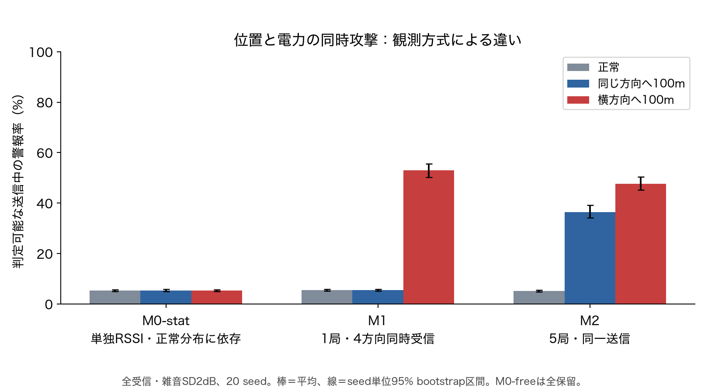
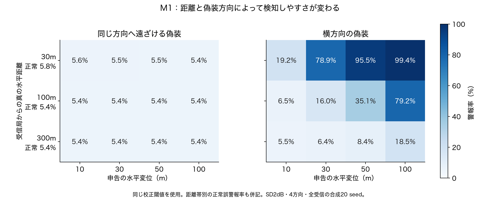
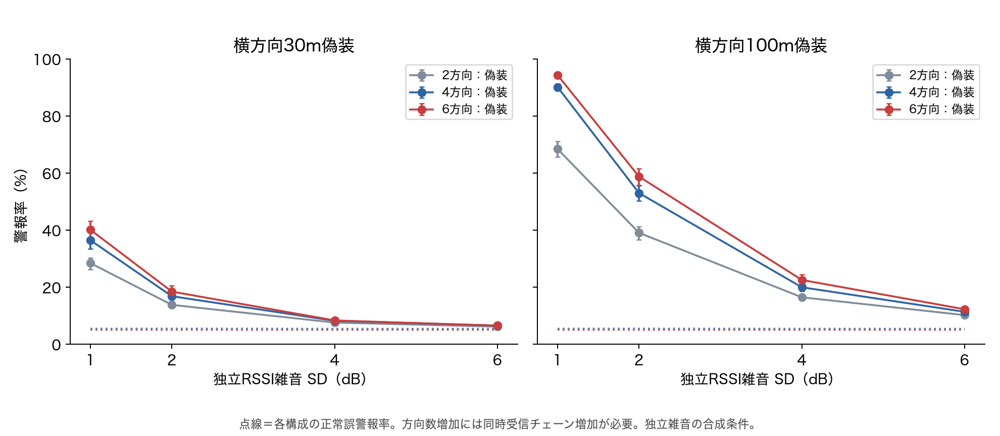
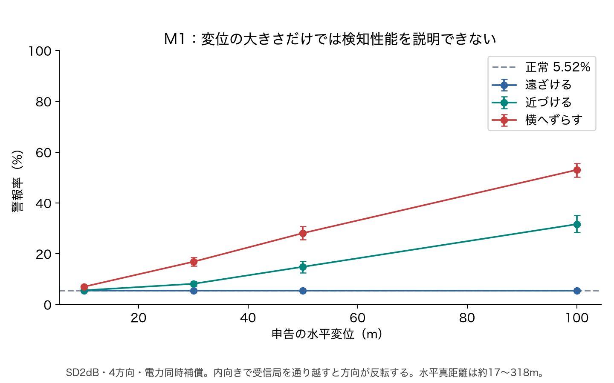
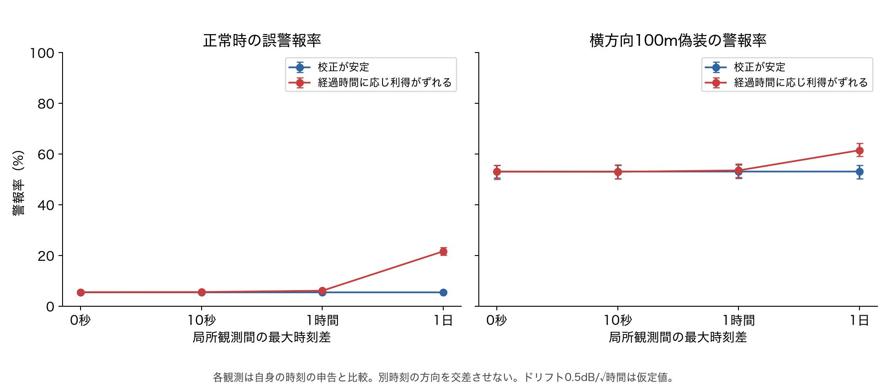
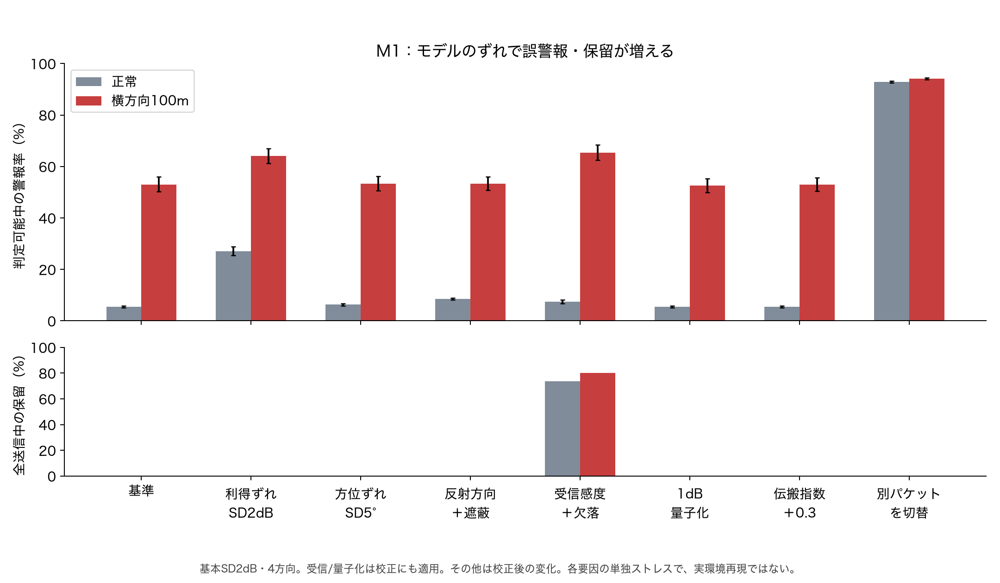
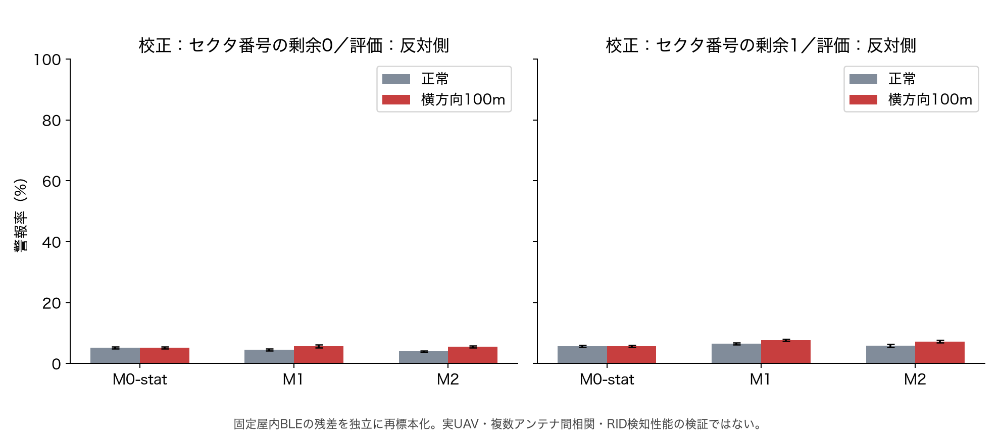
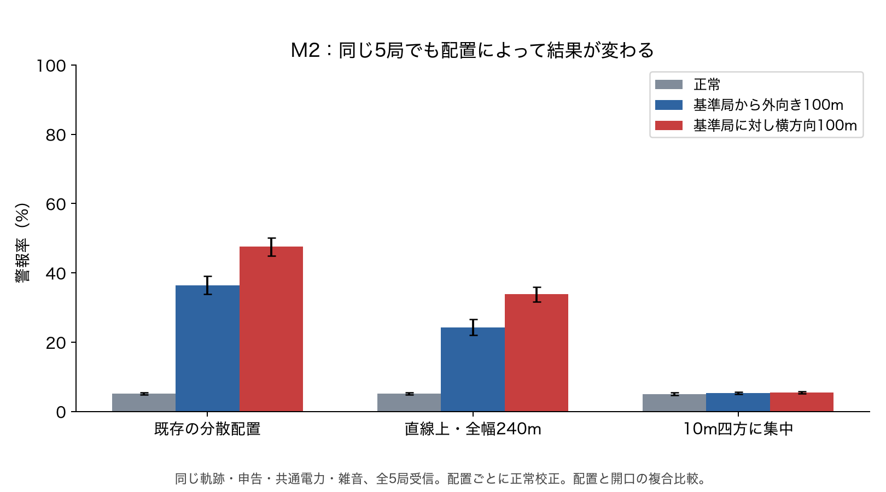

# Week26：非同期・未知送信電力下でのM0／M1／M2比較

2026-11-02実行。**RSSIから位置偽装を検知できる観測条件を調べる合成実験**。距離推定モデルの競争、実ドローンの攻撃実証、機体認証、安全運用システムの評価ではない。

## 今回分かったこと

- 1送信1RSSI・自由電力のM0では、電力を未知変数として除去すると位置申告を検査する残差が残らない。正常分布に依存するM0-statも、位置と電力の同時操作では正常付近の警報率になった。
- 各局で同一送信を複数方向から同時受信するM1を新規実装。基本条件では横方向の不整合を検査できたが、同じ方向の距離偽装を区別できなかった。
- 受信局同士が非同期でも、各局でその時刻の申告を検査できる。別時刻の方向の交差による測位は行っていない。長時間の校正変化は別に問題となる。
- M1の基本条件の数値を実環境性能として扱えない。利得ずれで正常誤警報が増え、屋内BLE残差を使ったストレスでは正常と偽装の分離が弱かった。

## 1. 観測モデルと公平な比較の範囲

| モデル | 1送信から得る情報 | 時刻の条件 | 追加条件 |
|---|---|---|---|
| M0 | 1局のRSSI 1値 | 局同士は別送信・別時刻 | 自由電力なら位置・電力を分離できない |
| M1 | 1局の2／4／6方向のRSSI | 同じ局の全方向で同一物理送信・同一周波数を同時受信。局同士は別時刻でよい | 複数指向性アンテナ、同時受信チェーン、位置・方位・利得校正 |
| M2 | 5局のRSSI | 複数局が同一物理送信を受信 | 受信範囲の重複、送信の正しい対応付け |

同じseed内では真の3D軌跡、申告位置、送信ごとの共通電力を共有する。M0／M1は各飛行で1局だけを利用し、M2は同じイベントを全5局で受信する。M0の無指向性受信とM1の各チェーンには別の雑音標本を与えるが、分布とSDは揃える。

これは**観測追加によって何が識別できるかの比較**であり、同じハード費用・受信チェーン数・設置面積での優劣比較ではない。旧報告19の軌跡・10 seedとは異なる新規比較であり、旧M2の検知率と直接並べない。

### M0：単独RSSI

\[
R=P-10n\log_{10}d+\varepsilon
\]

自由な電力を許すと、候補位置までの距離が変わっても電力を補償できる。M0-freeは残差の自由度が0となるため**全保留**。検知率0%と評価しない。

M0-statは正常校正の `R+10n log10(d_claim)` の中央値と95%残差閾値を使う対照。正常時の電力・伝搬分布に依存し、自由電力に対する保証を持たない。

### M1：同一局・同一送信の方向別RSSI

\[
R_k=P-L(d)+G_k(\theta)+\varepsilon_k,\quad
R_i-R_j=G_i(\theta)-G_j(\theta)+\varepsilon_i-\varepsilon_j
\]

実装は角度の点推定ではなく、申告位置qの予測利得との差 `u_k=R_k−G_k(θ(q))` を平均除去したRMSスコア。未知共通電力と共通距離減衰を除去し、方向別の形の整合性を検査する。

仮定したアンテナは `G_k(θ)=6(cos(θ−φ_k)−1) dB`、φは等間隔。**実測アンテナ特性でも論文の追試でもない**。仰角の情報を持たず、同方向の距離や高度を証明しない。対向2アンテナには左右鏡像の曖昧さもある。



### M2：同一送信・複数局

`u_i=R_i+10n log10(||q−x_i||)` を平均除去したRMSスコア。共通電力を消せるが、配置・伝搬指数・受信機ごとの誤差に依存する。受信局が同一送信を観測するため、元の完全非重複条件への追加条件である。

## 2. 条件・攻撃・校正

| 項目 | 設定 |
|---|---|
| 独立反復 | 20 seed。各seed：正常校正20飛行、独立評価30飛行、各60イベント |
| 軌跡 | 基準局を中心に滑らかに変化する局所軌跡。水平距離約17〜318m、局からの高さ20〜50m。飛行間は別遭遇で連続飛行を仮定しない |
| 電力 | 基準受信電力−42dBm相当、一定／送信ごとSD8dB変動／申告変更への無制約な電力補償 |
| 電波 | 基本は既知伝搬指数2.2、独立ガウスRSSI雑音SD1／2／4／6dB、全受信 |
| 正常申告 | 真位置に独立な3軸SD2mのGNSS誤差を加算 |
| 偽装 | 水平10／30／50／100m、基準局から外向き／内向き／接線方向。真位置を変えず申告を変更 |
| 電力補償 | `ΔP=10n log10(d_true/d_claim)`。M0の基準局に合わせる1つの電力を全モデルで共有 |
| 校正 | 正常データのみで95%スコア分位点を設定。M0-stat／M1は局・受信チャネル集合別、M2は受信局集合別。40件未満は保留 |
| 評価 | 閾値を固定して独立評価。評価結果を見て誤警報率を5%へ合わせ直さない |

「自由電力」は全ての攻撃をランダム探索した意味ではない。M0への補償攻撃と、平均除去スコアの任意共通電力への不変性を確認した。適応的に偽装方向・軌跡・送信ビームを選ぶ最悪攻撃は未評価。補償量の最小・最大はCSVへ保存し、実機出力で可能とは主張しない。

## 3. 実験1・2：M0の識別不能性と同時攻撃

雑音SD2dB、M1は4方向、全受信。表は20 seedの警報率平均。各条件の全送信数は36,000だが、同一飛行内のイベントを独立36,000試行とは扱わない。

| 観測モデル | 正常 | 外向き100m＋電力補償 | 横方向100m＋電力補償 |
|---|---|---|---|
| M0-free：自由電力を未知変数として除去 | 未定義（全保留） | 未定義（全保留） | 未定義（全保留） |
| M0-stat：正常分布に依存する対照 | 5.34% | 5.38% | 5.38% |
| M1：1局・4方向同時受信 | 5.52% | 5.46% | 53.01% |
| M2：5局・同一送信受信 | 5.12% | 36.48% | 47.56% |



M0-statでは、異なる申告位置でも電力補償で正常分布に近い観測を作れる。M1の同方向偽装も正常付近。M2が外向き偽装に反応するのは、基準局と同方向でも、他局から見た距離比は一般に変わるため。

数学的反例では、20mと120mの位置を同方向に置き、実効電力差を約17.12dB与えると、理想モデル上のM0とM1の全RSSIを一致させられる。これは実RF攻撃の実証ではない。厳密一致・対向2アンテナの鏡像・任意共通電力へのスコア不変性をテストした。

## 4. 実験3：M1の成功条件と失敗条件

| M1の基本条件 | 警報率平均 | seed単位95% bootstrap区間 |
|---|---|---|
| 正常 | 5.52% | 5.19–5.87% |
| 外向き100m | 5.46% | 5.10–5.84% |
| 横方向100m | 53.01% | 50.24–55.55% |

区間は20 seedの率を1,000回再標本化したもの。アンテナモデルや実環境の不確かさを含む区間ではない。全条件に多数の比較があり、多重比較補正済みの有意差検定として使わない。

同じ30m偽装でも、受信局から遠いほど横方向の角度差が小さくなる。

| 真の水平距離 | 正常誤警報 | 横方向30m | 外向き30m |
|---|---|---|---|
| 30m | 5.81% | 78.90% | 5.52% |
| 100m | 5.41% | 16.01% | 5.39% |
| 300m | 5.36% | 6.38% | 5.36% |







内向きの大きな変位では受信局を通り越し、方位が反転する場合がある。「内向きなら常に検出不能」ではない。同じ方位を維持する偽装が失敗例となる。

## 5. 実験4：非同期の局所検査と履歴集約

時刻差0秒／10秒／1時間／1日を設定。**各観測と自身の時刻の申告の対応を保った、別遭遇の局所検査**である。時刻差だけでは測定値・スコアは変わらない。連続した1日飛行や、ネットワーク実装を再現したものではない。

別条件として校正後の方向別利得に `0.5√経過時間[時間] dB` のずれを与える。係数は実測値ではない。M1正常誤警報は最大時刻差0秒で5.52%、1日で21.62%となった。非同期そのものと、校正が古くなる影響を区別する。



別時刻・別局の3遭遇を束ねた履歴集約も評価した。軌跡の三角測量は行わず、単純な警報個数で集約する。

| 集約規則（基本条件） | 正常履歴の警報率 | 横方向100m偽装履歴の警報率 |
|---|---|---|
| 3観測中1件以上の警報 | 15.70% | 89.61% |
| 3観測中2件以上の警報 | 0.87% | 54.57% |

これは履歴レベル5%に校正した提案検出器ではない。単発5%程度の警報をOR結合すれば正常警報も増えることを示す比較である。同じRID文字列が同一機体を意味するとは保証しない。

## 6. 実験5：モデルのずれ・欠測・実測残差・配置

### M1のストレス試験

| 条件 | 正常：判定可能中の警報率 | 横100m：判定可能中の警報率 | 横100m：全送信中の保留率 | 横100m：全送信中の警報割合 |
|---|---|---|---|---|
| 基本条件 | 5.52% | 53.01% | 0.00% | 53.01% |
| 校正後の利得ずれ SD2dB | 27.10% | 64.07% | 0.00% | 64.07% |
| 校正後の方位ずれ SD5° | 6.34% | 53.39% | 0.00% | 53.39% |
| 20%に遮蔽＋反射方向ずれ | 8.53% | 53.39% | 0.00% | 53.39% |
| −100dBm感度＋独立10%欠落 | 7.40% | 65.43% | 80.06% | 13.18% |
| 1dB量子化 | 5.49% | 52.63% | 0.00% | 52.63% |
| 伝搬指数＋0.3 | 5.52% | 53.01% | 0.00% | 53.01% |
| 別パケットを切替・独立電力差 SD8dB | 92.85% | 94.16% | 0.00% | 94.16% |



利得ずれで攻撃警報が増えても、正常誤警報も増えているため改善と呼べない。欠測時の条件付き検知率上昇も、届きやすい標本への選択を含む。全送信中の警報と保留を必ず併記する。

NLOSは共通10dB減衰と20%のイベントへのランダム方向ずれSD20°という簡略代理モデル。実測マルチパスや電磁界解析ではない。各ストレスは原則単独で、複合環境や悪意ある受信者は未評価。

「別パケットを切替」は方向ごと独立の電力差SD8dBを与える失敗試験。校正時に同一送信を想定した検出器は高い正常警報を出す。物理的な切替時間やBLEのパケット波形は実装していない。同一パケット内で共通成分を保てる切替の可能性を否定する実験でもない。

### 屋内BLE実測残差を使うストレス

固定コミットの公開屋内BLEデータをハッシュ照合して使用。各セクタ・ビーコン・出力設定の先頭50件で中央値を求め、残り50件の残差を使用。セクタ偶奇で校正と評価を分割し、向きを逆にした2条件も実施。

| 校正セクタの剰余 | M1正常警報率 | M1横方向100m警報率 |
|---|---|---|
| 0側 | 4.46% | 5.65% |
| 1側 | 6.45% | 7.60% |



残差RMSは約8.21〜8.49dBであり、基本SD2dBより大きい。異なるセクタの分布変化と裾の影響もあるため、原因を分散だけに断定しない。**このストレスではM1の正常と攻撃の分離は弱い。実環境で有効な方式が完成したとは判断しない。**

各チャネル・時刻へ独立に再標本化するため、同一局のアンテナ間相関・UAVの伝搬・RID信号を再現していない。元の測定データはignoredの `captures/week26-public-ble/` に保持し、CSV／JSONには集計とハッシュのみを出力する。

### M2の配置比較



同じ5局を既存分散配置／直線上全幅240m／10m四方への集中に変更。真軌跡・申告・共通電力・雑音は共有し、配置ごとに正常校正する。局数の比較ではなく、配置と開口の複合効果の比較である。M1の方位情報だけで距離を識別できない問題を、単なる局数増加で解決したとはしない。

## 7. 実装可能性と研究としての判断

| 項目 | 今回の確認 | 次の判断条件 |
|---|---|---|
| 元のM0条件 | 自由電力下の非識別性と補償攻撃を確認 | 電力・移動・真値校正に制約を追加する根拠があるか |
| M1の局所方向検査 | 同時受信の理想モデルを実行。径方向偽装が残る | 測定可能なアンテナ利得と誤差相関で十分な正常／攻撃分離が残るか |
| 標準Pixel受信 | Android ScanResult.getRssi()はRSSI 1値を返すAPI | このAPIだけをM1の方向別同時RSSIと扱わない。別の受信構成を実証する必要 |
| Raspberry Pi | 今回は実機RF試験を行っていない | 計算処理の実行と、必要な同時RF観測能力を分けて確認 |
| 非同期履歴 | 時刻対応が正しい局所検査と単純集約まで | 履歴レベルの誤警報制御、校正の有効期限、対象対応付け |
| ZKP | 今回は回路・証明生成を実装していない | 方式と観測の成立後、秘匿された観測に対する計算の正しさを証明 |

ZKPでRSSI・受信機位置の真実性や機体認証が生じるわけではない。既存V2もclaimed RIDの集約と観測者署名の検証の範囲であり、DRIP信頼鎖、センサの正直さ、観測者ハードウェア認証は対象外。

**現時点の設計判断：M1を研究候補として追加できたが、採用は未決定。方向が変わらない偽装への限界と、実測残差ストレスでの弱い分離を踏まえ、先に受信方式と校正の実現可能性を確認する。**

## 8. 保存結果・再現方法

- [設定](results/mac-directional-m0-m1-m2-20261102-v2/config.json)、[全集計JSON](results/mac-directional-m0-m1-m2-20261102-v2/summary.json)、[全集計CSV](results/mac-directional-m0-m1-m2-20261102-v2/summary.csv)
- [seed別CSV](results/mac-directional-m0-m1-m2-20261102-v2/per_seed.csv)、[正常校正の閾値](results/mac-directional-m0-m1-m2-20261102-v2/thresholds.csv)
- [履歴集約CSV](results/mac-directional-m0-m1-m2-20261102-v2/history_summary.csv)、[実行環境・入力／出力ハッシュ](results/mac-directional-m0-m1-m2-20261102-v2/manifest.json)
- [図9組の説明・ハッシュ](results/mac-directional-m0-m1-m2-20261102-v2/figures.json)、[保存監査](results/mac-directional-m0-m1-m2-20261102-v2/audit.json)

数値実行はPython 3.12.14／NumPy 2.3.5、Mac上で20.00秒、プロセス最大RSS 101.0MiB。これはシミュレーターの実行資源であり、Pi性能や検出処理の実機ベンチマークではない。

```sh
# 数値用の独立venv（既存環境を変更しない）
python3 -m venv .cache/week26-directional-numeric
.cache/week26-directional-numeric/bin/pip install -r experiments/week26-rssi-privacy/requirements-directional.txt

# 公開屋内BLEを固定コミットから取得。rawはignored captures内、700/600。
.cache/week26-directional-numeric/bin/python -c 'import sys; from pathlib import Path; sys.path.insert(0,"experiments/week26-rssi-privacy"); from recheck_ble import download; download(Path("captures/week26-public-ble"))'

# 出力先は新規ディレクトリを指定。既存結果を上書きしない。
.cache/week26-directional-numeric/bin/python experiments/week26-rssi-privacy/directional_observations.py --output week26/results/NEW_DIRECTIONAL_RUN --empirical-raw captures/week26-public-ble

# 図用venv
python3 -m venv .cache/week26-directional-plots
.cache/week26-directional-plots/bin/pip install -r experiments/week26-rssi-privacy/requirements-directional-plots.txt
.cache/week26-directional-plots/bin/python experiments/week26-rssi-privacy/plot_directional_observations.py week26/results/NEW_DIRECTIONAL_RUN
.cache/week26-directional-numeric/bin/python experiments/week26-rssi-privacy/audit_directional_observations.py week26/results/NEW_DIRECTIONAL_RUN

# M1等の単体テスト
.cache/week26-directional-numeric/bin/python -m unittest discover -s experiments/week26-rssi-privacy -p test_directional_observations.py
```

各seed完了時にCSVへ追記してfsyncし、`progress.json`を更新する。SSH／プロセス切断前に完了したseedのCSVは残る。途中seedの自動再開機能はなく、再実行は新しい出力先へ行う。実測残差の取得先・入力ハッシュはsummary.jsonへ保存。

## 9. 根拠資料

1. Han, S.; Jang, B.-J. *Drone’s Angle-of-Arrival Estimation Using a Switched-Beam Antenna and Single-Channel Receiver*. Sensors 25(8), 2376, 2025. DOI: [10.3390/s25082376](https://doi.org/10.3390/s25082376)。[本文](https://pmc.ncbi.nlm.nih.gov/articles/PMC12031410/)。6方向を時分割、OFDM映像信号を使用。§3.2は1.2ms切替周期と短いパケットの制約を説明。今回の同時受信M1はその実装再現ではなく、BLE RIDへの適用成功も示していない。
2. Android Developers, [ScanResult.getRssi()](https://developer.android.com/reference/android/bluetooth/le/ScanResult#getRssi())。1スキャン結果のRSSIをintで返す。これをアンテナ別RSSIベクトルと解釈しない。機種の全RF機能が不可能だという主張ではない。
3. 公開屋内BLE [manwestc/ble-rssi-indoor-localization-dataset](https://github.com/manwestc/ble-rssi-indoor-localization-dataset/tree/b38a9a4a53a01f52136f4e9b29b5045f61655a06)。固定コミットとCSVハッシュを既存ローダーで検証。実ドローンRIDの実測ではない。

参照確認日：2026-11-02。
