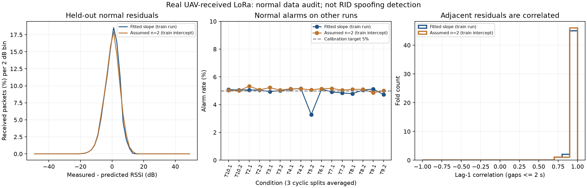

# 代替実測の取得監査と正常RSSI残差の初回評価

2026-11-03、Macで実行。AADMだけに依存せず、別の公開データを実取得・パースした。以下は**新規CSIのデータ監査**と、**既存LoRa実測の追加分析**であり、同一実験ではない。位置偽装の新しい検出率、Remote IDの実機性能、方向推定精度は今回測っていない。

## 1. データ確保の結果

| データ | 実際の取得結果 | 採用できる範囲 |
|---|---|---|
| AERPAW AADM | 公開メタデータ取得。本体API401／Web403を再確認 | 実ファイル監査は未実施。主候補として残すが作業を止めない |
| Mendeley UAV CIR v2 | 公開説明を確認。公開API403 | 反射の実測解析は未実施 |
| UCSB屋外2.4GHz 802.15.4 | メタデータ取得。本体API401／Web403 | 実ファイル未取得 |
| **KU Leuven UAV CSI** | **10飛行ログCSV・23,465行、3電波記録×31時点＝93 CSI標本を取得** | **C：伝搬・品質監査**。RSSI／同一送信多局／AoAの実測としない |
| **既存LoRa UAV** | **19条件142,039観測・52 runグループを再確認** | 固定送信機→飛行UAV受信のRSSIモデル分析。地上局による飛行送信機監視とは逆 |

[取得先別の記録](results/acquisition-status-20261103.json)。HTTP拒否はこの実行環境からの結果であり、一般に取得不能と断定するものではない。

## 2. 新規CSIの実ファイル監査

[配布元：Zenodo 15655702](https://zenodo.org/records/15655702)。UAVのパイロット送信を64アンテナの基地局で観測。2.61GHz、100サブキャリア。作成者：Achiel Colpaert、Sander Coene、Zhuangzhuang Cui、Sofie Pollin。ライセンスCC BY 4.0。受信機のdBm RSSIとは別の量。

全体約38.4GBのバイナリを全取得せず、公開フォーマットに従い、3記録から5秒間隔と末尾の各31シンボルをHTTP Rangeで取得。バイナリ部分は合計2,380,800 bytes。完全取得したCSVは配布MD5を照合し、ローカルSHA-256も記録。**バイナリ全体の配布ハッシュは照合していない**。部分データごとのSHA-256と取得範囲を保存した。

時刻は公開prepare_data.pyと同様にファイル名をUTCとして扱い、CSVのUTC開始時刻と相対ミリ秒から再構成。時計をずらして無理に一致させていない。別機器の時計精度を独立に検証したものではない。

| 電波記録 | 抽出 | 非ゼロCSI | 全ゼロCSI | 位置時刻対応 | 最大時刻差 |
|---|---:|---:|---:|---:|---:|
| 122613 | 31 | 29 | 2 | 31 | 100ms |
| 124034 | 31 | 13 | 18 | 31 | 94ms |
| 125316 | 31 | 5 | 26 | 31 | 103ms |

- 位置対応の許容差は150ms。外挿を禁止し、複数候補・矛盾する時刻の近傍は保留する。
- 全10CSVに、同一時刻・同一位置の余分な行が226行。同時刻で位置が異なるグループが1件あった。前者は明示的にまとめ、後者は隔離。元ファイルは書き換えない。
- 全ゼロの46 CSI標本は対数電力に変換しない。原因は未確認なので、実RFパケット欠落やマルチパスの証拠とは呼ばない。
- 非ゼロ47標本について、公開の整数I/Q形式でチャネルゲインを計算できた。絶対RSSI・送信電力には変換していない。
- 抽出時点は収録時刻の対応を確認する予備標本。全飛行の統計や検出率には使わない。
- 64アンテナは1基地局内の配列。64地点の独立受信機として数えない。位相校正・配列のAoA推定は未実施。

[監査JSON・入力ハッシュ](results/mimo-audit-20261103/summary.json)。原CSV・CSI断片・座標・機体シリアル等はignored captures内、0700/0600で保持しGitへ入れていない。公開コードはダウンロードして内容を読んだが、実行せず独立した読み込み処理を作成した。

## 3. 既存LoRaで正常残差の分析を先に進めた

[元データとWeek26の取得記録](../week26/13_公開UAV実測データの入手とLoRa再解析.md)。今回は新規取得ではない。以前の実測解析をWeek27で再利用し、正常モデルの適合性を追加比較した。

3 runのある16条件で、学習・校正・評価を別runとした3巡回分割、48 fold／方式。共有runを含むため48独立試行とはみなさない。距離は地上固定送信機とUAVの位置・AGL・埋設深さから計算した平坦地の斜距離近似。

比較するモデル：

- **実測学習**：学習runで `R = a - 10 n log10(d)` の切片と傾きを最小二乗推定。
- **n=2固定**：傾きを−20に固定し、切片は同じ学習runで最小二乗推定。送信電力を既知とするものではない。

正常校正runの絶対残差95%点を閾値とし、評価runで調整しない。評価は受信済み標本の正常時警報率。全送信の母数は不明であり受信率・全送信基準の警報率ではない。

| fold等重み平均 | 実測学習 | n=2固定 |
|---|---:|---:|
| 未使用runのRSSI残差RMSE | 4.53 dB | 4.74 dB |
| 正常時警報率 | 4.90% | 5.09% |
| 隣接残差の相関（2秒超の空白は跨がない） | 0.951 | 0.955 |

実測学習方式の分割別の正常時警報率は2.18〜8.22%。伝搬指数の学習値は約0.95〜4.30。平均の警報率が5%付近でも、全条件で5%が保証されるわけではない。差の有意性や一般的優位性は主張しない。

**ここから分かること**：この実測は独立Gaussian雑音を加えた理想モデルと同じではなく、距離モデルの残差に強い連続依存がある。多くのパケットを独立な証拠と数える評価や、理論FPRを無条件に実測へ適用する評価には注意が必要。相関の原因を送信電力・反射・遮蔽のどれかに特定した結果ではない。残差の正規性は今回検定していない。



左：正常残差分布。中央：条件別の正常警報率（3分割平均）。右：隣接残差の相関分布。実測学習でも条件別の違いと強い時間依存が残る。

[全foldのCSV](results/normal-lora-residuals-20261103-v2/fold-metrics.csv)／[設定・集計JSON](results/normal-lora-residuals-20261103-v2/summary.json)／[SVG](results/normal-lora-residuals-20261103-v2/normal-residual-audit.svg)。図・CSVは集計値のみ。

## 4. 実行・再現

```sh
# 既存の研究用環境。必要なのはNumPy/Matplotlib（Week26環境の固定版）。
.cache/week26-mac-venv/bin/python -m unittest discover \
  -s experiments/week27-data-audit -p 'test_*.py'

# CSI：初回は --fetch を付ける。元データはcapturesに限定。
.cache/week26-mac-venv/bin/python experiments/week27-data-audit/audit_mimo.py \
  --raw captures/week27-acquisition --fetch \
  --output week27/results/NEW_mimo_audit/summary.json

# 残差：既存のハッシュ固定LoRa ZIPを使用。出力は未存在のディレクトリを指定。
.cache/week26-mac-venv/bin/python experiments/week27-data-audit/normal_residuals.py \
  --archive captures/week26-public-lora/dataset.zip \
  --out week27/results/NEW_normal_residuals
```

CSIの再解析のみなら --fetch を外す。異なる既存入力は上書きせず停止する。今回の監査専用テスト11件を通過。既存Python61件・Go・コントラクト48件も確認。

## 5. 次の判断

- RSSIの実測分析は既存LoRaで継続できる。ただし元のRID監視配置の実証にはしない。
- 新規CSIは実ファイルに到達したが、現状C判定。RSSI多局比較へ無理に流用しない。
- AADMが取得できれば、同一送信の地上多局観測のゲートを別途通す。取得できない間も正常残差・依存性の評価は進められる。
- 反射を直接扱うCIRデータは未取得。追加ランダム雑音を実マルチパスと称する実験は行わない。
