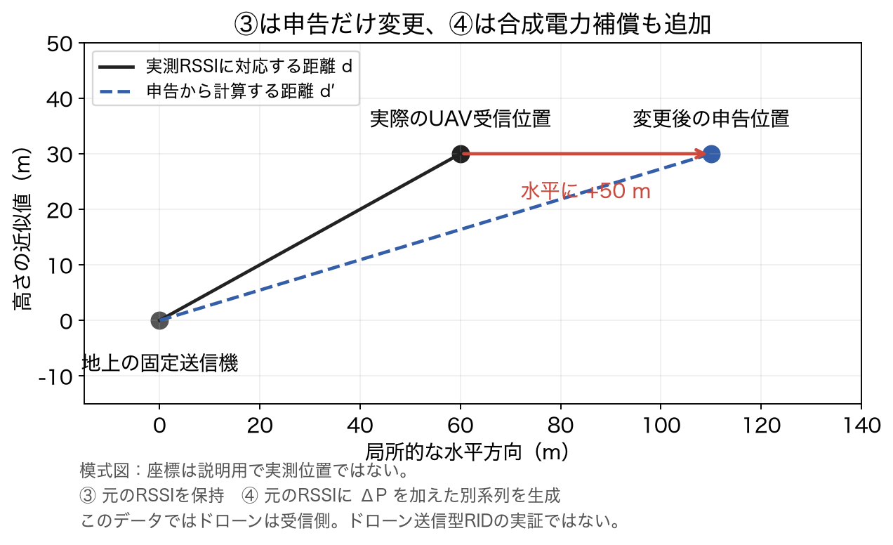
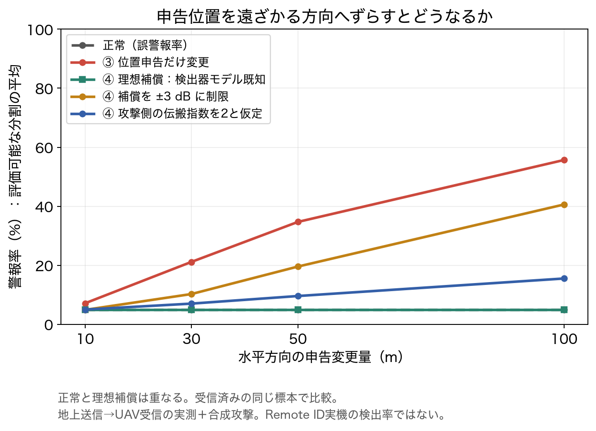
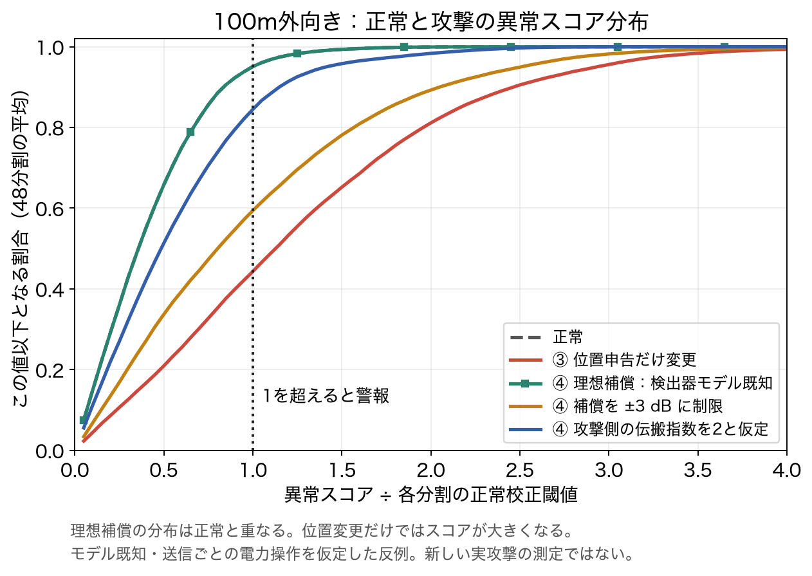

# 実測RSSIを基準とした位置申告変更③と電力補償④の対比較

2026-11-03、Macで実装・実行。既存LoRaの観測を保持し、同じ受信標本・正常校正閾値で比較した。**以下は実測RSSIに合成の申告・電力変化を与えた評価であり、Remote ID実機の攻撃実証ではない。**

## 最初に押さえる結果

- 100m外向きの位置申告変更では、警報率は正常4.90%から55.67%になった。全件を検出できたわけではない。
- 検出器と同じモデルに従う理想的な電力補償では、正常と全件同じ判定になった。これはモデル式から構成した反例であり、実攻撃の再現成功率ではない。
- 補償幅±3dBでは40.59%、攻撃側の伝搬指数を2と置くと15.51%。補償能力・モデル知識を制限すると結果が変わった。

## 1. 何の位置を変えたか

原データは地上の固定送信機→飛行中UAV受信機。今回は**UAV受信側の位置申告を変更したリンク整合性の代理評価**とする。ドローンが送信するRIDの位置偽装へ送受信を入れ替えた実証とは扱わない。④の電力変更を物理的に行うなら地上送信機の操作が必要であり、実際にドローンがその権限を持つと仮定したデータではない。



図の座標は説明用の合成値で、実測位置ではない。実際の位置・時刻・RSSIの個票はignored captures内に保持した。

## 2. データと公平な比較条件

- [公開LoRa v2](https://zenodo.org/records/17339095)のハッシュ固定アーカイブ。全19条件142,039観測のうち、3runのある16条件・116,691受信標本を比較に使用。
- 学習・正常校正・評価を別runとした巡回3分割、計48fold。各runが評価役になるのは1回。共有runを含むため48独立試行とは扱わない。
- `f(d)=a+b log10(d)` を学習runだけで最小二乗推定。`b=-10n`。閾値は別の正常校正runの絶対残差95%点。攻撃を使って校正しない。
- dは既往評価と同じ平坦地の斜距離近似。垂直差zはUAVのAGL高度＋埋設深さ、水平距離hは `sqrt(d²-z²)`。地形を含む厳密な3D距離ではない。
- ③では実測RSSIをそのまま使う。④では実測RSSI配列を書き換えず、合成電力差を加えた別配列を作る。雑音・反射等を含む元の残差は保持されるが、その原因は分離しない。
- 改変量は水平10／30／50／100m。ランダム操作はなくseedは不要。
- 主結果はfold等重み平均。受信済み標本が母数で、全送信・実際の受信率や稼働システム全体の検出率ではない。

### 申告変更の幾何

各標本の地上送信機を原点とする局所座標で、受信UAVを `(h,0,z)` と表す。地図上の一定平行移動ではなく、各標本の方向を基準とした合成変更。

| 方向 | 変更した申告 | 申告距離 d′ |
|---|---|---|
| 遠ざかる | `(h+δ,0,z)` | `sqrt((h+δ)²+z²)` |
| 近づく | `(h−δ,0,z)` | `sqrt((h−δ)²+z²)`、h>δのみ |
| 横方向 | `(h,δ,z)` | `sqrt(h²+δ²+z²)` |

近づく方向で送信機を通り越す申告は保留。正常・③・④のすべてに同じ対象マスクを適用する。

## 3. 異常スコアと電力補償の意味

正常スコアは `S0=|R−f(d)|`、③は `S3=|R−f(d′)|`。スコアが正常校正閾値τを超えれば警報。

④は `ΔP=b_att log10(d′/d)` を仮定し、`S4=|R+ΔP−f(d′)|` を計算する。

| 条件 | 加える電力差 | 攻撃側の知識・制約 |
|---|---|---|
| 正常 | 0、申告も変更なし | 基準 |
| ③ 位置のみ | 0 | 元のRSSIを保持 |
| ④ 理想補償 | `b log10(d′/d)` | 検出器の傾きと真・申告距離が既知、送信ごとに無制限の相対電力変更 |
| ④ ±3dB制限 | 理想補償量を±3dBで制限 | 同じ知識を持つが変更量が不足し得る |
| ④ モデル不一致 | `−20 log10(d′/d)` | 攻撃側はn=2と仮定。検出器の推定nとは一般に異なる |

理想補償では `ΔP=f(d′)−f(d)` なので、

```text
R + ΔP − f(d′) = R − f(d)
```

となる。**元のRSSIに実環境の揺らぎが残っていても、同じモデルを使う検出器の残差はそのままになる。** これは実測から新たな攻撃成功率を発見したことではなく、実測標本上でも成立するモデル依存の構成的反例。第三者が現実にこの精度で電力制御できることは検証していない。

### 説明用の数値例（実測結果ではない）

`f(d)=−40−20 log10(d)`、真距離100mなら予測−80dB、元の観測を−77dBとすると残差は+3dB。申告距離だけ200mにすると予測−86.02dB、スコアは9.02dB。ここでΔP=−6.02dBを加えると観測は−83.02dBとなり、スコアは元と同じ3dBに戻る。値は式を説明するための合成例で、RSSI校正や実送信電力の測定ではない。

## 4. 結果：遠ざかる方向

同じ116,691受信標本・48foldで比較。正常の値はFPR、攻撃時の値は合成攻撃に対する条件付きTPR（警報率）。TPRには正常時にも警報した標本が含まれる。

| 水平変更量 | 正常FPR | ③位置のみ | ④理想補償 | ④±3dB | ④攻撃側n=2 |
|---|---:|---:|---:|---:|---:|
| 10m | 4.90% | 7.11% | 4.90% | 4.87% | 4.99% |
| 30m | 4.90% | 21.14% | 4.90% | 10.25% | 7.00% |
| 50m | 4.90% | 34.69% | 4.90% | 19.56% | 9.57% |
| 100m | 4.90% | 55.67% | 4.90% | 40.59% | 15.51% |



100mの③では、正常との差は+50.78ポイント。対比較では54.13%の標本に新しく警報が出る一方、正常時の警報が消える標本も3.35%あった。警報率55.67%をすべて新たに識別できた標本と解釈しない。

④理想補償は、全方向・全変更量で正常との警報不一致0件。100m外向きのスコア差の最大値は4.3×10^-14 dB程度で、浮動小数点計算の範囲。正常時に警報する約4.90%は残るため、攻撃を検出した証拠が追加されたわけではない。

100m外向きの理想補償では、必要な絶対電力変更量の中央値をfoldで平均すると9.49dB、必要量が3dBを超える割合は平均98.78%。変更幅を±3dBに制限した結果が理想補償と異なる理由になる。実EIRPの上限・下限・設定精度は検証していない。

## 5. 正常と攻撃のスコア分布



100m外向きの同一標本を使用。横軸は各foldのスコア÷正常校正閾値、縦軸はその値以下の割合をfold等重みで平均したCDF。横軸1を超えると警報。理想補償と正常の分布は一致し、図でも重なっている。スコアが小さいことは、申告位置が正しい証明にはならない。

## 6. 方向と対象標本に関する注意

- 100m横方向の③は38.22%。同じ水平変更量でも斜距離の変化が外向きより小さいため、単一リンクのRSSIスコアに与える影響が異なる。これは方向観測やAoAの評価ではない。
- 近づく100mは評価可能30/48fold、対象割合は48fold等重み平均で33.48%。正常FPRは対象に合わせて4.06%、③は49.84%。他の変更量とは対象標本が変わるため、曲線を純粋な距離依存性と解釈しない。
- 単一リンクでは、送信機から等距離の異なる申告位置も残る。位置偽装の方向・量だけで一般的な検出境界を主張しない。

[近づく方向の図](results/paired-attacks-20261103-v2/figures/02_alarm_inward.png)／[横方向の図](results/paired-attacks-20261103-v2/figures/03_alarm_tangential.png)／[必要な補償量の図](results/paired-attacks-20261103-v2/figures/05_required_compensation.png)。

## 7. 今回言える範囲

この受信済み実測標本と校正条件では、申告位置のみの変更は正常との差を増やす場合がある。一方、検出器モデルを知る送信ごとの理想補償で残差を正常に一致させられる。電力補償の幅・モデル知識を制限すると、正常と攻撃の分離は条件依存で変わる。

電力変更による受信可否、干渉、受信機飽和、未受信パケットの変化は再現していない。RSSIに含まれる反射や遮蔽の寄与を分離した評価でもない。時系列の軌跡整合性や多局差分は使っていない。

以前のWeek26は斜距離に直接オフセットを加えた代理評価。本報告は水平位置変更の3方向、同一標本の対比較、変更幅制限・攻撃モデル不一致を追加したものであり、独立した新規飛行実験ではない。

## 8. 保存物と再現

- [全foldのCSV](results/paired-attacks-20261103-v2/fold-metrics.csv)：2,880行。方向・変更量・攻撃の全組合せ。
- [集計CSV](results/paired-attacks-20261103-v2/aggregate.csv)／[設定・結果JSON](results/paired-attacks-20261103-v2/summary.json)。
- [解析コード](../experiments/week27-data-audit/paired_attacks.py)／[図生成](../experiments/week27-data-audit/plot_paired_attacks.py)／[独立した保存結果監査](../experiments/week27-data-audit/audit_paired_results.py)。
- 図6組のPNG・SVGとハッシュ、コードハッシュを保存。集計値と説明用合成図のみを公開し、実測座標・時刻・個票はGitに含めない。

```sh
.cache/week26-mac-venv/bin/python -m unittest discover \
  -s experiments/week27-data-audit -p 'test_*.py'
.cache/week26-mac-venv/bin/python experiments/week27-data-audit/paired_attacks.py \
  --archive captures/week26-public-lora/dataset.zip \
  --out week27/results/NEW_paired_attacks
.cache/week26-mac-venv/bin/python experiments/week27-data-audit/plot_paired_attacks.py \
  week27/results/NEW_paired_attacks
.cache/week26-mac-venv/bin/python experiments/week27-data-audit/audit_paired_results.py \
  week27/results/NEW_paired_attacks
```

NumPy 2.5.4、Matplotlib 3.11.2。図生成には日本語フォント（Hiragino Sans、Noto Sans CJK JP等）が必要。攻撃の処理には乱数を使わない。正常解析と同じ元ZIP・ハッシュを使用し、既存の出力を上書きしない。監査専用テストは19件。CIでは生データを取得せず、合成入力の単体テストと集計結果の整合を検査する。
