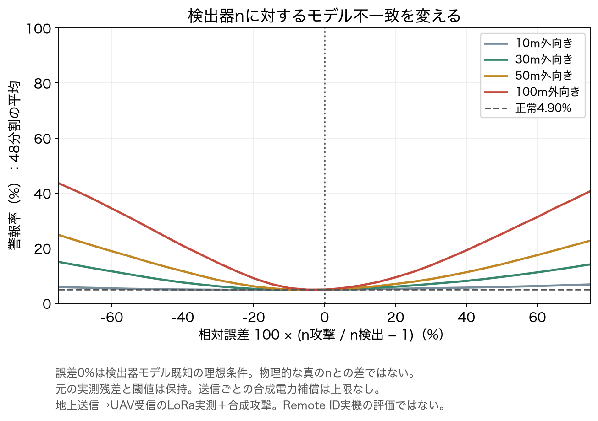
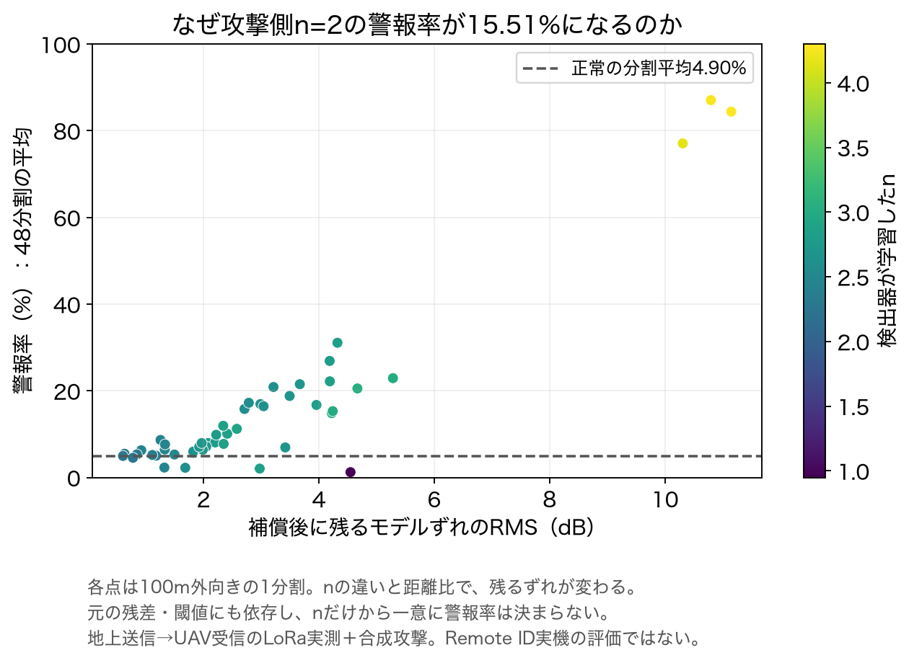
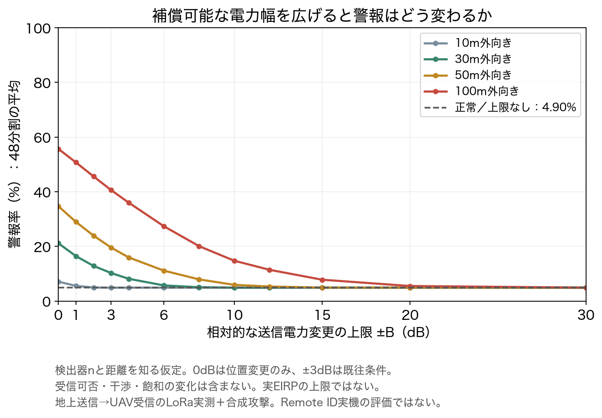
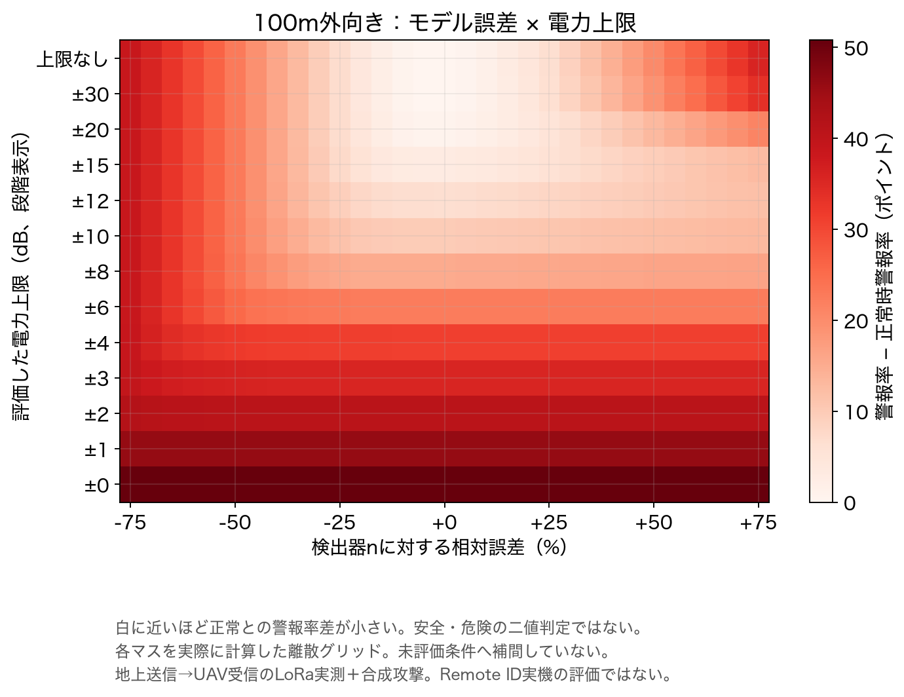
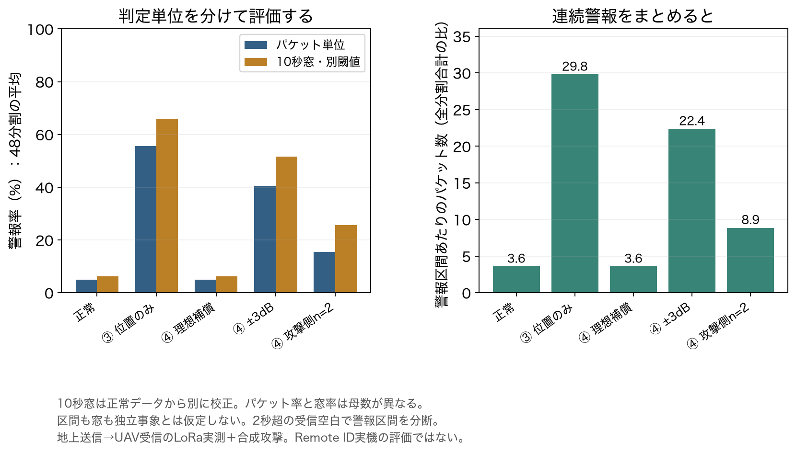

# 攻撃モデル誤差・補償電力制約・時間相関の追加評価

2026-11-03実行。既存実測を維持したまま、攻撃者の知識と補償幅を変えた感度分析を追加した。

## 今回わかったこと

単一RSSIによる位置申告検査では、**攻撃者が検出器モデルをどれだけ知り、どれだけ電力を補償できるかで警報率が変わった**。100m外向きの申告変更では、位置だけの変更で55.67%、理想補償で正常と同じ4.90%。±10dBの補償制限でも14.75%まで低下した。

これは実測LoRaへの合成攻撃による代理評価であり、Remote ID実機の検出性能ではない。正常に近い警報率は、攻撃を正常と区別しにくいことを意味する。攻撃時の警報率そのものを、誤警報を除いた検出成功率と解釈しない。

## データ・比較条件

- 公開データ：[Zenodo v2・17339095](https://zenodo.org/records/17339095)。地上の固定送信機→飛行UAV受信機という構成。元記録142,039件、19条件、52run。
- 3runがある16条件を採用。訓練・正常校正・評価をrunごとに分離し循環させた48分割。評価受信済みパケット116,691件は全パラメータで共通。
- 48分割は訓練・校正runを共有するため独立試行ではない。結果は分割の等重み平均。条件別範囲は記述統計であり信頼区間ではない。
- 訓練runでRSSIの距離減衰を当てはめ、別の正常runの絶対残差95パーセンタイルで閾値を校正。評価runで閾値を変えない。
- 真の位置関係と元RSSIは維持し、UAV受信機側の申告位置だけを水平外向きに10・30・50・100m変更。距離は平坦地形を仮定した高度・埋設深度込みの斜距離代理値。
- 電力操作は記録RSSIへの加算。実際の送信電力変更、受信可否、干渉、飽和の変化を再現したものではない。補償上限は相対的な変更量であり、実機EIRP上限ではない。

元アーカイブのSHA-256：`29c9715ca39d297ac7f00142958dc959fa154c34d684d32adeebe5f97681cc84`。元データ・座標・個別時刻はGitに含めない。

## モデル誤差が残差に残る仕組み

検出器の学習式を f(d)=a−10 n_d log10(d)、正常の符号付き残差を e=R−f(d) とする。申告距離をd′、攻撃者のモデル係数をn_aとすると、合成補償は

```text
ΔP = clip(−10 n_a log10(d′/d), −B, B)
e_attack = e + 10 n_d log10(d′/d) + ΔP
```

上限なしなら、残るずれは `10(n_d−n_a)log10(d′/d)`。検出器モデルを正確に知るn_a=n_dでは、正常残差と完全一致する。これはモデルと距離を知る理想的な反例であり、実際の攻撃者がその情報を持つことの実証ではない。

n_dは実測から当てはめた**検出器の係数**であり、独立に測定した物理的真値ではない。相対誤差0%も「検出器モデルに一致」の意味。

## ① 攻撃者モデル誤差の掃引

固定n_aを0.5〜5.0（0.1刻み）、比n_a/n_dを0.25〜1.75（0.05刻み）で評価した。連続パラメータを離散格子で調べた結果であり、未評価条件まで保証する境界ではない。

100m申告変更、電力補償上限なしの場合：

| 検出器nに対する相対誤差 | 警報率 |
|---|---:|
| −50% | 27.69% |
| −25% | 11.69% |
| 0%：モデル一致 | 4.90% |
| ＋25% | 11.38% |
| ＋50% | 25.18% |

固定n_a=2の15.51%は、各分割の学習係数n_d（0.948〜4.299）との不一致で補償後にずれが残るため。100m条件で残るずれの分割内RMSを平均すると3.02dBだった。ただし距離比、元の符号付き残差、閾値にも依存するため、n=2なら常に15.51%になるわけではない。ずれは元残差を増幅も相殺もする。





## ② 補償可能電力の掃引

モデル既知n_a=n_dとして、補償上限Bを0・1・2・3・4・6・8・10・12・15・20・30dBと上限なしで比較した。

| 補償上限 | 100m外向きの警報率 |
|---|---:|
| 0dB：位置変更のみ | 55.67% |
| ±1dB | 50.72% |
| ±3dB | 40.59% |
| ±6dB | 27.36% |
| ±10dB | 14.75% |
| ±15dB | 7.80% |
| ±20dB | 5.49% |
| ±30dB | 4.90% |
| 上限なし | 4.90% |
| 正常 | 4.90% |

±30dBで警報率が正常と一致しても、全パケットの残差が完全一致したことは意味しない。補償上限を広げるほど正常に近づく傾向は今回のデータ・外向き変更における結果。



100mに限定し、モデル比31点×電力上限13条件の403格子も評価した。未測定点の補間はしていない。



## ③ 時間相関を考慮した集計

連続する警報パケットを独立した成功として数えないため、パケット率に加え、連続警報区間と10秒窓を記録した。正常パケットまたは2秒超の受信空白で警報区間を切る。区間数も独立事象数とはみなさない。

10秒窓は受信空白をまたがない完全な非重複窓のみ。端の不完全窓は除外し、絶対残差の中央値をスコアとする。**正常校正runの窓スコアから別の閾値を校正**した。評価窓は計2,467窓で、窓間の独立性は仮定しない。

| 100m条件 | パケット警報率 | 10秒窓警報率 | 警報パケット合計 | 警報区間合計 |
|---|---:|---:|---:|---:|
| 正常 | 4.90% | 6.27% | 5,786 | 1,613 |
| 位置変更のみ | 55.67% | 65.84% | 66,142 | 2,220 |
| 理想補償 | 4.90% | 6.27% | 5,786 | 1,613 |
| ±3dB補償 | 40.59% | 51.61% | 49,525 | 2,215 |
| 固定n_a=2 | 15.51% | 25.58% | 21,419 | 2,416 |

率は分割平均、件数は合計なので単純な割り算では一致しない。窓の正常警報率は6.27%であり、校正目標5%が未知runでも保証されたわけではない。窓率とパケット率は対象・閾値が違い、窓率の上昇だけを改善と評価しない。n=2では区間が細切れになり、位置変更のみより区間数が多くても検出性能が高いとはいえない。



## 再現・検証

[結果JSON](results/compensation-sensitivity-20261103/summary.json)と、同ディレクトリの`*-fold.csv`・`*-aggregate.csv`、図のPNG/SVGを保存。36,912行の分割別結果は同じデータを使うパラメータ組合せであり、独立試行数ではない。乱数を使わないためseedはなし。

```sh
# Python 3.13以降、NumPy 2.5.4、描画にはMatplotlib 3.11.2
# 元アーカイブは各自取得し、ignored captures/ 内に権限600で置く
.cache/week26-mac-venv/bin/python experiments/week27-data-audit/compensation_sensitivity.py --archive captures/week26-public-lora/dataset.zip --out /tmp/week27-sensitivity-reproduction
.cache/week26-mac-venv/bin/python experiments/week27-data-audit/plot_sensitivity.py /tmp/week27-sensitivity-reproduction
.cache/week26-mac-venv/bin/python -m unittest discover -s experiments/week27-data-audit -p 'test_*.py'
python3 experiments/week27-data-audit/audit_sensitivity_results.py week27/results/compensation-sensitivity-20261103
```

出力先は未作成ディレクトリを指定する。解析ソースのハッシュ、描画ソースと図のハッシュを同梱。CIでは元データを公開せず、保存結果の全集計・既往結果との対応・式・同一コホート・ハッシュを監査する。専用テストは既存19件＋追加8件の27件。

## 残る課題

優先度①②は実行済み、③は時間単位別集計まで実行した。独立飛行の追加やブロック単位の不確実性評価は未実施。今回の結果から実環境での一般的検出率や攻撃原因を断定できない。

④のUAV送信→地上受信の複数局RSSI評価は未実施。取得済みUAV送信CSIは伝搬分析用であり、dBm RSSIに置き換えない。実際のRemote ID、受信欠落の変化、ハードウェアの電力制約は別途測定が必要。
