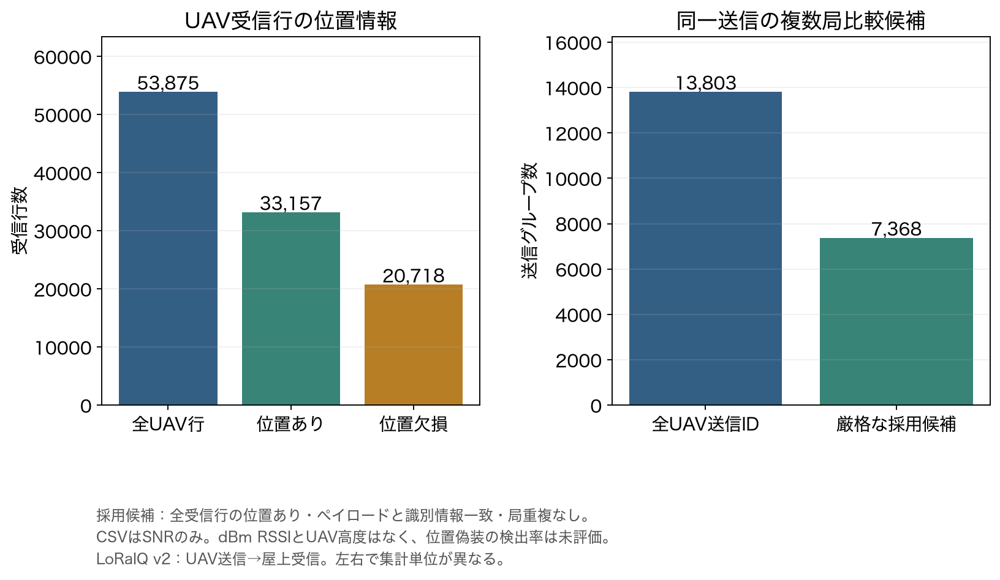
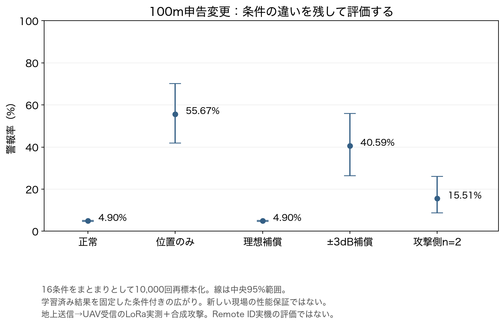

# UAV送信データの取得監査と条件単位の不確実性評価

2026-11-03に実行。パラメータの追加より外的妥当性を優先し、UAV送信データの実取得・採用監査と、既存結果の条件単位の不確実性評価を行った。

**今回の到達点：UAV送信→屋上4局受信の実CSVを取得できた。ただしdBm RSSIとUAV高度がなく、現在のRSSI検出器による再評価は未実施。** SNRをRSSIへ読み替えたり、未知の高度・雑音床を補って検出率を出したりしていない。

## 1. 新しい実測候補：LoRaIQ v2

- Tapparel・Burg（EPFL）、[LoRaIQ v2、Zenodo 20341802](https://zenodo.org/records/20341802)、2026-05-20公開。初版ではなくv2を固定して取得した。
- 配布説明では、UAV／歩行者が送信し、屋上4局のUSRP-2920・Raspberry Pi 5・GPS受信機で観測する。LoRa 862.5MHzであり、Wi-Fi/BLE Remote IDではない。
- 取得したもの：`dataset.csv` 28,253,049 bytes、受信局位置のMD 390 bytes、配布読み込み例2,831 bytes。3ファイルとも配布MD5を照合し、SHA-256も保存。配布プログラムは内容を読み、実行していない。
- CSVのSHA-256：`f261a911a96c6e79b23272a21091b97e51719ef1c1033116d900862afde65fd3`。
- 全IQ ZIPは約71GBで未取得。ローカル空き容量約18GiBに対して全取得しない。CSVの監査結果をIQの検証結果とはしない。
- 元CSV、受信局座標、個別時刻はignored `captures/week27-loraiq-v2/` に保持。ディレクトリ0700・ファイル0600。Gitには集計とハッシュだけを入れる。

### 実ファイルから確認した内容

| 集計 | 件数 |
|---|---:|
| CSV全受信行 | 114,147 |
| UAV受信行 | 53,875 |
| 除外した非UAV行 | 60,272 |
| UAVセッション名 | 6 |
| UAVの送信IDグループ | 13,803 |
| 4局の行を持つ送信グループ | 12,466 |
| 3局の行を持つ送信グループ | 1,337 |
| UAV行の位置あり | 33,157 |
| UAV行の位置欠損 | 20,718 |
| グループ内のペイロードまたは位置不一致 | 2,006 |
| 全行の位置と識別情報が揃う複数局比較候補 | **7,368** |

グループキーは`(name, transmission_idx)`。局重複、位置、ペイロード、SF、CR、中心周波数、帯域、エリアの整合を検査した。送信IDだけで正しさを仮定しない。位置やペイロードの不一致は記録し、厳格候補から外す。原因を誤復号・GPS障害などに断定していない。

「位置ありの受信行だけを残す」場合には9,138グループ、うち複数局8,994グループとなるが、元グループの欠損行を除いた緩い条件である。主な採用候補数は、**全受信行の位置あり・識別情報一致・局重複なし**の7,368とする。補間や欠損値の生成はしていない。

UAV全グループの受信タイムスタンプ差は中央値約0.480ms、最大約6.617ms。ただしこれはCSVに記録された局間時刻差であり、独立に測定した時計精度や電波伝搬時間ではない。欠けた局の行も、そのまま実RFパケット損失率とはしない。セッション名6個を6独立飛行・6日と断定しない。



### 何に使え、何が不足するか

| 項目 | 判定 | 必要な確認 |
|---|---|---|
| UAV送信・地上側多局受信 | 配布説明と実CSVで前進 | 実機RIDではない |
| 同一送信の対応付け | ID＋識別情報の整合を監査 | 不整合を除外し、IQ側の対応は別確認 |
| RSSIモデルの再評価 | **未実施** | CSVはSNRのみ。受信雑音床・利得・校正が不明 |
| 真の3D距離 | **未確立** | CSVにUAV高度なし。注釈位置も独立した真正な真値とは未確認 |
| 方向情報 | **未評価** | 複数地点の受信は同一局内AoAではない。位相・配列の校正は未実施 |
| 物理的な電力操作 | **未評価** | 設定固定の記録から電力操作時の欠落や干渉を実証できない |

次のゲートは、小さなIQ・SigMFメタデータの取得で**受信利得と雑音床を追跡できるか**を調べること。追跡不能なら、絶対RSSIではなく受信機固有の相対IQ電力等の別指標として定義し直す必要がある。その場合も既存dBm RSSI検出器の同条件再評価とは呼ばない。dBFSとdBmを混同しない。

## 2. AADMは取得制約が継続

[AERPAW AADM配布元](https://datadryad.org/dataset/doi:10.5061/dryad.7d7wm3898)はUAV送信のLoRa RSSI・ゲートウェイ識別情報・テレメトリを案内しており、研究要件には引き続き有力。今回再確認したが、本体API401・Web403だった。[取得結果JSON](results/aadm-recheck-20261103-next.json)。メタデータの閲覧を実測ファイル取得としない。認証や配布制限の回避は行わない。

補足候補： [Oryx](https://ems-tu-ilmenau.github.io/dataset/multi-node-uav-sensing/)はUAV送信・固定局4点を含むチャネル応答データ。ただし今回実ファイルは未取得。主シナリオの送信UAVがほぼホバリングで、dBm RSSIと同一視できないため、位置偽装RSSI評価の完了とはしない。

## 3. 条件のまとまりを残した不確実性評価

既存LoRa対比較の100m外向き条件を再集計した。元のデータは**地上送信→UAV受信**のまま。この再集計で通信方向の問題が解決したわけではない。

48分割は16条件×3runの循環分割で、訓練・校正runを共有する。そこで、個別パケットや48分割を独立に再標本化せず、**各条件の3runを一つのブロックにまとめた16ブロック**を、復元抽出で10,000回再標本化した。seed=27。方式間で同じブロック抽出を使い、正常との差も対で計算する。既存学習済みの係数・閾値は固定し、再学習はしていない。

以下は再標本化分布の中央95%範囲。条件の交換可能性を仮定した記述的な広がりであり、新しい飛行・機体・現場に対する95%性能保証ではない。同一キャンペーン由来の条件間依存が残り得るため、無条件の独立クラスタ信頼区間とは呼ばない。

| 100m外向き | 警報率平均 | 再標本化中央95%範囲 | 正常との差 |
|---|---:|---:|---:|
| 正常 | 4.90% | 4.66〜5.05% | 0ポイント |
| 位置変更のみ | 55.67% | 41.95〜70.14% | ＋50.78ポイント |
| 理想補償 | 4.90% | 4.66〜5.05% | 0ポイント |
| ±3dB補償 | 40.59% | 26.29〜55.95% | ＋35.70ポイント |
| 攻撃者n=2 | 15.51% | 8.72〜25.97% | ＋10.62ポイント |



**解釈**：n=2の15.51%などを精密な普遍値として提示すべきではない。電力補償後に残る不整合と条件差が結果を左右する。理想補償と正常が一致する点は、再標本化でも維持されるが、これは残差が一致する代数的構成に由来する。追加実測によって攻撃成功を新たに実証した結果ではない。

各条件を一つずつ除いた平均の範囲もJSONに保存した。パケットの二項分布CIは算出しない。新しい飛行・機体・日・サイトを独立に収録し、分割ごとの再学習を含める評価は残件。

## 4. 再現手順と成果物

```sh
# 原データの取得と監査：公開ファイルはサイズ・MD5を固定
python3 experiments/week27-data-audit/audit_loraiq.py \
  --raw captures/week27-loraiq-v2 --fetch --output /tmp/loraiq-audit-reproduction.json

# 既存の集計CSVだけで条件単位の評価を再現
.cache/week26-mac-venv/bin/python experiments/week27-data-audit/cluster_uncertainty.py \
  --input week27/results/paired-attacks-20261103-v2/fold-metrics.csv \
  --output /tmp/condition-block-reproduction.json

.cache/week26-mac-venv/bin/python -m unittest discover -s experiments/week27-data-audit -p 'test_*.py'
.cache/week26-mac-venv/bin/python experiments/week27-data-audit/audit_external_validity.py
.cache/week26-mac-venv/bin/python experiments/week27-data-audit/plot_external_validity.py
```

Python数値環境は前回と同じNumPy 2.5.4・Matplotlib 3.11.2。出力先は未作成パスを指定する。描画コマンドは今回の固定結果ディレクトリへPNG/SVGを再生成する。日本語フォントが異なる場合、画像ハッシュの一致は要求しない。

- [LoRaIQ監査JSON](results/loraiq-v2-audit-20261103/summary.json)：ファイルハッシュ・全項目・欠損・局数・識別不一致・未成立ゲート。
- [条件単位の再標本化JSON](results/cluster-uncertainty-20261103/summary.json)：各条件の方式別平均・対差・中央範囲・1条件除外評価・設定。
- 専用テスト32件。CIは原データなしで再標本化を再計算し、監査集計の算術整合・解析コードハッシュ・図のハッシュを検査する。CIがLoRaIQの原CSVを再監査したことは意味しない。

## 5. 次に進める順番

1. LoRaIQのIQ・メタデータを少数取得し、受信機ごとの校正・雑音・高度情報の取得可否を判定する。
2. 成立する観測量が決まったら、セッションを分離した正常校正から単局と同一送信の多局差分を比較する。SNR差分で電力が消えるかは、雑音床の仮定を別途検証する。
3. RSSIが校正できない場合はAADM等の真正なRSSI記録を継続探索し、LoRaIQはチャネル・欠損・多局対応の補助評価に限定する。
4. 実際の送信電力変更と受信欠落の評価には、その条件を収録した公開データまたは実機収録が必要。現在のデータから代用して完了扱いにしない。
