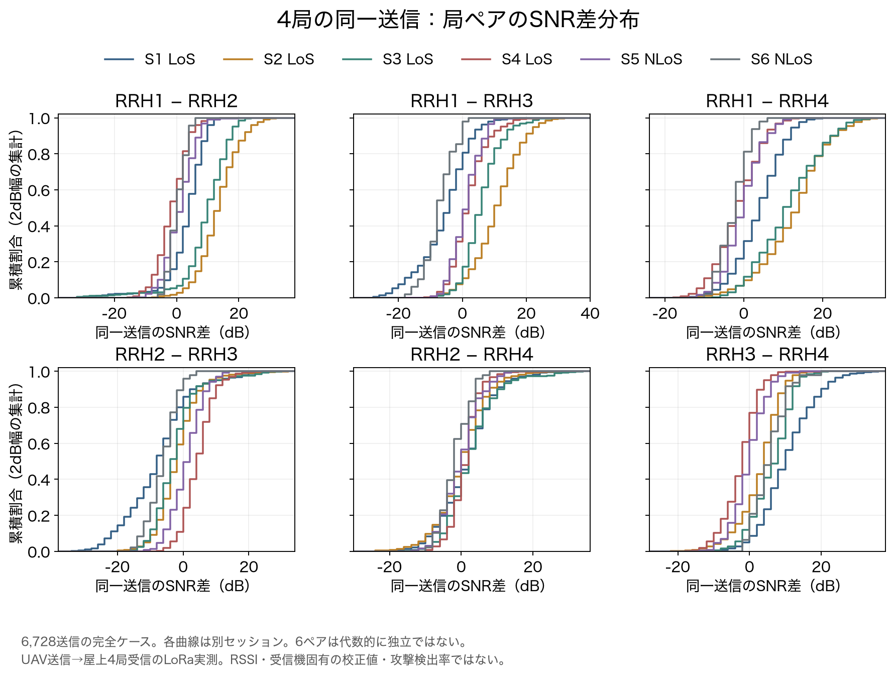
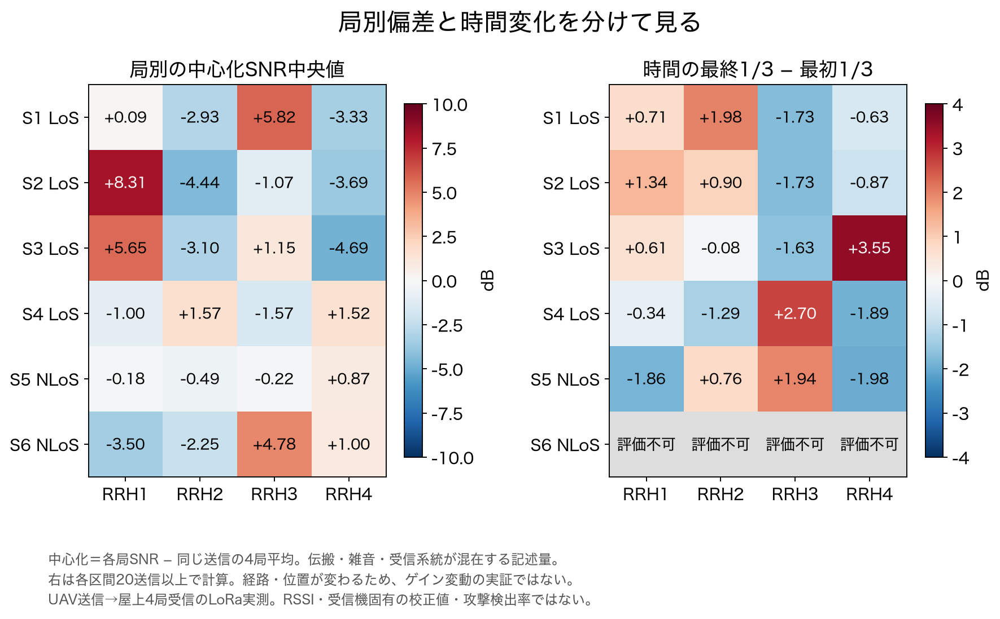
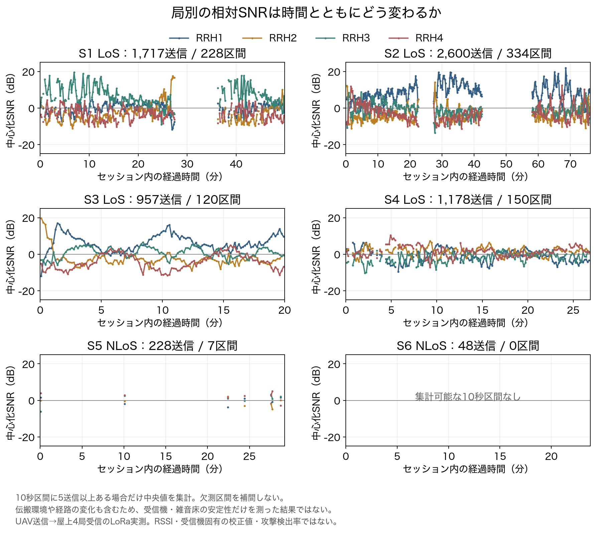
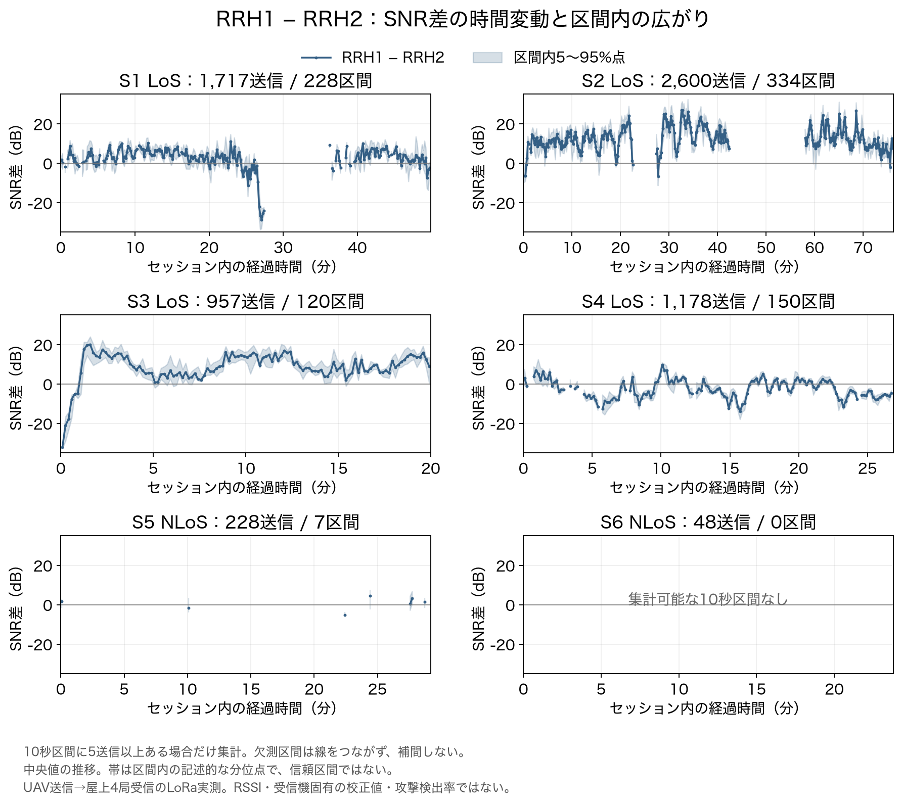

# 同一送信4局のSNR差分布・局別偏差・時間変動

2026-11-04、Macで実行。[LoRaIQ v2](https://zenodo.org/records/20341802)の取得済み実測CSVから、同一送信の4局受信候補を厳格に選択し、差分の分布と時間変動を解析した。新しい雑音を合成せず、元のSNRを使用した。

**中心となる結果：6,728送信について4局の差分を構成できた。ただし、観測される局差はセッション・時間で変わり、受信機固有の偏差として分離できていない。** これは位置申告検査の前段評価であり、攻撃の検出率を追加した実験ではない。

## 1. 何を確認する分析か

1. 同一送信に対応する4局のSNRを揃え、6ペアの差分を構成できるか。
2. 局ごとに、他の局より高い／低いという傾向がどの程度あるか。
3. その差が時間とともに動くか、連続依存や欠測がどれほど残るか。

局間差が動くこと自体を「不正」とはしない。UAVが移動すれば各局までの伝搬経路が変わるため、正常でも差は動く。今回の統計だけでは、移動・遮蔽・雑音床・推定誤差・受信系統の寄与を分離できない。

## 2. データと採用条件

元データはUAV送信→屋上4局受信のLoRa実測。Wi-Fi/BLE Remote IDではない。CSVはdBの推定SNRであり、dBm RSSIではない。[取得監査06](06_UAV送信データの取得監査と条件単位の不確実性評価.md)と[IQメタデータ監査07](07_LoRaIQのIQメタデータ監査と観測量の採用判断.md)の制約を引き継ぐ。

- 元CSV全体114,147受信行。UAV部分53,875行、送信ID候補13,803グループ。
- キーは`(name, transmission_idx)`。**局ID1・2・3・4が各1行ずつある**グループだけを採用。
- 4行すべてに位置があり、位置・ペイロード・SF・CR・周波数・帯域・エリアが一致することを確認。
- 排他的な除外内訳：4局が揃わない1,337グループ、4局は揃うが位置欠損を含む5,738グループ。残る6,728グループを使用。
- 元グループ全体では識別／位置不一致2,006グループもあるが、上記欠損と重なるため足し合わせない。独立した不一致除外が0になるのは、先に欠損グループを除いているため。
- 以前の「厳格な複数局比較候補7,368」は3局のものも含む。今回は4局すべての完全ケースに限定した。

これはCSVの識別情報に整合する同一送信候補の選択であり、IQ復号・RF測定による同一送信の独立検証ではない。局間受信時刻差の最大は約6.55msだったが、これを時計精度の保証とはしない。

位置はUAV搭載GPS由来のペイロード注釈で、独立した真正な真値ではない。高度も未取得。今回、座標による距離補正・位置推定はしていない。

| セッション | 配布名 | 分類 | 4局送信数 | 採用10秒区間数 | 区間に入った送信数 |
|---|---|---|---:|---:|---:|
| S1 | `drone_campus_east` | LoS | 1,717 | 228 | 1,650 |
| S2 | `drone_campus_south` | LoS | 2,600 | 334 | 2,578 |
| S3 | `drone_epfl_west_long` | LoS | 957 | 120 | 956 |
| S4 | `drone_epfl_west_long_2` | LoS | 1,178 | 150 | 1,143 |
| S5 | `drone_field_bailly` | NLoS | 228 | 7 | 43 |
| S6 | `drone_field_perrettes` | NLoS | 48 | 0 | 0 |

LoS＝見通し条件、NLoS＝非見通し条件。分類は配布注釈を使用し、画像等で独立に確認したものではない。6つのセッション名を6独立飛行・6独立日とみなさない。4局完全ケースの選択は、受信しやすい条件へ偏る可能性がある。上記件数から実RFパケット損失率を算出しない。

## 3. 観測量の定義

### 局ペア差分

```text
D_ij(k) = SNR_i(k) − SNR_j(k)
```

同じ送信kの4局から6ペアを計算する。6差分は代数的には3次元の対比しか持たず、6個の独立観測とは数えない。

### 局別の中心化SNR

```text
C_i(k) = SNR_i(k) − mean_j SNR_j(k)
```

4局のSNRをdB値のまま算術平均して基準とした相対量。物理的な平均受信電力ではない。例えば＋5dBなら、その送信における4局平均よりSNRが5dB高い意味。

今回「局別偏差」として示すのはC_iの分布・中央値であり、**受信機ハードウェアの校正値ではない**。各局までの経路、雑音床、SNR推定方法や受信系統の影響を含む。6セッション等重みの平均もJSONに保存したが、普遍的な補正定数として使わない。

同じ送信に共通する加算値はDとCから代数的に消える。この性質は単体テストでも確認した。ただし、元データの送信電力設定は固定であり、実機で電力を変更して差分が不変になることを測ったわけではない。非線形、飽和、雑音床変化、欠測選択の影響も未検証。

## 4. SNR差分布

各セルは同一送信ペア差の**セッション内中央値、単位dB**。正常時に何dBの差があっても、それだけで不正・異常を意味しない。

| セッション | RRH1−2 | RRH1−3 | RRH1−4 | RRH2−3 | RRH2−4 | RRH3−4 |
|---|---:|---:|---:|---:|---:|---:|
| S1 | +3.24 | -5.52 | +3.01 | -8.59 | +0.84 | +8.90 |
| S2 | +12.24 | +9.80 | +12.44 | -3.17 | -0.84 | +2.87 |
| S3 | +9.09 | +4.56 | +9.88 | -4.15 | +1.09 | +6.18 |
| S4 | -2.65 | +0.42 | -2.55 | +3.36 | +0.16 | -3.10 |
| S5 | +0.10 | +0.19 | -1.50 | +0.04 | -1.09 | -1.17 |
| S6 | -1.07 | -8.34 | -3.48 | -6.97 | -3.20 | +4.56 |

RRH1−RRH2でもS2は＋12.24dB、S4は−2.65dB。同じ受信局ペアの差でもセッションによって変わる。ただし飛行経路・位置も異なるため、この差を受信機ゲインの変化へ帰属できない。



累積割合が0.5になる近辺が中央値。右へ寄るほど前者の局のSNRが相対的に高い。曲線が横へ広いほど、そのセッションで差が大きく変動している。2dB幅ヒストグラムから描画した累積分布で、個別パケットの公開はしていない。分位点の数値は元SNR差から直接計算した。

## 5. 局別偏差と時間の前後差



左はC_iの中央値。例えばRRH1はS2で＋8.31dB、S6で−3.50dBだった。この差にも位置・経路の違いが混ざる。

右は、セッションの経過時間を3等分し、**最後1/3のC_i中央値から最初1/3の中央値を引いた値**。中央1/3は使わず、両区間に20送信以上ある場合だけ計算した。S3のRRH4では＋3.55dB。局ペア差では最大絶対値5.41dBの前後差があった。

これは独立な検証試行やゲインドリフト測定ではない。正常な移動に伴う差も含む。S6は最初16送信・最後13送信しかなく、前後差を評価不可とした。灰色を0dBとして処理しない。

## 6. 時間変動と連続依存

時刻は4局の受信時刻の中央値を代表値とし、セッション内で整列。公開する図・CSVには経過時間の区間集計だけを用いる。

10秒ごとの非重複区間を作り、5送信以上ある区間だけ中央値・5〜95%点を計算した。末尾の10秒に満たない区間は除外。区間内で連続受信できたことを保証する条件ではない。空白の補間や、基準を満たさない区間を0として埋める処理はしていない。



LoSの4セッションは比較的多くの区間を集計できた。一方、S5は228送信中43送信が7区間に入るだけで、S6は集計区間が0。疎なNLoS部分に、LoSと同じ時間解析が成立したとはいえない。大きな空白を実RF損失と断定もしない。



この図は代表としてRRH1−RRH2を示す。他の5ペアの区間集計もCSV・JSONに保存。帯は区間内5〜95%点であり、中央値の信頼区間ではない。

### 隣接する観測の相関

隣り合う採用送信の時刻差が正で2秒以下の場合だけ相関を計算した。これは固定の「1秒ラグ」の相関ではなく、欠測のある観測列の隣接相関。3組未満または定数列なら評価しない。4局完全ケースでは、通常の隣接間隔はLoSで約1.21秒だった。

| セッション | RRH1−2中央値 | 5〜95%点 | 相関に使う隣接組数 | 隣接相関 |
|---|---:|---:|---:|---:|
| S1 | +3.24 | -6.88〜+9.53 | 1,487 | 0.831 |
| S2 | +12.24 | +1.92〜+23.48 | 2,437 | 0.811 |
| S3 | +9.09 | -3.16〜+17.92 | 921 | 0.900 |
| S4 | -2.65 | -10.36〜+5.31 | 1,085 | 0.910 |
| S5 | +0.10 | -8.05〜+7.26 | 82 | 0.378 |
| S6 | -1.07 | -5.42〜+3.52 | 2 | 評価不可 |

評価できた5セッションの6ペアでは相関0.371〜0.923だった。S6は2秒以下の隣接組が2組しかないため相関を出さない。多数のパケット・区間・6ペアを独立の検出成功数として扱わず、今回も独立パケットの二項分布CIは計算していない。

## 7. 今回の判断と攻撃実験へ進む条件

| 問い | 現在の判断 |
|---|---|
| 同一送信の4局SNR差を構成できるか | CSV上で整合する6,728送信について構成できた |
| 全局が同じ強さで受信するか | そうではなく、局差があり、セッションと時間でも変わる |
| 固定の受信機偏差を特定できたか | **できていない**。伝搬経路・雑音・受信系統の分離が未成立 |
| 差が変動したら位置偽装か | **判断できない**。正常の移動でも変動する |
| SNR差分方式の物理的保証を検証したか | 未実施。実電力変更・雑音床・飽和を測っていない |
| 非同期・別送信の元問題を解決したか | 未解決。同一送信多局という追加観測条件 |

**次のゲートは正常時の予測モデルを定義すること。** 位置関係や見通し・セッション差をどう扱うかを決め、正常データと評価データを分けて、正常スコアと閾値の安定性を先に検査する。未知高度の扱いも明示する。それが成立してから申告位置変更を追加する。今回の差分中央値をそのまま校正定数や警報閾値にしない。

## 8. 保存物・再現方法

[結果JSON](results/snr-four-station-20261104/summary.json)と同ディレクトリのCSV5種を保存：

- `pair_stats.csv`：全6ペア×6セッションの分位点・平均・SD・隣接相関・時間前後差。
- `station_stats.csv`：中心化SNRの同じ記述統計。受信機校正値ではない。
- `histograms.csv`：2dB幅ヒストグラムの件数。
- `time_windows.csv`：全6ペア＋4局の10秒区間集計。
- `session_quality.csv`：採用件数・観測間隔・時刻差・区間数。

元CSVのSHA-256：`f261a911a96c6e79b23272a21091b97e51719ef1c1033116d900862afde65fd3`。元CSVは配布MD5とSHA-256、関連2ファイルも固定ハッシュを照合して解析する。元の座標・個別時刻・ペイロード・単一送信のSNR行はGitに含めない。

```sh
.cache/week26-mac-venv/bin/python experiments/week27-data-audit/snr_four_station.py \
  --raw captures/week27-loraiq-v2 --out /tmp/snr-four-station-reproduction
.cache/week26-mac-venv/bin/python experiments/week27-data-audit/plot_snr_four_station.py \
  /tmp/snr-four-station-reproduction
.cache/week26-mac-venv/bin/python -m unittest discover -s experiments/week27-data-audit -p 'test_*.py'
.cache/week26-mac-venv/bin/python experiments/week27-data-audit/audit_snr_four_station.py
```

出力先は未作成のディレクトリを指定。NumPy 2.5.4・Matplotlib 3.11.2を使用。追加乱数や合成雑音がないのでseedはなし。専用テストは既存37＋追加6＝43件。取得済み原データによる解析はローカル実行済み。CIは原CSVなしで集計CSV/JSON、差分恒等式、件数、時間区間、ハッシュを監査し、原データを再解析したことにはならない。
