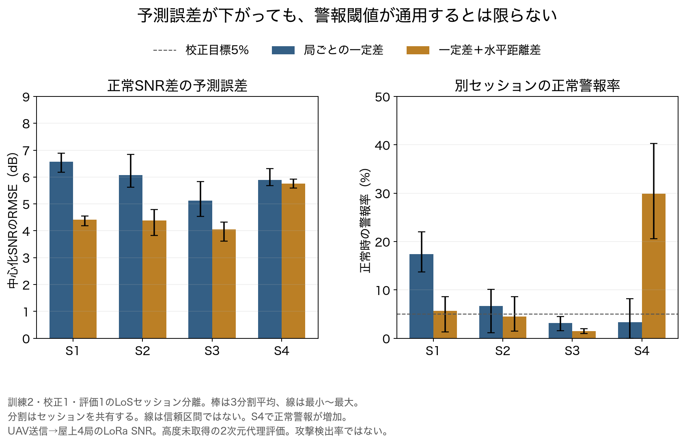
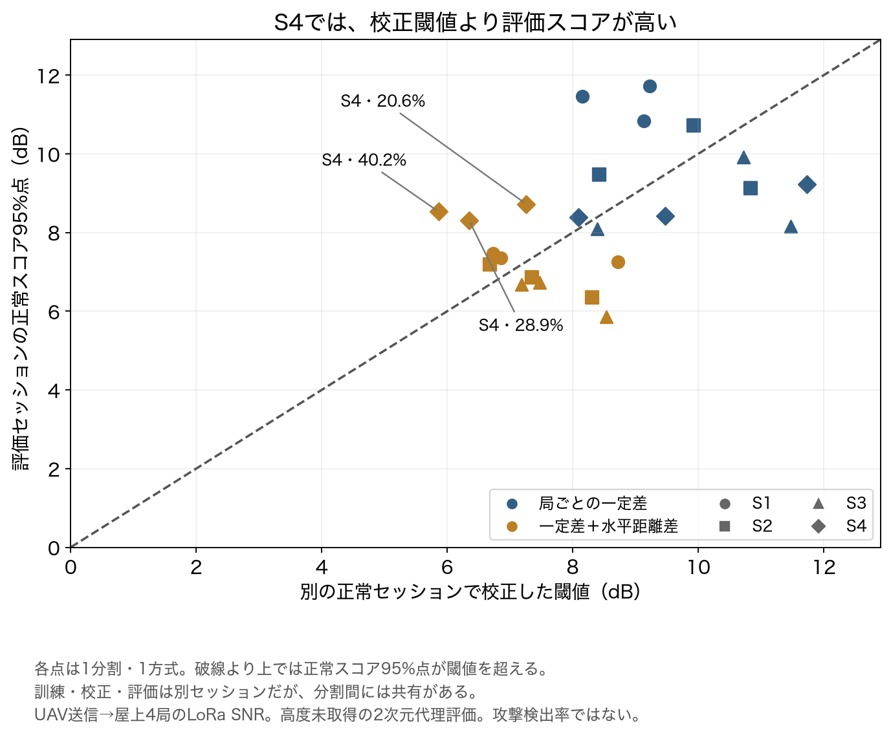
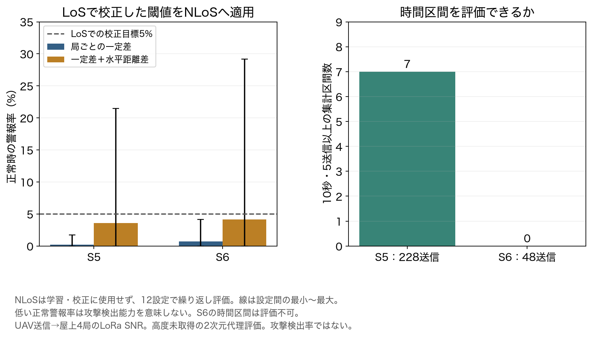

# 正常時SNRモデルの別セッション検証

2026-11-04に実行。[4局差分・偏差・時間変動の分析08](08_同一送信4局のSNR差分布と局別偏差_時間変動.md)を受け、正常時の予測モデルと警報閾値が別セッションへ移せるかを評価した。位置偽装は追加していない。

**結果：水平距離差を加えると、LoSの平均RMSEは5.92→4.65dBへ低下した。一方、正常警報率は7.65→10.41%、最大40.24%となり、校正目標5%が別セッションでも保たれたとはいえない。** 現時点で、位置偽装の検出性能を論じるための安定した正常基準が完成したとは判断しない。

## 1. 研究上の問いとデータ境界

正常の移動でも局間SNR差が変わることを前回確認した。そこで、受信局ごとの一定差だけを使う基準モデルと、位置に応じた水平距離差も使うモデルを比較した。

- [LoRaIQ v2](https://zenodo.org/records/20341802)の同一送信4局候補6,728件を使用。前回と同じ厳格コホート。
- 元SNRを維持し、攻撃・合成雑音・送信電力操作は加えない。
- 配布記録に攻撃がないと仮定し、今回の警報を正常時警報として扱う。独立に真位置やセンサーの正直さを証明したものではない。
- UAVの位置は送信ペイロード由来。高度は未取得。受信局位置のMDも配布ハッシュを照合して読み、**水平の大円距離だけ**を計算した。真の3次元伝搬距離ではない。
- 対象はUAV送信→屋上4局受信のLoRa SNR。Wi-Fi/BLE Remote IDや、別時刻・別パケットによる1送信1RSSIの検証ではない。

## 2. 比較したモデル

観測は同一送信kの中心化SNR：

```text
C_i(k) = SNR_i(k) − mean_j SNR_j(k)
```

H_i(k)を配布位置注釈から計算した水平距離、X_iを中心化した対数水平距離とする。

```text
X_i(k) = log10 H_i(k) − mean_j log10 H_j(k)

M_const: C_hat_i(k) = b_i
M_geo:   C_hat_i(k) = b_i + beta X_i(k)
```

b_iの和を0とし、訓練セッションの重みを等しくして最小二乗推定。各セッション内は各送信を等重みにする。大きいセッションだけが訓練を支配しないようにした。

M_geoのbetaは4局に共通の係数。`n_fit = −beta/10`を記録したが、これは**水平距離代理モデルの回帰係数**であり、物理的な真の伝搬指数ではない。訓練から得た範囲は1.274〜1.520だった。非負nへ黙って切り詰める処理はしない。今回の全訓練組合せでは減衰方向の係数だった。

b_iにも伝搬経路・雑音床・推定方法等の影響が混ざる。受信機固有の校正値として同定したものではない。NLoS固有の係数は学習していない。

## 3. セッションを分けた評価設計

| 役割 | 使用データ |
|---|---|
| 訓練 | LoSの4セッションから2つ |
| 閾値の正常校正 | 訓練に使わないLoSを1つ |
| LoS評価 | 残るLoSを1つ |
| NLoSへの転用評価 | S5・S6。訓練・校正には一切使用しない |

訓練2つの選び方6通り×校正の選び方2通り＝12分割。各分割で2方式を評価。NLoSも同じモデル・閾値で評価し、合計72行の結果を保存した。

**72独立実験ではない。** 分割間で訓練・校正・評価セッションを共有し、NLoSは同じ2セッションを12設定で繰り返し評価する。独立したパケット・分割の信頼区間を付けない。

1送信のスコアは、4局の中心化SNR残差のRMS：

```text
score(k) = sqrt(mean_i (C_i(k) − C_hat_i(k))^2)
```

正常校正セッションのスコア95%点を閾値とし、評価スコアが閾値を超えた割合を正常警報率とする。評価データで係数や閾値を再調整しない。6ペアを独立観測として数えない。

RMSEは全評価送信・4局成分の二乗残差平均の平方根。集計値は評価セッションを等重みにする。LoSは各セッション3分割、NLoSは各セッション12設定の平均。

## 4. LoSの主結果

| 方式 | セッション等重み平均RMSE | 平均正常警報率 | 分割別の正常警報率範囲 |
|---|---:|---:|---:|
| 局ごとの一定差 | 5.92dB | 7.65% | 0.00〜22.02% |
| 一定差＋水平距離差 | 4.65dB | 10.41% | 0.94〜40.24% |



棒は各評価セッション内の3分割平均。線は最小〜最大であり、信頼区間ではない。水平距離差を使うモデルはS1〜S3では予測誤差と警報率が下がる一方、S4では警報率が大きく上がった。

| 評価セッション | 設定数 | 一定差RMSE | 水平距離RMSE | 一定差の正常警報率 | 水平距離の正常警報率 |
|---|---:|---:|---:|---:|---:|
| S1 | 3 | 6.57 | 4.42 | 17.43% | 5.69% |
| S2 | 3 | 6.08 | 4.39 | 6.69% | 4.53% |
| S3 | 3 | 5.12 | 4.06 | 3.13% | 1.50% |
| S4 | 3 | 5.89 | 5.76 | 3.34% | 29.91% |
| S5 | 12 | 4.28 | 4.16 | 0.22% | 3.58% |
| S6 | 12 | 4.92 | 4.51 | 0.69% | 4.17% |

S5・S6は下記のNLoS転用ストレス評価であり、LoS主結果の平均には入れていない。

## 5. なぜRMSEが下がっても警報が増えるのか

S4を評価する1分割の例（訓練S1・S2、正常校正S3）：

| 項目 | 一定差 | 一定差＋水平距離差 |
|---|---:|---:|
| S3で校正した閾値 | 8.09dB | 5.86dB |
| S4の正常スコア95%点 | 8.40dB | 8.53dB |
| S4の正常警報率 | 8.15% | 40.24% |

水平距離モデルでは校正用S3の残差が小さくなり、閾値も下がる。しかしS4では同じように残差の尾部が小さくならず、閾値を超える正常スコアが増えた。全分割で評価スコアを見て閾値を緩める操作はしていない。



各点は1分割・1方式。破線より上は、評価の正常スコア95%点が校正閾値より高い場合。**正常残差の分布が別セッションへ移るとは限らない**ことが、今回の数値から分かる。ずれの物理原因が高度・遮蔽・雑音床・受信機差のどれかは識別していない。

なお、訓練した対数距離特徴の成分ごとの最小〜最大を評価特徴が外れる割合も保存した。S4はこの割合が0でも警報率が高かった。単純な成分範囲内であることは、地理的な補間・同じ伝搬条件・閾値の妥当性を保証しない。

## 6. NLoSへの転用と時間区間

NLoSは2セッションしかなく、セッションを分けた訓練・校正・評価の3役を独立に確保できない。そのためNLoS係数を新たに学習せず、LoSのモデルと閾値を転用するストレス評価に限定した。



S5は228送信、S6は48送信の完全ケース。低い正常警報率は、不正を検出できることを意味しない。受信しやすい4局完全ケースだけを選ぶ影響や、疎なデータによる不確実性も残る。

時間区間の別評価では、前回と同じ10秒・5送信以上の区間内スコア中央値を使い、校正セッションの区間スコアから**別の95%閾値**を作った。

- LoSの平均区間警報率：一定差8.72%、水平距離13.48%。パケットとは統計量・閾値・対象が異なる。
- S5は7区間だけ、S6は0区間で評価不可。NLoS全体の時間評価が成立したとはしない。
- 区間は独立試行とみなさず、空白は補間しない。

## 7. 今回の研究判断

**2次元の位置関係を使うと平均的なSNR差の予測は改善したが、正常警報率の校正がセッション間で安定していない。** 「距離情報を入れたので位置偽装を検出できる」と進める根拠はまだ揃っていない。

次の検討対象は、モデルをむやみに複雑化することではなく、S4と校正セッションの正常残差が変わる理由と、どの条件で同じ校正分布を使えるかを切り分けること。位置関係・高度不足・伝搬環境・雑音や受信系統の情報不足を整理し、新しい独立した飛行・環境で検証する必要がある。現データの評価結果を使って閾値を後付けし、成功した検出器として報告しない。

SNR差分を作る観測条件は確認できたが、任意送信電力・非同期別送信という元の識別不能性は解決していない。

## 8. 成果物・再現

[結果JSON](results/snr-normal-model-20261104/summary.json)、分割別`rows.csv`、方式・領域別`aggregates.csv`、PNG/SVG3種類を保存。訓練セッション、校正・評価、学習係数、校正閾値、各正常警報率、時間区間の評価可否を追跡できる。

元CSVのSHA-256：`f261a911a96c6e79b23272a21091b97e51719ef1c1033116d900862afde65fd3`。受信局位置MDは`62531352197223e47c4a1a5ed0e9b44eac74a01e472512febae97ab4bfd9621e`。元座標・時刻・個別送信の特徴や残差をGitに保存しない。

```sh
.cache/week26-mac-venv/bin/python experiments/week27-data-audit/snr_normal_model.py \
  --raw captures/week27-loraiq-v2 --out /tmp/snr-normal-model-reproduction
.cache/week26-mac-venv/bin/python experiments/week27-data-audit/plot_snr_normal_model.py \
  /tmp/snr-normal-model-reproduction
.cache/week26-mac-venv/bin/python -m unittest discover -s experiments/week27-data-audit -p 'test_*.py'
python3 experiments/week27-data-audit/audit_snr_normal_model.py
```

NumPy 2.5.4・Matplotlib 3.11.2。追加乱数はなし。出力先は未作成パスを指定する。専用テスト49件（既存43＋追加6）。今回の等重み試験ではゼロ付近に約1e−15の浮動小数点丸め差が出たため、比較に1e−12の絶対許容差を明記した。試験のスキップやモデル制約の緩和はしていない。

原データによる解析はローカル実行済み。CIでは元データを取得せず、分割の分離、校正閾値が評価データに依存しないこと、CSV/JSONの集計、コード・図のハッシュを監査する。CIが原データを再解析したことは意味しない。
