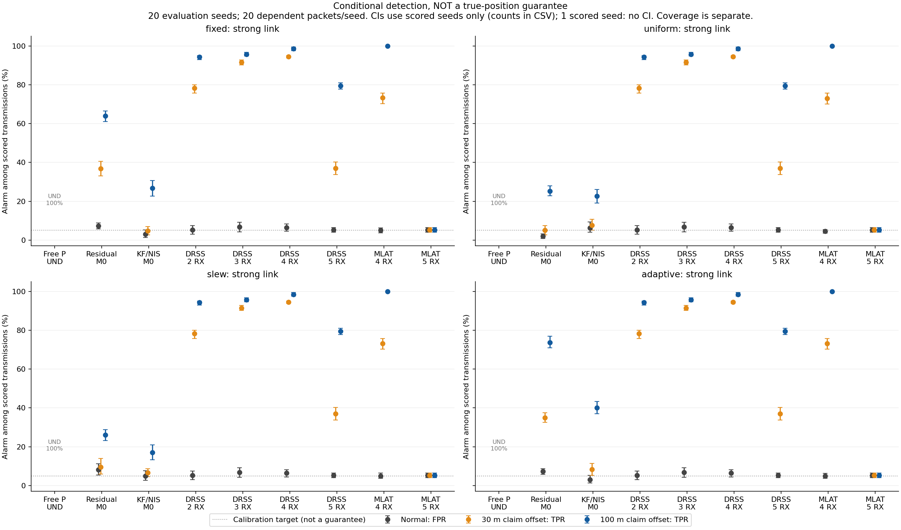
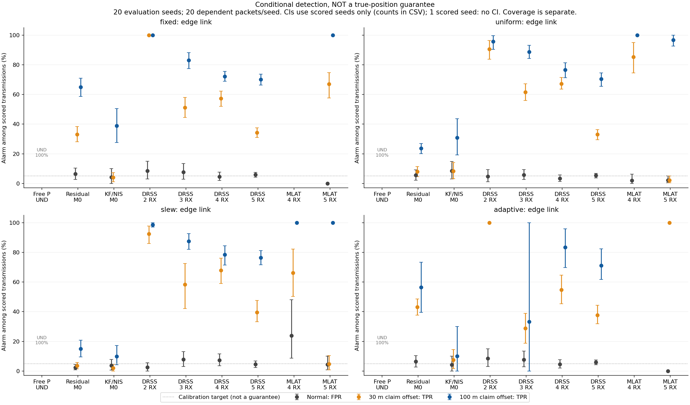
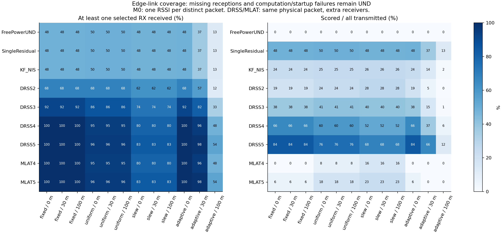
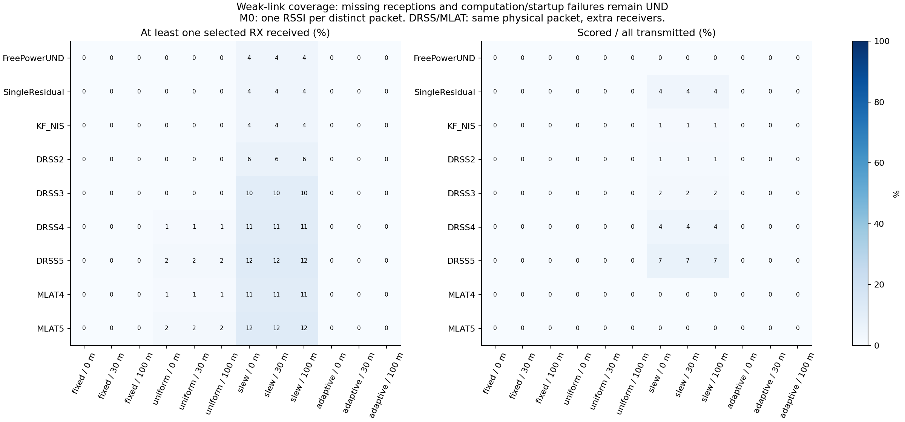
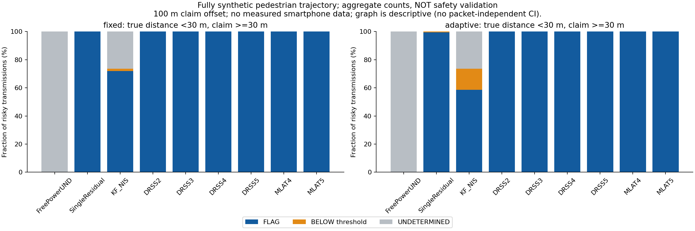

# Issue70 PR4：正常校正と20seedによる位置申告不整合の条件付き評価

本来条件の「非同期・別パケット・1観測1RSSI・送信ごと任意の未知電力」では、今回も位置の真偽を一般に識別できない。**無制約電力の方針は全件UNDETERMINED**とした。一方、電力・伝搬・受信情報に追加仮定を置いた検出器は、どの条件で警報・閾値以下・保留になるか実行評価できた。

これは **OMNeT++/INETによるRemote ID相当カスタムBeaconの合成実験**。実UAV Remote ID実測、センサの正直さ、機体認証、DRIPチェーン、30m安全性の実証ではない。#68の実測トラックや未取得Dataset-21と混同しない。

## 1. 段階と実行の証拠

| 段階 | 成果 | PR |
|---|---|---|
| PR1 | 依存構築、正常／上流位置偽装、イベント・欠測の正規化 | [#71](https://github.com/SMRI2170/zkp-m1-v2/pull/71) |
| PR2 | パケット電力をPHYへ反映、RSS・到達・干渉の対照試験 | [#72](https://github.com/SMRI2170/zkp-m1-v2/pull/72) |
| PR3 | 実時間差・非同期1RSSI／同一送信多局の分離、非識別反例 | [#73](https://github.com/SMRI2170/zkp-m1-v2/pull/73) |
| PR4 | 正常だけの学習・校正、独立seed評価、集計・図・30m合成シナリオ | この報告 |

PR3の `e1700af36d3b0a22a2e62a414e30e9ca35a8eada` はpush/PRの6 Actions runが成功し、全6 jobのログも確認済み（専用43件、RSSI監査49件、既存UAV61件、contracts48件など）。PR4へ進む前の成功ゲートとして確認した。

PR4最小試行は30ケース・390物理送信・1,250受信で成功。その後、最初の20seed評価663ケースが成功したが、strongは全受信、weakはほぼ欠測となった。この事実を保持し、受信境界を確認する **edge電力帯**を追加した。検出率を見て閾値を調整する操作はしていない。

最終評価は **943ケース・20,810物理送信・61,141受信**。うち663ケースは前回の成功済みRF記録を明示的に再利用し、spec・vectorハッシュ・元vectorからのTX/RX/GCS対応・PHY電力を再監査した。**新しいRF実行はedgeの280ケース**。943ケースすべてを再実行したとは扱わない。

- 集計正本：[`results/uli-net-sim-evaluation-20261108-full-b/`](results/uli-net-sim-evaluation-20261108-full-b/)
- 実行元：upstream `3cf9474fe960955556de118065591915a7be2bc1`、OMNeT++6.2.0、INET4.5.4、Eigen5.0.0、macOS arm64。
- ネイティブ実行ファイルSHA256：`09d81955a7e981f0232c9754163e9a2290c444e558b9e4e04fcfef15eee7485d`。
- 7200行のseed別指標、360条件の集計、12000行の局別集計、943ケースの終了コード／元ログ・vectorハッシュ／コマンドを保存。
- raw vector、CSV/Parquet、真位置・申告位置・合成ユーザの距離台帳はowner-onlyのignored `captures/` に保存。Gitには集計・図・設定・位置を含まない実行ログだけを追加。

## 2. 何を固定し、何を変えたか

| 項目 | 設定と限定 |
|---|---|
| 伝搬 | FreeSpace・Dipoleアンテナ・固定−100dBm背景雑音、干渉送信機なし |
| UAV | 高度40m・半径80mの円運動、3m/s。seedごとに開始角度を変更 |
| 局 | 受信専用地上5局。2/3/4/5局比較は累積部分集合で、台数と配置が同時に変わる |
| 時間 | 各飛行20パケット、実シミュレーション時刻で10秒間隔 |
| 学習 | 正常seed501・1000パケット、受信局別のlog-distance回帰 |
| 閾値校正 | 正常seed601〜610、各20パケット。宣言した電力モデル・link帯・シナリオごとに95%経験分位点 |
| 評価 | 未使用seed701〜720、各20パケット。学習／校正／評価のseed重複なし |
| 位置偽装 | 真軌跡を維持し申告のみ全体X方向へ30m／100m平行移動 |
| nominal電力 | strong [10,20]、edge [−6,−2]、weak [−14,−10] dBmからseedごとに一様生成。検出器には渡さない |
| A fixed | 飛行中固定・未知 |
| B uniform | パケットごと±3dB一様乱数 |
| C slew | nominal±10dB、1パケットの変化上限2dB |
| D adaptive | **局0だけ**を基準とするn=2の位置補償、±10dB上限 |
| 物理上限 | 全モデルとも実出力[−80,23]dBmにclamp。数学的無制約Dとは別 |

Dの攻撃者には真位置・申告位置・局0座標・n=2を与え、受信結果のフィードバックは与えない。これは合成攻撃者の知識であり、現実に自動取得できる情報とは扱わない。**局ごとに選択される観測をすべて相殺する最強攻撃ではない。**

飛行・建物・環境を独立に変えた一般化試験ではない。20seedで変えるのは開始角度、nominal電力、電力乱数。PR3の300/3600秒・10/100/1000件は観測監査であり、ここで全時間差の20seed検出性能を取得したわけではない。

## 3. 検出器へ渡す情報

検出器入力は受信したRSS、受信局位置、受信した申告位置・識別子・時刻、送信対応IDだけ。真位置・真電力・攻撃ラベル・seed・ケース名は投影段階で除外する。未受信パケットの申告値も渡さない。送信IDは対応付け専用で、数値特徴量にしない。

| 方法 | 使う観測と追加仮定 |
|---|---|
| FreePowerUND | 別パケットごと1RSSI。未知電力を毎回独立に選べるので全保留 |
| SingleResidual | 同じ非同期選択観測。正常log-distance回帰からの残差を使い、飛行窓全体の中央値で共通電力offsetを除く。オンライン即時判定ではなく、固定／確率制約の追加仮定を持つバッチ指標 |
| KF_NIS | 同じ選択観測だけで、局・申告RID別に上流の1次元KF式を再計算。Q=.01、R=4、P0=10、n=2、2400MHz。初回と欠測は保留 |
| DRSS2〜5 | **同一物理パケット**の成功受信だけ。正常モデルの局間残差の最大幅。既知の−100dBm背景成分を引く追加仮定あり |
| MLAT4/5 | pinした上流 `multilaterate_with_tx_power` を呼び出す。返された3D推定位置と受信申告位置の距離。上流の平滑化付きMultilatDetector全体の再現ではない |
| MLP | N/A。上流は `is_spoofed` を教師とする二値学習であり、今回の正常のみ学習方針と比較不能 |

上流のnative KFが全受信で出力した45個のNISと再計算を照合し、最大差は **1.3518×10⁻¹²**。本命M0ではnativeの全受信履歴を流用せず、選択された観測だけを更新する。初回を0点の正常にする上流オフライン評価の扱いも採用しない。

DRSSの電力相殺は、孤立信号・局間校正・共通電力というモデルに依存する。INETの記録RSSは信号＋雑音であり、任意干渉まで厳密に消えるわけではない。局偏差、方向性アンテナと回帰モデルのずれ、欠測は残る。

MLATは最低4局という入力条件だけで頑健・一意な3D位置を保証しない。上流solverはsuccess **またはcost<100**を受理し、推定電力を[−50,50]dBmに制約、初期位置は受信申告位置。有限だが大きい正常誤差を都合よく削除していない。

## 4. 強い電波：正常と偽装の警報を同時に見る

以下は **評価可能なseedごとの警報率を等重みで平均**した値。列の分母はスコアを計算できた送信。UNDは別欄であり、位置が正しいという意味ではない。

| 電力モデル | 方法 | 正常FPR | 30m偽装TPR | 100m偽装TPR | 100m時UND |
|---|---|---:|---:|---:|---:|
| fixed | SingleResidual | 7.25% | 36.75% | 64.00% | 0.00% |
| fixed | KF_NIS | 3.00% | 4.67% | 26.67% | 25.00% |
| fixed | DRSS2 | 5.25% | 78.25% | 94.25% | 0.00% |
| fixed | DRSS5 | 5.25% | 37.00% | 79.50% | 0.00% |
| fixed | MLAT4 | 5.00% | 73.25% | 100.00% | 0.00% |
| fixed | MLAT5 | 5.25% | 5.25% | 5.25% | 0.00% |
| uniform | SingleResidual | 2.00% | 5.00% | 25.25% | 0.00% |
| uniform | KF_NIS | 6.33% | 7.67% | 22.67% | 25.00% |
| uniform | DRSS2 | 5.25% | 78.25% | 94.25% | 0.00% |
| uniform | DRSS5 | 5.25% | 37.00% | 79.50% | 0.00% |
| uniform | MLAT4 | 4.50% | 73.00% | 100.00% | 0.00% |
| uniform | MLAT5 | 5.25% | 5.25% | 5.25% | 0.00% |
| slew | SingleResidual | 8.25% | 9.50% | 26.00% | 0.00% |
| slew | KF_NIS | 5.00% | 6.67% | 17.00% | 25.00% |
| slew | DRSS2 | 5.25% | 78.25% | 94.25% | 0.00% |
| slew | DRSS5 | 5.25% | 37.00% | 79.50% | 0.00% |
| slew | MLAT4 | 5.00% | 73.25% | 100.00% | 0.00% |
| slew | MLAT5 | 5.25% | 5.25% | 5.25% | 0.00% |
| adaptive | SingleResidual | 7.25% | 35.00% | 73.75% | 0.00% |
| adaptive | KF_NIS | 3.00% | 8.33% | 40.00% | 25.00% |
| adaptive | DRSS2 | 5.25% | 78.25% | 94.25% | 0.00% |
| adaptive | DRSS5 | 5.25% | 37.00% | 79.50% | 0.00% |
| adaptive | MLAT4 | 5.00% | 73.25% | 100.00% | 0.00% |
| adaptive | MLAT5 | 5.25% | 5.25% | 5.25% | 0.00% |

正常校正で5%を狙っても、未使用seedのFPRが必ず5%にはならない。SingleResidualのfixed 7.25%、slew 8.25%などをそのまま記録した。高いTPRだけで方式を採用しない。

DでSingleResidualのTPRが73.75%でも、任意電力攻撃を解けたことにはならない。**Dは局0向け補償なのに、M0は観測局を順番に選ぶため**、他局に残差が残る。数学的無制約電力の非識別反例はPR3にあり、この条件ではFreePowerUNDの保留を変えない。

この配置ではMLAT5がMLAT4より良いとは言えなかった。fixed正常で最大位置誤差は4局25.43mに対し5局311.73m、正常校正閾値は約24.52m／251.71mだった。正常受信から逆算した等方的FSPL電力にも局間差が残る。**モデル不一致・選択配置・初期値依存を含む実装上の結果**であり、受信機一般の5台の限界を示したものではない。詳細は `mlat-normal-diagnostics.csv`。

## 5. 受信境界：見えたパケットだけの評価を避ける

edge・D・SingleResidualでは、正常は **194/400件受信**、100m偽装＋電力補償は **52/400件受信**。後者の警報は34件、受信できたが閾値以下は18件、残る348件は未受信・保留となった。

- 評価可能な15seedの条件付き率の平均：56.44%。
- 受信件数で加重した率：34/52＝65.38%。
- 全送信中の警報割合：34/400＝8.50%。
- 全送信中の保留率：348/400＝87.00%。

この4値は分母と重みが違う。最後の8.50%を、保留を除いたTPRと呼ばない。受信できなかったために見逃しなのか、スコアが閾値以下だったのかを分ける。

同一送信のDRSS5でも、edge・Dでは1局以上の受信が400件中217件、2局以上で評価できたのは50件、警報33件だった。多局にすれば欠測や保留が消えるわけではない。

weakのほぼ全欠測という結果も残す。少数seedしか評価できない条件の「100%」を成果の代表値にしない。

`paired-cohort.csv` は正常／攻撃で共に評価できた送信の比較を別に保存する。`per-seed-metrics.csv` は各ケースの変化後の受信母数を保存する。M0のreceivedは選択した1局、M2のreceivedは対象局で**1局以上受信した送信**。評価可能に必要な局数とは別である。

## 6. 不確実性と指標

正常FPR、偽装TPR、条件付きFNR（below/scored）、保留、受信、評価可能、全TX警報を保存。平均と95%区間は独立seed単位の1000回bootstrap。連続20パケットを独立20試行と扱わない。

未受信などでスコアがないseedは条件付き率を定義できない。CSVに有効seed数を併記し、有効seedが1つなら平均だけを示して**信頼区間はnull**、0なら条件付き性能自体nullとする。全送信の母数・保留率からその選択効果を必ず確認する。これは特定配置・モデル内の区間で、実環境の確率保証ではない。

## 7. 30mの完全合成シナリオ

UAVを高度20m・半径20mへ変更し、独立した合成歩行者の水平運動を追加した。ユーザ位置は計測値ではなく `user_at(t)` のシナリオ入力。正常学習・正常校正もこのシナリオでやり直した。

真3D距離<30m、申告3D距離>=30mの送信は、20seed合計で各電力モデル200件。100m申告偽装についてfixedのKFは144警報・3閾値以下・53保留、DのKFは117警報・30閾値以下・53保留。FreePowerUNDはいずれも200保留。DRSS5などで200警報になった条件も、今回の一つの合成配置・モデル内の結果に限定する。

真位置・申告位置・合成歩行者の距離台帳はprivate rawに保存。検出器のスコア計算へ距離の真値や危険マスクを渡していない。これによって真位置の証明や安全距離遵守が成立したとは言わない。

## 8. 失敗・未実行・継続項目

| 項目 | 状態・理由 |
|---|---|
| SciPy1.15.3の読込 | ENV_BLOCKED。macOS27 arm64のwheelがdyldのzero-fill検査に失敗。RF未実行。1.16.3へ更新して解消 |
| 上流evaluations import | ENV_BLOCKED。集約packageの副作用でmatplotlibが必要。3.10.7追加後に解消 |
| MLP学習 | N/A。攻撃教師ラベルを使う上流方式は今回の正常学習条件と一致しない |
| radial/tangential/距離維持方向 | NOT_RUN。今回の定量評価は全体X方向30/100mのみ |
| 異なる配置、局bias・遮蔽・マルチパス・GPS誤差の掃引 | NOT_RUN。固定配置のFreeSpace/Dipole評価を一般化しない |
| Cの範囲／速度制約の広範な掃引 | NOT_RUN。今回±10dB・2dB/packetの代表条件 |
| 全時間差の20seed検出性能 | NOT_RUN。PR3の時間差掃引は実行・対応監査まで |
| 実Remote ID・実ユーザ・実機電力制御 | NOT_RUN。本結果を実測で置き換えない |
| Linuxのネイティブ環境構築 | NOT_RUN。Linux Actionsは単体・集計検査であり、無線シミュレーションを動かしていない |
| #69 UI | 対象外。mode E変換とprivate 1イベント出力6レコードまで確認。重複する検出器や重いUIを作らない |

Issue70の推奨4段階の実装・実行は揃えたが、上記の未実行掃引を完了扱いにせず、親Issueも自動Closeしない。次は実測トラックとは別に、配置／方向／伝搬誤差を変えた外的妥当性評価を行う。

## 9. 再現

完全コマンドは [`experiments/week27-rid-sim/README.md`](../experiments/week27-rid-sim/README.md)。順にbuild → power controls → observations → evaluation → aggregate/audit → figures。新規実行には新しいraw/outパスを使い、rawを消さない。明示的 `--reuse-existing` は再実行と区別する。

最終rawは `captures/issue70-evaluation-20261108-full-a/`、集計正本は `full-b/`。命名が違う理由は、最初の成功663ケースのrawへedge280ケースを追加して再集計したため。原RF記録を上書きしていない。

ローカル検証：専用57件、既存UAV61件、Go、contracts48件が成功。公開集計の母数・seed分離・全ケース943件・全360条件・7200行の再検算も成功。Linux CIでこの検算を実行するが、CIでRF実行したことにはしない。
