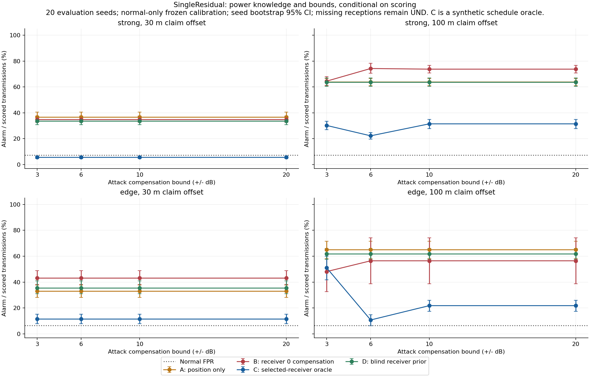
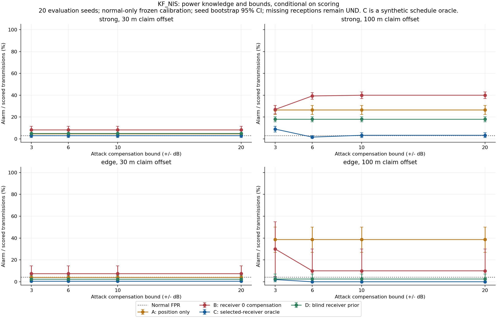
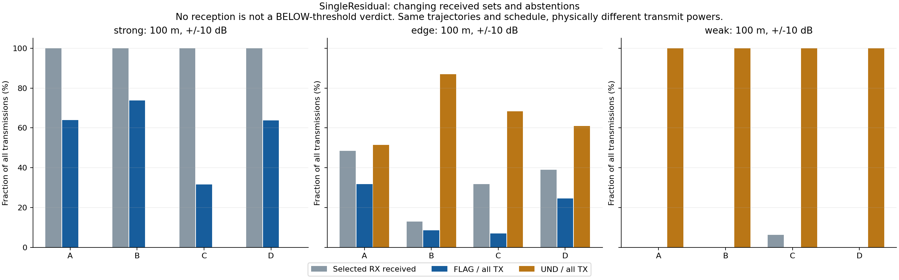
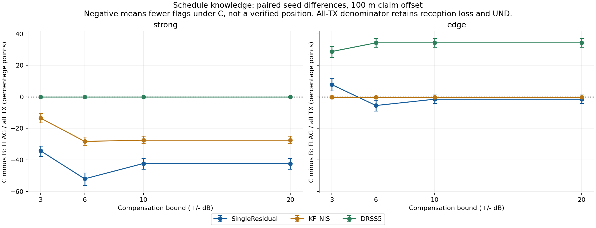
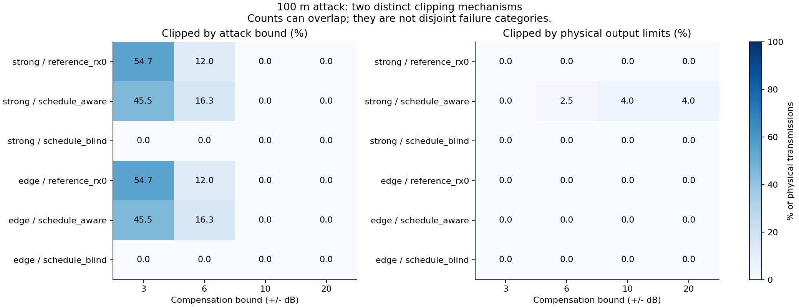
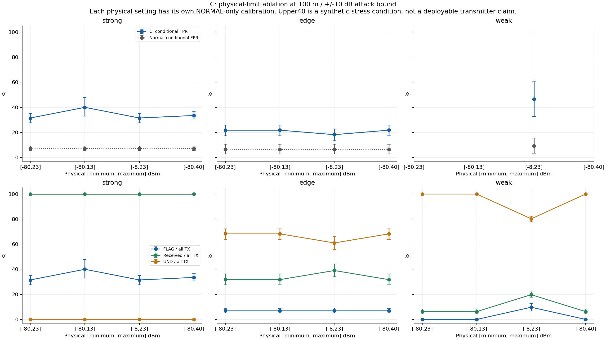
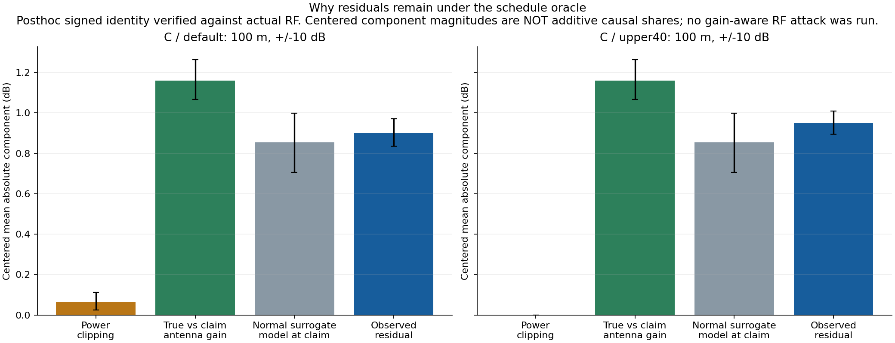
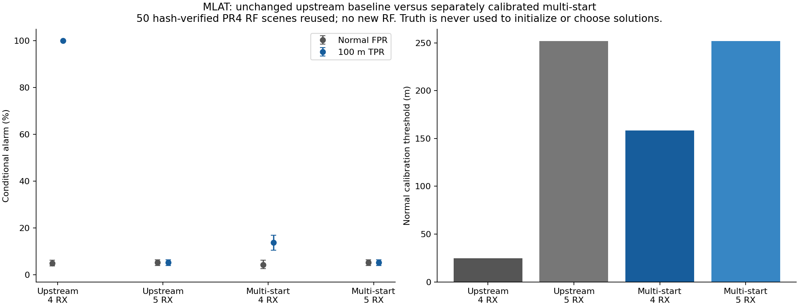
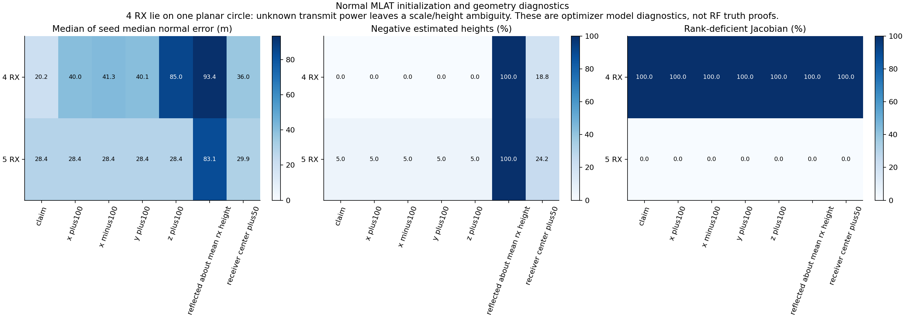
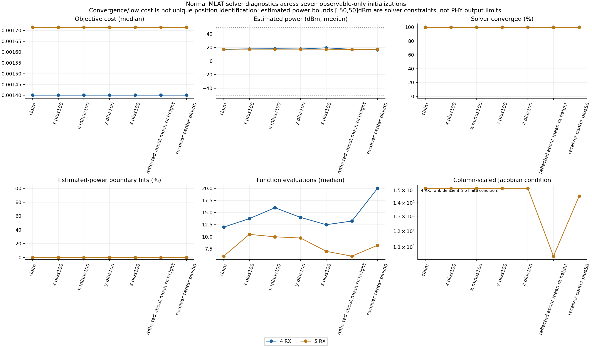

# Issue75 / PR5：観測局適応電力補償攻撃と検出限界

今回の結果は、**観測局に合わせると単一RSSIの警報が減る一方、残った警報も位置の真偽を保証しない**、というもの。局0向け補償と、実際に選択される観測局向け補償は区別する必要があった。

強電波・補償幅±10dB・30m偽装ではSingleResidualの警報率が **B=35.00% → C=5.75%**。同じ条件の正常FPRは7.25%。100mでは **73.75% → 31.50%**。後者の残存警報は、電力制限や欠測だけでは説明できず、アンテナ利得と正常log-distance近似のずれを含む物理モデル分解で確認した。

本来条件の「別時刻・別パケット・1観測1RSSI・送信ごと任意で未知の電力」では、**FreePowerUNDは引き続き全保留**。同一送信多局DRSSは追加観測の比較対照であり、本来条件の解決に置き換えない。

すべて **OMNeT++/INET Remote ID相当Beacon simulation**。実Remote ID・実UAV・実ユーザ・30m安全性の実証、機体認証、DRIP信頼チェーン、センサ／観測者ハードウェアの正直さの証明ではない。

## 1. 着手前のゲートと保存

Issue75全文、関連66/67/68/70、PR71〜74の説明・状態・差分・実行制約を確認。PR74のheadは `55db328520594f94b5e19bf126a62934d337dea7`、全PRはOPENでmerge/closeしていない。PR74差分APIは300ファイル上限でHTTP406となったため、同じbase/headのローカルGit差分を使用した。

変更前に専用57テスト、既存UAV61件、Go、contracts48件、PR4集計監査を実行。PR4の **943ケース全vectorと元ログのハッシュ**も確認した。開始時の公開成果ハッシュ一覧はprivateキャッシュへ保存し、終了時の不変性も監査する。

- upstream：`3cf9474fe960955556de118065591915a7be2bc1`、OMNeT++6.2.0／INET4.5.4／Eigen5.0.0、macOS arm64。
- PR4実行ファイルSHA256：`09d81955a7e981f0232c9754163e9a2290c444e558b9e4e04fcfef15eee7485d`。上書きせず、PR5は `.cache/issue75/project-build/` に別ビルド。
- 依存は既存のローカル構築物を参照。外部コード・ライセンス未確認の上流ソース・バイナリをGitへコピーしない。
- raw・truth ledger・真位置／申告位置・solver推定位置はignored `captures/` 内でowner-only。公開するのは集計・図・設定・位置を含まない実行証跡。

## 2. 攻撃の定義

同じ真軌跡、seed、nominal出力、送信時刻で、申告位置のみX方向へ30m/100m平行移動する。観測者は各送信kを `[0,2,3,4,5]` の順に1局ずつ選び、選択局で未受信なら代替しない。

| Case | 電力選択 | 知識・限定 |
|---|---|---|
| A position_only | 飛行中固定 | 真位置・偽申告位置、補償なし |
| B reference_rx0 | 局0へ合わせる | 局0座標、真位置・申告位置、n=2 |
| C schedule_aware | 選択局i(k)へ合わせる | **送信前の観測局スケジュールを知る合成oracle**。現実に自然に取得できるとは仮定しない |
| D schedule_blind | 全5局の補償量の事前一様平均 | 配置は知るが選択局・未来のRX成否を知らない。全てのblind攻撃や最適戦略を代表するものではない |

Cが知る伝搬モデルは **n=2の距離減衰**であり、検出器の回帰係数や実際のアンテナ利得まで知る万能oracleではない。Dのnative経路は `observerSchedule` を読まず、数学helperの引数にも選択局／スケジュール／RX結果を渡せない構成とした。

同じ送信の真位置p、申告q、対象局aについて、

\[
\delta_k=20\log_{10}\frac{\|p_k-a_{i(k)}\|}{\|q_k-a_{i(k)}\|}
\]

として、まず攻撃幅bで制限し、その後PHY上下限で制限する。

\[
P^{\rm PHY}_k=\mathrm{clip}_{[P_{min},P_{max}]}\left(P_{nom}+\mathrm{clip}_{[-b,b]}(\delta_k)\right).
\]

真距離10m・申告100mならδ=−20dB。制限のない理想n=2モデルでは、補償した真位置のRSSとnominalで申告位置から送るRSSが一致する。符号・加算位置はPythonとコンパイルした独自C++数学helperの両方でテストした。

電力は実際のPacketへ `SignalPowerReq` として付け、PHY transmitterの使用電力と照合する。RSSIをCSV上で加算した値をRF結果にしていない。private ledgerにはrequested/applied delta、攻撃幅clamp、PHY clamp、誤差、対象局、実PHY電力、deliveredを保存。真位置を合成攻撃者が使うのは明示的な知識仮定で、検出器へは渡さない。

## 3. 実験行列と実行件数

| 項目 | 実行内容 |
|---|---|
| 環境 | FreeSpace、垂直Dipole、固定−100dBm背景、既存5局、3m/s円運動 |
| 正常学習 | seed501、1000packet。PHY設定ごとに新しい正常学習 |
| 正常校正 | seed601〜610、各20packet。PHY×linkごとに正常のみで95%経験分位点 |
| 評価 | seed701〜720、各20packet、実シミュレーション時間で10秒間隔 |
| nominal出力 | strong [10,20]、edge [−6,−2]、weak [−14,−10]dBm。seedごとに生成し検出器へ渡さない |
| 位置偽装 | 真軌跡を維持し申告のみ30m/100m変更 |
| 補償幅 | B/C/Dを±3/6/10/20dB、Aは補償なし |
| 基準PHY | [−80,23]dBmでA/B/C/Dを比較 |
| 独立PHY掃引 | C・±10dBで[−80,13]、[−8,23]、[−80,40]dBm。上限と下限の変更を分離 |
| 上限40 | 合成ストレス条件。機器での実装可能性や規格適合を主張しない |

初期Smokeは **27ケース、620 PHY送信、2406受信**で成功。正常／攻撃を1〜2seedで確認してから本実行へ進んだ。

本実行は **2288ケースすべて新規RF実行、49680 PHY送信、129043受信**。内訳は制御4、正常学習4、正常校正120、評価2160ケース。評価結果19440行、972条件×20seed。PR4のRFを新しい攻撃結果として再利用したケースはない。

一方、MLAT診断は **PR4の50 RFケースを再解析**したもので、**新規RFは0**。両者を別ディレクトリ・別集計とした。極小距離の意図的な拒否テストは終了コード1を確認した別記録であり、本実行成功件数へ混ぜない。

本実行の正常閾値はPR4 fixed-power校正を再現できた。さらに新規normal/A/Bの **300ケース**を旧vectorのハッシュ検証後に照合し、送信軌跡・電力・受信欠落・測定RSSの再現を確認した。攻撃結果を見て閾値は調整していない。

## 4. 検出器の情報と指標

FreePowerUND、SingleResidual、KF_NIS、DRSS2/3/4/5、MLAT4/5を使用。M0は選択した1局だけ、M2は同じ物理パケットの複数受信だけを使う。異時刻・別パケットをDRSSへ結合しない。

- SingleResidual：正常log-distance近似と、飛行窓内中央値による未知共通offset除去。バッチ指標であり、任意電力に対する一般的な位置証明ではない。
- KF_NIS：選択局／申告RID別の状態だけ更新し、初回・欠測は保留。未選択の多局受信履歴を流用しない。
- DRSS：正常モデルと既知の合成背景雑音に追加仮定がある。同一送信で共通電力を除く比較対照。
- MLAT：上流solverは変更せず使用。少なくとも4局を要求するが一意な3D位置を保証しない。

真位置・真電力・攻撃ラベル・対象局・clamp情報は検出器へのwhitelist投影で除外。電力帯／PHY設定は宣言済みの条件付き校正stratumであり、実運用で未知stratumを自動識別した評価ではない。

指標は正常FPR、攻撃TPR、条件付きFNR（below/scored）、保留、RX、評価可能、全PHY送信中の警報を分離。全送信中の警報割合を条件付きTPRと呼ばない。平均はseedを等重みとし、95%区間はseed単位の1000回bootstrap。20packetを独立20試行としない。有効seed0ならnull、1なら区間null。

## 5. 強電波：補償先の不一致が与えた影響

以下は±10dB・基準PHYの**評価可能送信に対する警報率のseed平均**。正常列はFPR、A〜D列はTPR。strongでは全送信が受信できたので、ここでのB→C差は受信欠落では説明できない。KFには共通して25%の初回保留がある。

| 偽装 | 方法 | 正常FPR | A | B | C | D |
|---|---|---:|---:|---:|---:|---:|
| 30m | SingleResidual | 7.25% | 36.75% | 35.00% | 5.75% | 33.75% |
| 30m | KF_NIS | 3.00% | 4.67% | 8.33% | 3.00% | 5.00% |
| 30m | DRSS5 | 5.25% | 37.00% | 37.00% | 37.00% | 37.00% |
| 100m | SingleResidual | 7.25% | 64.00% | 73.75% | 31.50% | 63.75% |
| 100m | KF_NIS | 3.00% | 26.67% | 40.00% | 3.33% | 18.00% |
| 100m | DRSS5 | 5.25% | 79.50% | 79.50% | 79.50% | 79.50% |

Bは400送信のうち320件で実際の観測局と補償先が異なり、Cの不一致は0。100m・±10dBのBには攻撃幅／PHY clampがなく、それでも295/400警報だった。Cは126/400警報へ低下した。**局0向け補償だけを評価して「任意電力にも強い」と言うことはできない。**

Cの30m結果5.75%は正常7.25%に近い。検出できたと強く評価せず、FPRと区間・母数を併記する。Dはこの宣言したblind戦略ではB/Cと異なる挙動だったが、他のblind戦略全般への保証にはならない。

同一送信DRSS5はstrong・100mでA/B/C/Dいずれも79.50%。電力が共通なら相殺されるモデル内の結果であり、本来の別パケットM0を解いたことではない。

## 6. 受信集合が変わる場合

edge・100m・±10dBのSingleResidualは次の通り。括弧内区間は評価可能seedに限った95%区間。件数加重率とseed平均は異なる。

| ケース | 条件付き警報率 [95%区間] | RX/全TX | 保留/全TX | 警報/全TX | 警報件数 |
|---|---:|---:|---:|---:|---:|
| normal | 6.48% [2.89, 10.58] | 48.50% | 51.50% | 2.75% | 11/400 |
| position_only | 65.00% [58.09, 71.63] | 48.50% | 51.50% | 31.75% | 127/400 |
| reference_rx0 | 56.44% [38.67, 74.22] | 13.00% | 87.00% | 8.50% | 34/400 |
| schedule_aware | 21.80% [17.35, 25.83] | 31.75% | 68.25% | 7.00% | 28/400 |
| schedule_blind | 61.77% [57.59, 65.81] | 39.00% | 61.00% | 24.50% | 98/400 |

BとCは受信件数が違う。`paired-cohort.csv` は正常／攻撃の双方で評価できた対応送信、`B-to-C-shared-cohort.csv` はB/C双方で評価できた対応送信を別表にした。ここでの対応は**別々のRF実行の同じ送信スケジュールindex**であり、runを跨ぐ同一物理パケットと偽って結合していない。

weakでは正常校正時に測定値が得られず、閾値がnullの方式がある。攻撃時に一部受信できても、正常閾値を捏造して0点の正常や検出成功へ変換しない。

## 7. clamp、モデル、時間状態の切り分け

C・strong・100mのSingleResidualは以下。補償幅を広げれば常に警報率が単調に下がる、とは言えなかった。

| 補償幅 | 条件付き警報率 [95%区間] | 件数 |
|---|---:|---:|
| 3dB | 30.25% [27.00, 33.50] | 121/400 |
| 6dB | 22.25% [19.75, 24.75] | 89/400 |
| 10dB | 31.50% [27.75, 35.00] | 126/400 |
| 20dB | 31.50% [27.75, 35.00] | 126/400 |

±10/20dBのC・strong・100mでは攻撃幅clamp0件、PHY clamp16/400件。警報126件のうち8件は当該送信がclamp、118件は当該送信が非clampだった。ただし窓中央値やKF状態は他送信の影響も受けるため、この内訳だけで因果寄与を割り振らない。

PHY上限を40へ広げてclampをなくしても、SingleResidualは134/400＝33.50%警報だった。全受信条件なので、**残存警報を電力制限・受信欠落だけで説明することはできない**。

### 残差の物理モデル分解

INET4.5.4の `DipoleAntenna::computeGain` は垂直方向に対して1.5sin²θ、両端の利得を合わせてG(p,a)とする。設定 `radio.channelNumber=6` は **zero-based indexで2.442GHz**。2400MHzを仮定する上流KF/MLATの定数は変更せず、モデル差として記録した。

受信信号は、この合成環境では

\[
S=P^{\rm PHY}-L(d)+G(p,a)
\]

で再構成できた。Cの距離だけの補償を代入すると、正常回帰f(q)との差は

\[
S-f(q)=\underbrace{P_{nom}-L(d_q)+G(q,a)-f(q)}_{\text{申告点での正常近似モデル残差}}
+\underbrace{G(p,a)-G(q,a)}_{\text{真位置と申告位置のアンテナ利得差}}
+\underbrace{P^{\rm PHY}-P_{nom}-\delta}_{\text{電力制約誤差}}.
\]

4000の選択局受信について、物理信号再構成の最大差は **3.2543×10⁻¹²dB**、残差の符号付き恒等式の最大差は **2.7089×10⁻¹⁴dB**。実測されたシミュレーションRSSと照合し、符号の間違いやCSVへの後付け電力操作ではないことを確認した。

この図の絶対値成分は加算できる因果割合ではない。private truthを**スコア計算後だけ**に使う診断であり、真値を検出器へ渡したり、利得まで知る攻撃をRF実行したりはしていない。SingleResidualには回帰近似・学習軌道外への外挿・窓中央値の影響もある。

KFでは、clampがなければn=2補償により「RSS＋申告距離の損失」が正常時の推定電力系列に近づく。Cの警報率が正常FPR近くになることはこの状態モデルと整合する。一方、既存のFreePowerUNDは全保留のまま。残存するモデル不整合を、任意未知電力下の真位置保証に読み替えない。

`factor-audit.csv`、`residual-decomposition.csv`、`model-audit.json`、電力帯別／clamp別集計に全件数を保存。電力帯・clamp stratumも評価truthであり、運用時に観測できる特徴ではない。

局別の `observer-stratified-aggregate.csv` と、電力帯・clamp別の `*-stratified-extended.csv` にも、FNRを含む各率のseed単位95%区間を保存した。これらは保存済みのseed別集計から算出し、RF再実行・閾値変更はしていない。

## 8. MLAT4/5の再点検

同じPR4正常校正10ケースと、独立評価20seedの正常／100m偽装40ケースを再解析した。上流solverを変更せず、独立した計測用最小二乗実装で収束・cost・推定電力・初期値依存・ヤコビアンを記録。上流が返す位置との差は **0m**。7初期値×2局数×1000送信で **14000 solver実行**を行った。

多初期値版は、受信申告位置・受信局配置から作る7初期値で解き、**accepted cost最小**を選ぶ別手法。真位置に近い解を選んだり、攻撃ラベルで校正したりしていない。上流はsuccessまたはcost<100を受理するため、その違いも保存した。

| 方法 | 正常FPR | 100m偽装TPR | 正常校正閾値 |
|---|---:|---:|---:|
| 上流4局 | 5.00% | 100.00% | 24.52m |
| 上流5局 | 5.25% | 5.25% | 251.71m |
| 別手法・7初期値4局 | 4.25% | 13.75% | 158.28m |
| 別手法・7初期値5局 | 5.25% | 5.25% | 251.71m |

4局の正方形配置は同一平面の同一円周上にある。等方的n=2・未知電力のsolverモデルではscaleと高さを交換でき、計測した正常400送信すべてでヤコビアンはrank不足だった。申告点から始めた正常解のmedian誤差は約20.17m、反射初期値では約93.36mで、どちらも小さいcostに到達した。**低cost／収束は一意の位置識別ではない**。

半径Rの円周上の受信機に対し、pの水平成分をλ倍し、

\[
 h'^2=\lambda(R^2+\|p_{xy}\|^2+h^2)-R^2-\lambda^2\|p_{xy}\|^2
\]

とすれば距離二乗を全局でλ倍にできる。送信電力を10log₁₀λだけ変えればRSSは同じ。両高さが正の非中心点の反例を独立数学テストで確認した。**これは理想等方モデルの反例であり、別のRF実行結果ではない**。

5局目は配置・高度が異なり、局数だけでなく幾何と条件数も変わる。しかし5局では正常時の大きい推定誤差により閾値が高く、今回のmulti-startでも検出性能は回復しなかった。推定電力の境界、失敗／fallback、負の高度、残差、条件数は `solver-start-summary.csv` に記録。有限だが都合の悪い解を削除していない。

## 9. 受け入れ条件と検証

| 条件 | 確認 |
|---|---|
| Cの局切替 | native packet indexと対象局を毎送信照合。通常scheduleで0/2/3/4/5を各4回 |
| Cを局0固定にする | Bと補償値・実PHY電力差0、独立RF実行で確認 |
| Dの未来情報遮断 | nativeはscheduleを読まず、割当を反転してもINI内容・実PHY電力差0 |
| PHY適用・RSS | Packet tagと実PHY電力一致。対照RSS応答の最大差1.4069×10⁻¹²dB |
| 極小距離・不正入力 | compiled C++／Pythonで拒否。nativeの意図的な極小距離テストは終了コード1 |
| 欠測・不正な多局結合 | 既存の厳密packet/run対応とnull処理を維持。代替局・0dBm埋めなし |
| truthの分離 | 新しい対象局・補償量・clamp・真電力もwhitelist投影から除外するテスト |
| 校正とseed | 正常学習501／校正601〜610／評価701〜720、攻撃結果による閾値変更なし |
| 母数 | 2288ケース、19440指標行、972独立seed条件の集計を再計算するoffline validator |
| 保存 | 旧raw・公開成果・旧バイナリのhash不変、新rawのowner-onlyを終了時監査 |

専用 **67テスト**、既存UAV61件、Go、contracts48件が成功。Linux Actionsはコードと保存済み集計の監査であり、CI上でRF実行したとは言わない。公開後にPRのActions結果とログを確認する。

## 10. 失敗・未実行の記録

- 最初の隔離ビルドはproject-buildディレクトリ作成前のsymlinkで失敗。既存ビルドを消さず、作成順を直して別ログで再構築した。
- Smoke-AはNEDの既存Host型が管理クラスを固定しており、新しいクラスへ切替できなかった。RFプロセスは20送信を実行したが攻撃auditが失敗し、**有効ケース0**。元ログとrawを保持。専用Host型を追加したSmoke-Bで成功した。
- nativeの極小距離テストは意図的な失敗（終了コード1）。予期したエラーメッセージまでCLIで確認した。
- 実UAV／実Remote ID／実ユーザ、LinuxネイティブRF、実マルチパス・遮蔽・GPS誤差、新配置、長時間差の20seed評価は **NOT_RUN**。本Issueの合成比較を外的妥当性の証明にしない。
- 利得や検出器回帰まで知る攻撃の新しいRF実行は **NOT_RUN**。今回の物理モデル分解を、その実行結果として扱わない。
- 無制約電力・非同期1RSSIの識別不能性は未解消。ZKPは追加していない。

## 11. 再現と成果物

完全コマンドは [`experiments/week27-rid-sim/README.md`](../experiments/week27-rid-sim/README.md) のPR5節。prepare → Smoke → full → 負の制御 → 層別監査／モデル分解 → MLAT再解析 → 図 → offline validator。新規run/raw/outを使い、旧結果を再生成で上書きしない。

- 主集計：[`results/observer-attack-full-20261108-a/`](results/observer-attack-full-20261108-a/)
- MLAT：[`results/observer-attack-mlat-20261108-a/`](results/observer-attack-mlat-20261108-a/)
- 主raw：`captures/issue75-full-20261108-a/`、solverのprivate結果：`captures/issue75-mlat-20261108-a/`。
- native/math/source hash、各ケース終了コード・元ログhash・vector hash、設定とseedを保存。元ログは個別privateと、公開用にまとめた `simulation.log` を対応付ける。
- 明示 `--reuse-raw` はmatching native manifest、spec、vector、元ログ、TX/RX/GCS/PHY/auditを検証し、新しい解析ディレクトリへ出力する。今回の主2288ケースでは使用していない。

Issue75の合成研究実装・20seed比較・MLAT診断・受け入れ検査は実行できた。実測トラックのIssue68や、以前のIssue70/PR71〜74をmerge/closeしていない。
