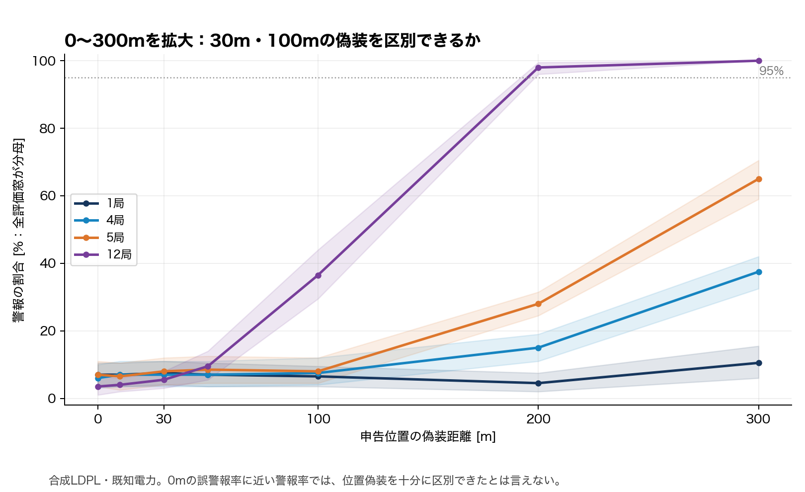
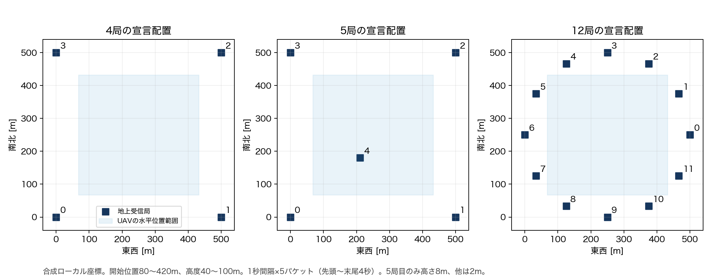
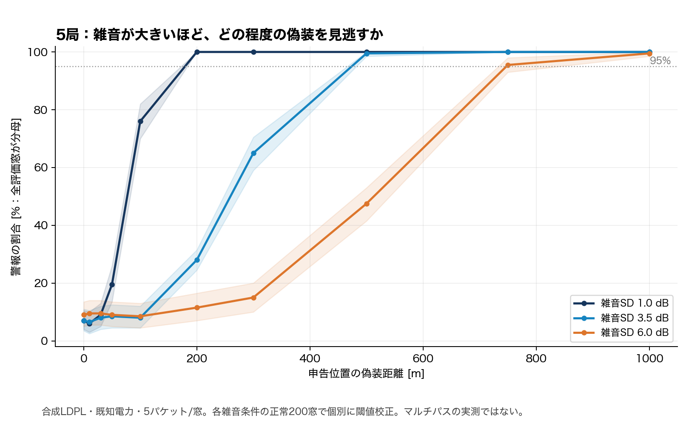
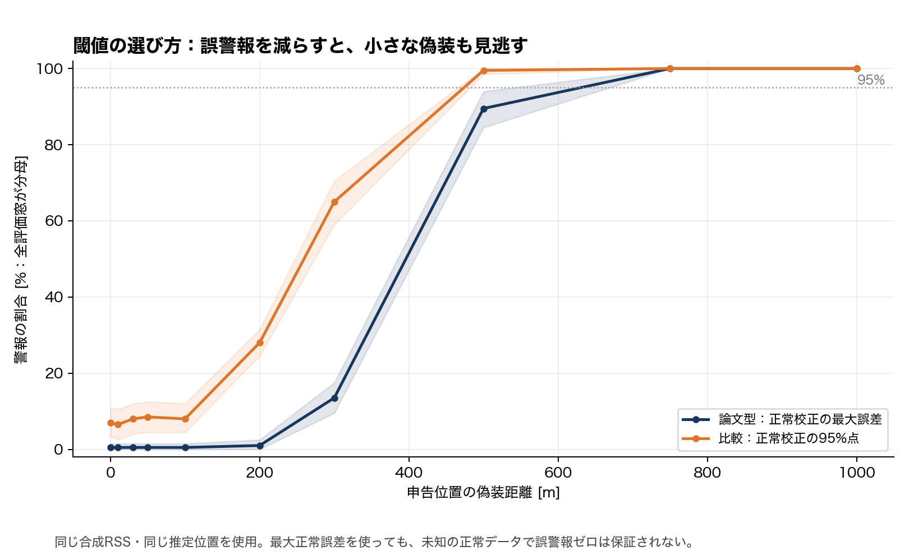
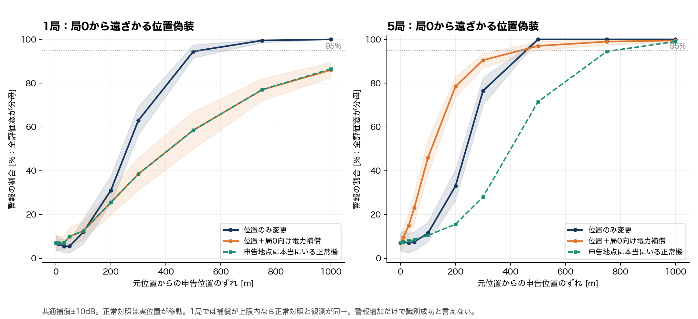
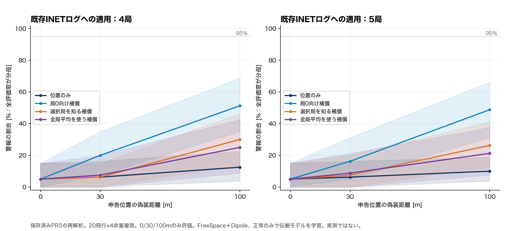
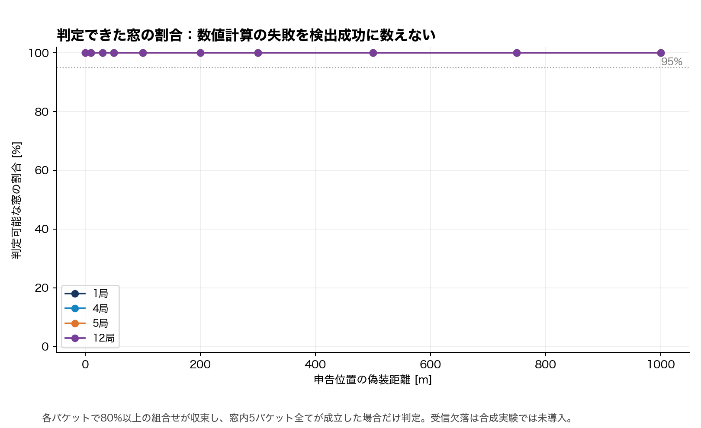

# GhostBuster方式の再実装と検出可能範囲

今回の成果は、GhostBusterの距離変換・組合せNLSE・座標中央値・窓内誤差中央値を独立実装し、**既知電力の合成条件で警報が増える距離と、既存INET条件では小さな偽装を十分に区別できないこと**を可視化したこと。論文図の数値を再現したという主張ではない。

## 図の読み方

横軸は真位置から申告位置までの3Dノルム[m]。縦軸は「全評価窓のうち警報が出た割合」。0mは正常時の誤警報なので低い方がよく、偽装ありは正常より十分高いことが望ましい。警報が出ないことは真位置の証明ではない。

判定可能窓だけを分母とする値もCSVに残すが、本文・図は保留を落として性能を高く見せない。1窓5パケット。帯は20評価seedを単位とした2000回の再標本化95%区間で、パケットを独立な成功試行とは数えない。線は測定点間の補助で、連続する全距離での保証ではない。



| 合成条件（SD3.5dB・位置のみ変更） | 正常0m | 30m | 100m | 200m | 最初の平均95%以上の測定点 |
|---|---:|---:|---:|---:|---:|
| 1局 | 7.00% | 7.50% | 6.50% | 4.50% | 1000m |
| 4局 | 6.00% | 7.00% | 7.50% | 15.00% | 500m |
| 5局 | 7.00% | 8.00% | 8.00% | 28.00% | 500m |
| 12局 | 3.50% | 5.50% | 36.50% | 98.00% | 200m |

この表は正常校正95%点を使う比較条件。論文型の最大正常誤差による結果は別曲線・CSVに保存した。「平均95%以上の最初の点」は今回試した離散点だけの値。95%区間の下端も95%以上となる最初の点を `tested-range.csv` に併記した。台数比較では配置も異なり、台数だけの一般的効果には読み替えない。

## 論文との対応

[Keizer et al., GhostBuster, CCNC 2024, DOI:10.1109/CCNC51664.2024.10454860（著者版）](https://ssciancalepore.win.tue.nl/publications_pdf/2024_Keizer_CCNC.pdf) のV-B〜D、式2〜6を参照した。PDFは配布しない。

| 論文の要素 | 今回の処理 |
|---|---|
| 式2：LDPLによるRSS→距離 | `d=10^((P_nominal−PL(1m)−R)/(10γ))` |
| 式3：受信局の組合せごとのNLSE | 全ての4局組合せで距離残差二乗和を最小化 |
| 式4：推定座標の中央値 | x/y/zごとの中央値。12局では495組合せ |
| 式5：申告との距離、Nパケットの中央値 | 各パケットの3D誤差を求め、5値の中央値で1窓を判定 |
| 式6：単一局 | 推定距離と申告からの距離の差の絶対値、その窓内中央値 |
| 正常学習からの閾値 | 論文型`max_normal`と比較用`q95_normal`を分離 |

原論文の正確な乱数列・受信局配置・部分集合サイズ・ソルバ設定を取得できていないため、著者コードの追試／図の数値再現は未達。γ=1.35、PL(1m)=58.07dBだけはTable IIIのUA1を参考にした。論文の実飛行軌跡やRSSを使用したことにはならない。

## 合成実験の条件

- 受信局1/4/5/12局。4局は500m四方の隅、5局は内部1局を追加。12局は中心(250,250)、半径250mの円周。地上局高さは2m、5局目だけ8m。実在する拠点の座標ではない。
- 窓の開始位置は水平80〜420m、高度40〜100mの一様乱数。水平3m/s、1秒間隔で5パケット（先頭〜末尾4秒）。窓ごとに独立な位置と進行方向。受信局・雑音条件を変えても元の飛行を共通にした。
- 公称送信電力20dBm、正しい既知LDPLモデル、ガウスdB雑音SD1/3.5/6、整数への切捨てRSS。受信欠落・遮蔽・実測マルチパスは入れていない。高い警報率を実Remote ID性能とみなさない。
- 正常校正10seed×20窓=200窓、評価20seed×10窓=200窓。校正601〜610と評価701〜720を分離。評価攻撃を見て閾値を変えない。
- 偽装距離0/10/30/50/100/200/300/500/750/1000m。局0から遠ざかる方向と、それに直交する横方向。どちらもノルムを監査。
- 電力補償は`ΔP=clip(10γ log10(d_true,0/d_claim,0),−10,+10)dB`を全受信局へ共通加算。各局へ別々の電力を送る攻撃ではない。合成dB操作であり、新しいRF実行でも実機の電力制御でもない。
- Sparse計画：局数比較はSD3.5、雑音比較は5局、電力比較は1/5局・SD3.5に限定。全Cartesian条件を実行したとは記載しない。





## 電力操作の警報を「識別成功」と誤認しない



局0だけの観測では、補償が上限に達しない場合、偽装機のRSSは「申告地点に本当にいる正常機」と同じになる。同じ雑音を使う対照を追加し、整数化後も局0のRSS差が0dBであることを監査した。この対照は初回結果を見た後に追加した探索的な診断で、事前固定の主要仮説検定ではない。この一致はLDPL合成モデルの構成的反例であり、別のRF実験ではない。

距離が大きいと補償時にも警報が増える場合がある。しかし、同じ申告地点の正常機にも警報が増えるなら、固定した絶対距離閾値の適用範囲外による誤警報であって、位置偽装を識別した根拠にならない。±10dB上限で補償が切り詰められる場合は、この完全一致の条件自体が成立しない。

複数局なら局0向け補償だけでは他局を同時に合わせられない場合がある。ただし、対称配置など全局で距離比が同じになる例外は残る。「未知の任意電力を複数局なら必ず識別できる」とは結論しない。

## 既存OMNeT++/INETログへの適用

| 既存INETログへの適用 | 正常0m | 位置のみ30m | 位置のみ100m | 正常時の判定可能率 |
|---|---:|---:|---:|---:|
| 4局 | 5.00% | 6.25% | 12.50% | 100.00% |
| 5局 | 5.00% | 6.25% | 10.00% | 100.00% |



PR5の成功済み191ケース（正常学習1、正常校正10、正常評価20、攻撃160）をhash照合して再解析した。新しいnative RF実行数は0。実測データではない。

FreeSpace＋Dipole、5地上局、飛行高度40m、送信間隔10秒、1飛行20パケットを4非重複窓に分ける。窓の先頭〜末尾は40秒で、合成実験の4秒と異なる。評価20飛行を再標本化した。局0固定補償、選択局を知る補償、全局平均補償も比較し、強いリンク・補償幅10dB・30/100mだけを対象にした。他の距離を実行したとは扱わない。

公称電力既知の論文条件と異なるため、正常学習501の受信RSSと正常申告から局別切片・共通指数を最小二乗で学習した。指数は1.376599。受信RSSから既知の−100dBm背景を差し引く追加仮定を置いた。実電力や真位置を検出器へ与えていない。既存の未知電力同時推定MLATをGhostBusterと呼び替えたものではない。

今回の結果では、30mの警報率は正常とほぼ同水準で、100mでも確実な判別には遠い。モデル・電力・アンテナ条件がずれると、既知電力LDPLの良い合成結果をそのまま持ち込めない。

## 数値計算・失敗の扱い

NLSEは申告位置や真位置を初期値にせず、局の重心と高さ60/300mの2開始点から計算する。自分で宣言した境界はx/y∈[−2000,2500]m、z∈[2.001,2000]m。無限精度の大域最適解や、実用速度を保証しない。

初回aは勾配だけの終了判定で保留が過大、bでは相対コスト終了条件を加えても固定反復数による未完了が残った。これを無線方式の限界と混同せず、最終cは同じ目的関数・境界のSciPy TRFへ再試行する。雑音付き境界解の目的関数を独立SciPy計算と照合するテストを追加した。a/bを削除・成功扱いしていない。

なおも失敗する組合せは記録し、各パケットで80%以上の組合せが収束し、窓内全5パケットが成立した場合だけ判定する。それ以外はUND。残る数値保留を論文固有の検出限界に読み替えない。ソルバ診断はJSON、判定可能率は別図に保存した。



## 結論と未実行

1. GhostBusterの式に沿った処理は実装・実行できた。校正条件内の既知電力・複数局・小さい雑音では、大きな偽装の警報率が上がる。
2. 元の任意電力・別パケット・1RSSI条件の解決にはならない。同じ観測を作れる反例があり、履歴件数だけではその曖昧さは消えない。
3. 既存INET条件に適用した30/100mは正常からの区別が弱い。今回の条件で、必要な検出性能を達成したとは評価できない。
4. 著者データ／著者コードでの厳密追試、実UAV・Remote ID実機、受信欠落・実測マルチパス、同じ閾値の未見飛行への検証は未実行。Issue77のPR6b/6c全体も、この追加実験だけでは完了していない。

これは研究PoCの条件付き検出評価で、航空機認証・位置の真実性・センサや観測者ハードの正直さ・安全性を証明しない。V2の観測者署名検証やZKPの成立を新しく主張するものでもない。

## 再現と成果物

```sh
.cache/issue77/python/bin/python experiments/week27-rid-sim/scripts/run_ghostbuster.py --raw-dir captures/ghostbuster-NEW --out week27/results/ghostbuster-NEW
.cache/issue77/python/bin/python experiments/week27-rid-sim/scripts/replay_ghostbuster.py --source captures/issue75-full-20261108-a --out week27/results/ghostbuster-native-NEW
.cache/issue77/python/bin/python experiments/week27-rid-sim/scripts/ghostbuster_counterfactual.py --study week27/results/ghostbuster-NEW --out week27/results/ghostbuster-counterfactual-NEW
.cache/issue77/python/bin/python experiments/week27-rid-sim/scripts/plot_ghostbuster.py --synthetic week27/results/ghostbuster-NEW --native week27/results/ghostbuster-native-NEW --counterfactual week27/results/ghostbuster-counterfactual-NEW --out week27/figures/ghostbuster-NEW
.cache/issue77/python/bin/python -m unittest discover -s experiments/week27-rid-sim/tests -v
```

公開CSVはseed別・集計・判定可能率・試した範囲、JSONは設定・ソルバ診断・hash。真位置列・受信生データはignored `captures/` のowner-onlyファイルに保持する。再解析には既存のprivate PR5ログが必要で、それを持たない第三者には合成実験と公開集計の監査が再現可能な範囲となる。

実験前固定の`external-validity.json`と1122ケースの計画は変更していない。今回の追加計画は`ghostbuster-range.json`、追加native RFは0、private/public予算は96/32MiB。元成果を破壊せず、追加PRとしてレビューする。
