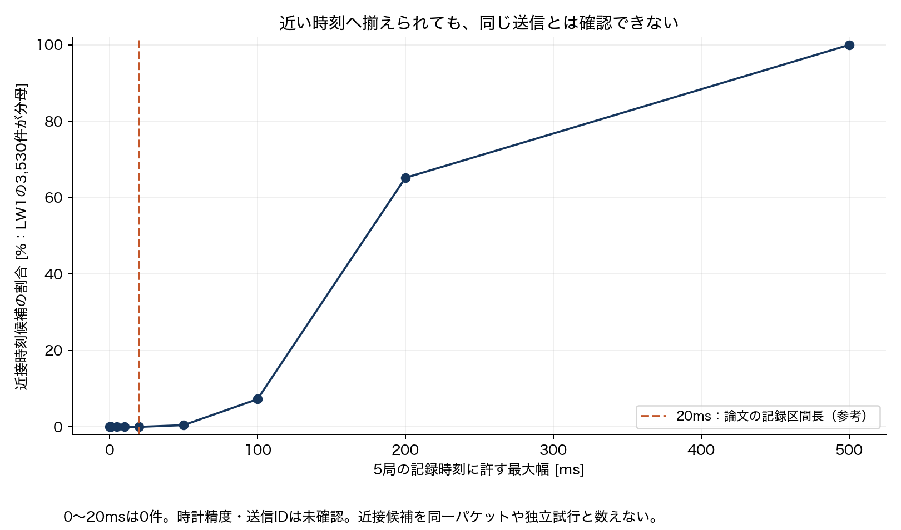
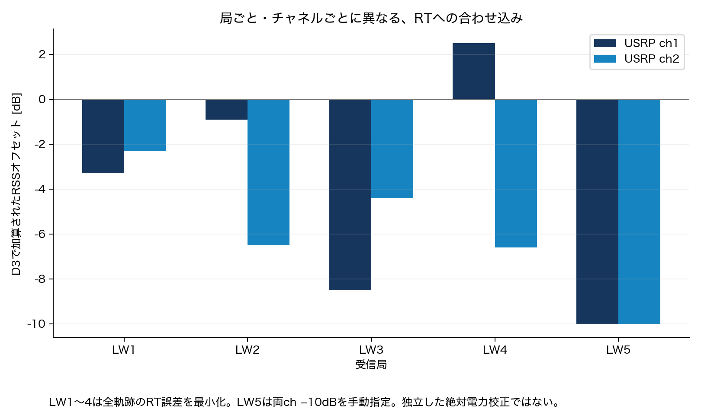

# Dataset-21実ファイル監査：同一送信の5局RSSとして扱えるか

**実測RSSは存在する。しかし、現時点では「同じ送信に対する5局RSS」としての採用ゲートは通らない。** D3の同じ行は、非同期に記録した各局の近い時刻を選んだ加工結果である。送信ID・時計精度・独立した局間校正が不足している。

今回実行したのは提供された実ファイルの監査。合成RSSの生成、位置偽装検出、Remote ID実機実験は行っていない。以前の取得失敗は過去の試行であり、今回は利用者が用意したZIPと実ファイルを読み込めた。

## 入手ファイルと由来

[DryadのDataset-21](https://datadryad.org/dataset/doi:10.5061/dryad.ttdz08m8r)と[AERPAW紹介](https://aerpaw.org/dataset/dataset-21-uav-ray-tracing-simulations-with-5-towers-at-lake-wheeler/)を照合した。DownloadsのZIPは公表されたサイズ8,736,011 bytes・SHA-256 `ff930df7158d4e9a4d2a038d225fb805b88031adef5628137bd3754ad2bd9ae1` と一致し、CRC検査も成功。展開済み16ファイルすべての内容がZIPと一致した。

| 区分 | 中身 | 今回の扱い |
|---|---|---|
| D1 | 地上LW1〜5で測ったUAV信号の2ch RSSとGPS | 実測系列として監査 |
| D2 | Sionnaの経路係数・遅延、3,530位置×5局 | シミュレーション結果として区別 |
| D3 | D2のRT RSSと、時刻合わせ・補正後のD1 RSS | 同時実測や独立校正済みデータとは扱わない |
| C1〜C3 | 軌跡表示、時刻合わせ・校正、比較図のMATLABコード | テキストを読み、数値処理をPythonで照合。MATLAB自体は未実行 |

元データ・座標・対応表はGitへ追加しない。`captures/dataset21-local-20261108-a/`にowner-onlyで保持し、利用者指定の `week27/Sionna_Ray_Tracing_Real_World_Measurements` はignored symlinkとして参照できる。公開するのはファイルhash、列の型・長さ、集計と図のみ。

## D1の実測列

| 局 | 元のRSS行 | 選択後のRSS行 | 各ch有限値数 | 測定時刻の間隔中央値 |
|---|---:|---:|---:|---:|
| LW1 | 3,916 | 3,530 | 3,530 | 約262ms |
| LW2 | 3,831 | 3,556 | 3,556 | 約251ms |
| LW3 | 3,604 | 3,369 | 3,369 | 約280ms |
| LW4 | 3,328 | 3,120 | 3,120 | 約297ms |
| LW5 | 3,218 | 3,043 | 3,043 | 約302ms |

合計16,618時点、33,236ch値。`RSS1/RSS2`は `RSS(validindex,:)` と完全一致し、欠損を0埋めしていない。各局の数値時刻は単調増加で、共通の917 GPS記録を参照する。GPS高度と、各局のRSS時点へ対応する変換座標列も存在するが、座標値は公開していない。

論文には20msの記録を100msごとに取る設定が記されている。一方、この配布ファイルの選択後の記録間隔は約251〜302msで、固定10Hzの独立パケット系列と解釈できない。保存されたTime_sを50点ずつに分けた区間幅は約19.992msだったが、これだけで各局の窓開始時刻や時計の同期精度が確定するわけではない。

## D3の3,530行はどう作られたか

付属C2は各局の測定を非同期と説明し、LW1の相対時刻ごとに他局の最も近い時刻を選ぶ。独立Python実装で、D3はこの近傍選択RSSに定数オフセットを加えたものと確認できた。誤差は最大約7.1×10⁻¹⁵dB。これはデータ変換の一致であって、物理的な同一送信の証明ではない。

| 局 | LW1との時刻差中央値（絶対値） | 最大時刻差 | 同じ元測定の再利用行数 |
|---|---:|---:|---:|
| LW1 | 0ms | 0ms | 0 |
| LW2 | 約64ms | 約151ms | 215 |
| LW3 | 約70ms | 約196ms | 273 |
| LW4 | 約76ms | 約167ms | 429 |
| LW5 | 約78ms | 約201ms | 490 |

LW5は元の3,043件を使って3,530行の図へ合わせ、実際に使われた別々の元測定は3,040件。したがってD3の3,530行を、そのまま3,530回の独立な5局同時受信とは数えられない。

5局の選ばれた時刻の最大−最小は中央値約175ms、95%点約260ms。さらに、全局の全記録時刻を走査して「各局から1件ずつ含む区間」の最小幅を求めても **21ms** だった。これは単に局ごとに最も近い値を選ぶ計算法だけの制約ではない。計算上の浮動小数の端数を避けるため、全局走査は相対時刻を1µs単位へ丸めて行った。µsの時計精度を保証するものではない。



| 記録時刻に許す5局の最大幅 | LW1の3,530件に対する近接候補 |
|---|---:|
| 0〜20ms | 0件 |
| 50ms | 16件 |
| 100ms | 256件 |
| 200ms | 2,302件 |
| 500ms | 3,530件 |

この候補数はC2と同じ近傍選択に基づき、同じ元測定の再利用を含む。全ての時刻組合せの件数でも、独立した送信件数でもない。幅を広げればグラフは揃うが、その間に送信電力を自由に変更できるという元の研究条件では、共通電力項を差分で消せる根拠にはならない。

「20ms以内0件」は保存時刻についての事実。時計の誤差が未確定なので、実際の電波に同時区間がなかったとまで断定しない。可読な数値・文字列列に共有パケットID／シーケンスはなく、同一送信を確認した組は0件としてゲートを保留する。

## 校正の意味



| 局 | ch1加算値 | ch2加算値 | 決め方 |
|---|---:|---:|---|
| LW1 | −3.3dB | −2.3dB | 全軌跡のRTとのRMSE最小化 |
| LW2 | −0.9dB | −6.5dB | 同上 |
| LW3 | −8.5dB | −4.4dB | 同上 |
| LW4 | +2.5dB | −6.6dB | 同上 |
| LW5 | −10dB | −10dB | C2で手動指定 |

C2の−50〜50dB・0.1dB刻みの探索を再計算し、LW1〜4の最小値とD3補正を照合した。LW5は探索上の最小値（−7.8/−9.7dB）を採用せず、両ch −10dBを指定している。RTの保存path gainからのRSS式も照合したが、SionnaやMATLABの計算を再実行したわけではない。

これはRTモデルへの合わせ込みであり、独立RF計測器による絶対dBm校正を確認できたことにはならない。全軌跡を使った補正を独立した評価飛行へ一般化できるかも未確認。D3を使い、同じRTへの一致を独立検証の精度として評価することは避ける。2chは同じ局の受信チャネルであって、地上10局でも方向推定AoAでもない。

## メタデータ上の未解決点

- 関連論文の3.3GHz、収録ファイル名の3.32GHz、LW1 MAT内`carrier_freq`の3.4GHzが一致しない。周波数を勝手に確定して距離モデルへ投入しない。
- ReadmeはB210、論文v1はB205と記載する。原収録設定の確認が必要。
- 共有送信ID、各パケットの実送信電力、局間時計精度、受信ゲインの独立校正を確認できない。
- UAVのGPS・変換座標はあるが、可読な標準数値列から地上5局全てのXYZを確認できない。C1の図用注釈位置を実測座標として逆算しない。
- MATLAB MCOSの不透明オブジェクトは未展開。`whosmat`はTypeError、全変数読み込みは重複`None`警告を生じたため、数値・文字列列を明示指定して監査した。未読のオブジェクト内に追加情報が存在しない、とまでは主張しない。

関連研究の測定条件は[Lee et al., arXiv:2502.10324v1, Section V](https://arxiv.org/html/2502.10324v1#S5)を参照した。

## 採用判断と次の段階

| 評価 | 判断 |
|---|---|
| 実UAV送信→地上局受信のRSS変動を分析 | 可能。D1を使用し、局・時刻・chの区別を維持 |
| 近接時刻の5局傾向を並べて可視化 | 条件付きで可能。時刻差と値再利用を明示 |
| 同じ送信の5局RSS差で任意電力を除去 | 現在の監査では根拠不足、保留 |
| 公開D3を独立校正済み絶対RSSとして採用 | 保留。RT由来補正と未確定の受信系偏差が残る |
| 実Remote ID位置偽装検出率の報告 | 未実行。今回のデータ監査からは導けない |

まずD1の局別・ch別で、時間相関、正常変動、GPSとの対応を分析できる。一方、同一送信5局方式を評価するなら、元IQ/共有送信番号・時計精度・地上局座標・受信ゲイン情報を追加確保する必要がある。20msの同時観測を仮定した合成実験で、この不足を埋めた扱いにはしない。

## 再現

既存のSciPy 1.16.3／NumPy 2.2.6環境を使用。MATLABは起動していない。

```sh
.cache/issue77/python/bin/python experiments/week27-data-audit/aerpaw21_local.py --source week27/Sionna_Ray_Tracing_Real_World_Measurements --archive captures/dataset21-local-20261108-a/dataset.zip --private-out captures/dataset21-local-NEW/audit --out week27/results/dataset21-local-audit-NEW
.cache/issue77/python/bin/python experiments/week27-data-audit/plot_aerpaw21_local.py week27/results/dataset21-local-audit-NEW
.cache/issue77/python/bin/python -m unittest discover -s experiments/week27-data-audit -p 'test_*.py'
python3 experiments/week27-data-audit/audit_aerpaw21_results.py week27/results/dataset21-local-audit-NEW
```

出力は`summary.json`、`stations/pairing/calibration/tolerances.csv`、集計図PNG/SVG。privateの対応インデックスは`captures/`。生RSS・絶対時刻・座標を公開出力へコピーしない。第三者は公式ZIPが必要で、CIは公開集計の整合性のみ検査する。
