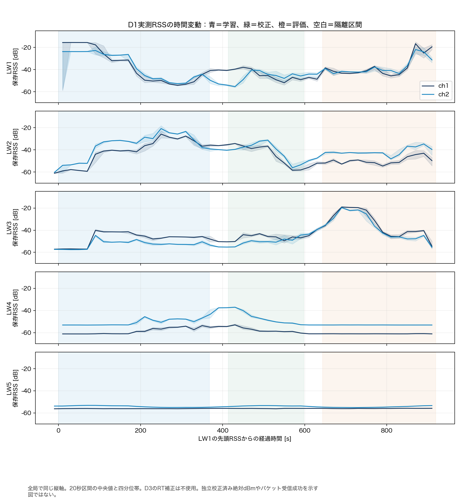
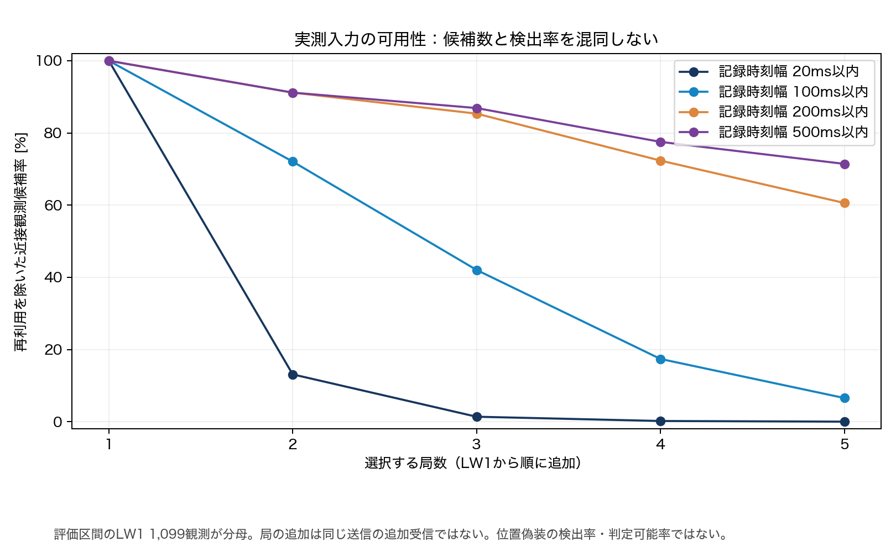
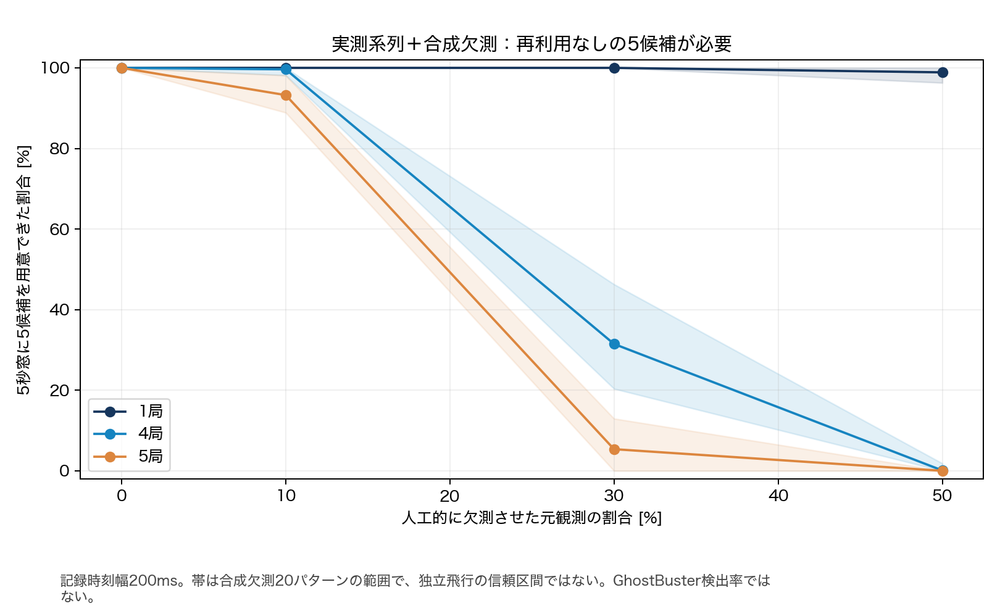
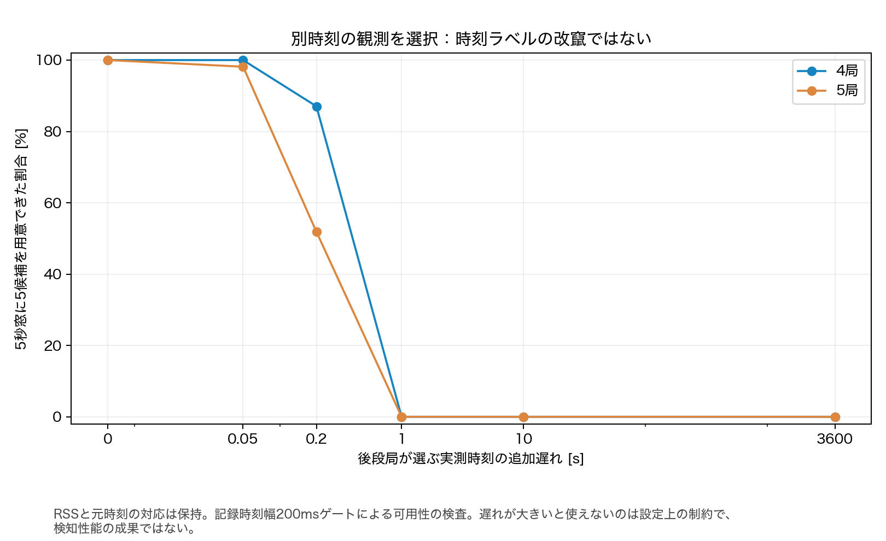

# Dataset-21：実測RSS評価アダプタと位置偽装実験の実行条件

**入力アダプタ・合成入力生成・入力可用性の実験は実装して実行した。GhostBusterの位置偽装検出率は未算出で、要求された性能評価全体は未完了。** 地上受信局の確定座標と、UAV高度と共通の高さ基準が不足しているためである。

今回の生RSSはDataset-21 D1の実測。位置申告・dB加算・欠測マスク・観測時刻の追加遅れは合成条件。D3を5局同時受信や独立校正データとして読み込む経路は設けていない。

## 実装・実行状況

| 項目 | 状況 |
|---|---|
| D1の実測RSS/GPS/時刻読込 | 実行済み。5局・16,618時点・2ch |
| RSS時刻へのGPS補間照合 | 実行済み。保存mX/mY/mZと最大約1.4×10⁻¹⁴の差 |
| 時系列分割と隔離区間 | 実行済み。学習0〜40%、校正45〜65%、評価70〜100%。間に各5%の隔離 |
| 20/50/100/200mの申告位置変更 | 実行済み。5局×4変位＝20入力条件。実測RSSは不変 |
| 一定＋6dB、振幅6dB・周期2秒の変動 | 実測RSSへの加算入力を生成済み。実機の送信電力制御ではない |
| 局0向けの攻撃者電力補償 | 座標が必要なため未実行 |
| 局数・観測時刻差・欠測率の可用性評価 | 210条件を実行済み。検出性能ではない |
| 実測入力の配列形状 | RSS `[54,5,K]`・申告 `[54,5,3]` をK=1〜5で構成。受信局XYZは未確定 |
| 既存GhostBusterとの結合テスト | 合成ユニットfixtureで実行。実測の検出性能とは区別 |
| FPR・TPR・FNR・検出可能距離 | 未算出。空欄／NOT_RUNを保存し、0%に置換しない |
| 偽装距離・電力操作対検出率の図 | 未生成。根拠となる性能値がないため |

## 座標を確定できなかった理由

前回18で未展開だったMCOSを、[MathWorks data-explorer-core](https://github.com/mathworks/data-explorer-core)の読取APIで調査した。依存コードはBSD-3-Clause、commit `dd49527c70d2aef0e0947ee4b8e9ed2b347a5ba0`に固定し、ignored `.cache/`内だけに保持した。MATLAB自体は実行していない。

- LW1のMATには`arrayConfig`・`rxsite`・`siteviewer`があり、LW2〜5には対応するMCOS heapがなかった。
- `rxsite`は`rx_site_temp`／`Site 5`という1オブジェクト。取り出せた緯度経度はUAVの補間GPSの1点と一致する。地上LW5、まして地上5局の座標と確認できるものではないため採用しなかった。
- D2には地上局を取り出せるMCOSオブジェクトはなく、D3のopaqueはファイル名等のstringだった。
- [元のDataset-12配布説明](https://datadryad.org/dataset/doi:10.5061/dryad.2z34tmpvv)には`LW1-5_locations.txt`の存在が記載される。150GB本体を取得せず小ファイルを取り出すため、公開配布先へ1MiB上限のRange取得を試したが、API401／配布URL403で取得できなかった。
- 公式マニュアルに埋め込まれた配置図URLは404。著者学位論文の取得もHTMLが返り、PDFとして参照できなかった。図の目測や別キャンペーンの座標で穴埋めしていない。

必要なのは、LW1〜LW5の局IDと確定した水平座標、アンテナ位置の高さ、Dataset-21のmZとの共通高さ基準、出典である。緯度経度だけを得ても、高さを勝手に0mや10mにして3次元評価は開始しない。

## 実測入力と時系列分割

`dataset21_adapter.py`は18の監査manifestのhashとD1を照合する。`timestamp_meas`は単調増加、RSS時刻はGPS区間内であることを確認し、GPSx/y/zを補間した値がmX/mY/mZと一致することを検査した。2chは同じ物理観測のチャネルで、独立した2飛行とは数えない。

水平申告はWGS84楕円体を基準としたローカルEast/Northの近似座標で生成し、東方向へ20/50/100/200mずらした。高さは元のmZのまま。変位ノルムを監査し、位置変更だけでは実測RSSが変わらないことを検査した。これは元のGNSSから作った合成申告であり、受信した実Remote IDペイロードではない。受信局との共通座標・高さ基準を確認できたという意味でもない。



図は20秒区間の実測RSS中央値と四分位帯。全局で縦軸を揃えた。D3のRT補正は使っていない。値が有限であることを、UAVパケットの復号・受信成功と扱わない。RSSの変動を位置、電力、遮蔽のどれかへ一意に帰属する図でもない。

学習・校正・評価は同じ1飛行を時間順に分割し、約46秒ずつの隔離を置く。局ごとの元観測IDを維持し、近接時刻の対応先も同じ分割に属するものだけを採用する。通常モデルのfitは学習部だけ、閾値は校正部だけを使う実装とし、評価RSSを大きく変更しても学習係数が変わらないテストを追加した。1飛行内の分割なので、独立した別飛行への一般化を確認したことにはならない。

## 入力可用性の実験

同じ元観測を複数回の新しい観測として数えない。K局の近接候補を貪欲に採用し、一度使った各局の元観測は再利用しない。追加遅れは「後段局がより後の実測時刻を選ぶ」操作で、RSSと本来のタイムスタンプの対応は保持する。受信・処理遅延でも、時刻ラベルを誤対応させる攻撃でもない。

固定5秒窓ごとに5個の再利用なし候補を揃えられるかを調べた。窓を延ばして欠測を隠すことはせず、評価区間に完全に含まれる54窓を分母にした。

210条件の内訳は、局数1〜5×時刻幅20/100/200/500msの20条件、K=1/4/5×欠測10/30/50%×20マスクの180条件、K=4/5×追加観測遅れ0.05/0.2/1/10/3600秒の10条件。全Cartesian組合せではない。合成欠測のseed20個を20飛行と数えない。



時刻幅200ms・追加遅れなし・人工欠測なしでは、K=5で1,099参照観測のうち666個（約60.60%）の再利用なし近接候補が得られた。5秒窓へ5候補を集めるだけなら54/54窓で成立した。しかし、これは同一送信の確認でも、位置偽装を判定できた割合でもない。時刻幅20msの5局候補は成立しない。



| 人工欠測率 | 1局：窓成立率 | 4局：窓成立率 | 5局：窓成立率 |
|---|---:|---:|---:|
| 0% | 100% | 100% | 100% |
| 10% | 100% | 約99.63% | 約93.24% |
| 30% | 100% | 約31.48% | 約5.37% |
| 50% | 約98.89% | 約0.09% | 0% |

欠測ありの値は20マスクの平均。帯はマスク間の範囲で、独立飛行の信頼区間ではない。元の測定で電波の欠落率を測った値でも、GhostBusterの保留率でもない。



大きな遅れで候補がなくなるのは、200msという近接条件と記録期間の制約による。非同期性に強い検出アルゴリズムを実証した図ではない。Aが10時、Bが11時に別送信を受信する元の問題を、この近接ゲートで解決したことにはならない。

## GhostBuster結合と実行ゲート

PR79の`ranges_from_rss`・組合せNLSE・座標中央値・窓内誤差中央値・正常閾値を再利用する。元のAPIのdefault境界は変更せず、ローカル実座標へ適用する際に明示的なソルバ境界を渡せるようにした。負のローカル高さを含む合成fixtureと、従来の8テストを検証する。合成fixtureの成功は実測検出の成功ではない。

受信局座標が揃った場合の実装は、D1学習部から局別切片と共通LDPL指数を推定し、D3や実送信電力を与えずに距離へ変換する。公称電力既知という原著の条件と違うため、これも条件付きの適用である。正常校正窓が20個未満、係数が不正、あるいはK=2/3（既存3D実装の対象外）なら実行しない。

同一送信IDがないため、多局スコア計算は既定で拒否する。別方式のストレス評価として`--allow-nearest-time-approximation`を明示した場合だけ、近接時刻・静止位置の近似として実行する構成にした。その共通申告は参照時刻の補間GPSから合成するので、位置変化と時刻集約が正常スコアへ影響し得る。原著の同一送信評価や、正しく時刻対応した非同期1RSSI方式と混同しない。

一定オフセット・時間変動は各観測の実時刻で加算する。局0向け攻撃は、座標が得られた場合に `clip(20 log10(d_true,0/d_claim,0),−10,+10)dB` を使う実装。各受信局へ別々の電力を同時に与える実装にはしない。合成加算で受信欠落や飽和がどう変わるかを実測したものではない。

今回の実測実行では、この距離計算の前に座標ゲートが停止した。`metrics.csv`の80条件は`NOT_RUN_MISSING_RECEIVER_GEOMETRY`、FPR/TPR/保留率は空欄。`detection-distance.csv`もNOT_RUNで、性能図は作っていない。CLI終了コード2はこの未実行ゲートを示し、全評価成功の終了コード0にはしていない。

検出可能距離は将来の実行時にも、試した20/50/100/200mのうちTPR≧95%、正常FPR≦5%、保留率≦5%を同時に満たす最初の点だけを条件付きで記録する。未測定の連続距離や、実環境一般の保証へ補間しない。

## 再現

元ファイルはPR80と同じignored sourceを使用。Python 3.12、NumPy 2.2.6、SciPy 1.16.3、Matplotlib 3.10.7。

```sh
# 現在の入力実験。座標なしなら終了コード2・検出NOT_RUNが正しい結果
.cache/issue77/python/bin/python experiments/week27-data-audit/run_dataset21_eval.py --source week27/Sionna_Ray_Tracing_Real_World_Measurements --audit week27/results/dataset21-local-audit-20261108-b/summary.json --private-out captures/dataset21-eval-NEW/run --out week27/results/dataset21-eval-NEW
.cache/issue77/python/bin/python experiments/week27-data-audit/plot_dataset21_eval.py week27/results/dataset21-eval-NEW
python3 experiments/week27-data-audit/audit_dataset21_eval_results.py week27/results/dataset21-eval-NEW

# MCOS調査の依存構築。出力に実座標が含まれるので必ずcapturesへ
bash experiments/week27-data-audit/prepare_dataset21_mcos.sh
node experiments/week27-data-audit/read_dataset21_mcos.mjs .cache/dataset21-geometry/bridge.mjs week27/Sionna_Ray_Tracing_Real_World_Measurements captures/dataset21-eval-NEW/mcos

# 検証済み受信局メタデータを用意した場合だけ、別出力で追加実行
# --receivers captures/.../receivers.json を追加。雛形はdataset21_receivers_template.json
```

雛形の確認フラグはfalseで、実座標は含まない。出典・局ID・水平CRS・mZとの共通高さ基準が確認できた後にprivateのメタデータを作る。単にフラグをtrueへ変えて実行するためのものではない。

公開出力は集計CSV/JSON・4図・状態表。各時点の座標・RSS・合成申告・対応インデックスはowner-only capturesに保持する。追加の座標資料が得られるまで、位置偽装検出の性能評価は未完了のまま残す。
