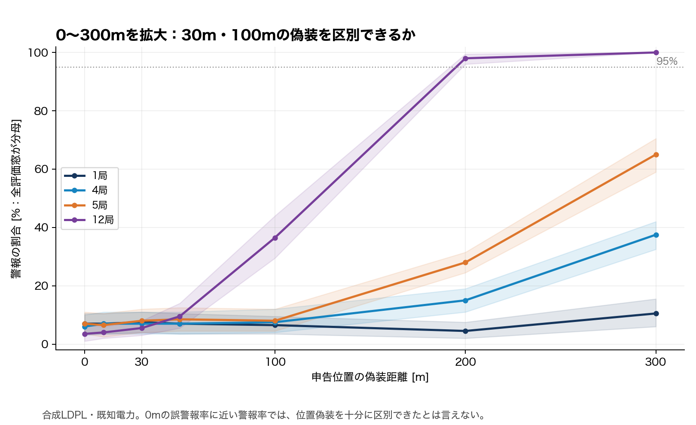

# Week27：RSSI位置偽装検知の実測解析とシミュレーション

親Issue [#68](https://github.com/SMRI2170/zkp-m1-v2/issues/68)。研究の問いは「未知電力と実環境の伝搬変動のもとで、位置申告検査に最低限必要な観測は何か」。

## 優先する順序

1. 原著比較：GhostBuster・方向推定・未知電力方式の観測と仮定を揃える。
2. 実ファイルの採用ゲート：位置、時刻、RSSI、局、同一物理送信、欠損を監査。
3. 正常残差分析：別飛行で校正し、未使用飛行のFPRと合成偽装時のスコアを比較。

検出境界マップ、長期履歴、Remote ID実機への適用はその後。デモ画面より定量分析を先にする。

## 現在の結果

- **[正常時SNRモデルの別セッション検証09](09_正常時SNRモデルの別セッション検証と閾値の限界.md)**：一定差／水平距離差モデルを訓練・校正・評価セッションに分けて比較。LoSのRMSEは5.92→4.65dB、正常警報率は7.65→10.41%で最大40.24%。校正の一般化が未成立のため、攻撃検出の実証へ進む根拠は未確立。

- **[同一送信4局のSNR差分布・局別偏差・時間変動08](08_同一送信4局のSNR差分布と局別偏差_時間変動.md)**：4局完全ケース6,728送信を解析。全6ペアの分布、局別中心化SNR、10秒区間、隣接相関を4図・CSV/JSONに保存。受信機固有偏差と伝搬は分離できず、攻撃検出率は未評価。

- **[IQメタデータ監査と観測量の採用判断07](07_LoRaIQのIQメタデータ監査と観測量の採用判断.md)**：6セッション×4局の24件を部分取得。IQはcf32_le・500k sample/s。選択標本にゲイン・AGC・絶対電力校正・高度の情報を確認できず、dBm RSSI評価は保留。相対IQ電力／SNRの成立条件を整理。

- **[UAV送信LoRaIQの取得監査と条件単位の不確実性評価06](06_UAV送信データの取得監査と条件単位の不確実性評価.md)**：CSV114,147行を取得・ハッシュ照合。UAV53,875行、厳格な多局比較候補7,368送信。ただしSNRのみでRSSI検出器の再評価は未実施。既存結果は16条件ブロックで再標本化し、条件差を図示。

- **[モデル誤差・補償電力・時間相関の感度評価05](05_攻撃モデル誤差と補償電力制約_時間相関の感度評価.md)**：同じ実測コホートで攻撃モデル・電力制限を掃引。100m条件で±1／3／6／10dBの警報率50.72／40.59／27.36／14.75%。窓・警報区間も別集計し、独立成功とは扱わない。

- **[位置申告変更③と電力補償④の対比較04](04_実測RSSIに対する位置申告変更と電力補償の対比較.md)**：同じ実測RSSI・正常校正閾値で48分割を比較。100m外向きの警報率は正常4.90%、位置のみ55.67%、理想補償4.90%、±3dB制限40.59%。地上送信・UAV受信の代理評価であり、RID実機ではない。

- **[新規CSI取得監査と正常RSSI残差の初回評価03](03_代替実測の取得監査と正常RSSI残差の初回評価.md)**：新規UAVデータの飛行CSV10件・23,465行とCSI93時点を取得。既存LoRa142,039観測を再確認し、別runの正常残差・警報率を追加分析。新規CSIはRSSI代用ではなくC判定。

- [原著の初回比較](01_先行研究の比較と成立条件.md)：GhostBusterの多局結果は1局実測由来のモデル展開。2026未知電力preprintは電力固定の仮定。
- [データ採用ゲートと取得確認](02_実測データ監査と適用可能範囲.md)：公開APIのメタデータは取得。本体API401／Web403で、AADM実ファイル監査・正常残差分析は未実行。
- [公開データ候補](01_公開実飛行データで再現できる評価と追加候補.md)：別目的のCIR・他の電波測定を比較。

取得確認・CSI・対比較の専用テスト49件を実行。正常RSSI残差と合成申告変更・電力補償の代理評価は実行済み。Remote ID実機の攻撃検出性能やAoA精度は未評価。

## Week27・Week28の統合

従来のWeek28資料・結果・図をWeek27へ統合した。以後の追加資料もこのディレクトリに置く。移動前に実行したログやhashはそのまま保持し、シミュレーションの再実行・数値変更は行っていない。

### シミュレーションの資料

1. [環境構築・正常通信・位置偽装の再現11](11_uli_net_sim導入とRemoteID_RSSI位置偽装実験.md)
2. [送信電力のPHY反映12](12_パケット単位送信電力のPHY反映と通信対照実験.md)
3. [非同期1RSSIと同一送信多局の区別13](13_非同期1RSSIと同一送信多局の観測条件監査.md)
4. [正常校正と20seed評価14](14_正常校正と20seedの位置偽装検出評価.md)
5. [観測局適応電力補償15](15_観測局適応電力補償攻撃と検出限界.md)
6. [配置・偽装方向の導入16（旧Week28）](16_PR6a_実験計画と局配置_偽装方向の導入.md)
7. [GhostBusterの再実装と検出可能範囲17（旧Week28）](17_GhostBuster方式の再実装と検出可能範囲.md)

**実測解析とシミュレーションは区別する。** 03〜09は公開実測データの監査・代理評価。11〜17はOMNeT++/INETや合成モデルの評価。GhostBusterの98%という結果は合成LDPL条件であり、実ドローンの測定RSSを使った検出性能ではない。

0mは正常時の誤警報率。偽装時の警報率がそれと近ければ、十分に区別できていない。合成条件と既存INET再解析を分け、設定・集計CSV・ソルバ診断・再現コマンドは17の報告内に記載した。実UAV・Remote ID実機は未実行。Issue77のPR6b/6c全体も未完了。
