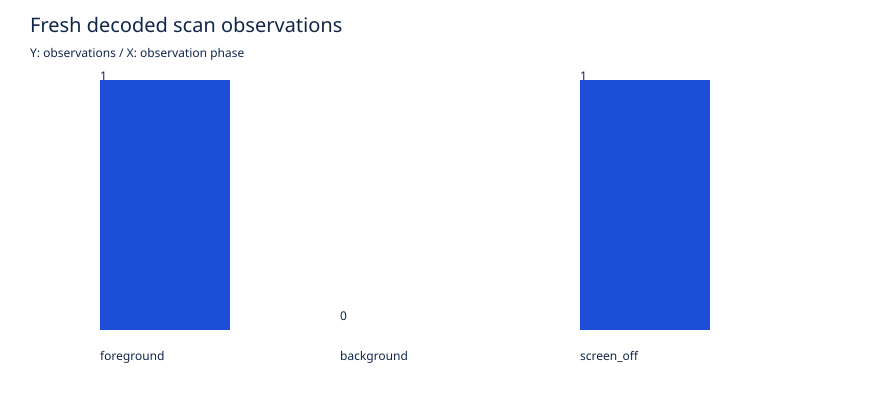

# Pixel 8：KMP版の背景・画面消灯時の受信

## 確認できたこと

バックグラウンド対応APKをPixel 8へ更新し、Pi Aのテスト用Remote ID Beaconを実際に受信した。
**画面消灯中に、新しい有効なRID観測が1件保存された。通知の「停止」からサービス終了・記録確定も確認できた。**
対象ドローンは利用者指定のDJI Matrice 350 RTKだが、今回の送信元はPiであり、M350実機の受信試験ではない。

| 条件 | 実行時間 | 新しい解析済み観測 | サンプル最大PSS |
|---|---:|---:|---:|
| アプリ表示中 | 30.22秒 | 1件 | 113,014 KiB |
| ホーム画面・アプリ非表示 | 30.24秒 | 0件 | 61,279 KiB |
| 画面消灯・アプリ非表示 | 30.22秒 | 1件 | 56,613 KiB |

保存2件のRSSIは−48、−47 dBm、2452MHz、counter 222。Vendor IE本体のダイジェストは送信側レシートと2件とも一致した。
保存開始前に取り込んだ1件が別にあり、受信全体のメモリ上件数は3件。記録セッションは2件である。

ホーム画面中にもサービスの要求・スキャン通知は動いたが、その区間では新しいRID観測が追加されなかった。
スキャン要求受理とresults_updated=trueだけでは、対象RIDが必ず追加されることを意味しない。
**各条件30秒・1回のSmoke testであり、0件を背景受信不能と結論したり、1件を安定取得の保証としたりしない。**
送信元別の間隔を推定するには各区間の観測数が不足するため、p95グラフは未測定と表示する。
PSSは各区間の限られたサンプルであり、性能差の比較やピーク保証ではない。

## 成果物

[CSV](results/kmp-bg-pixel8-20261110-a/summary.csv)、[JSON](results/kmp-bg-pixel8-20261110-a/summary.json)、[検証条件・APKハッシュ](results/kmp-bg-pixel8-20261110-a/validation.json)。

[最大PSS](results/kmp-bg-pixel8-20261110-a/pss_max_kib.svg)、[最大空白時間](results/kmp-bg-pixel8-20261110-a/max_edge_inclusive_gap_s.svg)、[更新間隔p95（今回は観測不足）](results/kmp-bg-pixel8-20261110-a/update_interval_p95_s.svg)。
件数グラフをPNGへレンダリングして表示も確認した。公開した図表は識別情報を含まない集計。
生JSONL・送信レシート・画面・端末の記録IDはignored captures内で0700/0600に保持する。

## 操作・停止・再起動

- Androidの通知許可ダイアログで許可し、location型Foreground Service起動を確認。
- 画面表示→ホーム→消灯を評価スクリプトで順次実行。追加のadb Wi-Fiスキャン要求やOS制限の無効化は行わなかった。
- 実行後の自動停止はロック画面で操作できず未確認になった。元の実行計画・途中ログはそのまま保持した。
- 画面操作が可能になった後、通知を展開し「停止」を押した。サービス一覧から消え、session_end理由notification_stop・保存2件が確定した。
- ADBのam stopserviceも試したがError stopping serviceとなり、停止には成功していない。成功した停止は通知操作である。
- 記録を確定した後にアプリをプロセスごと再起動し、最新セッションCSVをSAFで書き出して2件を確認した。
- Piの120秒上限付き送信は終了し、一時AP削除・hostapd停止・SSH疎通も確認。スマホも現在受信・記録を停止済み。

## 実機で見つけて修正した点

1. 画面を毎秒無条件に作り直しており、UI Automatorがidle状態を取得できなかった。状態が変わった場合だけ再描画するよう修正し、修正版で実機の自動収録を実行できた。
2. 評価スクリプトが、後始末未確認でも終了成功を出していた。今後は停止未確認を専用状態に記録し、エラー終了させる。正常終了／ロックによる停止失敗の2ケースをモックでテストした。この変更後の完全な自動実機評価は未再実行。

Android/JVM共通テスト各15件、修正版APK・Lint成功。Pythonは11件成功。
既存UAV77件、contracts48件、Go成功。ログは結果ディレクトリに保存した。

## 条件・限界と未実行

USB接続・充電中で実行し、監査サンプルのdevice_idleはfalse。**画面消灯の確認であり、深いDozeや非充電での長時間継続の確認ではない。**
Piは合成ID・申告位置を載せる制御用テスト送信機。レシートUTCとスマホのUTC／単調時刻の対応で期間を照合したが、機器間の時計誤差を独立校正したものではない。
ScanResultは物理パケットそのものではなく、キャッシュやProbe Responseを含み得る。ダイジェスト一致は同一物理パケットや機体真正性の証明ではない。

以下は引き続き未実行で、Issue #84は閉じない。

- 各条件30分の比較、非充電・Doze・長時間運用・電池消費評価。
- 通知拒否・位置権限剥奪・保存上限到達・保存失敗の実機試験。
- 受信動作中のActivity再生成・OSによるプロセス終了からの復旧試験。
- M350実機の地域・FW・RID状態の確認と受信・データ形式の照合。

[PR #85](https://github.com/SMRI2170/zkp-m1-v2/pull/85)と[Issue #84](https://github.com/SMRI2170/zkp-m1-v2/issues/84)へ反映する。研究PoCであり、ZKP・BC・DRIP・機体位置の真正性保証は含めない。
