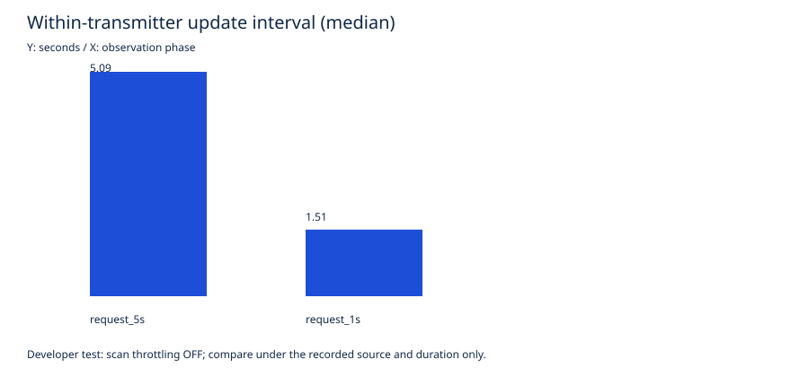

# Pixel 8：高速スキャン要求と実際のRID取得間隔

## 結果

**開発用設定では、1秒ごとのスキャン要求に対し、新しいRIDの更新間隔は中央値1.51秒だった。**
要求間隔と取得間隔を分け、ScanResult.timestampが更新された解析済み観測だけを集計した。

| スキャン要求 | 条件 | 測定窓 | 新しいRID観測 | 間隔のサンプル数 | 実効中央値 | 最小〜最大 |
|---|---|---:|---:|---:|---:|---:|
| 5秒 | スロットリングOFF・表示中 | 30.23秒 | 6件 | 5区間 | 5.09秒 | 5.04〜5.20秒 |
| 1秒 | スロットリングOFF・表示中 | 30.21秒 | 20件 | 19区間 | 1.51秒 | 1.37〜1.61秒 |

Pixel 8、Android 17 / API 37、USB充電中、Pi Aの同じテスト用Beacon、順次各1回の短時間測定。
2セッションの生保存は合計27件。測定窓内は26件で、窓の開始前に保存された1件は上表に含めていない。
保存27件すべてcounter 224・送信レシートのVendor IEダイジェスト一致。
Matrice 350 RTK実機の受信・更新周期・背景／消灯での高速性能は未検証。

[CSV](results/kmp-fast-20261110-b/summary.csv)、[JSON](results/kmp-fast-20261110-b/summary.json)、[検証条件とAPKハッシュ](results/kmp-fast-20261110-b/validation.json)。
同ディレクトリに件数・中央値・p95・最大空白時間・PSSのSVGを保存した。中央値の図を画像化して表示確認済み。

## 通常設定とは別の結果

アプリの標準設定は30秒ごとの要求。前報12の通常設定では、保存2件の間隔は60.164203秒だった。
ただしこれは表示中／背景／消灯の混在する短い試験の1区間だけで、正常運用の平均取得間隔ではない。
今回の高速設定と対照条件を揃えた反復比較でもないため、「常に約40倍速い」と一般化しない。

[Android公式のスキャン制限](https://developer.android.com/develop/connectivity/wifi/wifi-scan)では、通常の前景アプリは2分間に4回の要求が上限。短時間のバーストは可能だが、継続的な1秒取得の保証ではない。
同資料に、ローカル試験用の開発者オプションでスロットリングを無効化できることが記載される。

今回の数値はその**明示的な開発用条件**である。送信頻度・受信環境・端末・スキャン時間・OS状態・負荷で変わる。
1秒モードでも1Hzの新しいRIDを保証していない。確認した最小1.37秒も、ハードウェアの絶対的な限界を示すものではない。
新しいスキャン値は物理パケットそのものではなく、同一送信の照合・受信率・位置の真正性を証明しない。

## v0.4の実装

- 画面の「スキャン要求」から標準30秒／開発用5秒／開発用1秒を選択。
- 受信中は間隔変更を拒否し、セッションの条件を固定する。
- 高速要求は[WifiManager.isScanThrottleEnabled](https://developer.android.com/reference/kotlin/android/net/wifi/WifiManager#isScanThrottleEnabled())でOFFを確認した場合だけ許可。ONのままの開始拒否を実機確認。
- アプリ自身がOS設定を変更する処理は追加していない。測定時は開発者設定を操作した。
- 要求間隔・APIで確認したスロットリング状態・成否を監査イベントへ記録。
- 通常条件のevaluate_pixel.pyも、記録開始時のAPI状態がON・要求30秒であることを検査する。settings get globalの値だけでは通常条件と認定しない。拒否ケースをテスト追加。
- 開始に失敗した場合は画面へ状態を表示し、IDを含まない診断ログを残す。

## 実行時の失敗と除外

初回の送信試行では、新規収録とスロットリングOFFを確認できず、前の記録が残っていた。
この試行は不成立とし、取得間隔の集計には使っていない。生証拠は削除せずcaptures内に保持した。
その後、設定画面のOFFだけでなく、各セッションの監査イベントでOFF・5秒／1秒を確認し、新しい記録IDで測定し直した。
最初の不成立試行も含めたテスト送信は2回、上表に使用した有効送信は1回。

## 終了と復元

- 2セッションともuser_record_stopで記録確定し、サービス停止を確認。
- 開発者設定のスロットリングをONへ戻し、アプリを標準30秒へ戻した。
- 復元後にアプリの診断ログで `interval=30000 throttle=true` を確認し、受信を停止。
- Piの上限付き送信終了、一時AP削除・hostapd停止を確認。既に終了していたunitへのstopはUnit not loadedとなったが、稼働中ではなかった。
- 生ログ・画面・実際の記録ID等はignored capturesへ0700/0600で保存。Gitには匿名集計のみ。

## 検証と再現

Android/JVM共通テスト各18件、Python12件成功。APK・Lint成功。既存UAV77件・contracts48件・Go成功。
実機で確認したのはモード選択、通常条件での高速拒否、開発条件での収録、通常状態への復元。
実行中にスロットリングをONへ戻す異常系の実機試験は未実行。長時間・Doze・電池消費・M350実機も残件。

再現は受信停止→開発者設定OFF→アプリで5秒→受信・記録→30秒収録→記録・受信停止→1秒で繰り返す。
終了後は必ず開発者設定ON・標準30秒へ戻す。受信環境・送信源・充電・前景／背景・時刻・測定窓を記録する。
集計は公開のanalyze_capture.pyへobservations.jsonl・events.jsonl・phases.jsonを渡す。phasesにはsource_kind=test_beaconとdebug_scan_throttle_disabled=trueを明示する。
通常用evaluate_pixel.pyは高速測定に流用せず、通常設定の比較用として維持する。
