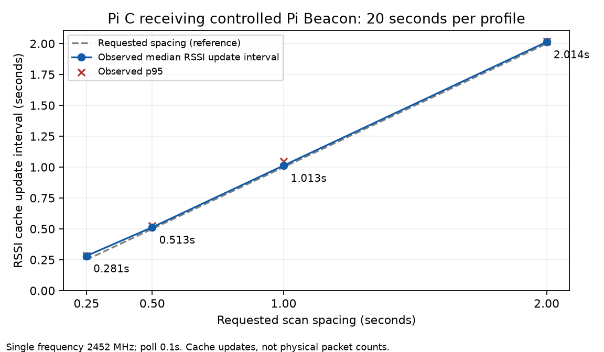

# Piの高速スキャン要求とRSSI保存

2026-11-11。各PiでRSSIを短い間隔で記録するため、受信コードと期間限定の起動・比較プログラムを整備した。

**Cでは、単一周波数の0.25秒要求に対し、実行中のRSSI付きキャッシュ更新間隔の中央値は0.281秒だった。Aは同じコードを導入し要求成功まで確認。BはSSHに応答せず、更新・実測は未実行。**
全台の最大性能やM350の受信周期が確認できたという結果ではない。

## 実装

- `uav/wifi_scan_capture.py`：通常のキャッシュ読取りは既定1秒へ変更。明示的な`--active-scan`で、`iw scan trigger`を期間内に順次要求。
- 読取り最小0.1秒、要求間隔最小0.25秒。要求コマンドが返ってから次の待ち時間を取る。
- busy／タイムアウト等は待ち時間を最大5秒まで増やし、5連続失敗か認識できた権限拒否で停止。コマンドは最大2秒に制限。
- RSSIは`rssi_dbm`、欠測は`null`＋理由。時刻・周波数・申告ID／位置・元Vendor内容も各Pi内JSONLへ保存。行ごとにflushする。
- 要求成否と停止理由を別のprivate `events.jsonl`へ保存。読み出しや要求を成功した観測として数えない。
- `benchmark_scan.py`：2／1／0.5／0.25秒要求を各20秒、固定順で実行しCSV／JSONLを生成。エラーも残して次条件へ進む。
- `start_fast.py`と`~/zkp-beacon-observer/fast`：明示操作で期間限定サービスを起動。既定60秒・0.25秒要求・0.1秒読取り。既存sudo権限で、そのサービスだけへCAP_NET_ADMINを渡す。
- 128MiB・1ファイル20MiB・期間上限・重複キー上限を維持。sudoers・SSH・Wi-Fi接続設定は変更しない。自動起動／無期限収録は設定しない。

最終release `6b9cf076f2b3`をA/Cへ導入し、転送した10ファイルのSHA-256一致を確認した。旧release・旧収録を保持。
最初の比較は同じ受信コードのrelease `6b65a1e4eeb1`で実行。最終版は簡易起動・そのテストを加えたもので、受信コードは同一。最終コマンドでも別送信を使って再確認した。

## 試験条件

| 項目 | 条件 |
|---|---|
| 送信 | Pi A、時間上限付きのテストBeacon、固定の合成RID申告 |
| 受信 | Pi C、Raspberry Pi 3 Model B Plus、brcmfmac通常スキャン |
| 対象周波数 | テスト送信で確認した2452MHzのみ |
| 観測 | `iw scan dump -u`、最短0.1秒間隔 |
| 比較 | 2→1→0.5→0.25秒要求、各20秒・1回ずつ |
| 再確認 | 最終`fast`コマンド、別のテスト送信、0.25秒要求・20秒 |
| 保存 | Pi内のignored captures、ディレクトリ0700／ファイル0600 |

Cの既存5GHz接続を維持して2.4GHzをスキャンした。Aも既存接続を維持。スキャン要求中のオフチャネル動作による通信影響が一般にないと保証するものではない。
受信側の時計オフセット・RSSI絶対校正・配置・実距離は測定していない。

## Cでの比較結果

| 要求間隔 | 要求成功／要求数 | RSSI付き保存数 | 実行中の時刻付き更新数 | 間隔中央値 | p95 | 最大 |
|---|---:|---:|---:|---:|---:|---:|
| 2秒 | 10／10 | 9 | 9 | 2.014秒 | 2.018秒 | 2.018秒 |
| 1秒 | 20／20 | 21 | 20 | 1.013秒 | 1.045秒 | 1.046秒 |
| 0.5秒 | 39／39 | 40 | 39 | 0.513秒 | 0.526秒 | 0.526秒 |
| 0.25秒 | 72／72 | 73 | 72 | 0.281秒 | 0.284秒 | 0.287秒 |
| 0.25秒・最終コマンド再確認 | 72／72 | 68 | 68 | 0.281秒 | 0.286秒 | 0.289秒 |

RSSI付き保存合計211件。すべて送信側レシートのVendor内容ダイジェスト・各試験のcounterと一致し、RSSI欠測なし。
最終試験の冒頭には送信起動の待ち時間が含まれるため、件数を定常状態の受信率やパケット損失率へ換算しない。



[集計CSV](results/pi-fast-rssi-20261111-a/profiles.csv)／[検証JSON](results/pi-fast-rssi-20261111-a/validation.json)／[SVG](results/pi-fast-rssi-20261111-a/request-vs-rssi-update.svg)。グラフの点は条件ごとの中央値、×はp95であり、信頼区間ではない。

### 間隔の定義

同じBSSID・周波数の、デコード成功・RSSIあり・時刻既知・古くない観測を対象にする。実行開始より前のキャッシュ時刻は除外。
カーネルが報告したキャッシュ更新時刻の差を集計し、同一時刻の複数IEや後戻りした時刻を追加の時間更新として数えない。
保存数には比較開始前の新鮮キャッシュが1件入る場合があり、実行中更新数と一致しないことがある。

この定義は802.11の物理パケット時刻ではない。Probe Response由来情報も混ざり得る。Vendor内容が同じでも、同一物理パケットの証明ではない。
固定RID申告を送っているため、**RSSIが更新した周期であり、ドローン申告位置が更新した周期ではない。**

## ノード別の達成範囲

| ノード | 実行済み | 未実行 |
|---|---|---|
| A | 導入・21件の受信テスト・3件の起動テスト。1秒要求10／10成功、最終fastの0.25秒要求39／39成功、各10秒、SSH維持 | 今回の高頻度ODID受信。送信源なしのため記録0、終了コード3。RSSI速度を推定しない |
| C | 導入・同テスト、4条件比較・最終コマンド再確認、RSSI保存211件 | 長時間、全チャネル比較、M350 |
| B | 既存の接続先へSSH確認を試行 | 接続タイムアウト。今回版の導入・テスト・実測すべて未実行 |

A/Cの1秒要求の事前確認はどちらも10秒・10要求成功で、当時ODIDなし。終了コード3をサービス失敗表示だけでクラッシュや受信成功に読み替えない。
終了時、実行中の実験unit・hostapdなし、一時APなし、両台SSH接続可能。MemAvailableはA約3.18GiB、C約568MiB。

## 起動と再現

```sh
# A/Cの一般ユーザーpiで実行。必要なら端末でsudoパスワード入力。
~/zkp-beacon-observer/fast --duration 60
# 対象周波数を実受信で確認できた場合だけ指定
~/zkp-beacon-observer/fast --duration 60 --frequency 2452
```

周波数指定なしでは全対応チャネルをスキャンするため、今回の単一周波数0.281秒をそのまま当てはめない。
M350の周波数は機種名だけで固定しない。引数・比較用サービスの起動方法は[README](../experiments/week28-beacon-observers/README.md)。

図の再生成はmatplotlib入りの環境で次を実行する。標準pythonにはmatplotlibがなく最初の描画は失敗したが、既存の解析用環境で生成済み。実機測定には追加パッケージ不要。

```sh
python experiments/week28-beacon-observers/plot_scan_profiles.py --results week28/results/pi-fast-rssi-20261111-a
```

## テストと限界

ローカルUAV82件、Pi関連10件、Go、contracts48件成功。A/Cで受信関連21件・起動3件を確認。
新テストは、拒否時の待機・期限、受動時に要求しないこと、RSSI欠測・旧キャッシュ・時刻不明を更新間隔へ混ぜないこと、受信元／周波数別集計、権限範囲と期間制限を検査する。
生JSONL・レシート・原始ログはprivate capturesへ保全し、公開物はコードと匿名集計のみ。

今回比較した最短は0.25秒要求であり、ハードウェアの絶対最短値を求めた結果ではない。各条件20秒・固定順・1回と最終条件の1追加確認に限る。
B、Aの高頻度RID受信、M350、長時間／温度／電池、全チャネル、損失率、生パケット、電源断は未評価。
研究PoCであり、DRIP・観測者ハードウェア・センサーの正直さ・機体・申告位置を認証するものではない。
