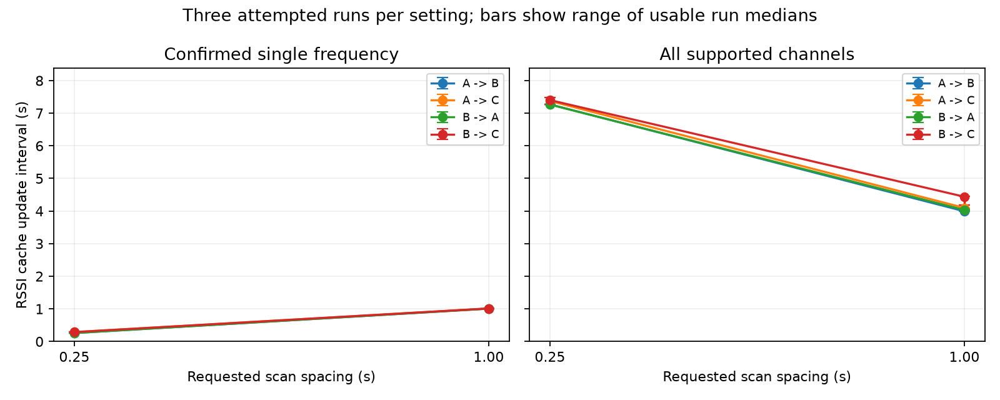
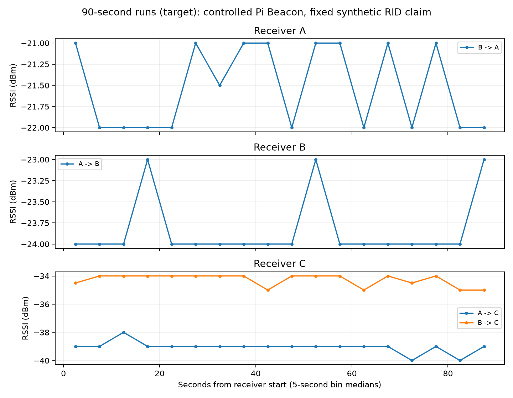
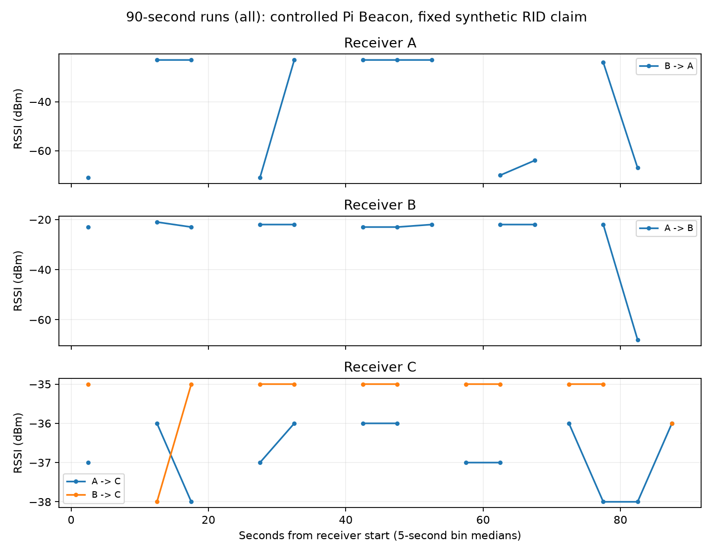

# 3台PiのRSSI反復取得と90秒収録

2026-11-11。前回未評価だったBを更新し、A/Bを交互に送信役、残り2台を受信役として実RF試験を実行した。

**RSSI付き取得はA・B・Cすべてで成立した。対象周波数が判明した場合は短い間隔で取得できたが、全チャネルでは同じ要求間隔でも遅くなった。要求を短くすれば必ず速くなるわけではない。**

## 条件と実行範囲

| 項目 | 実行した条件 |
|---|---|
| 機材 | A/B：Pi 4、C：Pi 3 Model B Plus。既存brcmfmac／managed接続 |
| 送信 | AまたはBの時間上限付きPi Beacon、固定の合成RID申告 |
| 周波数 | 既存STAと同じ2452MHz。対象周波数は送信時に確認 |
| 受信方式 | Linuxスキャンキャッシュ。raw 802.11 monitor受信ではない |
| 条件比較 | 単一周波数／全対応チャネル × 0.25／1秒要求 × A/B送信 × 各3反復 |
| 比較時間 | 1条件15秒。反復2では条件と送信役の順を反転 |
| 継続確認 | 単一周波数90秒×A/B送信、全チャネル90秒×A/B送信 |
| 保存 | 全ノードで時刻・RSSI・周波数・申告情報をprivate JSONLへ逐次保存 |
| 資源保護 | 受信PythonのRLIMIT_AS 128MiB、ファイル20MiB、有限時間、空きRAM監視。cgroup上限も128MiBを要求 |

26試験の基本系列と、全チャネル90秒の追加2試験を完了。送信試行は計28、受信プロセスは計56。
「全チャネル」は周波数フィルタを指定しないスキャン要求。各チャネルの実滞在時間は計測していない。
同じ試行を2台で受信しているため、56回の独立飛行ではない。配置・姿勢・距離は変更／計測しておらず、一般的なドローン性能や位置偽装検出率を評価したものではない。

送信内容・counterが一致した保存観測は計**2,256件**、その中のRSSI欠測は**0件**。これは全無線送信を分母とした欠落率ではない。

## 反復比較の結果

各セルは最大3実行の更新間隔中央値の中央値。差分を計算できた実行数をnで示す。3実行は同じ機材・場所の反復であり、独立した環境・飛行ではない。

| 送信→受信 | 単周波0.25秒要求 | 単周波1秒要求 | 全チャネル0.25秒要求 | 全チャネル1秒要求 |
|---|---:|---:|---:|---:|
| A→B | 0.259秒 (n=3) | 1.008秒 (n=3) | 7.270秒 (n=3) | 3.994秒 (n=3) |
| A→C | 0.289秒 (n=3) | 1.012秒 (n=3) | 7.375秒 (n=3) | 4.097秒 (n=3) |
| B→A | 0.259秒 (n=3) | 1.008秒 (n=3) | 7.265秒 (n=3) | 4.033秒 (n=3) |
| B→C | 0.288秒 (n=3) | 1.013秒 (n=3) | 7.402秒 (n=3) | 4.439秒 (n=3) |

図の縦棒は3実行の中央値の最小〜最大であり、信頼区間ではない。[各実行CSV](results/pi-extended-rssi-20261111-a/main/runs.csv)と[条件集計CSV](results/pi-extended-rssi-20261111-a/main/groups.csv)に個別値を保持。

### なぜ要求間隔だけでは決まらないか

全チャネルでは進行中のスキャンに次を要求するとbusy等で拒否される。この実装は拒否時に1／2／4／最大5秒の待機を挟むため、ドライバのスキャン時間とソフトウェアの待機方針が両方影響する。
したがって、全チャネルの値をWi-Fiの原理的な最短限界と解釈しない。拒否回数・要求成功数は各runのCSVに併記した。
今回の構成では、未確認の周波数を探す段階と、判明した周波数で収録する段階を分ける根拠になった。

## 90秒収録

RSSI更新の中央値／p95と、先頭・末尾も含む最大観測空白時間を秒で示す。全チャネル条件は基本比較とは別の追加試行。

| 条件 | 送信→受信 | 実行中のRSSI更新数 | 中央値 秒 | p95 秒 | 最大空白 秒 |
|---|---|---:|---:|---:|---:|
| 単一周波数 | A→B | 344 | 0.259 | 0.278 | 0.513 |
| 単一周波数 | A→C | 302 | 0.280 | 0.370 | 0.737 |
| 単一周波数 | B→A | 347 | 0.259 | 0.267 | 0.281 |
| 単一周波数 | B→C | 314 | 0.282 | 0.292 | 0.582 |
| 全チャネル | A→B | 12 | 7.273 | 7.362 | 7.365 |
| 全チャネル | A→C | 13 | 7.476 | 7.580 | 7.584 |
| 全チャネル | B→A | 12 | 7.292 | 7.314 | 7.320 |
| 全チャネル | B→C | 12 | 7.532 | 7.647 | 7.678 |

図は5秒区間ごとのRSSI中央値。空区間を0dBmで補わない。送信・アンテナ・配置が異なるため、機材間のRSSI差を距離差・受信性能順位として解釈しない。
全チャネル90秒ではA/BのRSSIに数十dBの変動も見られた。原因は未特定であり、距離変化・送信電力操作・マルチパスのいずれかと断定しない。独立した実EIRP・配置真値やrawフレームとの照合が必要。
90秒の結果を30分・一晩・屋外飛行・電池運用の安定性へ拡張しない。

## メモリとSSH

| 受信ノード | 受信試行数 | 子プロセス最大RSSの平均±SD MiB | cgroup現在値の最大観測値 MiB | ホスト空きRAM最小 MiB | SSH状態照会最大 秒 |
|---|---:|---:|---:|---:|---:|
| A | 14 | 22.54 ± 0.29 | 27.004 | 3230.6 | 0.822 |
| B | 14 | 24.87 ± 0.18 | 未取得 | 3412.2 | 1.040 |
| C | 28 | 22.80 ± 0.47 | 未取得 | 540.0 | 0.543 |

子プロセスRSSは各実行のru_maxrss、cgroup値とホスト空きRAMは数秒間隔の観測。B/Cではcgroup値を取得できず、MemoryPeakも全台未取得。未取得を0で埋めていない。B/Cでのcgroup上限の実効性は未確認で、受信PythonのRLIMIT_ASとcgroup設定を同一視しない。PSS・ホスト全体の瞬間最大メモリ・CPU使用率ではない。単一SSH照会時間はsystemctlとメモリ照会を含む処理時間で、純粋なネットワーク遅延ではない。
修正後の系列では受信処理の異常終了・OOMによる停止は記録されなかった。資源CSVには観測時点のCPU累積時間も保持する。SSHの全時点の無切断を保証するのではなく、実行中の照会成功と終了時の接続を確認した。

## 集計の正当性

- 生RSSIは実機測定、ID・申告位置は合成。M350や飛行UAVの受信ではない。
- 各送信receiptと内容ダイジェスト・counterが一致した行だけを選ぶ。内容一致は機体認証や同一物理パケットの証明ではない。
- 実行開始BOOTTIMEを受信メタデータへ追加。開始より前のキャッシュ・時刻不明・古いキャッシュ・欠測RSSIを更新間隔へ入れない。
- 受信元・周波数・カーネル時刻で重複を排除して、間隔を生観測から再計算する。
- 固定RID申告なので、測ったのはRSSI付きキャッシュの更新周期。機体位置フィールドの更新周期・物理パケット受信率ではない。
- 各受信機のRSSI絶対校正・時計オフセット精度・真位置・DRIP／ハードウェア認証は未検証。

## 失敗・修正の記録

最初の起動はSSH control socketの絶対パスがOSの長さ制限を超え、RF測定前に停止した。短い相対パスへ修正し、事前検査を追加。
次の1試験はRSSI受信に成功したが、正常終了でunloadされたtransient unitを停止失敗と誤判定し、系列を中断した。inactiveを明示確認する修正とテストを追加した。初期2試行の原始ログを残し、上の反復集計へ合算していない。
プログラムは自身が作ったunitだけを後始末し、一時AP撤去が確認できない場合は次へ進まない。元の送信上限120秒は維持した。

## 再現と成果物

- 自動実験：`experiments/week28-beacon-observers/run_rf_matrix.py`
- 匿名集計・図：`experiments/week28-beacon-observers/analyze_rf_matrix.py`
- 起動条件・設定形式：[README](../experiments/week28-beacon-observers/README.md)
- [基本系列JSON](results/pi-extended-rssi-20261111-a/main/summary.json)、[追加90秒JSON](results/pi-extended-rssi-20261111-a/all-sustain/summary.json)
- 各結果ディレクトリの`runs.csv`／`groups.csv`／`resources.csv`／`memory-statistics.csv`／`sustain-rssi-bins.csv`。

生JSONL・接続情報・送信receipt・座標はignored capturesに0700／0600で保持し、Gitには追加しない。Bを含む全台を同一受信releaseへ更新し、旧版・旧収録は保持した。
終了時には試験unit・hostapd・一時APが残っていないことと、A/B/CのSSH接続を確認する。

ローカルUAV82件・Pi関連23件・Go・contracts48件成功。GitHub CIの実行結果はPRへ記録する。

## 次に必要な評価

今回から言えるのは、現行の内蔵Wi-Fi／スキャン方式でRSSIを保存できる条件と、全チャネル走査・要求拒否・待機が取得間隔へ与える影響。
M350の実際の周波数・送信方式・位置メッセージ更新を確認し、より長い実運用、実距離・姿勢・遮蔽、必要なら固定チャネルraw受信を別途評価する。
位置偽装の検出成功や航空機の安全保証を主張する結果ではない。
