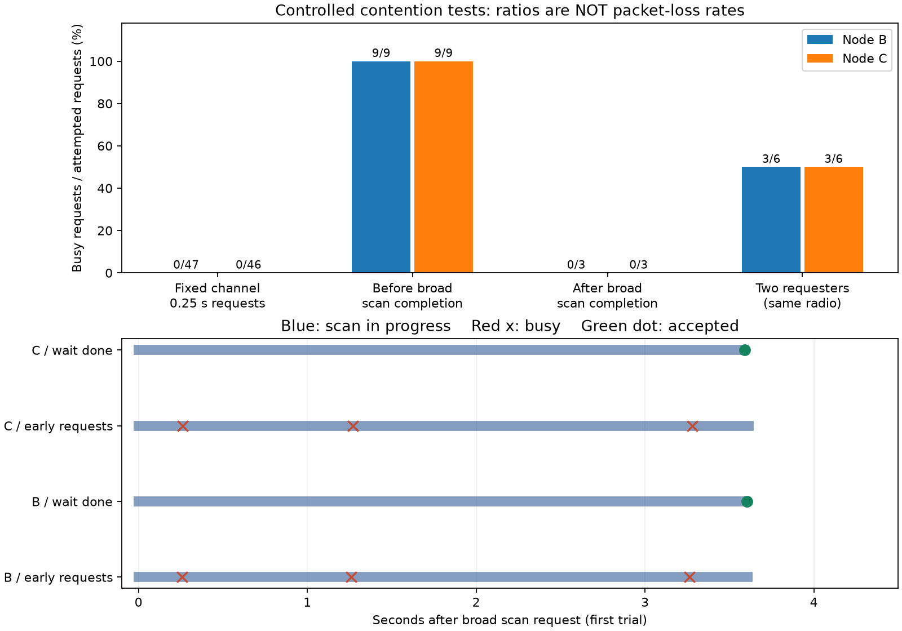

# Piスキャンbusy：原因切り分けと実機比較

## 結論

2026-11-13、B（Pi 4）とC（Pi 3B+）で制御した実機試験を実施した。**今回再現した主因は、全チャネル探索の受付を完了と解釈し、探索中に次の要求を発行すること。** `scan trigger`の終了0は非同期スキャンの受付であり完了ではない。

両台とも全チャネル探索に約3.6秒かかり、0.25秒後などの再要求は`Device or resource busy (-16)`となった。`iw event`のscan started〜scan finishedの間でbusyを観測した。完了イベントを待ってからの要求は両台とも3/3受付。権限不足の対照試験は`Operation not permitted (-1)`となり、別の原因として区別できた。



上段の縦軸は試験中の要求拒否割合、横軸は条件。数字はbusy回数/要求数。下段は各条件の最初の試行を、全チャネル要求時点からの相対秒で表示。青帯は探索中、赤×はbusy、緑点は受付。パケット損失率・受信率ではない。

## 想定した原因と実験

| 想定原因 | 比較方法 | 判断 |
|---|---|---|
| 権限不足 | 通常シェルとCAP_NET_ADMIN付き一時サービス | 通常シェルだけEPERM。権限あり試験にpermission拒否なし |
| 0.25秒要求が常に速すぎる | 確認済み2452MHzだけを約12秒連続要求 | B47/47、C46/46受付。今回の単一周波数条件ではbusyなし |
| 広域探索の未完了 | 全チャネル要求の約0.25/1.25/3.25秒後に単一周波数を要求、各3試行 | B/Cとも9/9がbusy、全件scan開始〜完了の間 |
| 完了を待てば改善する | 全チャネル完了イベント後に単一周波数を要求、各3試行 | B/Cとも3/3受付、busy 0 |
| 複数要求元の競合 | 同じ無線機へ2つのiw子プロセスから同時要求、各3組 | B/Cとも6要求中3受付・3busy。競合は別経路でも再現可能 |
| 自分以外の探索 | 通常受信を停止して6秒の無要求期間と全試験のイベントを監視 | 無要求期間のscan開始は両台0。全期間の開始数も自分の受付数と一致 |

最後の行はNetworkManagerやwpa_supplicantを原因と特定する証拠がなかったという意味。これらは停止していない。短時間の監視から、将来の自動探索・ローミングとの競合まで否定しない。`iw event`はインターフェース単位で、要求元PIDや今回の各要求を一意に結ぶIDを返さないため、完了イベントのプロセス帰属は直接証明していない。

## 実機結果

| 条件・分母 | B：busy/要求 | C：busy/要求 |
|---|---:|---:|
| 単一周波数、0.25秒要求 | 0/47 | 0/46 |
| 広域探索中の追加要求のみ | 9/9 | 9/9 |
| 広域探索完了後の追加要求のみ | 0/3 | 0/3 |
| 意図的な2要求元の競合 | 3/6 | 3/6 |

CSV/JSONでは広域開始の要求も含めるため、`broad_probe`は12要求中9busy（75%）、`broad_wait`は6要求中0busy。上表・グラフでは「途中／完了後に出した追加要求」だけを分母にしている。この区別を集計テストで確認した。

| 全チャネル探索の要求開始→完了イベント、各3回の中央値 | B | C |
|---|---:|---:|
| 途中に追加要求する試験 | 3.608秒 | 3.572秒 |
| 完了待ち試験 | 3.634秒 | 3.608秒 |

実機の試験本体はB約47.15秒、C約47.02秒。通常受信の停止待ちは別。Bのscan開始/完了は各59件、Cは各58件、scan abortedと完了待ちタイムアウトは両台0。これは短い機能切り分け試験であり、長期安定性・一般的な拒否率の推定ではない。

**以前の通常受信60秒での3.4%/4.9%と、今回の意図的な競合条件の100%を混同しない。** 通常受信のbusy6回ずつは開始時・約30秒時点の広域探索直後に集中していた。今回、その発生機構と完了待ちによる回避を別の制御実験で再現した。過去の要求すべてのカーネル内部経路をトレースしたわけではない。

## 実装と安全な実行

新規`diagnose_scan_busy.py`は既存受信サービスの停止を確認してから実行。接続・チャネル・ドライバ・省電力設定・NetworkManagerは変更しない。単一周波数は既に受信で確認した2452MHzを使用。Aの送信機・センサーサービスは変更していない。

- B：空きRAM約3.3GiB、C：約543MiBを開始前に確認。メモリガード192MiBを下回れば未実行として停止。
- 一時サービスはUser=pi、CAP_NET_ADMIN、NoNewPrivileges、MemoryMax96MiB要求、CPU50%、TasksMax16、RuntimeMax180秒。
- ExecStartPreで通常受信を停止、ExecStopPostで通常受信を再開。SSH切断時もPi側の時間上限と復帰処理が残る。通常受信のenabled設定やcurrent releaseは変更しない。
- 最初のB起動照会は既存収録の正常停止待ち中にローカルSSHの25秒待機上限に到達。サービス自体は稼働を継続したため重複起動せず状態照会・回収を行った。Cの起動はno-block方式に変更。両台とも完了を確認し、通常受信のactiveを確認した。
- イベント・stderr・iw原文はowner-only capturesに保存。生電波データ・ID・位置・個別時刻をGitへ追加しない。

実機のカーネルはB `6.18.50+rpt-rpi-v8` / iw6.9、C `6.6.51+rpt-rpi-v8` / iw5.19。Python標準ライブラリのみで計測できる。プロットだけmatplotlibが必要。

```sh
# Pi側：通常受信がactiveであることを確認してから、コードのあるディレクトリで実行
# unit名・出力先は毎回新規。2452は今回確認した周波数であり他の機体へ固定しない
sudo systemd-run --unit=zkp-scan-busy-new-test --uid=pi \
  --property=UMask=0077 --property=RuntimeMaxSec=180 \
  --property=TimeoutStartSec=120 --property=MemoryMax=96M \
  --property=CPUQuota=50% --property=TasksMax=16 \
  --property=NoNewPrivileges=yes \
  --property=AmbientCapabilities=CAP_NET_ADMIN \
  --property=CapabilityBoundingSet=CAP_NET_ADMIN \
  '--property=ExecStartPre=+/usr/bin/systemctl stop zkp-rid-observer.service' \
  '--property=ExecStopPost=+/usr/bin/systemctl start zkp-rid-observer.service' \
  /usr/bin/python3 "$PWD/experiments/week28-beacon-observers/diagnose_scan_busy.py" \
  --frequency 2452 --repeats 3 --output "$PWD/captures/new-busy-probe"

# 回収データのレイアウト：private-input/{b,c}/events.jsonl
python3 experiments/week28-beacon-observers/analyze_scan_busy.py \
  --input captures/pi-scan-busy-20261113 \
  --output week28/results/new-busy-analysis --plot
python3 -m unittest discover -s experiments/week28-beacon-observers -p 'test_*.py'
```

計測コードは一般ユーザーへの権限付与やサービス停止を自動実行しない。上の最初のコマンドを無権限シェルから実行しても有効な比較にはならない。導入時に使用した一時unit設定と復帰状態は非公開`captures/pi-scan-busy-20261113/`に保存。

[匿名JSON](results/pi-scan-busy-20261113/summary.json)／[条件別CSV](results/pi-scan-busy-20261113/scenarios.csv)／[SVG](results/pi-scan-busy-20261113/scan-busy-comparison.svg)／[単体テスト記録](results/pi-scan-busy-20261113/tests.log)。未完成実験を成功集計しない、他インターフェースを混ぜない、scan abortedを完了扱いしない、欠けた完了イベントを成功にしない、権限不足とbusyを分けるテストを追加。Pi関連48件、既存UAV88件、Go、contracts48件成功。

## 次の改善判断

改善対象はスキャン受付後の状態管理。広域探索後に完了イベントを待ち、その間はキャッシュ読取りを継続すれば、無駄な再要求と1/2/4秒のバックオフを避けられる可能性がある。今回その要求受付の改善を確認したが、**常駐受信側はまだ変更していない**。次の変更では、イベントの欠落・中断・外部要求との競合・待機上限を扱い、既存の資源・失敗時停止を維持する必要がある。

完了待ちは全チャネル探索そのものの約3.6秒を短縮しない。空中パケットの欠落・RSSI更新の空白がなくなることも保証しない。キャッシュ更新間隔を改善したという主張には別の受信比較が必要。Androidのスキャン制限とは別問題で、今回Androidは変更・実行していない。

## 根拠資料

- [Linux cfg80211 scanの契約](https://docs.kernel.org/6.12/driver-api/80211/cfg80211.html)：受付後、ドライバが完了を通知する非同期処理。
- [Linux v6.12 nl80211.c](https://github.com/torvalds/linux/blob/v6.12/net/wireless/nl80211.c)：既存scan_req等がある場合のEBUSY。
- [iw event実装](https://kernel.googlesource.com/pub/scm/linux/kernel/git/jberg/iw/+/2f31605db4ffe5d90f84f731fdfa91f209aa2d98/event.c)：scan started / finished / abortedの区別。

上記は機構を説明する参照ソースであり、各Piの実行バイナリの命令位置を特定したものではない。実機判断は保存した要求結果・イベント・条件変更による再現を根拠とする。研究用PoCであり、航空機認証・センサー正直性・位置の真正性を保証しない。
