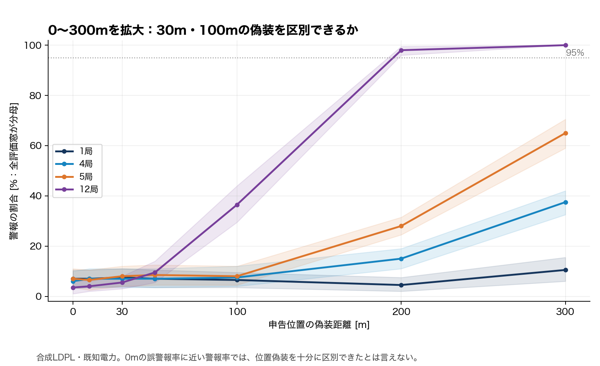

# Week28：観測条件と伝搬モデルへの依存性

- [PR6a：計画固定、配置・偽装方向のnative導入](00_PR6a_実験計画と局配置_偽装方向の導入.md)
- [GhostBusterの式に沿った再実装・既存INETログへの適用](02_GhostBuster方式の再実装と検出可能範囲.md)

最初に見る図：

0mは正常時の誤警報率。偽装時の警報率がそれと近ければ、十分に区別できていない。これは合成LDPL・既知電力・同一送信を複数局で受信する追加条件の結果で、任意電力・別パケットの元条件の解決ではない。

合成結果と既存INET再解析を分け、設定、集計CSV、ソルバ診断、再現コマンドを報告内に記載。実UAV・Remote ID実測は未実行。Issue77のPR6b/6cは、この追加実験で完了としない。
