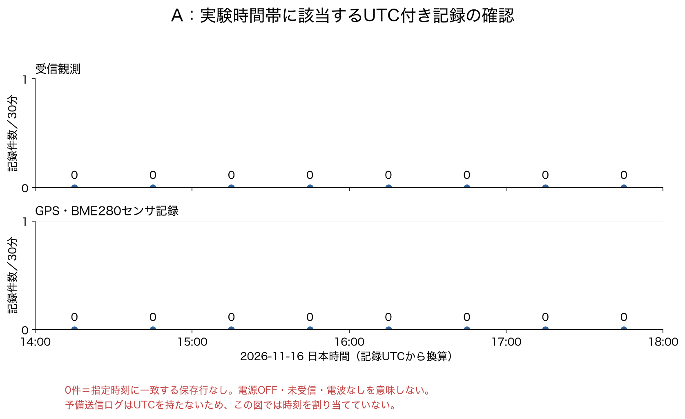
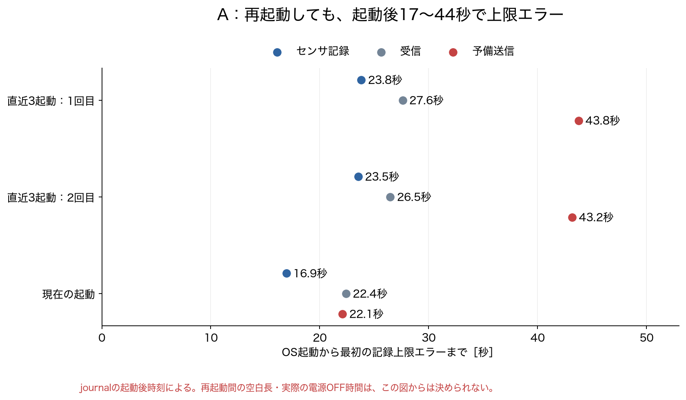
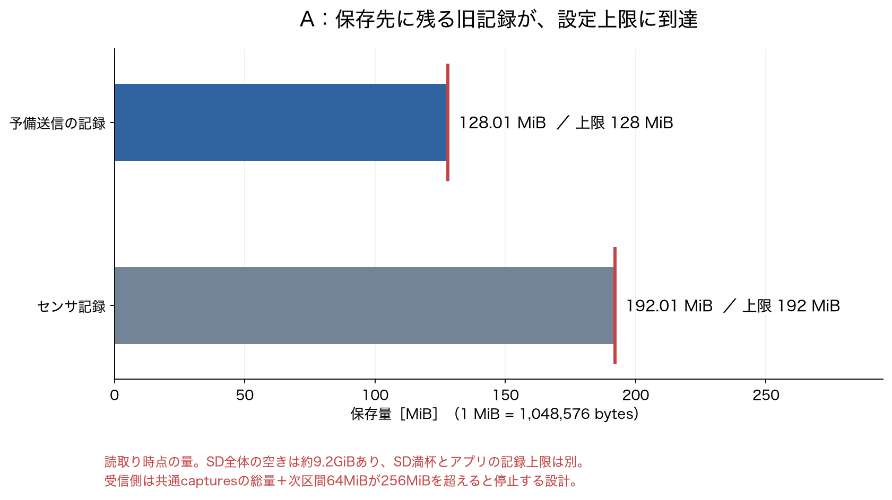

# Aノード：保存記録と停止原因の初期解析

追加解析：[実バイト数の累積と停止ログを照合した結果](02_Aノード停止原因の履歴検証と容量計算.md)。本ページは初期監査として残す。追加解析では低電圧警告も確認した。

## 対象と、最初に分かったこと

対象：2026年11月16日14〜18時ごろ、日本時間。途中に電源OFFがあったことをユーザーから確認した。OFF・ONの正確な時刻はまだ不明。

**確認したAの保存先には、対象時間帯のUTCに一致する受信・センサ記録が見つからなかった。一方、直近3回の起動すべてで記録上限エラーを確認した。**

これは「電波がなかった」「受信率0%」「4時間ずっと電源OFF」という結果ではない。ログの時刻が実験時刻を正しく表しているかも独立検証していないため、まず保存範囲と停止原因の監査結果として扱う。

## 保全と確認範囲

- SSH先のホスト名が`observer-a`であることを確認した。
- Aの`zkp-beacon-observer/releases`配下のcaptureファイル7,181件、839,175,724 bytesをコピーした。圧縮後は約67.25 MiB。
- コピー元ファイル一覧と、展開した7,181件のサイズはすべて一致。各ファイルのSHA-256をローカル保全用manifestへ保存した。ただし、全ファイルのリモート側SHA-256との照合までは行っていない。
- 現行releaseと旧releaseを分けて、JSONLを逐次走査した。内容が完全一致するファイルは同一区分内で重複集計しない。空ファイルの重複も含む。
- 回収した直近4起動のサービスjournal、現在のサービス状態、NTP状態、SD空き容量を確認した。
- サービス再開、時計変更、ログ削除、容量制限解除、設定変更はしていない。

保全データは`captures/week29-a-20261117/`に保存。ディレクトリ0700、ファイル0600。生JSONLや座標をこのMD・公開CSVへ転載していない。

## 図1：実験時間帯に該当する記録



横軸は11月16日14〜18時の日本時間、縦軸は現行releaseの保存行数／30分。センサは`host_utc`、受信は`received_at_utc`を優先して照合した。

全8区間で0件。ただし、これは**その時刻に一致する保存行がなかった**という意味であり、受信可能な稼働時間を分母にした受信率ではない。

予備Beaconの送信JSONLには`host_monotonic_s`はあるが、行自体にUTCはない。このグラフへ時刻を推測して配置していない。送信ログのセンサsession/sequenceを使った追加照合は未実施。

## 図2：再起動後の記録上限エラー



横軸はjournalの**OS起動後の秒数**。NTP補正で壁時計が動く可能性があるため、起動ごとの経過時刻を使った。

| 直近の起動区間 | センサ記録 | 受信 | 予備送信 |
|---|---:|---:|---:|
| 1回目（journal boot -2） | 23.8秒 | 27.6秒 | 43.8秒 |
| 2回目（boot -1） | 23.5秒 | 26.5秒 | 43.2秒 |
| 現在（boot 0） | 16.9秒 | 22.4秒 | 22.1秒 |

数値は、その起動で最初に確認した記録上限エラーの時刻。無線受信がその秒数まで正常だった、という意味ではない。

センサには`RuntimeError: sensor capture budget/headroom reached`、予備送信には`RuntimeError: TX capture budget/headroom reached`、受信には`CAPTURE_BUDGET_REACHED`を確認した。受信の現在のstatusは同理由・完了区間0で停止している。

電源を切ると収録も止まるが、**電源を入れ直しても保存先の旧記録は残るため、容量上限は解消しない**。直近3起動では、これを裏付ける停止ログがある。

## 図3：SDの空きと、プログラム側の上限は別



| 保存対象 | 読取り時点の量 | 設定上限 |
|---|---:|---:|
| 現行releaseの予備送信記録 | 128.01 MiB | 128 MiB |
| 現行releaseのセンサ記録 | 192.01 MiB | 192 MiB |

読取り時点でSD全体には約9.2GiBの空きがあった。SD全体が満杯になった事象とは区別する。

受信プログラムは、共通`captures`配下の使用量に次区間用64MiBを加え、256MiBを超えると停止する設計。この構成ではセンサ・送信の記録も同じ親ディレクトリに蓄積するため、受信側の予算にも影響する。上限があること自体は資源保護だが、現地実験前に新セッションと容量を確認する運用が必要だった。

## 残っていた記録と今回の区別

現行releaseで重複ファイルを除いた集計：

| 種類 | JSONL行数 | 記録上の時刻範囲（日本時間） | 今回4時間のUTCに一致 |
|---|---:|---|---:|
| 受信観測 | 91 | 11月14日17:46:29〜17:47:07 | 0 |
| GPS・BME280記録 | 178,282 | 11月14日17:43:18〜11月15日03:37:34 | 0 |
| 予備送信の記録 | 238,641 | 行単体のUTCなし | 判定保留 |

旧release側のUTC付き記録にも対象時間帯の一致行はなかった。JSONL走査で不正JSONは0行だった。ただし、journalやstatusなどの補助ファイルは別形式であり、JSONL行数には含めていない。

GPS有効・BME280有効の過去記録は残っているが、この表の過去記録を11月16日の飛行データとして流用しない。

## 電源OFF時間について分かること・分からないこと

- ユーザー申告：途中に電源OFFあり。
- journal：起動区間と、起動後のサービスエラーを確認できる。
- 未確定：実験4時間のうち何分電源OFFだったか、各飛行とどの起動が対応するか。
- 現在のNTP同期はyesだったが、実験中ずっと同期していたことの証明にはならない。過去の起動ログには壁時計の飛び・不自然な開始時刻があるため、起動後時刻と分けて扱う。

したがって、電源OFF区間の色分けや稼働時間ベースの受信率はまだ作らない。通電・飛行のメモ、写真・動画の時刻、他ノードのA送信受信記録などと照合し、対応が確認できた区間だけを確定する。Aの送信IDを他ノードが受信していれば、送信していた区間の追加証拠になるが、A自身のドローン受信成功の証明ではない。

## 次の解析

1. 他ノード・スマホの今回データを保全し、搭載Aの予備送信を観測した時刻があるか確認する。
2. Aの予備送信ログとセンサsession/sequenceの対応を検査し、UTCを安全に付けられる範囲だけを追加評価する。
3. 電源・飛行時刻と起動区間を照合する。時計を推測で書き換えない。
4. 復旧は保全完了後の別作業。旧記録を保持した新セッションを用意し、容量・起動後の新規行増加を確認する。保護上限を外すだけの修正はしない。

## 再現

Git対象外の保全先を使い、リポジトリルートから実行する。

```sh
python3 week29/scripts/analyze_a_snapshot.py \
  --input captures/week29-a-20261117 \
  --output captures/week29-a-20261117/analysis

# matplotlibが利用できるPython環境で実行
python3 week29/scripts/plot_a_audit.py \
  --analysis captures/week29-a-20261117/analysis \
  --inventory captures/week29-a-20261117/inventory-private.json \
  --output week29/figures/a-initial-audit

python3 -m unittest discover -s week29/tests -v
```

公開する集計は[results/a-initial-audit](results/a-initial-audit/)。再生成用にJSONとCSV、図はPNGとSVGを残した。元データは同梱しない。解析スクリプトは今回のAのrelease・対象日時を明示した専用初期監査であり、任意ノード向けの自動飛行判定器ではない。

日時のUTC/JST変換、タイムゾーン欠落、不正JSON、重複ファイル、対象終了時刻の除外、UTCなし送信の保留を2件の合成テストで確認した。元の受信・センサ・送信プログラムは変更していない。
