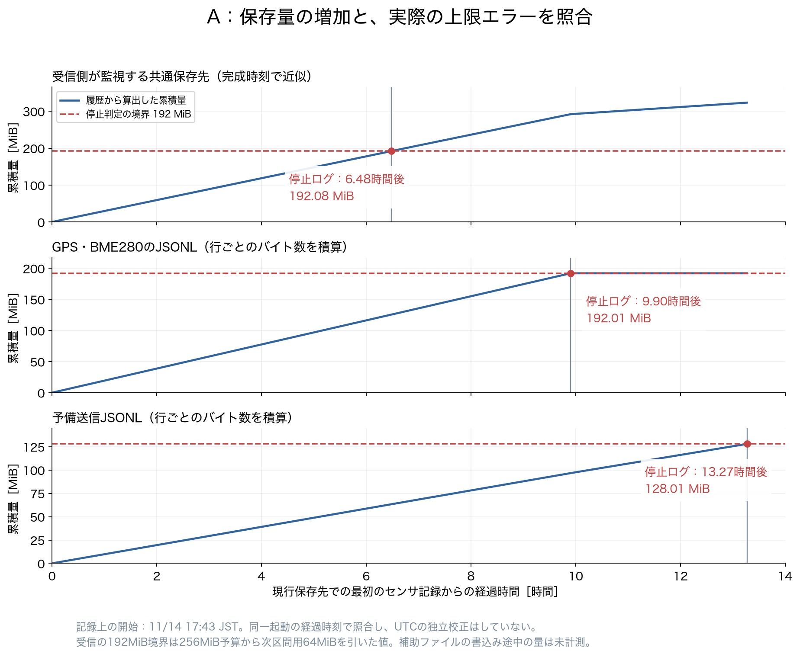
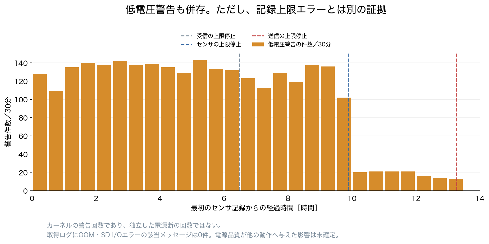
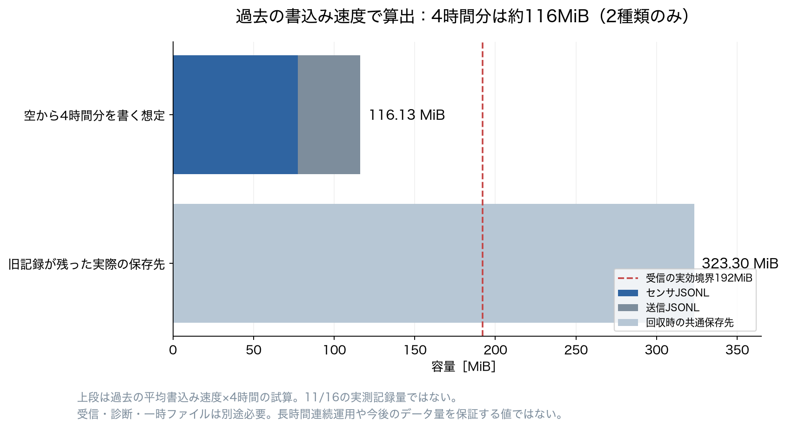

# Aノード：停止原因を保存履歴から検証

## 結論

**記録上限が直接の停止原因だったことを、A上の実コード・保存量の履歴・実際の停止ログの一致で確認した。**

現在の保存量が大きいという理由だけで判断したものではない。現行保存先のセンサ178,282行、送信238,641行について、各行の実バイト数を起動後時刻で積算した。結果、センサJSONLが192MiBを超過した約1.65秒後、送信JSONLが128MiBを超過した約5.01秒後に、それぞれ明示的な上限エラーが出ていた。

ただし、**低電圧警告も併存**していた。上限停止の説明と、電源品質による別の影響の可能性を分ける。実験中の電源OFF時間や、すべての未受信・欠測の原因を、この結果だけで確定したわけではない。

## 1. 上限到達と停止ログの照合



横軸は、現行保存先の最初のセンサ記録からの経過時間。縦軸は累積保存量。青線は実際の保存履歴から計算し、赤い破線はAに導入されているコードの停止判定境界、赤い点は実際のエラーログを示す。

| 対象 | エラー時の計算量 | 境界 | 最初の記録からエラーまで | 記録上の日本時間 |
|---|---:|---:|---:|---|
| 受信 | 共通保存先 約192.08MiB※ | 実効192MiB | 6.48時間 | 11月15日00:11:56 |
| センサ | JSONL 192.008MiB | 192MiB | 9.90時間 | 11月15日03:37:34 |
| 予備送信 | JSONL 128.010MiB | 128MiB | 13.27時間 | 11月15日06:59:36 |

※受信の共通保存先は補助ファイルの完成時刻で加算した近似。センサ・送信のJSONLは行単位で積算した値。補助ファイルを含むディレクトリ使用量を、過去の各瞬間にOSで直接計測したデータではない。

### なぜ受信は192MiBなのか

A上の`boot_observer.py`は次区間の余裕64MiBを予約する。

```text
共通capturesの使用量 + 64MiB > 256MiB なら停止
```

したがって、実効境界は192MiB。受信時の保存先は、センサ・送信ログも入る共通の`captures`である。自分自身の受信ログが少なくても、他の記録が増えると停止する。

受信エラーの時点では、センサ・送信JSONLだけで188.79MiB。受信・診断などの補助ファイルを加算すると約192.08MiBになり、境界と整合する。受信ログには`CAPTURE_BUDGET_REACHED`と完了区間374の記録がある。

### センサ・送信の停止までの差

| 対象 | JSONL単体が境界を超えた後、エラーログが出るまで |
|---|---:|
| センサ | 約1.65秒 |
| 予備送信 | 約5.01秒 |

両プログラムは約10秒ごとに容量を確認する。バイト数の超過とエラーの差は、この確認周期と矛盾しない。センサの`latest.json`等も判定に含まれるため、JSONL単体の超過時刻がディレクトリ全体の正確な超過時刻とは限らない。

## 2. 実コードの停止条件をオフラインで再評価

A上の現行releaseから、導入済みのソース・systemd定義を読み取り専用で回収した。ローカルリポジトリのコードだけを根拠にしていない。

センサ・送信では、導入済みコードの該当`if`条件をASTから取り出し、ファイルサイズ・件数・空き容量を与えてオフライン評価した。受信では、導入済みコードの副作用のない`capacity`関数だけを取り出して評価した。無線送信やPi上のサービス起動はしていない。

| 判定対象 | 回収時点の量を与えた結果 | 保存先を空と仮定した結果 |
|---|---|---|
| センサの上限条件 | true（停止） | false |
| 送信の上限条件 | true（停止） | false |
| 受信のcapacity関数 | `CAPTURE_BUDGET_REACHED` | 停止理由なし |

空の保存先の評価は、現在確認したメモリ・SD空きの下での仮定計算。実際にログを消したり、新保存先へ切り替えたりしてはいない。これだけで今後の連続収録成功を保証するものでもない。

回収時点のファイル数はセンサ595、送信797で、各上限10,000未満。SD空きは9,823,948,800 bytes（約9.15GiB、約9.82GB）。センサ・送信のバイト数超過だけで停止条件が成立する。

受信の関数はメモリ不足・SD空き不足を先に判定するため、実際に`CAPTURE_BUDGET_REACHED`を返した記録は、その判定時点で先行する2つのチェックを通過していたことも示す。ただし、他の時点におけるハードウェア障害を否定する証拠ではない。

## 3. 別の原因：低電圧も見つかった



現行保存先での収録開始から送信の初回上限エラーまでの同一起動区間に、カーネルの低電圧検出メッセージが2,726件あった。正常化メッセージは2,727件。警告が繰り返された回数であり、独立した電源断2,726回という意味ではない。

| 原因候補 | 今回確認した証拠 | 判断 |
|---|---|---|
| 固定の記録容量上限 | 境界超過・導入コードの条件・明示的エラー・終了状態が一致 | 今回照合した停止の直接原因と判断できる |
| RAM不足によるOOM kill | 回収した直近4起動のカーネルログで、検索したOOMメッセージは0件 | 裏付けなし。全障害の完全否定ではない |
| SD全体の空き不足 | 回収時点で約9.15GiB空き。受信エラーも空き不足の理由ではない | 固定予算との違いを確認。過去の全空き容量履歴は未取得 |
| SDのI/O異常 | 同ログで検索したI/O・EXT4エラー等は0件 | 裏付けなし。媒体の健全性保証ではない |
| 低電圧 | 上記警告あり | 併存する問題。処理速度・無線・USB/GPS等への影響量は未確定 |
| 手動の電源OFF | ユーザーから途中OFFありと確認 | 正確な区間は未確定。受信失敗として集計しない |

センサ・送信は例外による終了、受信はコード78で終了した記録があり、この停止を単に「電源が落ちた」と説明するのは不正確。低電圧警告から実際の電圧値や、そのまま欠測の因果関係までは算出できない。

## 4. 過去の履歴から必要容量を算出



各種JSONLの実バイト数を、それぞれの最初と最後の起動後時刻の差で割った。

| データ | 履歴上の頻度 | 平均1行サイズ | 1時間の書込み量 | 同じペースで4時間分 |
|---|---:|---:|---:|---:|
| GPS・BME280 JSONL | 約5.00行/秒 | 約1,129 bytes | 約19.39MiB | 約77.54MiB |
| 予備送信JSONL | 約5.00行/秒 | 約562 bytes | 約9.65MiB | 約38.58MiB |
| 上記2種類の合計 | — | — | 約29.03MiB | **約116.13MiB** |

式は`JSONL総バイト数 ÷ 記録時間 × 4時間`。受信・診断・一時ファイルは別途必要。これは**過去の平均書込み速度からの試算**であり、11月16日の実測保存量でも、新構成の容量保証でもない。

今回の問題は「4時間分だけで必ず上限を超える」ことではない。**準備中から同じ保存先に記録が蓄積し、実験前の記録上の時刻ですでに上限へ達していた**ことと、再起動しても同じ旧記録を容量判定したことが重要である。

## 5. 時刻の根拠と限界

- センサの`host_utc − host_monotonic_s`を全178,282行で比較した。対応する時計原点の最大差は約0.0041秒。
- その中央値を基準に、同じ長時間起動の送信経過時刻をUTCへ換算した。送信エラーログとの対応も内部的に整合する。
- これは同じOS時計どうしの整合確認であり、真のUTCへの4.1ms精度の証明ではない。独立した外部時計との校正はしていない。
- 初期監査の「送信行自体にUTCなし」という事実は変わらない。本解析では同一起動の経過時刻を用いた履歴再構成まで進めた。GPS時刻や他ノードによる独立照合は別作業。
- 11月16日の電源OFF/ONの正確な時刻や飛行区間は未確定。他ノード・スマホの今回データはまだ解析していない。

## 6. 再現と成果物

```sh
python3 week29/scripts/analyze_a_stop_cause.py \
  --input captures/week29-a-20261117 \
  --private-output captures/week29-a-20261117/cause-analysis \
  --output week29/results/a-stop-cause

# matplotlibが利用できるPython環境で実行
python3 week29/scripts/plot_a_stop_cause.py \
  --input week29/results/a-stop-cause \
  --output week29/figures/a-stop-cause

python3 -m unittest discover -s week29/tests -v
```

- [集計JSON](results/a-stop-cause/summary.json)：停止時の計算量、超過からの時間差、導入コードのSHA-256、条件評価結果、書込み速度、代替原因の確認結果。
- [容量履歴CSV](results/a-stop-cause/byte_history.csv)：約1分間隔の再構成値。停止時の値はJSONに別保存。
- [低電圧警告CSV](results/a-stop-cause/voltage_history.csv)：30分ごとの警告件数。
- [グラフPNG/SVG](figures/a-stop-cause/)：3種類。

元JSONL・実座標・ID・BSSID・カーネルログ全文・導入ソースとサービス定義の保全コピーは、owner-onlyの`captures/`に保持する。公開集計へ生の位置・IDを含めない。

テスト5件成功。時刻区間・重複・不正JSONに加え、境界ちょうど／1byte超過、入れ子の条件抽出、ファイル数・SD空き・メモリ判定の維持を確認した。初回の条件抽出で外側の判定を誤って選び解析が失敗したため、対象の例外を直接出す内側の条件を選ぶよう修正し、回帰テストを追加した。この失敗を観測結果としては集計していない。

Pi上の受信・センサ・送信プログラム、予算、サービス状態は変更していない。
