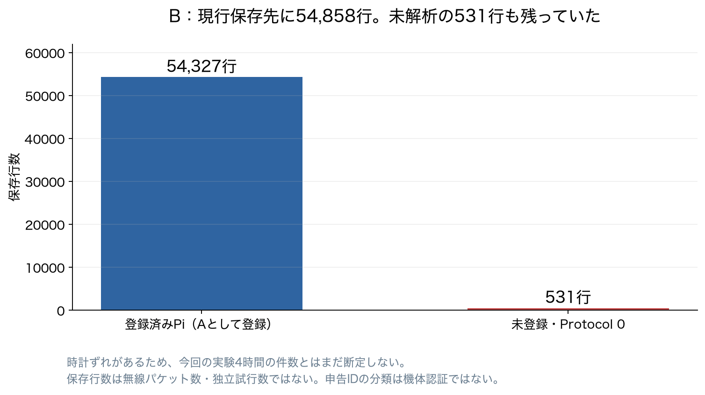
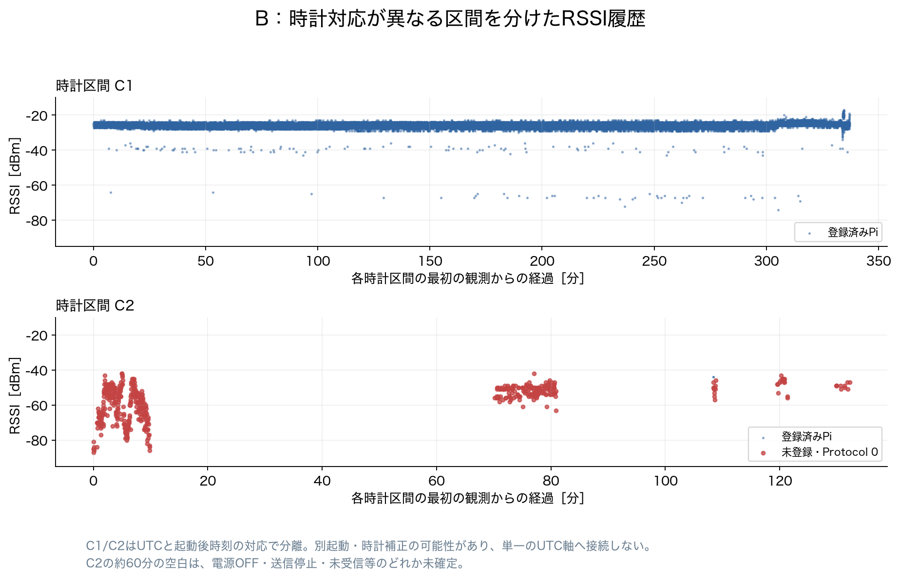
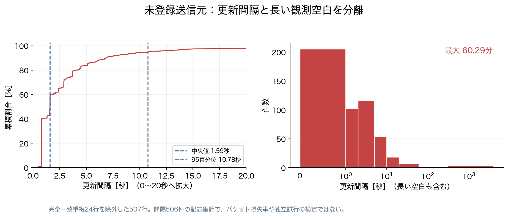

# Bノード：受信データとProtocol 0の再解析

## 結論

**Bには受信データが残っていた。現行保存先の有効なJSON行は54,858行。そのうち531行は既存パーサの対応版の違いで未解析になっていたが、生データから位置・高度を含むRemote IDメッセージとして再解釈できた。**

ただし、Bの過去時計にずれがあり、これをすべて11月16日14〜18時の記録とは断定していない。未登録送信元の機体型式も未確定で、Matrice 350の受信成功という結論にはまだしない。

## 1. 保全と現在の状態

- SSH先のホスト名`observer-b`を確認。
- 全releaseのcaptureファイル5,563件、407,925,237 bytes（約389.03MiB）をowner-privateの`captures/week29-b-20261117/`へ保全。
- 受信を止めず、一覧取得時のファイル長までをコピーした。増え続けるファイルを無制限に読み続けず、後から増えた部分はB上に残る。
- 展開ファイルは一覧取得時のサイズと一致。ローカルのSHA-256 manifestをprivate領域に保存した。全リモートファイルのSHA-256との照合までは実施していない。
- Bの受信サービスは確認時にactive。プログラム更新・再起動・手動の時計変更・設定変更はしていない。
- 調査開始時はNTP未同期で11月14日を表示。ネットワーク接続後、OSによる自動NTP同期をjournalと再確認で観測し、現在は同期yes。過去ログは変更していない。

主集計は現行releaseの`observations.jsonl` 517ファイル。旧releaseのデータは保全したが、下記の主集計へ混ぜていない。

## 2. 残っていたデータ



| 区分 | 保存行数 | 既存パーサ | オフライン再解析 |
|---|---:|---|---|
| Aとして登録されたPiのID・BSSID | 54,327 | Protocol 2、解析済み | 今回の主な再解析対象外 |
| 未登録の別送信元 | 531 | Protocol 0を非対応として保留 | 531行とも参照実装で解釈可能 |

登録済みPiは1組の申告ID・BSSID、未登録送信元も1つのBSSIDからの記録。登録分類は運用上の注釈であり、観測ハードや機体の認証ではない。

別途、不完全なJSONが1行あった。ファイル末尾に改行なしで残っており、再取得したB上のファイル全体のSHA-256とも一致した。今回のコピーによって切れた末尾ではないことを確認した。電源断等で書込みが中断された可能性はあるが、原因は未確定。元ファイルを修復・削除せず、その1行を件数・解析から除外して記録している。

## 3. 未解析だった531行は何だったか

生のMessage Packは、Protocol 0、1メッセージ25bytes、4メッセージ、計103bytesだった。

既存の`uav/observer_capture.py`はProtocol 2に限定して検査しており、0は`unsupported message pack protocol version`となる。したがって、この531件を「電波が取得できなかった」「必ず破損したデータ」と扱うのは適切でない。

OpenDroneIDの[参照ヘッダ](https://github.com/opendroneid/opendroneid-core-c/blob/849c03adbe0cdd68997a462fafab397edcfe53f3/libopendroneid/opendroneid.h)にはProtocol 0がASTM F3411-19の版として記載され、後方互換のためのデコード方針が説明されている。その[参照C実装](https://github.com/opendroneid/opendroneid-core-c/blob/849c03adbe0cdd68997a462fafab397edcfe53f3/libopendroneid/opendroneid.c)を固定commitで取得し、Mac上だけで再解析した。

| 参照実装で確認した項目 | 行数等 |
|---|---:|
| Packの解釈成功 | 531 / 531 |
| Basic IDの申告ID | 1種類、シリアル番号型 |
| Locationメッセージ | 531 |
| 非ゼロの緯度・経度の申告 | 531 |
| Height・Geo高度の申告 | 各531 |
| 時間内秒の申告 | 531 |

**これは送信者の申告値を読めたという結果。真位置・真高度・機体認証を証明した結果ではない。** B上の本番パーサやZKPの入力許可条件は変更していない。参照ラッパーもPack長・個数・既知の版を検査し、切れたPackや不正個数を拒否する。

実際のID・BSSID・位置・高度の行単位データはprivate領域だけに保存した。機体や操縦アプリのRemote ID表示と手元で照合するための`analysis/identity-candidates-private.json`も同領域に置いた。IDを公開資料へ転載しない。

## 4. 時計の異なる記録を分けたRSSI推移



受信UTCとカーネルの起動後観測時刻の対応が2通りあるため、C1/C2に分けた。別起動や時計補正の可能性があり、過去boot IDとの対応を確定した区分ではない。

| 時計区間 | 登録済みPi | 未登録Protocol 0 | 記録の特徴 |
|---|---:|---:|---|
| C1 | 54,325行 | 0行 | 主にPiの記録。経過約337分 |
| C2 | 2行 | 531行 | 別送信元を含む。経過約132分 |

横軸は各時計区間の最初の観測からの経過時間、縦軸は実測RSSI。C1とC2の開始を同じ実時間と解釈しない。距離・位置・送信電力の正解がないため、このRSSI変化だけから移動距離や位置偽装を判定しない。

### C2に残るPiの2行

どちらもIDのみのPack、counter 0。Aとして登録されたIDを使ってローカルの`build_ie`で生成した起動時ID-only payloadと、Vendor IEが一致した。

修正前のA送信コードはAPと初期Beaconを用意した後に記録予算を検査していたため、**送信ログを書けずに停止しても、ごく短い初期配信が出る可能性がある**。この2行はその動作と整合するが、その時の起動だったと断定はできない。ID・BSSIDは偽装可能で、Aの連続送信の証明にもならない。

## 5. 更新間隔と長い空白



未登録送信元531行から完全一致の重複24行を除き、507行を記述集計した。既知Piの重複40行も別に除外し、全体では64行の完全一致重複を検出した。

| 項目 | 結果 |
|---|---:|
| 集計した候補行 | 507 |
| 正の更新間隔 | 506 |
| 更新間隔中央値 | 約1.59秒 |
| 95百分位 | 約10.78秒 |
| 最大の記録上の更新間隔 | 約3,617.62秒（60分18秒） |
| RSSIの中央値 | −55dBm |
| RSSI範囲 | −87〜−42dBm |

重複キーは時計区間・BSSID・周波数・カーネル観測時刻・Vendor内容digestの一致。近い時刻を推測で同一パケットにまとめてはいない。同一時計区間・同一BSSIDの正の間隔だけを集計する。

507行が独立試行という意味ではない。最大の空白も電源OFF・送信停止・未受信のどれか未確定であり、送信総数がないためパケット損失率は算出しない。

## 6. 11月16日14〜18時との対応

現行保存先の受信UTCは11月14日になっているが、実際にBは今回接続時にも日付が古かった。**日時だけで「今回のデータなし」と判定しない。**

過去起動のjournalは今回取得できず、`journalctl --list-boots`は現在起動だけだった。RIDの時間内秒は取得できるが、日付と時を一意に復元できる情報ではなく、送信者の申告でもある。

飛行・通電の時刻、機体のRemote ID表示、他ノード・スマホの記録と照合して初めて、今回の実験区間を絞る。約60分の空白について、ドローンまたはBの電源を切った時間帯を追加確認中。

## 7. 成果物・再現

- [集計JSON](results/b-initial-audit/summary.json)
- 行単位RSSI時系列CSV：ローカル非公開。公開版には含めず、匿名図と集計を参照。
- 個別更新間隔CSV：ローカル非公開。公開版には集計・図のみを掲載。
- [参照実装の固定commit・SHA-256](results/b-initial-audit/reference-source.json)
- [テスト・検証記録](results/b-initial-audit/validation.json)

参照コードはGitへ同梱せず、指定commitを取得してビルドする。

```sh
mkdir -p .cache/week29-odid-reference
curl -fsSL https://raw.githubusercontent.com/opendroneid/opendroneid-core-c/849c03adbe0cdd68997a462fafab397edcfe53f3/libopendroneid/opendroneid.h \
  -o .cache/week29-odid-reference/opendroneid.h
curl -fsSL https://raw.githubusercontent.com/opendroneid/opendroneid-core-c/849c03adbe0cdd68997a462fafab397edcfe53f3/libopendroneid/opendroneid.c \
  -o .cache/week29-odid-reference/opendroneid.c
curl -fsSL https://api.github.com/repos/opendroneid/opendroneid-core-c/commits/849c03adbe0cdd68997a462fafab397edcfe53f3 \
  -o .cache/week29-odid-reference/commit.json

clang -O1 -Wall -Wextra -DODID_DISABLE_PRINTF \
  -I .cache/week29-odid-reference week29/scripts/odid_reference_decode.c \
  .cache/week29-odid-reference/opendroneid.c -lm \
  -o .cache/week29-odid-reference/decode

python3 week29/scripts/analyze_b_snapshot.py \
  --input captures/week29-b-20261117 \
  --reference-binary .cache/week29-odid-reference/decode \
  --reference-metadata .cache/week29-odid-reference/commit.json \
  --private-output captures/week29-b-20261117/analysis \
  --output week29/results/b-initial-audit

# matplotlibのあるPython環境で実行
python3 week29/scripts/plot_b_snapshot.py \
  --private-input captures/week29/B-reference-private \
  --input week29/results/b-initial-audit --output week29/figures/b-initial-audit
python3 -m unittest discover -s week29/tests -v
```

今回のローカル実行は9件成功、skip 0件。既存パーサがProtocol 0を拒否したままであること、参照実装で合成Protocol 0を解釈できること、不正長・不正個数・未対応版の拒否、Protocol 2の既存経路も確認した。参照バイナリ未ビルドの環境では対応する3件は明示的skipになるため、9件実行済みとは報告しない。

## 次に確認すること

1. privateに保存した候補IDを機体・操縦アプリの表示と照合する。
2. 時刻ずれ・電源OFF区間を他ノードやスマホと照合し、今回の区間を確定する。
3. Protocol 0の本番対応は独立した互換性修正として設計・テストする。今回の解析で検査を緩めて自動承認してはいない。
4. Bの保存制御は旧版のまま。Aで実施したWeek29のセッション分離はBにまだ導入していない。

Aの6時間監視も並行して接続確認したが、今回はAへ接続できず、完走は未確認。これだけでAの電源OFFや故障とは断定しない。
