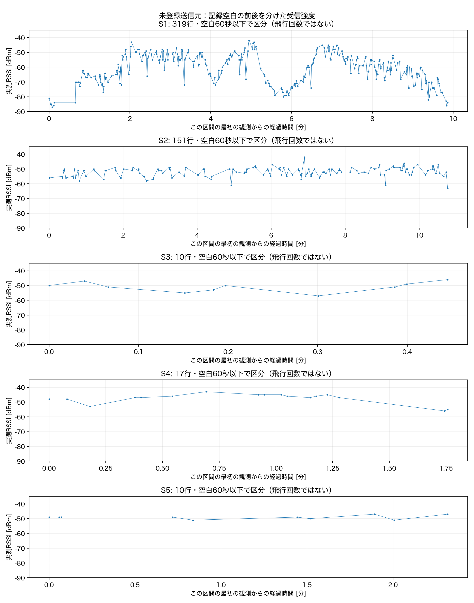

# Bの未登録送信元531行：詳細解析

531行すべてを固定版OpenDroneID参照実装で読み出せた。1種類の申告ID・1つのBSSIDによるProtocol 0の記録で、登録済みPiのProtocol 2とは区別できる。ただし、Matrice 300/350のどちらか、あるいは別の送信機かは、機体・操縦端末のIDと未照合。

参照実装・元ログ保全・既存パーサがProtocol 0を拒否する理由は[前報](04_Bノードの受信データとProtocol0の再解析.md)を参照。今回もBの設定や本番パーサは変更せず、保全済みコピーだけを解析した。

## 何が残っていたか

| 項目 | 結果 |
|---|---:|
| 生ログの行数 | 531 |
| 完全一致の重複 | 24 |
| 重複を除いた行数 | 507 |
| 異なるMessage Pack内容 | 503 |
| 異なる申告座標の組 | 493 |
| 受信機B自身の位置が記録された行 | 0 |
| RSSI中央値／範囲 | −55dBm／−87〜−42dBm |

重複キーは時計区分・BSSID・周波数・観測monotonic時刻・Vendor内容digest。503種類の内容や493座標は、独立パケット数・GPS測位回数を表さない。生の531行はそのまま保存し、重複を削除していない。

すべてにLocation・Height・Geo高度の申告がある。Heightの基準種別は0（参照実装で`OVER_TAKEOFF`）。離陸点基準の申告値であり、地面からの高さを独立計測した値ではない。Geo高度とも区別する。

## 記録空白を分けた結果

同じ時計対応内で前の記録から60秒を超える空白があれば別区間とした。60秒は表示・記述のための区切りであり、飛行開始・着陸・電源断の検出閾値ではない。

| 区間 | 行数 | 最初〜最後の観測 | RSSI中央値 | RSSI範囲 | 正の更新間隔中央値 |
|---|---:|---:|---:|---:|---:|
| S1 | 319 | 9分52秒 | −60dBm | −87〜−42 | 0.80秒 |
| S2 | 151 | 10分46秒 | −51dBm | −63〜−42 | 2.41秒 |
| S3 | 10 | 27秒 | −50.5dBm | −57〜−46 | 2.37秒 |
| S4 | 17 | 1分45秒 | −47dBm | −56〜−43 | 4.61秒 |
| S5 | 10 | 2分19秒 | −49dBm | −51〜−47 | 7.05秒 |



横軸は各区間内の経過時間。全区間で縦軸の範囲を揃えた。線は観測点を結んだもので、点間を連続受信できた証拠ではない。区間間の空白は順に約60分18秒、27分28秒、10分45秒、8分34秒。5区間の各先頭〜末尾の長さを足すと約25分9秒だが、これも通電時間・送信時間・連続受信時間ではない。

S1では申告軌跡とHeightが変化し、RSSIにも大きな変動があった。後続区間では申告位置の変化が比較的小さい部分や、Heightが離陸点基準付近となる部分が見られる。送信側の移動・着陸等と整合し得るが、実飛行の確認には別の記録が必要。

## 今回言えること・まだ言えないこと

- **言えること**：未登録送信元のRemote ID形式の生データをBが保存しており、後から申告ID・位置・高度を復元できる。単なる未知の文字列だけではなかった。
- **未確定**：申告IDが実験機体と一致するか、過去の時計ずれを補正したとき11月16日14〜18時に対応するか。
- **算出できない**：Bから機体までの実距離、距離誤差、位置偽装の検出率、送信総数に対するパケット損失率。Bの位置や独立した真位置、送信総数がない。
- **断定できない**：長い空白が電源OFF・送信停止・受信不能・記録中断のどれによるか。5区間を5飛行とも扱わない。

単一局のRSSI変化だけで送信電力・距離・遮蔽・姿勢の影響を分離できない。この解析は研究PoCの観測ログ確認であり、機体認証・センサの正直性・位置の正当性の証明ではない。

## 非公開の詳細図・再現

実際の申告ID・座標を含む元データは`captures/week29-b-20261117/analysis/`のみ。追加生成した以下のファイルもGit対象外・所有者専用権限で保存した。

- `captures/week29-b-20261117/candidate-detail/claimed_track.csv`：座標・高度・区間内経過時間・RSSI。
- `captures/week29-b-20261117/candidate-detail/claimed_track_and_height.png`：最初の申告点を基準にした軌跡、Height、Geo高度。相対座標の図も実測由来なので非公開のまま扱う。

公開用の[集計JSON](results/b-candidate-detail/summary.json)、[区間CSV](results/b-candidate-detail/segments.csv)にはID・座標・行単位の高度を入れていない。

```sh
# 前報の参照デコード出力とmatplotlibが必要
.cache/week26-mac-venv/bin/python week29/scripts/analyze_b_candidate.py \
  --input captures/week29-b-20261117/analysis/reference-decoded.jsonl \
  --private-output captures/week29-b-20261117/candidate-detail \
  --output week29/results/b-candidate-detail \
  --figures week29/figures/b-candidate-detail
python3 -m unittest discover -s week29/tests -v
```

実行済み：Week29テスト11件成功・skipなし。集計件数の一致、private生成物の所有者専用権限、両グラフの表示を確認。[検証記録](results/b-candidate-detail/validation.json)。未実行：機体IDとの照合・他ノードとの同一送信対応・独立真位置による検証。
