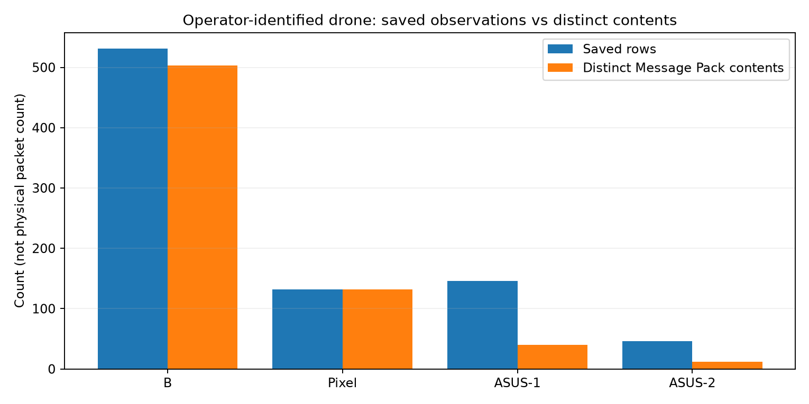

# 実機ID確認後のB・Android横断解析

ユーザーから、これまで未登録候補として解析した申告IDが今回の実機ドローンのものだと確認された。以降、この対象を「ユーザー照合済みの実機ID」として整理する。実際のIDは非公開の`captures/week29/confirmed-drone/operator-identification-private.json`に保持し、公開用集計には含めない。

この確認は運用者による機体IDの照合であり、DRIP・署名・ハードウェア認証の成立を意味しない。また、機体から受け取った座標が独立した真位置になったわけではない。

## 1. 対象IDの記録は少なくとも855行あった

保全済みのB・Android 3台のうち、固定版参照実装でMessage Packの解釈に成功した対象IDの記録を抽出した。Pi全releaseの網羅検索は未実施のため、以下は全保存履歴の最終件数ではない。

| 受信機 | 保存行 | 完全一致重複除外後 | 異なるPack内容 | RSSI中央値 | RSSI範囲 |
|---|---:|---:|---:|---:|---:|
| B | 531 | 507 | 503 | −55dBm | −87〜−42dBm |
| Pixel 6 Pro | 132 | 132 | 132 | −55dBm | −86〜−40dBm |
| ASUS-1（device-2） | 146 | 146 | 40 | −52dBm | −85〜−40dBm |
| ASUS-2（device-3） | 46 | 46 | 12 | −70dBm | −79〜−64dBm |

計855保存行、完全一致除外後831行。ASUSでは同じ内容の繰返しが多い。繰返し送信なのかスキャンキャッシュなのかをこの表だけで断定しない。各行の`cache_stale`はfalseでも、行数が独立パケット数になるわけではない。

RSSIの端末間の中央値差は、観測時刻・位置・アンテナ・受信機差を含む。ASUS-2の感度が悪い等の一般的な端末性能差とは扱わない。

## 2. 同じ内容を複数端末で保存できていた

Pack全体のバイト列が一致する内容は、BとPixelで15種類、BとASUS-1で4種類、BとASUS-2で1種類、PixelとASUS-2で1種類。PixelとASUS-1、ASUS同士には一致がなかった。

内容一致は同一機体の観測を対応付ける手掛かりになる。ただし、同じPackが繰返し配信される可能性があるため、**同一の物理送信パケットの同時受信を証明した結果ではない**。TSF・counter・観測monotonic時刻と時計区分を追加照合する前に、RSSI差で未知送信電力を完全に除去できるとは主張しない。

## 3. スマホ自身のGPSとの組合せ

対象のAndroid記録324行すべてに、アプリが`MATCHED`とした端末自身のGPS位置が付いていた。providerはgps、mockフラグはfalse。ただし、これは端末の申告属性であり測位の正確性の独立証明ではない。

| 端末 | 位置が対応した対象行 | OSの水平精度申告の中央値 | 観測と測位の時間差絶対値の中央値 |
|---|---:|---:|---:|
| Pixel | 132 | 約0.97m | 約0.50秒 |
| ASUS-1 | 146 | 約6.07m | 約0.47秒 |
| ASUS-2 | 46 | 約13.65m | 約0.49秒 |

参照デコードした機体申告座標と端末GPSから、球面距離で水平距離を再計算し、RSSI散布図を作成した。元のパーサが位置を読み出せなかった行も、オフライン解析として計算できた。本番DBを書き換えてはいない。

図ではPixelの対象データに、申告距離が大きい部分でRSSIが弱い傾向と同距離帯でのばらつきが見られる。ただし、独立飛行を分けた推定・検定や送信電力の確認は未実施であり、距離推定精度や位置偽装の検出性能はまだ報告しない。ASUS-2は端末の水平精度申告が計算距離と同程度になり得るため、細かい距離差の評価には不向きな可能性がある。

この距離は機体のRID申告位置が正しいと仮定した**水平距離**。独立な真距離・3次元の斜距離ではない。Height・Geo高度・スマホ高度の基準を揃えずに混ぜていない。Bは自身の位置が記録されていないため、この計算の対象外。

## 4. 時計と残る未分類データ

BとPixel・ASUS-1の時計は大きくずれている。RIDの時間内秒と受信UTCの差を1時間で折り返した記述統計も集計したが、これは日付や時を一意に復元するものではなく、時計の自動補正には用いていない。ASUS-2の記録上の実験時間帯も独立に確定していない。

ASUS-2で参照Message Packデコーダが解釈しなかった残り7,624行を再確認したところ、全行がアプリ上で`UNCLASSIFIED_VENDOR_IE`、形式は`unclassified_wifi_candidate`だった。この中には今回解釈できた送信元とBSSIDが同じ行が46行あったが、生Vendor IEに対象ID文字列を含む行はなかった。

したがって、7,624行をすべて「ドローンの壊れたRemote ID」や「Protocol 0未対応」とは扱わない。一般のWi-Fi Vendor IE等を含む可能性があり、形式別調査は未実施。同じBSSIDだけで対象機体のRIDとして追加集計しない。

## 5. 保存物と検証

- [公開用の匿名集計JSON](results/confirmed-drone/summary.json)
- 再解析コード：`week29/scripts/analyze_confirmed_drone.py`
- 非公開CSV：`captures/week29/confirmed-drone/confirmed-drone-records.csv`
- 非公開の距離とRSSI図：`captures/week29/confirmed-drone/claimed_distance_vs_rssi.png`
- 非公開距離集計：`captures/week29/confirmed-drone/distance-summary-private.json`

解析スクリプトには実IDを埋め込まず、`--claimed-id`で手元から指定する。`--source 匿名ラベル=参照デコードJSONL`を複数指定し、非公開出力は`captures/`内に制限する。参照デコードの入力生成は[Android保全報告](07_Android2台のデータ保全とProtocol0再解析.md)と[B報告](04_Bノードの受信データとProtocol0の再解析.md)の固定commitに基づく。

実行済み：Week29テスト14件成功・skipなし。距離計算・欠測処理・Pack内容の重複を数えない照合をテストし、生成した2図を目視確認した。生ログ・端末DB・本番パーサ・端末設定は変更していない。

次は、共通Packの観測時刻・キャッシュを調べて実験区間を対応付け、操縦端末の飛行ログがあれば真位置と比較する。現状で確かに言える成果は、**実機IDの記録がBとAndroid 3台に残り、スマホでは自身の測位と組み合わせて実測RSSIを解析できること**。
