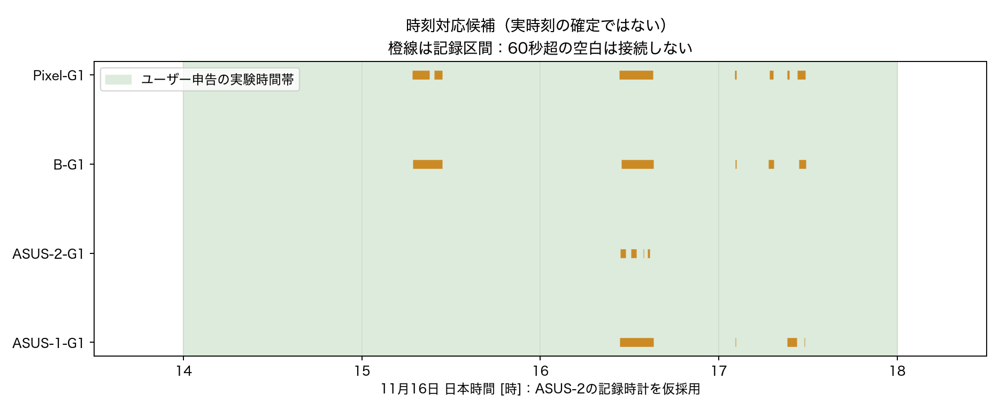

# Issue #89：全保存先の監査と時刻対応候補

対象：[Week29 #89](https://github.com/SMRI2170/zkp-m1-v2/issues/89)。**ローカル監査と再現コードを実行した。時計が大きくずれたB・Pixel・ASUS-1の記録を、追加ASUSの時計を仮採用した時間帯へ対応付ける候補が得られた。独立した絶対時刻の確定は未達で、全て候補扱い。**

## 1. 現行releaseだけでなく全保存先を監査

A〜Fの全保全release、Android 3台のSQLiteと追加JSONLを読み取り、21,763ファイル・2,432,419,465 bytesを保全時のmanifestと照合した。全件一致。原本の移動・削除・更新、端末の時計変更・受信開始は行っていない。

| 入力 | 保全ファイル | 整理後の保存レコード | 対象実機IDの保存レコード |
|---|---:|---:|---:|
| A | 7,181 | 750 | 0 |
| B | 5,563 | 121,317 | 531 |
| C | 4,912 | 82,151 | 0 |
| D | 1,603 | 42,122 | 0 |
| E | 1,275 | 42,222 | 0 |
| F | 1,167 | 45,326 | 0 |
| Pixel | 17 | 174 | 132 |
| ASUS-1 | 17 | 183 | 146 |
| ASUS-2（追加端末） | 28 | 7,740 | 46 |

「整理後」は、同一ノード内の同じ種類の完全一致ファイルを一度だけ読み、DB/追加JSONLの同じ保存レコードを重複計上しない件数。全releaseを対象とするため、以前の現行releaseだけの件数とは異なる。release別の集計を残し、収集時に現行だったreleaseの匿名スコープも出力した。

レコードの重複除外キーにはUTC・観測monotonic時刻・送信元・周波数・内容を含む。一方、Bの24行は同じカーネル観測時刻と内容でも保存UTCが異なる。このため、この監査の対象保存レコードは855行で、同一monotonic時刻・Pack内容の反復を別に数えると831キーになる。855/831/内容種類数を混ぜず、どれも独立パケット数とはしない。

0件は「この保全コピーで参照解釈できた対象IDがない」という意味。対象電波を一度も受信できなかった、実験中ずっと受信サービスが動いていた、という証明ではない。未分類Vendor IEや過去の試験IDを対象機体へ推測で分類しない。`other_decoded_rid`には運用注釈のない試験送信ID等も含み得る。

全JSONLで解析対象外の末尾12行を記録した（B 3、C 5、E 2、F 2）。全て改行なしの末尾だった。書込み中・過去の中断・一覧長での収集時点切出しを、この特徴だけで切り分けない。原本は修復していない。

## 2. 時計を対応付ける手掛かり

対象機体について、UTC−monotonicの広がりが5秒以内の対応群を、端末と記録されたboot_scopeを分けて作った。これは過去boot IDを確定した区分ではない。1分の丸め境界だけで同じ時計を分割しない。

| 時計群の組 | 一致するPack内容 | 双方1記録ずつの内容 | 反復があり曖昧な内容 |
|---|---:|---:|---:|
| B–Pixel | 15 | 13 | 2 |
| B–ASUS-1 | 4 | 0 | 4 |
| B–ASUS-2 | 1 | 0 | 1 |
| Pixel–ASUS-2 | 1 | 0 | 1 |

同一内容でも再送・キャッシュがあり得るため、全て`candidate_content_only`。同一物理パケットの確定数は0。局間RSSI差で未知送信電力を完全除去できたとは扱わない。

B–Pixelの内容ごとの記述的な時刻差のMADは約0.017秒だった。これは15内容の代表差が揃うという結果であり、時計同期精度17msを証明した数値ではない。遅延や反復を除去できたわけではない。

## 3. 実験時間帯への対応候補

追加ASUSは11月17日の接続確認時にPCと約5秒以内の日時を表示していた。これを根拠に**追加ASUSの記録時計を仮の基準**とした。ただし、実験時も正しかったという独立証拠にはならない。

共通Packの全観測組合せから時計差の最小・最大を求め、基準端末までの全単純経路を列挙して候補の幅を作った。定数オフセットの仮説であり、ドリフト・再送遅延・同内容の別日送信を排除できない。この幅は統計的信頼区間や真の時計誤差の上限ではない。ユーザー申告の14〜18時は、オフセット推定後の整合性確認に使用した。

| 端末 | 候補の最初〜最後（11月16日・日本時間） | 対象保存行 | 状態 |
|---|---|---:|---|
| B | 約15:17〜17:29 | 531 | 候補 |
| Pixel | 約15:17〜17:29 | 132 | 候補 |
| ASUS-1 | 約16:27〜17:29 | 146 | 候補 |
| ASUS-2 | 記録上16:26:53〜16:36:47 | 46 | 仮基準・未検証 |



橙線は60秒を超える空白で分けた記録区間。帯全体の連続受信や通電を意味しない。BとPixelの約1時間の空白も、同じ時刻モデルで対応する形が得られた。

**候補モデルでは対象855保存行全てが14〜18時に収まる。ただし、この結果をもって実験日の確定・同時送信の証明・全実験期間の記録成功とはしない。**

## 4. その他の時刻・位置情報

- Aの有効GPS記録184,302行では、記録されたNMEA時刻（時分秒）とホストの時刻の位相差中央値が約0.175秒だった。日付のない形式なので、これだけで11月16日への対応は確定できない。GPSの真値性を証明した結果でもない。
- Pi B〜Fの収集時boot IDは保存されているが、それを過去の受信記録へ遡って割り当てていない。Androidのboot_scopeもOS/hardware認証ではない。
- Piの受信レコードには受信機位置がない。Androidには自己位置があり、対象機体の324行には対応位置があるが、独立真位置との照合は未実施。
- A自身のGPS/BME記録はあるが、今回の飛行中の独立真位置として採用できる時刻対応は得られていない。
- 実ドローンの送信総数は不明。PDR・実際の位置偽装検出率はこの監査では算出しない。

## 5. 実装・再現

- `week29/scripts/audit_field_time.py`：manifest照合、全release/DB/追加JSONL、私的SQLiteへの整理、版を固定した参照解釈、時計群と内容一致候補。
- `week29/scripts/analyze_clock_candidates.py`：定数オフセットの全経路候補、採用/保留窓、入力情報の可用性、時刻対応図。
- 入力設定：`captures/week29/issue89-input-private.json`。各入力の`node`、`kind`、`snapshot`、`manifest`、Androidのみ`database`、`identity_file`、`reference_binary`、`field_utc`を指定する。実IDは私的なidentificationファイルから読む。
- 解析用SQLiteのキャッシュは32MiB。ファイル・JSONLは順次処理し、原本を一括でメモリへ載せない。実際の最大RAMを計測した結果ではない。

```sh
# 新しい出力ディレクトリを使用。既存の解析SQLiteへの上書きは拒否する。
python3 week29/scripts/audit_field_time.py \
  --config captures/week29/issue89-input-private.json \
  --private-output captures/week29/issue89-audit-recheck \
  --output week29/results/issue89-time-audit-recheck

.cache/week26-mac-venv/bin/python week29/scripts/analyze_clock_candidates.py \
  --audit-private captures/week29/issue89-audit-recheck \
  --audit-output week29/results/issue89-time-audit-recheck \
  --config captures/week29/issue89-input-private.json \
  --anchor-group ASUS-2-G1

python3 -m unittest discover -s week29/tests -v
```

私的出力は`captures/week29/issue89-audit-c/`。座標・Pack・識別子・一致台帳・実パスを含むのでGitへ追加しない。公開用は以下の匿名集計に限定する。

- [監査サマリー](results/issue89-time-audit-c/summary.json)
- [時計候補・release区分・入力可用性](results/issue89-time-audit-c/clock-candidates.json)
- [時計群CSV](results/issue89-time-audit-c/clock-groups.csv)
- [共通内容候補CSV](results/issue89-time-audit-c/content-matches.csv)
- [時間窓候補CSV](results/issue89-time-audit-c/candidate-windows.csv)
- [入力情報の可用性CSV](results/issue89-time-audit-c/input-availability.csv)

## 6. 実行履歴と検証

| 実行 | 結果 |
|---|---|
| a | 全入力読取後、MAD集計で大標本に対して遅くなる処理を停止。中央値の重複計算を修正。途中SQLiteと失敗記録を保持 |
| b | データ集計後、CSV出力のimport不足で失敗。非空の時計群CSVを通すテストを追加して修正。途中結果は未完了として保持 |
| c | manifest照合・参照解釈・CSV/JSON出力まで完走。時刻候補と図も生成 |

ローカル確認：Week29テスト29件成功、既存UAV 88件成功、Go全package成功、contracts 48件成功。年ずれ・タイムゾーン・時計補正・1時間折返し・同内容反復・破損末尾・DB/追加JSONL重複・原本不変・候補経路の逆符号/不確実性をテスト。生成図を目視確認した。

公開先へコードをpushしてCIを確認する工程は未実施。#89は公開・レビュー前のためOPENのまま。絶対時刻の独立検証は今回のデータだけではNOT_EVALUABLEとして明記する。

次は#90の停止原因と記録空白、#91の自己位置品質を、確定情報とこの候補モデルの両方を区別して進める。候補時計で集計した結果を、確定した実時刻の性能と表示しない。
