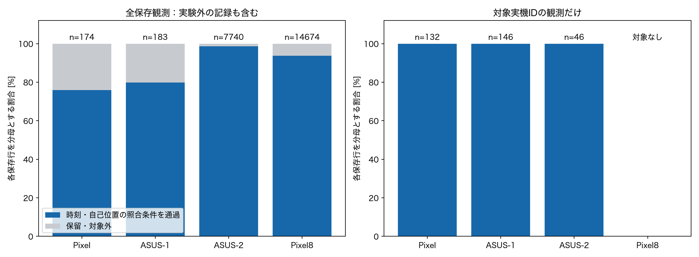
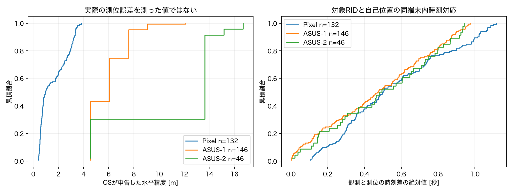
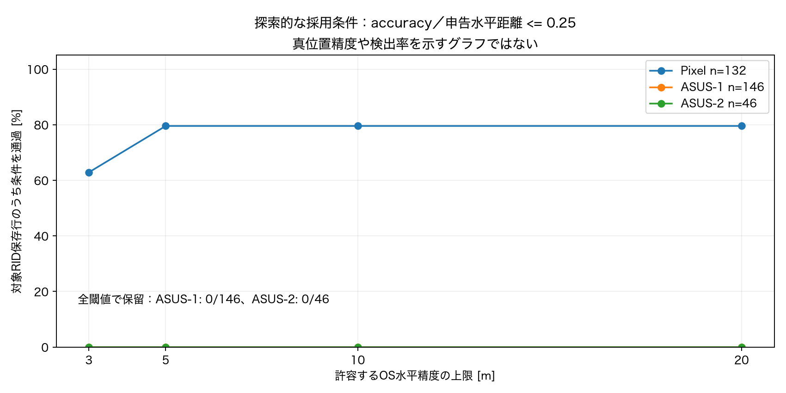
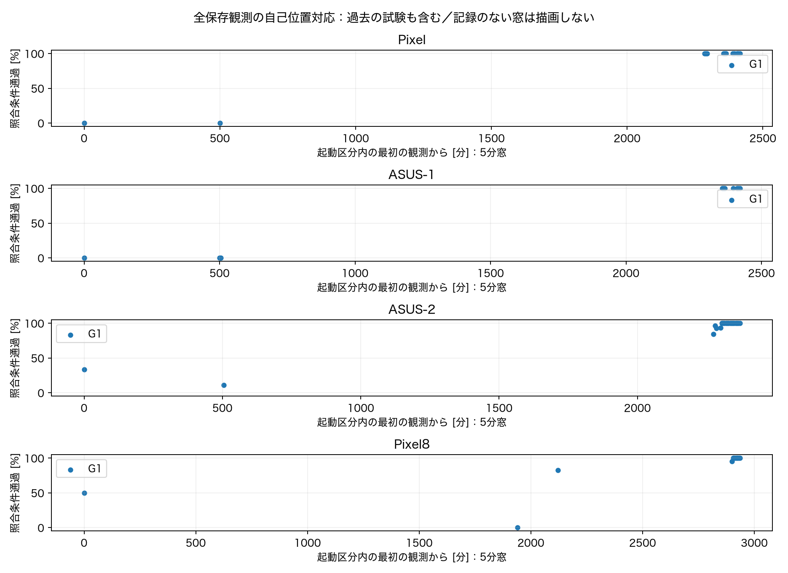

# Issue #91：Android自己位置の品質監査

[Issue #91](https://github.com/SMRI2170/zkp-m1-v2/issues/91)について、保全済み4台のSQLiteと参照デコードを使い、自己位置・観測時刻の対応を評価した。3台の対象実機ID記録324行は、全行で同じ端末内の独立保存GPS記録と照合できた。ただし、真位置の精度・地上高の整合性は別問題である。

## 1. 検査内容

受信観測の添付位置について、鮮度フラグ、MATCHED、座標/精度の有効範囲、mock=false、観測と測位の時間差2秒以内、記録された時間差の一致、既知boot_scope、同じboot_scope・測位monotonic時刻・providerのGPSレコード存在、座標と精度の内容一致を検査した。

boot_scopeやmock=falseをハードウェア認証とは扱わない。UTCの日付が大きくずれた端末でも、同端末の観測と測位の対応はmonotonic時刻で確認できる。端末間の絶対時刻の確定とは分離した。

## 2. 対象機体の結果

| 端末 | 対象RID行 | 時刻・位置照合通過 | OS水平精度中央値 | 時間差中央値 |
|---|---:|---:|---:|---:|
| Pixel 6 Pro | 132 | 132 | 約0.97m | 約0.50秒 |
| ASUS-1 | 146 | 146 | 約6.07m | 約0.47秒 |
| ASUS-2 | 46 | 46 | 約13.65m | 約0.49秒 |
| Pixel 8 | 0 | 対象なし | 対象なし | 対象なし |

OSのaccuracyは端末の精度申告であって、真位置との差を測った値ではない。上表を機種一般の性能順位にしない。ASUSの同じPack内容の繰返しを含むため、行数も独立試行数ではない。



左は全保存観測（準備・試験等も含む）、右は対象RIDだけで、分母を明記した。Pixel 8の対象なしを「GPS品質0%」とはしていない。全保存観測ではPixel 8の259行がboot情報不明で保留となり、アプリのMATCHED表示だけでは厳格な照合条件を満たさなかった。



## 3. 距離分析の採用条件を変えた場合

探索的な条件として「時刻・位置照合を通過」「OS水平精度が所定値以下」「OS水平精度／RID申告基準の水平距離が所定比率以下」を試した。機体位置はRID申告であり、距離は独立真値ではない。これらの条件は保証のある最適閾値ではなく、データをどれほど絞るかを見る感度分析。

OS水平精度上限20mの場合：

| 精度申告／申告距離の上限 | Pixel：132行中 | ASUS-1：146行中 | ASUS-2：46行中 |
|---|---:|---:|---:|
| 0.10 | 27 | 0 | 0 |
| 0.25 | 105 | 0 | 0 |
| 0.50 | 124 | 13 | 14 |
| 1.00 | 128 | 50 | 18 |



精度申告10m以下かつ距離の25%以下でもPixelは105/132行（79.5%）が残る一方、ASUS 2台は0行。多くのASUS観測では、精度申告が申告距離に比べて大きかった。**GPSが付いているという理由だけで、3台を同じ細かさの距離評価へ投入するのは避ける**。条件を緩めてデータを増やす場合は、その前提を結果に残す。

## 4. 更新間隔・位置の変化・時間推移

GPS保存記録はPixel 19,418、ASUS-1 32,879、ASUS-2 17,762、Pixel 8 2,271行。boot_scopeとproviderを分けて、正の測位更新間隔・隣接座標間の変化量と見かけの速度を集計した。更新間隔中央値は各台で概ね1秒。ただし、これは受信RSSIや新しいRID内容が1秒ごとに得られる保証ではない。

10秒を超える空白を位置変化速度の計算から除外し、除外件数も記録した。全保存期間には準備・試験・移動が混在し、大きな位置変化もある。閾値2/5/10/20m/sを超えた「見かけの変化」を集計したが、GPS異常や実際の移動速度の証明には用いない。



5分窓の分母はその窓の保存観測だけ。記録のない窓を0%や正常として埋めていない。正解の静止時間帯がないため、「静止時の真の測位誤差」「独立真位置との差」はNOT_EVALUABLE。GPS自身から静止窓を選び、その散らばりを真の誤差と扱うことはしていない。

## 5. 3次元距離は保留

先に作った3D図で、機体Geo高度とスマホGPS高度には大きな記録値の不整合がある。機体の離陸点基準Heightも別の基準。基準が整合したことを確認できていないため、3D斜距離は算出せず、水平の申告基準距離に限定した。上下方向のズレを固定オフセットで勝手に消していない。

## 実装・再現・検証

実装：`week29/scripts/audit_android_position.py`。

```sh
.cache/week26-mac-venv/bin/python week29/scripts/audit_android_position.py \
  --config captures/week29/issue91-input-private.json \
  --private-output captures/week29/issue91-position-a \
  --output week29/results/issue91-position-a
python3 -m unittest discover -s week29/tests -v
```

入力設定は4台それぞれの保全SQLite、参照デコードJSONL、非公開の機体IDファイルを指定する。DBはread-only。前後のSHA-256一致を確認し、行単位の位置・距離・時刻はignored `captures/`だけに出力した。公開は[匿名集計](results/issue91-position-a/summary.json)、[採用条件CSV](results/issue91-position-a/eligibility-sensitivity.csv)、[時間窓集計](results/issue91-position-a/association-time-bins.csv)と図に限定。

測位欠損・鮮度不明・古い観測・2秒境界・mock・boot不一致・内容不一致・無効値・ゼロ距離・boot/空白をまたがない変化量を合成fixtureでテストした。静止真値、3D高度基準、機種を統制した測位精度比較は未検証。コード公開・CI確認も未実施で、ローカル評価結果として扱う。
